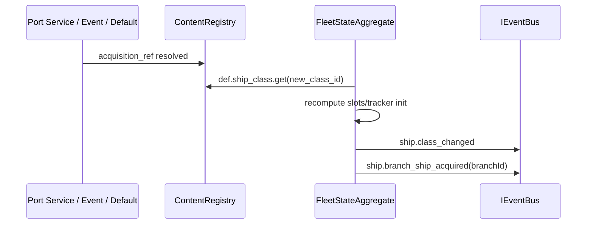

# DEV-SPEC-017 v1.0 — «Ship & Fleet Domain»

**Тип документа:** Спецификация к разработке
**Дата:** 2026-11-03
**Статус:** draft
**Волна:** Wave 2
**Зависит от:** `DEV-SPEC-001…009`
**Блокирует:** `DEV-SPEC-018`, `DEV-SPEC-019`, `DEV-SPEC-029`, `DEV-SPEC-038`, `DEV-SPEC-039`
**Основана на:** `DESIGN v1.0 — «Механики корабельных веток фракций»` (SPEC-FLEET-001…017, 030…051, 060…065, 070…073, 080…083), `GENERAL DESIGN v1.0` (GD-03, GD-04)

---

## 1. Назначение и границы

### 1.1. Что делает
Домен `Fleet` — владеет кораблём игрока и флотом:
- 4 фракции (`FactionDefinition`) с доктринами (`DoctrineDefinition`): `steam-forge-doctrine`, `ancient-leyline-doctrine`, `necrotic-corpse-tide-doctrine`, `living-relic-volition-doctrine`;
- классы кораблей (`ShipClassDefinition`): common-и规模以上 и signature-корабли, slot-раскладка из 4 слотов (`speed_detection/firepower/survivability_repair/doctrine_utility`);
- ветки кораблей фракций (`FactionShipBranchDefinition` + `acquisition_refs_by_ship`);
- `ShipInstance` (runtime) — текущий класс, ресурсы, статусы, слоты, tracker-состояния;
- реестр mechanics `MechanicDefinition` fleet scope (resolver/tracker по SPEC-FLEET-036…038);
- событийная модель `ship.*`/`combat.*` + фракционные `industrial-steam.*` и т.д. (SPEC-FLEET-042…045);
- контент первой волны: 4 фракции, 4 доктрины, 4 common + 4 signature корабля на фракцию (итого 8 классов × 4), 20+ механик, грани `forge_discipline`, `wild_arcane_feedback`, `plague_bloom`, `machine_ghost_pact`.

### 1.2. Что НЕ делает
- Не моделирует реальный морской веринт-бой по времени (→ 018);
- не экономику/рынки/снаряжение построек → 020…022 домен Economy;
- не мир и катаклизмы (→ 023…026);
- не бывает party/дуэли (→ 027…031).

## 2. Зависимости
Обязательные: 001–009 ( foundational: domain infra, RNG, ContentRegistry, MechanicRuntime, Memento, локализация, локали...).
Мягкие: `DEV-SPEC-023` (world-регионы → флот движение), `DEV-SPEC-025` (катаклизмы → считывание корабельных модификаторов), `DEV-SPEC-021` (economy ports на корабельные resources).

## 3. Термины
| Термин | Определение |
|---|---|
| Common Ship | Базовый класс корабля с 2-3 активными механиками |
| Signature Ship | Уникальный фракционный корабль особой механикой + facet-binding |
| Facet | Дополнительная «грань» доктрины (forge_discipline, wild_arcane_feedback, plague_bloom, machine_ghost_pact) |
| Resolver/tracker | Граница механик по SPEC-FLEET-037 |

## 4. Событийная модель

### 4.1. Ядро (каноническое — ContentRegistry)
`ship.class_changed`, `ship.slot_equipped`, `ship.resource_changed`, `ship.status_applied`, `ship.status_removed`, `ship.tracker_state_changed`, `ship.branch_node_unlocked`, `ship.branch_ship_acquired`, `combat.encounter_started`, `combat.encounter_resolved`, `combat.ship_damaged`, `combat.ship_destroyed`, `doctrine.phase_changed`, `doctrine.binding_changed`, `ship.dock_entered`, `ship.dock_left`.

### 4.2. Фракционные расширения (SPEC-FLEET-044)
`industrial-steam.*` (forge.output_boosted, forge.discipline_changed, boiler.overpressure_warning), `ancient-arcane.*` (leyline.resonance_surge, rite.stage_advanced), `necromantic-corpse.*` (corpse_tide.swarm_intensified, plague.bloom_stabilized), `living-artifact.*` (relic.pact_whispered, hull.adaptation_advanced).

### 4.3. Инварианты
- `INV-017-01` ядро всегда локализовано до фракционных —.validation избегает duplicate semantic namespace fuzz;
- `INV-017-02` механики ссылаются на зарегистрированные события (graph integrity);
- `INV-017-03` resolver-механики не have persisted state (city contract SPEC-FLEET-037).

## 5. Domain-модель

### 5.1. Content
```ts
// src/domain/content/fleet/FactionDefinition.ts
export interface FactionDefinition {
  readonly id: string;
  readonly display_name_key: string;
  readonly description_key: string;
  readonly doctrine_id: string;
  readonly branch_id: string;            // FactionShipBranchDefinition ref
  readonly starting_region_id?: string;  // world-сслка (ограничение на Wave 4)
  readonly palette_policy_id?: string;   // visual (011)
}

export interface DoctrineDefinition {
  readonly id: string;                    // steam-forge-doctrine ...
  readonly display_name_key: string;
  readonly faction_id: string;
  readonly phases: readonly DoctrinePhaseDefinition[]; // ≥1
  readonly facet_bindings: readonly FacetBinding[];    // facet: forge_discipline etc.
}
export interface DoctrinePhaseDefinition {
  readonly phase_id: string;
  readonly display_name_key: string;
  readonly enter_condition_policy_id: string;
  readonly while_active_mechanic_ids: readonly string[];
  readonly on_enter_mechanic_ids: readonly string[];
}
export interface FacetBinding { readonly facet_id: FacetId; readonly mechanic_ids: readonly string[]; }
export type FacetId = 'forge_discipline' | 'wild_arcane_feedback' | 'plague_bloom' | 'machine_ghost_pact';

export interface ShipClassDefinition {
  readonly id: string;
  readonly display_name_key: string;
  readonly faction_id: string;
  readonly rarity: 'common' | 'signature';
  readonly slot_layout: Readonly<Record<ShipSlotName, string | null>>;  // mechanic/upgrade slot refs
  readonly hp: number; attack: number; defense: number; speed: number;
  readonly mechanic_ids: readonly string[];   // ≥1
  readonly acquisition_refs: readonly AcquisitionRef[];
  readonly facet_bindings?: readonly FacetBinding[];
}
export type ShipSlotName = 'speed_detection' | 'firepower' | 'survivability_repair' | 'doctrine_utility';
export interface AcquisitionRef { readonly type: 'port_service' | 'world_event' | 'quest_reward' | 'start_default'; readonly id: string; }
```

### 5.2. Runtime
```ts
export interface ShipInstance {
  readonly ship_id: string;
  readonly class_id: string;
  readonly faction_id: string;
  readonly hp: { current: number; max: number };
  readonly resources: Readonly<Record<string, number>>;   // steam, arcane, plague, relic-charges... (data)
  readonly statuses: ReadonlyArray<StatusRuntime>;
  readonly slots: Readonly<Record<ShipSlotName, SlotRuntime>>;
  readonly tracker_states: Readonly<Record<string, unknown>>; // per mechanic tracker id
  readonly doctrine_phase_id: string;
}
export interface StatusRuntime { readonly status_id: string; readonly remaining_ticks?: number; readonly intensity: number; }
```

- `FleetStateAggregate` — root runtime-агрегат (игрокский корабль + encounter-медиа-usage потребителей 018/029).
- `FleetStateMementoProvider` (domainId `'fleet'`).

Инварианты runtime: `INV-017-10` hp.current ∈ [0, hp.max]; destroyed корабль не принимает урон (событие `combat.ship_destroyed` один раз); `INV-017-11` каждый tracker state соответствует tracker-механике из `ShipClassDefinition.mechanic_ids`.

## 6. Data-контракты
- Схемы (SPEC-FLEET-050…061): `faction.json`, `doctrine.json`, `ship-class.json`, `faction-ship-branch.json`, `ship-instance.json`, `status.json`, `acquisition-ref.json`.
- Контент: `content/fleet/factions.json`, `doctrines.json`, `ship-classes-common.json` (4×4), `ship-classes-signature.json` (4), `branches.json`, `statuses.json`.
- Локализация: ключи `faction.*`, `ship.*`, `doctrine.*` (§2.2.2 design).

## 7. Рантайм-поведение

### 7.1. Обработка такта (симуляция фазы)
1. `fleetTick` резолвит механики по приоритету (FLEET-036):
   - состояния tracker (итеры); события doctrine phase enter; resource regeneration; статусом expiry.
2. Изменения публичются через `EventBus`; хранение через Memento.

### 7.2. Sequence смены корабля


### 7.3. Doctrine phase enter
Проверка `enter_condition_policy_id` каждый такт; on_enter механики публикуют фракционные события.

## 8. Порты и адаптеры
- `IFleetWorldPort` — запросы мира (регион, ttl-контекст, dock services) — реализация Wave 4→023, до этого Fake/Fixed.
- `IFleetEconomyPort` — перевод ресурсов в экономику (020/021); до Wave 3 — заглушка.
- Ошибки: `FLEET_CLASS_UNKNOWN`, `FLEET_SLOT_INCOMPATIBLE`, `FLEET_RESOURCE_UNKNOWN`, `FLEET_DOCTRINE_PHASE_INVALID`.

## 9. RNG
Потоки (SPEC-FLEET-046): `rng.fleet.encounter_generation`, `rng.fleet.doctrine_phase` (roll enter odds), `rng.fleet.signature_ship_spawn`. Изолированные.

## 10. Сохранение
`FleetStateInstance` — полный снимок (ships по fleet, resources, statuses, tracker states, doctrine phase, branch unlocks). Отдельный `fleet_events_journal` для важных событий (damage/док/branch) — как `epilogue_events_journal` аналог SPEC-FLEET-050.
Валидация при загрузке — `FLEET_STATE_INVALID`.

## 11. Валидация и CI
Schema + graph integrity (branch корабли существуют в классах; doctrine ссылки корректны; slot_layout механизм типа) + gameplay lint:
- каждая фракция имеет ровно 4 common + 2 signature;
- каждый common корабль ≥2 активных механики, signature ≥ 3;
- у каждого signature корабля ≥ 1 facet_binding;
- resolver механик не имеет state_schema (null);
- более 20% `tracker` на фракцию — lint warning (перегруз tracker-ами).

Stage-интеграция: правила в `tools/ci/rules/domain/fleet.ts`.

## 12. Структура файлов

```text
src/domain/fleet/{FleetStateAggregate,DoctrineRuntime,ShipRuntime}.ts
src/domain/content/fleet/*.ts
src/infrastructure/fleet/providers/FleetStateMementoProvider.ts
content/fleet/*.json + content/schemas/fleet/*.json (7 схем)
test/unit/fleet/*.test.ts, test/contract/fleet.contract.test.ts, test/integration/fleet-...
```

## 13. Критерии приёмки
- `DEV-SPEC-017-R01` — 4 фракции со всеми ветками. **AC:** AC01 загрузка контента — 4 фракции, 4 doctrine, 32 корабля (24 common + 8 signature); AC02 branch кораблей signature ≥ 1 facet_binding.
- `DEV-SPEC-017-R02` — resolver/tracker граница. **AC:** AC03 resolver без state_schema проходит; AC04 tracker со state_schema и persisted=true работает.
- `DEV-SPEC-017-R03` — runtime такт. **AC:** AC05 100 тактов с seeded RNG — deterministic snapshot; AC06 ship_damaged → hp уменьшен + событие.
- `DEV-SPEC-017-R04` — доктринальные фазы. **AC:** AC07 вход в фазу >1 (threshold) → `doctrine.phase_changed` + on_enter события.
- `DEV-SPEC-017-R05` — acquisition. **AC:** AC08 world_event acquisition ref разблокирует signature корабль в ветке.
- `DEV-SPEC-017-R06` — сейв/лоад. **AC:** AC09 serialize/restore идентично (JSON).
- `DEV-SPEC-017-R07` — CI. **AC:** AC10 битый slot_layout → lint; AC11 duplicate mechanic_id — schema error.

## 14. Тест-план
Unit: FleetStateAggregate (damage/res/tick), DoctrineRuntime (phase transitions), MECHаные resolver/tracker контрактные тесты.
Integration: полный «борьба → dock → acquisition» прогон; contract: schema, детерминизм, Memento roundtrip; CI: validate-gameplay расширенные правила fleet.

## 15. Производительность
треcks имемных механик ≤ 30 на один корабл; tick-обработка fleet ≤ 5 ms.

## 16. Открытые вопросы
| ID | Вопрос | Блокер? |
|---|---|---|
| Q-017-01 | Формат resource key реестра (формализованный список ресурсов на фацию)? | нет — fix в контенте первой волны |
| Q-017-02 | tracker-обмен ресурсами между механиками | нет — events only |

## 17. Вне scope
Бой по верификации (018), глобальный мир (023), economy (020…022), party (027…031), narrative (033…035), поведение UI.

## 18. Трассировка
| DESIGN | Требование | AC |
|---|---|---|
| SPEC-FLEET-001…004 | DEV-SPEC-017-R01 | AC01…02 |
| SPEC-FLEET-035…038 | DEV-SPEC-017-R02 | AC03…04 |
| SPEC-FLEET-040/046 | DEV-SPEC-017-R03 | AC05…06 |
| SPEC-FLEET-008/044 | DEV-SPEC-017-R04 | AC07 |
| SPEC-FLEET-010/013 | DEV-SPEC-017-R05 | AC08 |
| SPEC-FLEET-050/051 | DEV-SPEC-017-R06 | AC09 |
| SPEC-FLEET-072/073 | DEV-SPEC-017-R07 | AC10…11 |
