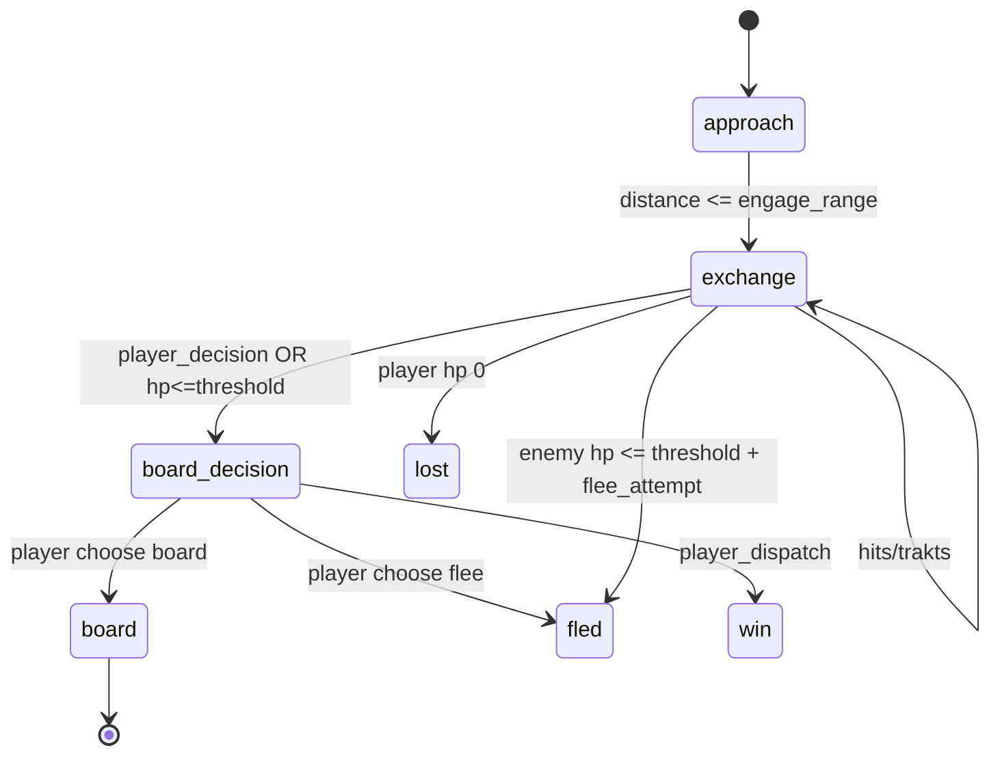

# DEV-SPEC-018 v1.0 — «Naval Combat Real-time»

**Тип документа:** Спецификация к разработке
**Дата:** 2026-11-03
**Статус:** draft
**Волна:** Wave 2
**Зависит от:** `DEV-SPEC-001…009`, `DEV-SPEC-017`
**Блокирует:** `DEV-SPEC-029`, `DEV-SPEC-038`, `DEV-SPEC-039`
**Основана на:** `DESIGN v1.0 — «Механики корабельных веток фракций»` (SPEC-FLEET-018…029, 043, 047…048, 066…068, 074…076, 084…086), `GENERAL DESIGN v1.0` (GD-06, GD-08)

---

## 1. Назначение и границы

### 1.1. Что делает
Реальный морской бой (ship-to-ship, до абордажа):
- `CombatEncounterState` — runtime-контекст боевой сцены (field distance, enemy ship slot, buffs/de-Buffs);
- диспетчер механик по events против своих ресурсов (T scene tick بمscoped);
- `CombatResolver` — hit roll / damage calculation (из RNG потока `rng.fleet.combat_resolution`), context-aware (statuses, doctrine phase, ражинных ships);
- encounter lifecycle: `start → phases (approach / exchange / board_decision) → resolution (win/lost/fled/board_dialog)`;
- атак-плей механики: statuses, temporary buffs (targets, targets attributed, counters);
- outcome интерфейсы в Narrative (4 канала и `EpilogueFactPort` мост `combat.resolved` — `epilogue.fact_published`);
- контент первой волны: 4 encounter archetypes (по одному на фракцию) с 5-6 механиками каждый.

### 1.2. Что НЕ делает
- Абортаж/бой команд/дуэль (→ 029, 031);
- катаклизмы (→ 025/026) — только модификаторы через events;
- не отдельно эфирный режим корпуса ( flank/discipline facet под classifierτική branch).

## 2. Зависимости
Обязательные: 001–009, 017 (ShipInstance, доктринные ресурсы).
Мягкие: `DEV-SPEC-025` (события катаклизмов → модификаторы эффективности), `DEV-SPEC-037` (epilogue facts при resolution), `DEV-SPEC-013/014` (HUD/вход боевые).

## 3. Термины
| Термин | Определение |
|---|---|
| Encounter | Единый конфликт между двумя ship-ами, состоящий из фаз |
| Field Distance | Расстояние между кораблями (метры), меняется каждoeКакой-то такт |
| Phase | Approach / Exchange / Board Decision — боец-фазы |
| Resolution | Один из финал: win / lost / fled / board (переход к абордажу) |

## 4. Событийная модель
- Ядро (под EventsRegistry): `combat.encounter_started` (уже из 017), `combat.phase_changed`, `combat.hit_landed`, `combat.status_applied`/`removed`, `combat.encounter_resolved` (outcome: `win|lost|fled|board`).
- Фракционные из 017 (damage-offset modifier events).
- `combat.party_battle_requested` — события абордажного моста (029).
- Инварианты: `INV-018-01` фазы идут в порядке approach → exchange → resident; skip фаз через fection-способности (data-driven, не hardcode); `INV-018-02` только в encounter state можно применять боечные атаки.

## 5. Domain-модель

```ts
// src/domain/fleet/CombatEncounterState.ts (runtime root Wave2)
export type EncounterPhase = 'approach' | 'exchange' | 'board_decision';
export type EncounterOutcome = 'win' | 'lost' | 'fled' | 'board';

export interface CombatEncounterState {
  readonly encounter_id: string;
  readonly player_ship_id: string;
  readonly enemy_ship_id: string;
  readonly field_distance_m: number;
  readonly phase: EncounterPhase;
  readonly active_buffs: ReadonlyArray<{ id: string; remaining_ticks?: number; source: 'status'|'doctrine'|'cataclysm' }>;
  readonly log_journal: ReadonlyArray<EncounterEventRecord>;
  readonly started_tick: number;
}

export interface EncounterEventRecord {
  readonly tick: number;
  readonly event_id: string;     // combat.hit_landed etc.
  readonly payload: Readonly<Record<string, unknown>>;
}
```

Components:
- `CombatEngine` — tick-driven state machine;
- `CombatDamageCalculator` — resolver (stateless) интеграция с MechanicRuntime;
- `CombatBuffsRegistry` (content: `CombatBuffDefinition` — from ships statuses/events — data-driven);
- `CombatEncounterMementoProvider` (domainId `'combat_encounter'`).

Инварианты:
- `INV-018-10` encounter state имергается в `ship.tracker_states` как `active_encounter` или отдельный domainId in snapshot;
- `INV-018-11` результат резолюции всегда ровно один.

## 6. Data-контракты
- Схемы: `combat-encounter.json`, `combat-buff.json`, `combat-archetype.json`, `combat-hits.json`.
- Контент: `content/combat/encounters.json` ( encounter archetypes первой волны — 4), `content/combat/buffs.json` (10+).

## 7. Рантайм-поведение



- Damage: производный hit roll через `DamageCalculator` (rng.fleet.combat_resolution) — с фактор умножения выстр счетчиками, buff/debuff.
- Каждый такт: 1-2 hit rolls (rate лимиты из данных), 0-1 buff-обновления.
- Систематический детерминизм: порядок обработки buff-ов — priority; hit-объекты — serIALIZED в encounter journal; при save/load — replay до текущего state.

## 8. Порты и адаптеры
- `IFleetCombatContextPort` (enemy defs, statuses from enemy), Debug порт `CombatDumpPort` (log).
- Ошибки: `COMBAT_NOT_ACTIVE`, `COMBAT_PHASE_INVALID`, `COMBAT_TARGET_UNKNOWN`.

## 9. RNG
`rng.fleet.combat_resolution` (attack roll, damage variance), `rng.fleet.combat_buffs` (proc chance), `rng.fleet.combat_flee` (удачность побега — если policy решит).

## 10. Сохранение
`CombatEncounterStateInstance` полные snapshot в момент длого повреждения/фазы + журнал событий; restore — детерминированный resumable (все tracker-иенверции исправляются по журнал).

## 11. Валидация и CI
Schema + graph integrity (бáффы ссылаются на события/статусы кораблей 017, archetypes свои ship-class), gameplay lint:
- каждый archetype ≥ 5 механик;
- combat buff origination должна быть ship-status/event tied;
- combat encounter journal serialized into survival state.

## 12. Структура файлов

```text
src/domain/fleet/combat/{CombatEngine,DamageCalculator,EncounterStateMachine}.ts
src/domain/content/fleet/combat/*.ts (+mutexłat USAGE)
content/combat/*.json + content/schemas/combat/*.json
test/unit/fleet-combat/*.test.ts, test/contract/fleet-combat.contract.test.ts, test/integration/combat-bridge...
```

## 13. Критерии приёмки
- `DEV-SPEC-018-R01` — запуск/фазы. **AC:** AC01 ship vs enemy → encounter_approach; AC02 расстояние < engage_range → phase_changed(exchange); AC03 решение board_decision → outcome=board.
- `DEV-SPEC-018-R02` — боевая математика. **AC:** AC04 hit_landed равен предрассчётанной формуле; AC05 buff-intensity влияет на исход damage.
- `DEV-SPEC-018-R03` — outcomes. **AC:** AC06 win, lost, fled — все три достижимы за фиксированные 50 тактов (сценарий); AC07 resolution → `combat.encounter_resolved` + событие до epilogue-факта (после Wave 6 — test shortcut).
- `DEV-SPEC-018-R04` — journal. **AC:** AC08 все hit/Applied events ждете в journal, сериализуется в snapshot.
- `DEV-SPEC-018-R05` — CI. **AC:** AC09 archetype с < 5 механик — lint error; AC10 graph link на неизвестный ship-class — graph issue.

## 14. Тест-план
Unit: CombatEngine (фазы), DamageCalculator; интеграция: 4 archetype-а сценариев полный cycle; contract: schema/determinism/replay после restore; CI rules combat.

## 15. Производительность
Encounter tick ≤ 3 ms при 10 активных buff-ах / 5 trackers; journal ограничен 200 событиями per encounter (rolling).

## 16. Открытые вопросы
| ID | Вопрос | Блокер? |
|---|---|---|
| Q-018-01 | Скорость / такт продолжительность фаз ( insists in data) | нет |
| Q-018-02 | Механические ветки отдельных abilities (phase skipping)ижь как active ability | нет |

## 17. Вне scope
Абортаж/партий бой (029/031), мир/карта (023), narrative (034/035), economy награды (020).

## 18. Трассировка
| DESIGN | Требование | AC |
|---|---|---|
| SPEC-FLEET-018/024 | DEV-SPEC-018-R01 | AC01…03 |
| SPEC-FLEET-025/058 | DEV-SPEC-018-R02 | AC04…05 |
| SPEC-FLEET-026/048 | DEV-SPEC-018-R03 | AC06…07 |
| SPEC-FLEET-050/066 | DEV-SPEC-018-R04 | AC08 |
| SPEC-FLEET-074/075 | DEV-SPEC-018-R05 | AC09…10 |
