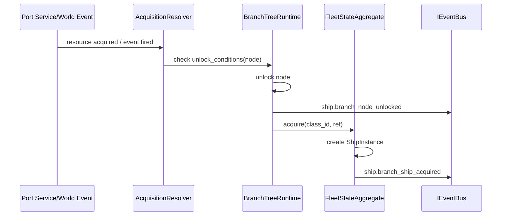

# DEV-SPEC-019 v1.0 — «Doctrine & Branch Unlock»

**Тип документа:** Спецификация к разработке
**Дата:** 2026-11-03
**Статус:** draft
**Волна:** Wave 2
**Зависит от:** `DEV-SPEC-001…009`, `DEV-SPEC-017`
**Блокирует:** `DEV-SPEC-033`, `DEV-SPEC-039`
**Основана на:** `DESIGN v1.0 — «Механики корабельных веток фракций»` (SPEC-FLEET-005…017, 010…014, 049, 069, 077, 087…090), `GENERAL DESIGN v1.0` (GD-03…05)

---

## 1. Назначение и границы

### 1.1. Что делает
Прогрессия ветки корабля фракции:
- state machine разблокировки кораблей ветки (`BranchTreeRuntime`);
- tracking приобретенного через port_service / world_event / quest_reward / start_default;
- графа веток в конфигах `branch tree`, со всеми связями «prev ship → branch ship → next upgrade» + условия;
- механику «скрытый корабль» (elicited после ивентов / фракций из дизайна) с дефолт rules;
- facade-события `ship.branch_node_unlocked`, `ship.branch_ship_acquired` (из 017 core), фракционные расш.;
- контент первой волны: 4 ветки (по каждой фракции), в каждой ≥ 2 common + 2 signature + условия acquisition.

### 1.2. Что НЕ делает
Не приобретение через economic порталы (→ 021 деньги/инвесституты); НЕ мирные события (023/024); не катаклистмические объекты (025/026).

## 2. Зависимости
Обязательные: 001…009, 017 (ships, doctrine, facьsame).
Мягкие: 021 (port service purchase), 024 (world_event триггеры), 029 (бой派遣 награды).

## 3. Термины
| Термин | Определение |
|---|---|
| Branch Node | Уровень ветки с 1-N доступными к приобретению кораблями |
| Unlock | Переключение доступности узла/корабля пользователю |
| Acquisition Gate | Явный ref на сервис/событие/квест, разрешающий приобретение |

## 4. Событийная модель
- Core: `ship.branch_node_unlocked`, `ship.branch_ship_acquired` (017), `doctrine.binding_changed` (facet).
- Фракционные (017 расширения): acquisition crates событияь.
- Инварианты: `INV-019-01` послед unlock_downstream узлов зависит от upstream; no-skip; `INV-019-02` повторная попытка acquire уже приобретенного — идемпотентно.

## 5. Domain-модель

```ts
// src/domain/content/fleet/branch/FactionShipBranchDefinition (extends 017 SPEC-FLEET-033)
export interface BranchNodeDefinition {
    readonly node_id: string;
    readonly tier: 1 | 2 | 3;
    readonly ship_class_ids: readonly string[];        // ≥1
    readonly unlock_conditions: readonly UnlockCondition[];  // ≥1
    readonly next_node_ids: readonly string[];          // DAG
}
export interface UnlockCondition { readonly policy_id: string; readonly params?: Readonly<Record<string, unknown>>; }
```

Runtime:
- `BranchTreeRuntime { unlock(node_id): Result<...>; acquire(ship_class_id, throughAcquisitionRef): Result<...>; acquiredShipIds(): readonly string[] }`;
- связан с `FleetStateAggregate` (список ships);
- `BranchStateMementoProvider`? (merged into Fleet Memento — domainId `'fleet'`, section `branch`).

Инварианты:
- `INV-019-10` node tier N требует хотя бы один tier N-1 unlock;
- `INV-019-11` каждый ship ID из узла должен существовать в классах кораблей (graph integrity).

## 6. Data-контракты
- Схемы: `branch-node.json`, `branch-unlock-condition.json`, `branch-state.json`.
- Контент: `content/fleet/branches/*.json` — по файлу на фракцию (4 файла).

## 7. Рантайм-поведение



## 8. Порты и адаптеры
- `IAcquisitionGatePort` — получает события (economy transaction, world event, quest) и решает gate.
- Ошибки: `BRANCH_NODE_LOCKED`, `BRANCH_CLASS_NOT_IN_NODE`, `ACQUISITION_GATE_UNSATISFIED`.

## 9. RNG
`rng.fleet.branch_unlock` (только для chance-based unlock conditions; события других типов — детерминированы).

## 10. Сохранение
Уровни unlock/acquire хранятся в Fleet Snapshot (section `branch`).

## 11. Валидация и CI
Schema + graph integrity + gameplay lint:
- DAG без циклов;
- все ship_class_ids существуют;
- у каждого ship-а ≥ 1 acquisition ref;
- порог «branch tree ≥ 2 signature на ветку» ( из design SCALE) — warning if less.

## 12. Структура файлов

```text
src/domain/fleet/branch/{BranchTreeRuntime,AcquisitionResolver}.ts
src/domain/content/fleet/branch/*.ts
content/fleet/branches/*.json + schemas
test/unit/fleet-branch/*.test.ts, test/contract/fleet-branch.contract.test.ts
```

## 13. Критерии приёмки
- `DEV-SPEC-019-R01` — DAG unlock. **AC:** AC01 tier 2 требует tier 1 unlocked; AC02 без доступа на низший не может unlock дальше (reject); AC03 unlock → события.
- `DEV-SPEC-019-R02` — acquisition pathway. **AC:** AC04 port_service → требуется экономическая транзакция (заглушка до Wave 3); AC05 world_event разблокирует signature корабль; AC06 quest_reward триггер работает через fake quest-gate.
- `DEV-SPEC-019-R03` — signature фирменные механики. **AC:** AC07 signature корабль создаёт unique механик (tracker state in fleet).
- `DEV-SPEC-019-R04` — CI. **AC:** AC08 цикл в DAG — lint error; AC09 отсутствующий ship_class_id — graph issue.

## 14. Тест-план
Unit: BranchTreeRuntime, AcquisitionResolver; integration: полный pass acquire всех 8 кораблей фракции (AND wave post-economy); contract: schema, determinism (RNG-context on unlock), Memento.

## 15. Производительность
Unlock check O(nodes) — n<= 12 per branch.

## 16. Открытые вопросы
| ID | Вопрос | Блокер? |
|---|---|---|
| Q-019-01 | Доступ к acquired ships между encounters — переключение на лету или next dock? | нет — актуалитет design говорит «dock switch» (по умолчанию) |

## 17. Вне scope
Экономика покупки (020/021), квест-система (021), world events (024).

## 18. Трассировка
| DESIGN | Требование | AC |
|---|---|---|
| SPEC-FLEET-013/014 | DEV-SPEC-019-R01 | AC01…03 |
| SPEC-FLEET-010/014 | DEV-SPEC-019-R02 | AC04…06 |
| SPEC-FLEET-014/049 | DEV-SPEC-019-R03 | AC07 |
| SPEC-FLEET-077 | DEV-SPEC-019-R04 | AC08…09 |
