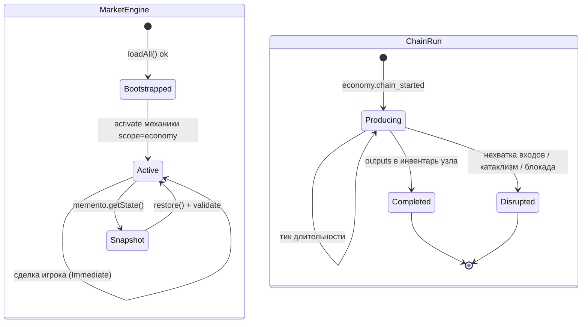
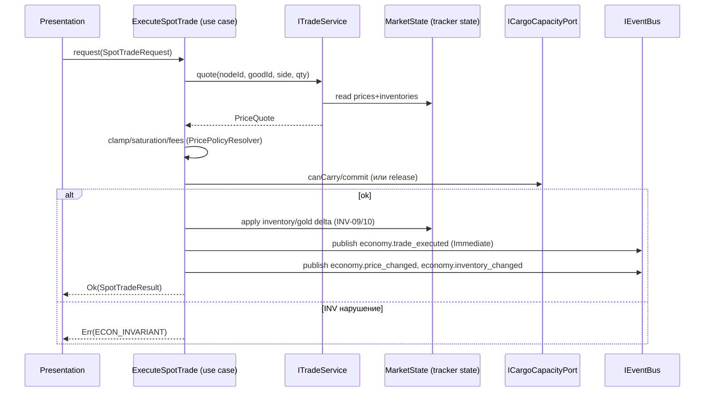

# DEV-SPEC-020 v1.0 — «Market & Trade Core»

**Тип документа:** Спецификация к разработке  
**Дата:** 2026-11-03  
**Статус:** draft  
**Волна:** Wave 3 (Economy core), первая блокирующая спека волны  
**Зависит от:** `DEV-SPEC-001`, `DEV-SPEC-002`, `DEV-SPEC-003`, `DEV-SPEC-004`, `DEV-SPEC-005`, `DEV-SPEC-006`, `DEV-SPEC-007`  
**Блокирует:** `DEV-SPEC-021`, `DEV-SPEC-022`, `DEV-SPEC-023` (мир потребляет экономические состояния), `DEV-SPEC-039` (vertical slice)  
**Основана на:** `DESIGN v1.0 — «Экономика (цепочки, гильдии, рынки, инвестиции)»` (SPEC-ECON-001…022, 050–066, 080–093, 100–103, 110–120), `GENERAL DESIGN v1.0` (GD-04…GD-09, GD-17, поток 13.1), `INTENT v1.0` (INT-06…INT-09, INT-27, INT-33.2)  
**Связанные DEV-SPEC:** `DEV-SPEC-017` (`CargoCapacityPort`), `DEV-SPEC-025/026` (мост `cataclysm.*` ↔ `economy.*`), `DEV-SPEC-036` (`EpilogueFactPort`).

---

## 1. Назначение и границы

### 1.1. Что спецификация делает
Фиксирует **ядро экономики**: bounded context `Market` (товары, рецепты, производственные цепочки, ценообразование, инвентари узлов, агентная симуляция NPC-торговцев) и **Trade-фундамент** (спот-сделки и контракты на поставку как use cases прикладного слоя). Определяет content-сущности `GoodDefinition … MarketState`, механики рынка как `MechanicPlugin` (scope `economy`), состояние `MarketState` как memento-провайдер, событийное ядро `economy.*`, детерминизм через именованные потоки RNG, CI-уровень schema + graph для экономического контента.

### 1.2. Что спецификация НЕ делает
- Не определяет гильдии, шаблоны заданий, репутацию (`DEV-SPEC-021`).
- Не определяет инвестиции, легальность, контрабандные проверки (`DEV-SPEC-022`; легальность — только интерфейсный стык `LegalityPort`).
- Не определяет реализацию `CargoCapacityPort` (→ `DEV-SPEC-017`), только контракт и заглушку для тестов.
- Не фиксирует числовой баланс (цены, объёмы, тайминги, проценты — data-driven, вне scope).
- Не описывает UI, рендер, звук (`DEV-SPEC-010…016`).
- Не описывает катаклизмы и ш scars узлов как механизм (→ `DEV-SPEC-025/026`); спека фиксирует только точки потребления мостовых событий.

### 1.3. Связь с DESIGN

| DESIGN-блок | Реализация | Расхождения |
|---|---|---|
| `SPEC-ECON-001` | Два bounded context, в 020 — `Market` + Trade-фундамент (§4, §9) | нет |
| `SPEC-ECON-002` | `EconomyDoctrineDefinition`-стык: market читает доктрину по `economy_doctrine_id` узла, семантика доктрин — `DEV-SPEC-022` | частично (доктрина как ссылка, не поведёнка) |
| `SPEC-ECON-003` | 12 узлов = контент-пакеты, код не знает числа | нет |
| `SPEC-ECON-004` | Такт рынка в фазе `scope:economy`, сделки — события Immediate | нет |
| `SPEC-ECON-005…008` | Таксономия товаров, рецепты-атомы, цепочки, ацикличность (§5, §6, AC) | нет |
| `SPEC-ECON-009…011` | Предприятие через `EnterpriseDefinition`-ссылку; доли, альтернативные рецепты, конверсия — data-driven поля (§5.3, §6) | нет |
| `SPEC-ECON-012` | Нет качества/порчи груза — не моделируется | нет |
| `SPEC-ECON-013` | `CargoCapacityPort` объявлен здесь (§8.1) | нет |
| `SPEC-ECON-014…018` | Агентная симуляция, антиарбитраж, двухуровневые цены, инвентари, потребление (§5.7, §7) | нет |
| `SPEC-ECON-019/020` | Знание цен (visited/hearsay) + память влияния игрока (§5.8) | нет |
| `SPEC-ECON-021/022` | Спот + контракты; тройная валюта — типы здесь, гильдейский кредит → `DEV-SPEC-021` | частично |
| `SPEC-ECON-050…052` | Сущности, kebab-case ID, переиспользование `MechanicDefinition` | нет |
| `SPEC-ECON-060…066` | JSON-схемы пакета (§6) | нет |
| `SPEC-ECON-080…083` | Событийное ядро `economy.*` + мосты fleet/cataclysm (§9) | нет |
| `SPEC-ECON-090…093` | Детерминизм, RNG-потоки, полные снимки (§7.5, §13) | нет |
| `SPEC-ECON-100…103` | CI schema + graph, ацикличность (§12.6, AC) | нет |
| `SPEC-ECON-110…120` | Скелет контента первой волны, vertical slice (§16) | нет |

---

## 2. Зависимости

### 2.1. Обязательные
- `DEV-SPEC-001` — `Result<T, E>`, `AppError`, GameContainer (DI, без decorator-а JDK: контейнер Wave 0).
- `DEV-SPEC-002` — `IEventBus`, `IEventRegistry`, `EventDefinition` (`payload_schema`, `delivery_policy`, `source`).
- `DEV-SPEC-003` — `IContentRegistry`, `AjvSchemaValidator`, пакет схем, `ContentKind` (`good`, `recipe`, `productionChain`, `tradeNode`, `tradeRoute`, `market` — уже в перечне).
- `DEV-SPEC-004` — `IMechanicRuntime`, `IMechanicRegistry`, `MechanicPlugin` (механики рынка, scope `economy`).
- `DEV-SPEC-005` — `IRngService`, каталог потоков (`rng.economy.market`, `rng.economy.agents`).
- `DEV-SPEC-006` — `MementoRegistry`, `IMementoProvider`, валидация снимков.
- `DEV-SPEC-007` — `IGameClock.onTickPhase(TickPhase)`; фаза `scope:economy` уже в перечне.

### 2.2. Мягкие
- `DEV-SPEC-017` — `CargoCapacityPort` в реализации, до интеграции с флотом — `NullCargoCapacityPort`/тестовая заглушка.
- `DEV-SPEC-009` — ключи локализации `good.*.name`, `node.*.name` и т.п. регистрируются в статусе Wave 0 ключей, значения — в контент-пакетах экономики.

### 2.3. Внешние
- `ajv` — уже в зависимостях (validation).
- Новых зависимостей не требуется.

---

## 3. Термины

| Термин | Определение |
|---|---|
| Узел (`node`) | экземпляр `TradeNodeDefinition`: точка мира, где есть рынок |
| Стек çeşit товара | `tier × origin` — двумерная классификация + декларативные теги |
| Рецепт (`recipe`) | атом преобразования: входы → выходы, `kind: production/conversion/refinement` |
| Цепочка (`chain`) | `ProductionChainDefinition` — нормативный маршрут, связывающий рецепты |
| `MarketState` | источник истины цен и запасов узла (runtime, персистентный) |
| Региональный индекс | вычислимая проекция узловых цен региона (не хранится) |
| Агент (NPC-торговец) | data-driven сущность симуляции, возящая товар между узлами |
| Спот-сделка | мгновенная купля/продажа по текущей цене узла |
| Контракт | обязательство поставки к сроку по зафиксированной цене |
| Резерв | `reserved` в инвентаре: за ним контракт или доставка |

---

## 4. Архитектурное размещение

### 4.1. Слои
`domain/economy/` — ядро Market; `application/trade/` — use cases сделок/цепочек; `infrastructure/economy/` — адаптеры (market engine, agents sim, memento provider); `content/` — data-пакеты; `tools/ci/stages/` — расширение CI.

### 4.2. Файлы

```text
src/
├── domain/
│   └── economy/
│       ├── GoodDefinition.ts
│       ├── RecipeDefinition.ts
│       ├── ProductionChainDefinition.ts
│       ├── TradeNodeDefinition.ts
│       ├── TradeRouteDefinition.ts
│       ├── MarketDefinition.ts
│       ├── MarketState.ts
│       ├── EconomyErrors.ts
│       ├── ICargoCapacityPort.ts
│       ├── IMarketEngine.ts
│       └── ITradeService.ts
├── application/
│   └── trade/
│       ├── ExecuteSpotTrade.ts
│       ├── GetTradeOffers.ts
│       ├── GetMarketPrices.ts
│       ├── RunProductionChain.ts
│       └── AcceptSupplyContract.ts
├── infrastructure/
│   └── economy/
│       ├── MarketEngine.ts            // MechRuntime plugin-хаб, трекер per-node MarketState
│       ├── MarketStateMementoProvider.ts
│       ├── AgentSimulator.ts          // определяет «ездоки»
│       ├── PricePolicyResolver.ts     // клэмпы/насыщение/издержки по политикам
│       ├── NullCargoCapacityPort.ts   // и дальностn транспорт dolg
│       └── TradeService.ts
content/
├── economy/
│   ├── good/core.json
│   ├── recipe/core.json
│   ├── production-chain/core.json
│   ├── trade-node/core.json
│   ├── trade-route/core.json
│   └── market/core.json
tools/
└── ci/stages/validate-economy-graph.ts   // ацикличность/связность экономии
```

> **Важно о registry (Wave 0):** `JsonContentRegistry` уже параметричен по `isContentKind(dir)` — директория в пути задаёт kind. Поэтому контент кладётся в каталоги `content/good/`, `content/recipe/`, `content/productionChain/`, `content/tradeNode/`, `content/tradeRoute/`, `content/market/` (по имени kind), а списки файлов регистрируются в `content/packs.json` для пакета `economy-core`. Спека обязывает расширить `schemaNameForKind` в маппинге: `good → good-definition`, `recipe → recipe-definition`, `productionChain → production-chain-definition`, `tradeNode → trade-node-definition`, `tradeRoute → trade-route-definition`, `market → market-definition`. Отклонение от схемы DESIGN (файлы в `content/economy/`) недопустимо — registry решает по директории.

### 4.3. DI (GameContainer Wave 0)
- `IMarketEngine` → `MarketEngine` (singleton).
- `ITradeService` → `TradeService` (singleton).
- `ICargoCapacityPort` → `NullCargoCapacityPort` (заменяется на реализацию `DEV-SPEC-017` при интеграции).
- Механики (`MarketPriceTracker`, `TradeAgentSimulator`, `ProductionChainRunner`) регистрируются в `MechanicRegistry` на bootstrap со scope `economy`.

---

## 5. Domain-модель

### 5.1. GoodDefinition

```ts
// domain/economy/GoodDefinition.ts
import type { Brand } from '../brand/Brand.js';

export type GoodId = Brand<string, 'GoodId'>;
export type GoodTier = 'raw' | 'intermediate' | 'final' | 'contraband' | 'strategic';
export type GoodOrigin = 'science' | 'magic' | 'hybrid' | 'neutral';
export type GoodTag =
  'perishable' | 'ritual-warded' | 'sealed' | 'bulky' | 'volatile' | 'flammable';

export interface GoodDefinition {
  readonly id: GoodId;
  readonly displayNameKey: string;      // 'good.coal.name'
  readonly tier: GoodTier;
  readonly origin: GoodOrigin;
  readonly tags: readonly GoodTag[];
  readonly basePricePolicyId: string;   // ссылка на политику цены (data-driven)
  readonly contrabandIn: readonly string[]; // id узлов/фракций, где нелегален
  readonly unitMassPolicyId: string;    // единица массы/громоздкости для CargoCapacityPort
}
```

**Инварианты:**
- `ECON-INV-01`: `tier ∈ GoodTier`, `origin ∈ GoodOrigin` — enum-валидация схемой.
- `ECON-INV-02`: товар не хранит числовой баланс: нет полей `price/quantity` — только политики.

### 5.2. RecipeDefinition

```ts
// domain/economy/RecipeDefinition.ts
export type RecipeKind = 'production' | 'conversion' | 'refinement';

export interface RecipeInputOutput {
  readonly goodId: GoodId;
  readonly quantityPolicyId: string;  // объём через политику, не число в контенте
}

export interface RecipeDefinition {
  readonly id: string;
  readonly displayNameKey: string;
  readonly inputs: readonly RecipeInputOutput[];
  readonly outputs: readonly RecipeInputOutput[];
  readonly kind: RecipeKind;
  readonly originTags: readonly GoodOrigin[];
  readonly durationPolicyId: string;
  readonly lossFractionPolicyId?: string;   // для conversion: потери и риск
  readonly riskPolicyId?: string;           // для conversion
}
```

**Инварианты:**
- `ECON-INV-03`: `kind === 'conversion'` ⇒ присутствуют оба поля `lossFractionPolicyId` и `riskPolicyId`; входы и выходы differing `origin` (научное в, магическое из, либо в обратную сторону).
- `ECON-INV-04`: `inputs.length >= 1`, `outputs.length >= 1`; товары входов/выходов существуют в реестре (CI graph).

### 5.3. ProductionChainDefinition

```ts
export interface ProductionChainDefinition {
  readonly id: string;
  readonly displayNameKey: string;
  readonly recipeIds: readonly string[];
  readonly entryGoodIds: readonly GoodId[];  // хоть один вход raw
  readonly exitGoodIds: readonly GoodId[];   // хоть один выход final/strategic
  readonly factionTags: readonly string[];
  readonly originTags: readonly GoodOrigin[];
  readonly validationRules: { readonly acyclic: true; readonly connected: true };
}
```

**Инварианты:**
- `ECON-INV-05`: все `recipeIds` существуют; подграф рецептов ацикличен и связен; каждый рецепт цепочки связывает `entry → exit` (CI graph).
- `ECON-INV-06`: цепочка — владелец маршрута: механика исполнения берёт рецепты ТОЛЬКО по цепочке (никаких «соседних» рецептов на том же выходе вне chain — альтернативные рецепты тоже объявляются в какой-то chain).

### 5.4. TradeNodeDefinition / TradeRouteDefinition

```ts
export interface TradeNodeDefinition {
  readonly id: string;
  readonly displayNameKey: string;
  readonly factionId: string;           // существующий FactionDefinition из content
  readonly economyDoctrineId: string;   // семантика → DEV-SPEC-022
  readonly portTier: number;            // 1..5, used for unlocks; no economy math here
  readonly marketId: string;            // ссылка MarketDefinition
  readonly enterpriseIds: readonly string[];
  readonly guildChapterIds: readonly string[]; // для DEV-SPEC-021
  readonly scarIds: readonly string[];
  readonly legalityPolicyId: string;    // для DEV-SPEC-022 (LegalityPort)
  readonly position: { readonly x: number; readonly y: number };
}

export interface TradeRouteDefinition {
  readonly id: string;
  readonly displayNameKey: string;
  readonly fromNodeId: string;
  readonly toNodeId: string;
  readonly distancePolicyId: string;
  readonly riskPolicyId: string;        // профиль риска → событие риск-развилки (SPEC-ECON-033)
  readonly blockedByTags: readonly string[]; // блокада/фронт (data-driven состояния рёбер)
  readonly legalityPolicyId: string;
}
```

**Инварианты:**
- `ECON-INV-07`: узел **не** хранит инвентарь и цены — только ссылки и политики.
- `ECON-INV-08`: каждый узел связан ≥ 2 рёбрами; граф узлов связен (CI graph).

### 5.5. MarketDefinition

```ts
export interface MarketDefinition {
  readonly id: string;
  readonly nodeId: string;
  readonly regionalIndexId: string;
  readonly priceClampsPolicyId: string;      // min/max клэмпы
  readonly transactionCostPolicyId: string;  // пошлины/сборы
  readonly consumptionPolicyId: string;      // data-driven функция потребления
  readonly saturationPolicyId: string;       // влияние объёма сделки на цену
  readonly reversionPolicyId: string;        // тяга к равновесию / память игрока
}
```

### 5.6. MarketState (runtime, персистентный)

```ts
export interface InventoryEntry {
  readonly quantity: number;   // целое ≥ 0 (инвариант рантайма)
  readonly reserved: number;   // 0 ≤ reserved ≤ quantity
}

export interface PriceEntry {
  readonly current: number;    // текущая цена, в пределах клэмпов
  readonly trend: number;      // сглаженное направление (0 нейтрально)
  readonly lastTick: number;   // номер такта последнего изменения
}

export interface PlayerImpactEntry {
  readonly soldTotal: number;  // память сделок игрока по товару узла
  readonly boughtTotal: number;
}

export interface MarketState {
  readonly marketId: string;
  readonly inventories: Record<GoodId, InventoryEntry>;
  readonly prices: Record<GoodId, PriceEntry>;
  readonly playerImpact: Record<GoodId, PlayerImpactEntry>;
  /** знание цен: точные — lastSeenPrice/lastSeenTick, слухи → hearsay */
  readonly knowledge: {
    readonly visited: Record<string, { readonly lastSeenPrice: number; readonly lastSeenTick: number }>;
    readonly hearsay: Record<string, { readonly roughPrice: number; readonly confidence: number }>;
  };
}
```

**Инварианты рантайма:**
- `ECON-INV-09`: `quantity ≥ 0`, `reserved ≥ 0`, `reserved ≤ quantity` — любая операция, нарушающая это, получает `Err(ECON_INVARIANT)` и не применяется.
- `ECON-INV-10`: `prices[g].current` в границах клэмпов политики `priceClampsPolicyId`.
- `ECON-INV-11`: при загрузке снимка валидация по `market-state.json`; несоответствие = повреждённое сохранение (`DEV-SPEC-006` общий механизм).

### 5.7. Валюта и сделки

```ts
export type CurrencyKind = 'gold' | 'barter' | 'guild-credit'; // guild-credit → DEV-SPEC-021

export interface PriceQuote {
  readonly goodId: GoodId;
  readonly unitPrice: number;         // после клэмпов/издержек
  readonly available: number;         // quantity − reserved
  readonly regionalIndex: number;     // проекция для сравнения
}

export interface SpotTradeRequest {
  readonly nodeId: string;
  readonly goodId: GoodId;
  readonly quantity: number;          // > 0
  readonly side: 'buy' | 'sell';
  readonly cargoPort: ICargoCapacityPort; // передаётся use case'ом
}

export interface SpotTradeResult {
  readonly goldDelta: number;         // по текущей цене + издержки
  readonly inventoryDelta: number;
  readonly transactionCost: number;
  readonly saturationApplied: boolean;
}

export interface SupplyContractRequest {
  readonly templateId?: string;      // из 021; для 020 — прямой контракт data-driven
  readonly goodId: GoodId;
  readonly quantity: number;
  readonly deadlineTick: number;
  readonly fixedUnitPrice: number;    // в границах клэмпов
  readonly reserveFrom: string;       // nodeId источника
  readonly lossPolicy: 'full_loss' | 'deposit' | 'insurance';
}
```

### 5.8. Порты

```ts
// domain/economy/ICargoCapacityPort.ts — объявлен здесь, реализация DEV-SPEC-017
export interface ICargoCapacityPort {
  capacityOf(captainId: string): number;                 // абстрактные единицы
  usedOf(captainId: string): number;
  canCarry(captainId: string, goodId: GoodId, quantity: number): boolean;
  commit(captainId: string, goodId: GoodId, quantity: number): void;   // резерв
  release(captainId: string, goodId: GoodId, quantity: number): void;  // отпуск резерва
}

// infrastructure/economy/NullCargoCapacityPort.ts — до DEV-SPEC-017
// capacityOf → Number.POSITIVE_INFINITY; usedOf → 0 — только для тестов/dev-собирающего среза.
```

`ITradeService` — фасад Trade-контекста для use cases; прямых вызовов Market↔Trade нет (bounded context, SPEC-ECON-001); в 020 оба контекста живут в одном модуле, но граница приватных интерфейсов фиксируется.

---

## 6. Data-контракты и схемы

### 6.1. Механики рынка (plugin'ы, scope economy)

Реестр `MechanicDefinition` из `DEV-SPEC-004` находится **без изменений**. Спека добавляет три механики в `content/mechanics/economy.json`:

| id | kind | consumes | emits | params |
|---|---|---|---|---|
| `economy-market-price-tracker` | tracker | `economy.tick_advanced`, `economy.trade_executed`, `economy.good_produced`, `economy.good_consumed` | `economy.price_changed`, `economy.inventory_changed` | `{}` + `stateSchema` = `MarketState` (per-node map) |
| `economy-trade-agents-sim` | tracker | `economy.tick_advanced` | `economy.trade_executed`, `economy.price_changed`, `economy.agent_dispatched`, `economy.agent_arrived`, `economy.agent_lost` | параметры агентской политики |
| `economy-production-chain-runner` | tracker | `economy.tick_advanced`, `economy.chain_started` | `economy.good_produced`, `economy.good_consumed`, `economy.chain_completed`, `economy.chain_disrupted` | параметры длительностей |

Правила: tracker'ы персистируются через `MarketStateMementoProvider` и общий механизм `DEV-SPEC-006`; резолверов экономики в 020 нет (все — тракто-вые, тактируемые в фазу `scope:economy` до `scope:cataclysm`, чтобы катаклизмы видели актуальные рынки той же фазовой очереди).

### 6.2. JSON Schema (`content/schemas/`)

Шесть схем по §4.2 + `market-state.json` для memento. Базовые требования ко всем:

```json
{
  "$id": "https://game/schemas/good-definition.json",
  "type": "object",
  "required": ["id","display_name_key","tier","origin","tags","base_price_policy_id","contraband_in","unit_mass_policy_id"],
  "properties": {
    "id": { "type": "string", "pattern": "^[a-z0-9][a-z0-9-]*$" },
    "display_name_key": { "type": "string", "pattern": "^[a-z0-9.\\-]+$" },
    "tier": { "enum": ["raw","intermediate","final","contraband","strategic"] },
    "origin": { "enum": ["science","magic","hybrid","neutral"] },
    "tags": { "type": "array", "items": { "enum": ["perishable","ritual-warded","sealed","bulky","volatile","flammable"] } },
    "base_price_policy_id": { "type": "string" },
    "contraband_in": { "type": "array", "items": { "type": "string" } },
    "unit_mass_policy_id": { "type": "string" }
  },
  "additionalProperties": false
}
```

Аналогично: `recipe-definition.json` (`kind` enum; `inputs`/`outputs` minItems 1; условное требование: `if kind == conversion → required [loss_fraction_policy_id, risk_policy_id]`), `production-chain-definition.json` (`validation_rules` fixed true; minItems 1 у списков), `trade-node-definition.json` (**`additionalProperties: false`**, все ссылочные id), `trade-route-definition.json`, `market-definition.json`, `market-state.json` (снимок: `inventories` — числа ≥ 0, `reserved ≤ quantity` через JSON Schema-условие; `prices.current` — число; снимок может быть пустым внутри полей для новых узлов).

### 6.3. Политики

Где политика — объект контента по kind `priceModifier` или внутри `market/core.json` (data-driven контракт; числа в контенте, не в коде). Формат: `{ "kind": "price-clamps" | "transaction-cost" | "saturation" | "reversion" | "consumption" | "quantity" | "duration" | "distance" | "risk", ... }`. Спека фиксирует только перечень сущностей и требование «код не хардкодит числа»; детальные схемы политик — в контент-пакете Wave 3 с валидацией generic-схемой.

### 6.4. Событийный контракт (расширяет пакет схем)

Все 25 ядерных `economy.*` из SPEC-ECON-081 регистрируются в `content/events/economy-core.json` с `source: core` и `payload_schema` (минимум: `node_id`, `good_id` где применимо, числовые дельты). Фракционные расширения: namespace `economy.<faction>.*`, регистрация обязательна, пересечение ID с ядром запрещено.

---

## 7. Рантайм-поведение

### 7.1. State machines



### 7.2. Sequence: спот-сделка



### 7.3. Tick-контракт

Фаза `scope:economy` (`TickPhase`, до `scope:cataclysm`) вызывает `MechanicRuntime.tickScope('economy')` из `DEV-SPEC-007`. Порядок внутри scope — убывание `priority`, tie-breaker `id` (как `INV-10` в 004). Фиксируем параметры приоритетов контент-пакетом: `economy-market-price-tracker` → 300, `economy-production-chain-runner` → 200, `economy-trade-agents-sim` → 100 (позиция агентов учитывает цены после производства и потребления). Развёртка агентной симуляции: агент выбирает маршрут из `TradeRouteDefinition`, тратит такты на путь, исполняет спот-сделку на узле прибытия тем же код-путём, что и игрок (тот же `PricePolicyResolver`), эмитит `economy.trade_executed` c флагом `agent: true`.

### 7.4. Идемпотентность и детерминизм (SPEC-ECON-090/091)
- Вся случайность — только через `IRngService` в потоках: `rng.economy.market` (колебания цен), `rng.economy.agents` (поведение агентов), `rng.economy.risk` (риск маршрута → событие-развилка), `rng.economy.shocks` (шоки, e2e с 025). Потоки `rng.economy.quests`, `rng.economy.investments` — не используются в 020, объявлены заранее (зарезервированы, запрещено использовать их здесь).
- Прогон `tick(n)` + сохранение + загрузка → идентичное продолжение (уже реализованный паттерн `determinism` CI-стадии из Wave 0, расширяется на экономический сценарий).
- `Math.random`, `Date.now` в домена `domain/economy|application/trade` запрещены (CI-стадия rng-streams уже проверяет соответствие паттерну — расширяем на новые каталоги).

### 7.5. Исполнение цепочек (SPEC-ECON-007)

`RunProductionChain` — use case игрока (вручную) и	internal автозапуск tracker'ом, если у предприятия достаточные входные запасы:
1. Списывает входы (`INV-09`).
2. Ждёт `durationPolicyId` тактов.
3. Кладёт выходы в инвентарь узла.
4. Эмитит `economy.good_produced`, при завершении маршрута — `economy.chain_completed`.
Отказ (нехватка входа, блокада ребра поставки) → `economy.chain_disrupted` + сохранение состояния.

---

## 8. Порты и адаптеры

### 8.1. Порты
- `ICargoCapacityPort` (объявлен, impl → `DEV-SPEC-017`).
- `ILegalityPort` (объявлен в §5.4-стыке; impl → `DEV-SPEC-022`; в 020 все легальность операции — `Ok`-passthrough тестовой заглушки).
- `IEpilogueFactPort` (объявлен в стабе Wave 0 при генерации `DEV-SPEC-036`; экономические 6 фактов SPEC-ECON-085 публикуются только в 021+; в 020 порт существует, но не используется).

### 8.2. Адаптеры
- `MarketEngine` — market-адаптер вокруг `MechanicRuntime`.
- `MarketStateMementoProvider` — snapshot provider (id: `economy.markets`), валидация по `market-state.json`.
- `AgentSimulator` — внутри `economy-trade-agents-sim`.
- `NullCargoCapacityPort`, `PassthroughLegalityPort` — заглушки (маркированные как «до интеграции»).

### 8.3. Ошибки (domain/economy/EconomyErrors.ts)

| Код | Когда |
|---|---|
| `ECON_INVARIANT` | нарушение `ECON-INV-01…11` |
| `ECON_NODE_UNKNOWN` | ссылка на несуществующий узел |
| `ECON_GOOD_UNKNOWN` | ссылка на несуществующий товар |
| `ECON_RESERVE_CONFLICT` | резерв > доступного остатка |
| `ECON_PRICE_CLAMP_VIOLATION` | цена вне клэмпов политики |
| `ECON_CHAIN_INVALID` | цепочка не проходит graph-контракт |
| `ECON_CAPACITY_EXCEEDED` | `CargoCapacityPort` не даёт перевезти |
| `ECON_CONTRACT_EXPIRED` | дедлайн истёк (для контрактов) |

Все методы домена и use cases возвращают `Result<T, ECON_E>` (`ECON_E` — union; AppError по общему `DEV-SPEC-001`).

---

## 9. Интеграционные точки

### 9.1. Потребляемые события
`economy.tick_advanced` (каждый такт), `world.tick_advanced` (в Wave 0 уже есть связка eventBus→runtime; экономическая механика получает tick Phase напрямую через `tickScope('economy')`), `fleet.ship_acquired/lost/trophy_converted/combat_ended` (регистрация ядром моста; реакция — производственные скорости/страхование в `DEV-SPEC-022`+), `cataclysm.triggered/escalated/ended` (потребление в 020: блок инвентаря — резкое изменение потребления/разрушение части производителя; скелет обработки обязателен, «магия» катаклизмов — `DEV-SPEC-025/026`).

### 9.2. Эмитируемые события
Ядро: `economy.tick_advanced, good_produced, good_consumed, trade_executed, price_changed, inventory_changed, chain_started, chain_completed, chain_disrupted` (минимум 020). Остальные 16 ядерных (`quest_*`, `investment_*`, `agent_*` (частично 020), `scar_*`, `legality_changed`, `wanted_level_changed`, `epoch_balance_shifted`, `blockade_*`) регистрируются в схем-пакете, эмитятся из 021/022.

### 9.3. Мост SPEC-ECON-085 (факты эпилога)
Порты `IEpilogueFactPort` объявлен; экономические факты (`epilogue.economy.monopolized_good`, `ruined_node`, `saved_node_from_famine`, `became_guild_master`, `swore_oath_to_guild`, `invested_in_epoch_shift`) — публикуются в 021/022/023; в 020 только контракт типа `EpilogueFact` (см. открытый вопрос Q-01).

### 9.4. Use cases (application/trade/)
`GetTradeOffers`, `GetMarketPrices`, `ExecuteSpotTrade`, `RunProductionChain`, `AcceptSupplyContract` (контракты из data-пакета, acceptance механика простая; шаблоны гильдий — 021). Presentation (сцена города `DEV-SPEC-013`) вызывает их напрямую по GD-13.

---

## 10. Обработка ошибок

Все ошибки через `Result<T, E>`: no throws вверх по слоям; внутренние исключения plugin'ов ловятся `MechanicRuntime` (INV-12 из 004). Восстановление: `ECON_INVARIANT` — падение в dev, в production отклонение операции (state не изменён); `ECON_PRICE_CLAMP_VIOLATION` — клэмп и лог (recoverable); `ECON_CAPACITY_EXCEEDED` — отказ операции, UX-о¬— продукт use case.

---

## 11. Критерии приёмки

### `DEV-SPEC-020-R01` — Таксономия товара
**Given** `good` с `tier: 'rare'` / `origin: 'sci'`  
**When** загрузка контента  
**Then** `Err(INFRA_SCHEMA_INVALID)` (enum из схемы)

**AC:**
- `DEV-SPEC-020-AC01`: валидный good (`raw`/`science`) → `Ok`.
- `DEV-SPEC-020-AC02`: `additionalProperties: false` — лишнее поле → `Err`.

### `DEV-SPEC-020-R02` — Инвентарь неотрицателен
**Given** узел с `coal: {quantity: 10, reserved: 4}`  
**When** спот-сделка `sell 7` из узла как покупатель … либо любая операция, требующая `quantity < reserved + delta`  
**Then** `Err(ECON_INVARIANT / ECON_RESERVE_CONFLICT)`, state не изменён

**AC:**
- `DEV-SPEC-020-AC03`: продажа 6 → `Ok`, `reserved ≤ quantity` сохранён.
- `DEV-SPEC-020-AC04`: попытка зарезервировать 7 > свободных 6 → `Err`.

### `DEV-SPEC-020-R03` — Цены в клэмпах и насыщение
**Given** политика клэмпов `[5, 50]`, инвентарь переполнен  
**When** bulk-сделка 1000 единиц  
**Then** effective цена ограничена, `saturationApplied = true`

**AC:**
- `DEV-SPEC-020-AC05`: сделка не может увести цену вне клэмпов ни в одну сторону.
- `DEV-SPEC-020-AC06`: повторные объёмные сделки двигают цену слабее (насыщение data-driven).

### `DEV-SPEC-020-R04` — Корректность цепочки
**Given** chain с рецептом, зависящим от собственного выхода  
**When** CI graph-стадия  
**Then** ошибка ацикличности

**AC:**
- `DEV-SPEC-020-AC07`: ссылка на несуществующий good → graph ошибка.
- `DEV-SPEC-020-AC08`: узел с < 2 рёбрами → graph ошибка (`ECON-INV-08`).

### `DEV-SPEC-020-R05` — Детерминизм и снимок
**Given** bootstrap с `seed: 'econ-001'`, 10 тактов, экономия из среза  
**When** save → load → 10 тактов  
**Then** состояние `MarketState` идентично прямому прогону 20 тактов

**AC:**
- `DEV-SPEC-020-AC09`: `rng.economy.market/agents/risk` использованные и изолированные (проверка стадии rng-streams).
- `DEV-SPEC-020-AC10`: снимок проходит `market-state.json`; повреждённый снимок → `Err` при загрузке.

### `DEV-SPEC-020-R06` — Региональный индекс — проекция
**Given** 2 узла в регионе с ценами `P1, P2`  
**When** спрос регионального индекса  
**Then** индекс = функция(только узловые состояния), узловые состояния = источник истины

**AC:** `DEV-SPEC-020-AC11`: изменение узловой цены меняет индекс; прямой записи индекса в снимок нет.

---

## 12. Тест-план

### 12.1. Unit
- Схемы: валидные/невалидные `Good/Recipe/Chain/Node/Route/Market` определения.
- `PricePolicyResolver`: клэмпы, насыщение, издержки (по фиксированным политикам).
- Инвентарь: превышение резерва, отрицательные числа.
- `RunProductionChain`: успех, нехватка входов, disruption.

### 12.2. Integration
- `ExecuteSpotTrade` + `MechanicRuntime` + `EventBus`: события `trade_executed/price_changed/inventory_changed` в recording bus.
- `AgentSimulator`: детерминсированный прогон 3 агентов × 5 тактов, инварианты инвентарей.
- `CargoCapacityPort`-заглушка: commit/release симметрия.

### 12.3. Contract
- Контент-пакет `economy-core` проходит все 6 схем.
- Все исходные `economy.*` ядра из DESIGN-081 зарегистрированы.
- `MechanicDefinition` трёх механик проходят `mechanic-definition.json` (INV-01..05 из 004).

### 12.4. Determinism
- Сценарий «10 тактов → save → load → ещё 10» vs «20 тактов» — идентичные `MarketState` (расширение сцены determinism CI).

### 12.5. E2E
- Vertical slice SPEC-ECON-120 (§16): 4 узла, 3 цепочки, спот-сделка игрока, автоген контракта — плод всей цепочки событий.

### 12.6. CI (tools/ci/)
- Стадия `schemas`: 6 новых схем валидны; контент пакета проходит.
- Стадия `graph` (расширение): уникальность ID экономических сущностей; корректность ссылок goods/recipes/nodes/routes/markets; ацикличность и связность цепочек; узлы ≥ 2 рёбер; граф узлов связен; все `economy.*` события существуют; механики `economy-*` существуют и имеют scope `economy`.
- Стадия `rng-streams`: 6 потоков `rng.economy.*` в каталоге, подтверждение отсутствия `Math.random` в `src/domain/economy|application/trade`.
- Стадия `determinism`: экономический сценарий добавляется в fixtures.

---

## 13. Производительность

### 13.1. Бюджет (контракт, цифры — DEV-SPEC-016)
`tickScope('economy')` обязан укладываться в `tick_budget` из `TickBudgetPort` (GD-05 гибридный цикл). В контексте 020 нормируется асимптотика: расчёт цен — O(|inventory товаров узла|), агент — O(маршруты узла) на тик; без O(|все goods|×|все узлов|) в одном тике.
Метрики: count событий `economy.*`, время фазы, число агентов на узел.

### 13.2. LOD
При переполнении бюджета: агентская симуляция пропускает такты (политики в данных), запускается «лёгкий» расчёт клэмпов агентов без шока.

### 13.3. Профилирование
RecordingEventBus + счётчики в `MarketEngine`; отчёт в `ci:validation-report` (json репортер).

---

## 14. Миграции
`MarketState` версий через `$id` в схеме (`market-state.json`), миграции state — вне scope (общее правило спеки). Политики контента версируются контент-пакетами; смена схем — через `DEV-SPEC-008` регламент (обновление схем с обратной валидируемостью старых пакетов не обещается).

---

## 15. Открытые вопросы

| ID | Вопрос | Блокер? | Решение / статус |
|---|---|---|---|
| `Q-01` | Тип `EpilogueFact` должен жить в Wave 0 (002/003), но в коде его нет | нет для 020 | В 020 объявляется локальный тип + порт-стаб; перенос в общий пакет — при генерации `DEV-SPEC-036`; противоречие каталогу записано |
| `Q-02` | Реализация `CargoCapacityPort` отсутствует до Fleet-интеграции | нет | `NullCargoCapacityPort` (test), замена — `DEV-SPEC-017`; вертикальный срез 020 работает с ним |
| `Q-03` | Гильдейский кредит как валюта без гильдий | нет | `CurrencyKind.guild-credit` объявлен, операции с ним → `DEV-SPEC-021`; в 020 отказ с `Err(ECON_NOT_SUPPORTED_IN_020)`-эквивалентном |
| `Q-04` | Расхождение срг: в current Registry schemaNameForKind неизвестный kind = `generic-content` | нет | Обязательно расширение маппинга (§4.2); иначе схемы не будут применены — CI-стадия schemas глаза |

---

## 16. Что остаётся вне scope
- Числовой баланс (цены, объёмы, тайминги, проценты).
- Гильдии/задания/репутация → `DEV-SPEC-021`; инвестиции/легальность/ш scars → `DEV-SPEC-022`.
- Реализация `CargoCapacityPort` → `DEV-SPEC-017`; сценарии катаклизмов → `DEV-SPEC-025/026`.
- Финальные лорные названия; art/VFX/аудио; мобильный UX; нарративные тексты.
- Миграции сохранений; сервер/мультиплеер — вне scope по INTENT.
- Нормативный skeleton контента (12 узлов / 4 доктрины / ~2 chains) реализуется как контент-пакет Wave 3 по сценарию SPEC-ECON-110…114, вертикальный срез по SPEC-ECON-120: 4 узла, 3 цепочки (научная/магическая/гибридная), 2 гильдии (для 021, данные уже в пакете), генератор — нет (021), 1 инвестиция (022).

---

## 17. Трассировка на DESIGN

| DESIGN-блок | Требование | AC | Тест |
|---|---|---|---|
| `SPEC-ECON-005` | `DEV-SPEC-020-R01` | `AC01` | `economy-schemas.test.ts` |
| `SPEC-ECON-017` | `DEV-SPEC-020-R02` | `AC03`, `AC04` | `market-state.test.ts` |
| `SPEC-ECON-015/016` | `DEV-SPEC-020-R03/R06` | `AC05`, `AC11` | `price-policy-resolver.test.ts` |
| `SPEC-ECON-008/102/103` | `DEV-SPEC-020-R04` | `AC07`, `AC08` | `validate-economy-graph.ts`, `economy-graph.test.ts` |
| `SPEC-ECON-090/092` | `DEV-SPEC-020-R05` | `AC09`, `AC10` | `save-load.determinism.test.ts` (econ-сцена) |
| `SPEC-ECON-021/022` | §5.7 | — | `trade-service.test.ts` |
| `SPEC-ECON-080…083` | §9 | — | `economy-events.test.ts` |
| `SPEC-ECON-110…120` | §16 | — | `transform-срез` в `demo/full`-скрипте Wave 3 |
