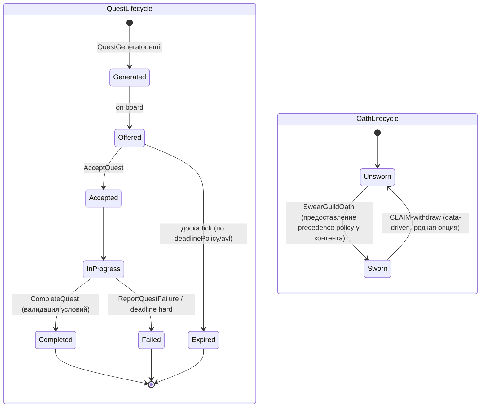
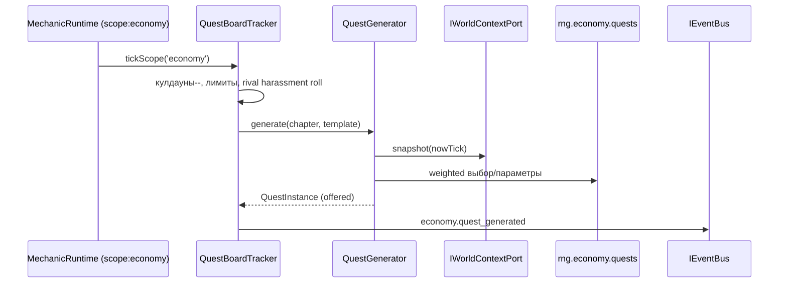

# DEV-SPEC-021 v1.0 — «Guilds, Quest Generation & Trade Agents»

**Тип документа:** Спецификация к разработке  
**Дата:** 2026-11-03  
**Статус:** draft  
**Волна:** Wave 3 (Economy core, после DEV-SPEC-020)  
**Зависит от:** `DEV-SPEC-020` (обязательно: MarketState, TradeService, агенты, событие `economy.trade_executed`, `CurrencyKind`), `DEV-SPEC-002` (EventRegistry), `DEV-SPEC-004` (MechanicRuntime)  
**Блокирует:** `DEV-SPEC-022` (инвестиции/легальность читают репутационный контур), `DEV-SPEC-028` (выбор напарников-гильдейцев), `DEV-SPEC-034` (нарративные арки списывают гильдейские операции как источники фактов), `DEV-SPEC-039`  
**Основана на:** `DESIGN v1.0 — «Экономика (цепочки, гильдии, рынки, инвестиции)»` (SPEC-ECON-023…035, 067…068, 073, 081, 091, 110…120), `GENERAL DESIGN v1.0` (GD-04, GD-07/08, GD-17), `INTENT v1.0` (INT-27)  
**Связанные DEV-SPEC:** `DEV-SPEC-020` (Market), `DEV-SPEC-022` (Investments/Legality), `DEV-SPEC-023` (World — источники процедурного наполнения), `DEV-SPEC-036` (EpilogueFactPort — 2 факта SPEC-ECON-085).

---

## 1. Назначение и границы

### 1.1. Что спецификация делает
Фиксирует Trade-контекст экономики: двухуровневую модель гильдий (`GuildDefinition` глобально + `GuildChapterDefinition` в узле), модель членства и «присяги», систему репутации со «шрамами», гильдейский кредит как третью валюту, гибридную генерацию заданий (шаблоны + процедурное наполнение из world state), доску заданий с кулдаунами и лимитами, конкуренцию гильдий, контракты на поставку как декларативный слой поверх спот-сделок 020, и полную подсистему NPC-агентов игрока (`TradeAgentDefinition`): доля прибыли, навыки, лояльность, порядок найма и содержимое поручений.

### 1.2. Что спецификация НЕ делает
- Не определяется числовой баланс наград/nakazаний/кулаундов (data-driven, вне scope).
- Не определяется модель инвестиций и проектов (→ `DEV-SPEC-022`).
- Не определяется легальность/контрабанда/розыск (→ `DEV-SPEC-022`; здесь только стык `LegalityPort`).
- Не определяется лор генерации уникальных напарников-гильдейцев (→ `DEV-SPEC-028`); спека даёт hook `acquisitionHookRef` для иного домена.
- Не описывает UI доски заданий (→ `DEV-SPEC-013`).

### 1.3. Связь с DESIGN

| DESIGN-блок | Реализация | Расхождения |
|---|---|---|
| `SPEC-ECON-023` | Гильдии двухуровневые (§5.1) | нет |
| `SPEC-ECON-024` | Ранги без эксклюзивности + присяга (§5.2) | нет |
| `SPEC-ECON-025` | Репутация: счётчик + ранги + флаги-шрамы (§5.3) | нет |
| `SPEC-ECON-026` | Гибрид шаблон + мир-наполнение (§5.4, §7.2) | нет |
| `SPEC-ECON-027` | 6 квест-типов (enum) | нет |
| `SPEC-ECON-028` | data-driven формула награды | нет (числа вне) |
| `SPEC-ECON-029` | `failure_policy` enum+комбинации | нет |
| `SPEC-ECON-030` | Конкуренция гильдий NPC | нет |
| `SPEC-ECON-031` | Доска: кулдауны/лимиты/автоснятие | нет |
| `SPEC-ECON-032` | NPC-агенты игрока (§5.6) | нет |
| `SPEC-ECON-033/034/035` | Риск перевозки → развилкка; `loss_policy`; `deadline_policy` (§5.5) | нет (бой делегируется 029/031) |
| `SPEC-ECON-067` | `GuildDefinition`/`GuildChapterDefinition` | нет |
| `SPEC-ECON-068` | `GuildQuestTemplateDefinition` | нет |
| `SPEC-ECON-073` | `TradeAgentDefinition` | нет (в 020 задекларирован срез; детальный контракт — здесь) |

---

## 2. Зависимости

### 2.1. Обязательные
- `DEV-SPEC-020` — `MarketState`, `ITradeService`, `ICargoCapacityPort`, `PricePolicyResolver`, `InventoryOps`, механика `economy-trade-agents-sim` (база агентной симуляции), `CurrencyKind` `guild-credit`, `SupplyContractRequest`.
- `DEV-SPEC-002` — `IEventBus`, `IEventRegistry`.
- `DEV-SPEC-004` — `IMechanicRuntime`/`MechanicRegistry` (гильдейские mechanical трекеры, scope `economy`).
- `DEV-SPEC-003` — контент и JSON-схемы.
- `DEV-SPEC-001` — `Result<T, E>`, `AppError`.
- `DEV-SPEC-005` — поток `rng.economy.quests` (в каталоге Wave 0, неиспользованный в 020).

### 2.2. Мягкие
- `DEV-SPEC-023` — источники процедурного наполнения (города, войны, статус фракций) существуют, но в 021 world state читается через `WorldContextPort` (data-driven снapshot), потому процедура тоже выполняется на fixture.
- `DEV-SPEC-028` — `acquisitionHookRef`: если hook напарника указан, но домена нет — задание остаётся функциональным, hook-разрешение отложено.
- `DEV-SPEC-036` — `IEpilogueFactPort` есть, факты `swore_oath_to_guild` / `became_guild_master` эмитятся здесь.

### 2.3. Внешние
Новых зависимостей нет.

---

## 3. Термины

| Термин | Определение |
|---|---|
| Гильдия | `GuildDefinition`: глобальная сущность (во всём мире), филиалы в узлах |
| Отделение | `GuildChapterDefinition`: филиал в узле, единственный источник заданий |
| Ранг | уровень членства (seniority), открывает механики задания/точности цен |
| Присяга | одноразовый обет точности −1 гильдии, даёт привилегии и обязательства |
| Репутация | числовой счётчик + rank-пороги на обоих уровнях |
| Шрам репутации | персистентный флаг «нарушил контракт» и т.п.; влияет на квесты и нарратив |
| Квест | инстанс задания: шаблон + сгенерированные параметры из world state |
| Доска | список активных заданий отделения с кулдаунами и лимитами |
| Trade-агент | нанятый NPC- factor с долей прибыли, навыками и лояльностью |
| Guild credit | неконвертируемая валюта доверия (не так bit; зарабатывается репутацией) |

---

## 4. Архитектурное размещение

### 4.1. Слои
`domain/economy/` дополняется Trade-частью; `application/guilds/` — use cases; `infrastructure/economy/` — mechanical трекеры и memento; контент — kinds `guild`, `guildChapter`, `guildQuestTemplate`, `tradeAgent`.

### 4.2. Файлы

```text
src/
├── domain/economy/
│   ├── GuildDefinition.ts
│   ├── GuildChapterDefinition.ts
│   ├── GuildQuestTemplateDefinition.ts
│   ├── TradeAgentDefinition.ts
│   ├── GuildState.ts        // runtime: membership, reputation, scars, guild-credit
│   ├── QuestInstance.ts     // runtime: generated quest
│   ├── QuestBoardState.ts   // runtime: активные, кулдауны, лимиты
│   ├── IQuestGenerator.ts
│   ├── IGuildService.ts
│   └── ITradeAgentService.ts
├── application/guilds/
│   ├── BrowseQuestBoard.ts
│   ├── AcceptQuest.ts
│   ├── CompleteQuest.ts
│   ├── ReportQuestFailure.ts
│   ├── SwearGuildOath.ts
│   ├── HireTradeAgent.ts
│   ├── DispatchTradeAgentOrder.ts
│   └── CollectAgentShare.ts
├── infrastructure/economy/
│   ├── mechanics/
│   │   ├── QuestBoardTracker.ts        // кулдауны/лимиты/автоснятие/конкуренция
│   │   └── GuildReputationTracker.ts   // репутация + шрамы + присяга
│   ├── QuestGenerator.ts
│   ├── GuildStateMementoProvider.ts
│   ├── QuestBoardMementoProvider.ts
│   ├── TradeAgentStateMementoProvider.ts
│   └── RealityLegalityPort.ts          // passthrough-заглушка → DEV-SPEC-022
content/
├── guild/guilds-core.json
├── guildChapter/chapters-core.json
├── guildQuestTemplate/templates-core.json
└── tradeAgent/agents-core.json
content/schemas/
├── guild-definition.json
├── guild-chapter-definition.json
├── guild-quest-template-definition.json
└── trade-agent-definition.json
tools/ci/rules/economy/quests-graph.ts   // граф references гильдейского контракта
```

> Контент кладётся в каталоги по ContentKind (как в 020 — kind по директории в `JsonContentRegistry`); маппинг `schemaNameForKind` расширяется на 4 новых kind. Файлы списки — в `content/packs.json` ещё того же пакета `economy-core` (или отдельного `guilds-core` — выбор фиксируется здесь: **отдельный пакет `guilds-core`**, чтобы Wave 3.1 был независим от 3.0).

### 4.3. DI
- `IGuildService` → `GuildService` (singleton).
- `IQuestGenerator` → `QuestGenerator` (singleton).
- `ITradeAgentService` → `TradeAgentService` (singleton).
- `ILegalityPort` → `RealityLegalityPort` (passthrough, до DEV-SPEC-022).
- Механики `economy-quest-board-tracker`, `economy-guild-reputation-tracker` → `MechanicRegistry`, scope `economy`.
- Провайдеры снимков → `MementoRegistry`.

---

## 5. Domain-модель

### 5.1. GuildDefinition / GuildChapterDefinition (SPEC-ECON-023, 067)

```ts
export type FactionTag = string; // 'neutral' | 'industrial-steam' | ...

export interface GuildDefinition {
  readonly id: string;
  readonly displayNameKey: string;
  readonly factionTags: readonly FactionTag[];
  readonly doctrineTags: readonly string[];   // 'trade' | 'contracts' | ...
  readonly rankPolicyId: string;
  readonly chapterIds: readonly string[];
  readonly creditUnlockPolicyId: string;      // правило заработка guild-credit
  readonly rivalGuildIds: readonly string[];  // для SPEC-ECON-030
}

export interface GuildChapterDefinition {
  readonly id: string;
  readonly guildId: string;
  readonly nodeId: string;                    // TradeNodeDefinition
  readonly questTemplateIds: readonly string[];
  readonly reputationPolicyId: string;
}
```

**Инварианты:**
- `GUILD-INV-01`: всякая гильдия имеет ≥ 1 отделение; всякое отделение привязано к существующему узлу (CI).
- `GUILD-INV-02`: отсекание циклов тут не применимо, но неделимыми объявляются: разрыв MG-LOOP «гильдия без отделений» — CI error.

Контент-скелет (SPEC-ECON-112): ≥ 2 гильдий первой волны — `guild-of-merchants` (торговая), `guild-of-contraband` (контрабандная); каждая имеет отделения во всех 12 узлах.

### 5.2. Членство, ранги, присяга (SPEC-ECON-024)

```ts
export type GuildRank = 'novice' | 'journeyman' | 'trader' | 'master' | 'elder';

export interface GuildMembership {
  readonly guildId: string;
  readonly rank: GuildRank;
  readonly reputation: number;   // равен счётчику
  readonly sworn: boolean;       // присяга этой гильдии; может быть только одной sworn в общих сведения
  readonly joinTick: number;
}

export interface OathState {
  readonly guildId: string;      // null/absent = игрок присяги не дал
  readonly sinceTick: number;
}
```

Правила:
- Ранги не эксклюзивны: состоять можно в ∞ гильдий; присяга — ровно ≤ 1, entrance policy data-driven; присяга НЕ блокирует другие гильдии, но даёт достоверную доктринальную интенсификацию преилегий + обязательства (напр., штраф при отказе).
- Присяга разблокирует: гильдейскийredit, повышенную точность цен по региону (если определено в `creditUnlockPolicyId`), преилегию в доске заданий.

### 5.3. Репутация и шрамы (SPEC-ECON-025)

```ts
export type ReputationScarType =
  | 'broken-contract' | 'rival-sabotage' | 'contraband-caught' | 'custom';

export interface ReputationScar {
  readonly type: ReputationScarType;
  readonly sinceTick: number;
  readonly sourceEvent: string;  // событие-источник (для нарратива)
}

export interface GuildReputationState {
  readonly membership: Record<string /*guildId*/, GuildMembership>;
  readonly scars: readonly ReputationScar[];
  readonly guildCredit: number;   // третья валюта, ≥ 0
}
```

- Шрамы персистентны; не снимаются тиком; могут сниматься событием `guild.scar_removed` (нарративная услуга, data-driven).
- Шрам блокирует определённые шаблоны {в data-driven фильтрах} и **входит** в нарративные триггеры (028 hook, `narrative_weight` через facts в 036).

### 5.4. Quest Generation (SPEC-ECON-026…028, 068)

```ts
export const QUEST_TYPES = [
  'delivery',              // доставка товара
  'chain-support',         // обеспечение цепочки (поставки на производство)
  'chain-sabotage',        // срыв чужой цепочки
  'escort',                // эскорт / охрана каравана
  'market-recon',          // разведка рынка (сбор информации)
  'investment-contract',   // инвестиционный подряд
] as const;
export type QuestType = (typeof QUEST_TYPES)[number];

export interface GuildQuestTemplateDefinition {
  readonly id: string;
  readonly displayNameKey: string;
  readonly questType: QuestType;
  readonly goodFilterTags: readonly string[];       // tier/origin/tag товарного фильтра
  readonly sourceNodeFilterTags: readonly string[]; // faction tags etc.
  readonly targetNodeFilterTags: readonly string[];
  readonly rewardPolicyId: string;
  readonly deadlinePolicy: 'hard' | 'soft' | 'none';
  readonly failurePolicy: readonly FailureAction[];  // комбинации допустимы
  readonly lossPolicy: 'full_loss' | 'deposit' | 'insurance';
  readonly riskTags: readonly string[];
  readonly generationPolicyId: string;
  readonly blockScars: readonly ReputationScarType[]; // шрамы, блокирующие шаблон
}

export type FailureAction =
  | 'none' | 'reputation_loss' | 'debt' | 'rival_gain' | 'scar'
  // scar — только через основную модель шрамов (§5.3)

export interface QuestInstance {
  readonly questId: string;        // runtime id
  readonly templateId: string;
  readonly chapterId: string;
  readonly type: QuestType;
  readonly generated: {            // процедурное наполнение
    readonly goodId?: string;
    readonly quantity?: number;
    readonly sourceNodeId?: string;
    readonly targetNodeId?: string;
    readonly deadlineTick?: number;
    readonly rewardGold?: number;
    readonly rewardGuildCredit?: number;
    readonly relatedChainId?: string;
  };
  readonly acceptedTick: number | null;
  readonly expiresTick: number | null;
  readonly status: 'offered' | 'accepted' | 'in_progress' | 'completed' | 'failed' | 'expired';
}
```

Правила генерации:
- Шаблон задаёт форму; мир заполняет конкретикой (источник: `WorldContextPort` snapshot: наличие товаров на узле, дефицит, war/катаклизм, связи узлов, реальный статус цепочек).
- Все случайные выборы — **только** `rng.economy.quests`; формулы наг/штрафы — по policy IDs, числа из контента (INT: не в коде).
- `chain-sabotage` создаёт НАСТОЯЩИЙ срыв (через `economy.chain_disrupted` из 020) плюс rival-driven эффекты.
- `market-recon` накапливает знание: записывает информацию в `MarketState.knowledge` игрока (020-контракт).

### 5.5. Риск, страхование, срока (SPEC-ECON-033…035)

Контракт поставки (`SupplyContractRequest` из 020) ⭢ квет-надстройка:
- `deadlinePolicy`:
  - `hard` — по истечении → `QuestInstance.status = 'failed'`, отчёт failure-политики;
  - `soft` — награда линейно падает по `small`/`medium`/`large` абсолютным уровням из `reward_policy` (все числа — из контента);
  - `none` — только сюжетные (used при генерации, без дедлайна).
- `lossPolicy` — определён выше; выполняется при рисковом событии маршрута: `risk_profile` маршрута (020) → событие `economy.risk_triggered` (здесь объявлено как расширение, payload_schema) → развилка «откупиться / бой / потеря»: бой — через `combat-context` hook `BattlePort` (стуб до `DEV-SPEC-029/031`), откуп — платёж из `bribe_policy_id` контента, потеря — `lossPolicy`.

### 5.6. Trade Agents (SPEC-ECON-032, 073)

```ts
export interface TradeAgentDefinition {
  readonly id: string;
  readonly displayNameKey: string;
  readonly skillPolicyId: string;      // навыки: скорость, риск-обработка, торг
  readonly sharePolicyId: string;      // доля прибыли (0..1), открытые формулы — data-driven
  readonly loyaltyPolicyId: string;    // модель лояльности/ámica отдача
  readonly unlockPolicyId: string;     // через гильдию/инвестицию; типы условий
  readonly maxOrders: number;          // одновременно поручений
}

export interface TradeAgentStateEntry {
  readonly agentDefId: string;
  readonly hiredSinceTick: number;
  readonly profitEarned: number;    // склад ведёт ITradeAgentService
  readonly playerSharePaid: number;
  readonly loyalty: number;          // счётчик по loyaltyPolicyId
  readonly activeOrderIds: readonly string[];
}
```

Правила:
- Агент — полноценный участник спот-сделок: его операции в 020 проходят через `PricePolicyResolver` (общий код-путь). 021 добавляет: `HireTradeAgent` (проверка `unlock_policy`), `DispatchTradeAgentOrder` — маршруты определены в data-driven поручении: buy/sell, quantity policy, маршрут (ребро), тайминг (до такта X), budget cap.
- Profit → `sharePolicyId` вычисляет долю агента, из накопленного баланса `CollectAgentShare` конвертирует в золото отношения игрока (учёт в `GuildState.tradeAgents`-карте и gold-состоянии капитана — последний порт через `WealthPort`, стуб).
- Лояльность: удар по loyalty при неудачных поручениях → риск потери (`economy.agent_lost` уже из 020) или бунт (hook `TradeAgentBetrayalEvent`, data-driven).

### 5.7. CurrencyKind.guild-credit (SPEC-ECON-022 a часть)

Реализация:
- `GuildReputationState.guildCredit` — счётчик, ≥ 0; заработок — по `creditUnlockPolicyId` (например, моменты с площадки: выполненное задание глильдии N ранга → +X credit; правило из контента).
- Расход в 021: приобретение приоритетов (в 022 — crestа членства, какое-то lock; в 023— обмен на услуги). Код с расходами refundable-only, если фактическое используемое место находится north-of-this spec.
- `CurrencyKind.barter` не реализуется здесь (требует товарных вычислений в актах цепочек 020; уже поддержано by contract).

### 5.8. Порты

```ts
export interface IWorldContextPort {
  snapshot(nowTick: number): WorldContextSnapshot;
}
export interface WorldContextSnapshot {
  readonly povertyIndex: Record<string /*nodeId*/, number>;
  readonly activeChainStatus: Record<string /*chainId*/, 'idle' | 'running' | 'disrupted'>;
  readonly warFronts: readonly string[];      // nodeIds на фронте
  readonly cataclysmTags: readonly string[];
}
// реализация: в 023; до её готовности — FixtureWorldContextPort (данные сцены детерминизма).

export interface IBattlePort {
  // заглушка: risk-развилка «бой» resolveCombat(riskProfile, partyState): 'win'|'lose'|'flee'
  // реализtentează в DEV-SPEC-029/031; до этого → авто 'flee' с lossPolicy.
}
```

Расширяются 020: `ILegalityPort` (passthrough), `IEpilogueFactPort` (используется впервые: 2 факта ниже).

---

## 6. Data-контракты и схемы

### 6.1. Механики (plugin'ы, scope economy)

| id | kind | priority | consumes | emits |
|---|---|---|---|---|
| `economy-quest-board-tracker` | tracker | 150 | `economy.tick_advanced`, `economy.quest_accepted`, `economy.quest_completed`, `economy.quest_failed` | `economy.quest_generated`, `economy.quest_expired`, `economy.guild_rival_harass` |
| `economy-guild-reputation-tracker` | tracker | 250 | `economy.quest_completed`, `economy.quest_failed`, `economy.trade_executed` (только гильдейские сделки — после фильтра контента) | `economy.reputation_changed`, `economy.guild_scar_revealed`, `economy.oath_sworn`, `economy.guild_credit_changed` |

Оба — tracker'ы с `state_schema` (снимки ниже), persistence через **новые** memento-провайдеры; RNG — только `rng.economy.quests` (board).

### 6.2. JSON Schema (content/schemas/)

- `guild-definition.json`, `guild-chapter-definition.json`, `guild-quest-template-definition.json`, `trade-agent-definition.json` — общие правила: `"additionalProperties": false`, kebab-case `id`, ссылки на инвестиции запрещены (это 022), все refsспецификациисобытие economics namespace.
- `guild-state.json` (снимок: memberships, scars, guildCredit),
- `quest-board-state.json` (снимок: активные QuestInstance, кулдауны, лимиты),
- `trade-agent-state.json` (снимок: hires, orders, profits).

### 6.3. События (расширение ядра SPEC-ECON-081)

021 эмитит из ядра: `economy.quest_generated, quest_accepted, quest_completed, quest_failed` + собственные расширения: `quest_expired, reputation_changed, guild_scar_revealed, oath_sworn, guild_credit_changed, guild_rival_harass, risk_triggered, agent_order_dispatched, agent_order_completed, agent_betrayed`. Факты эпилога: `epilogue.economy.became_guild_master`, `epilogue.economy.swore_oath_to_guild` (публиковать при первом достижении ранга master/oath).

---

## 7. Рантайм-поведение

### 7.1. State machines



### 7.2. Sequence: генерация задания



### 7.3. Tick-контракт
Фаза `scope:economy`: цены (300) → reputation (250) → доска (150) → chain runner (200, всё по `priority` desc: [300 price, 250 reputation, 200 chain, 150 board, 100 agents]). Числа фиксированы константами пакета `content/mechanics/economy.json` (extends 020).

### 7.4. Детерминизм
- Единственный RNG — `rng.economy.quests`; агентские потоки `rng.economy.agents/risk` наследуются 020.
- Все snapshot'ы — canonicalJson (порядок map-ключей сортирован), детерминизм save/load не выделяется из общего контура.

---

## 8. Порты и адаптеры

### 8.1. Порты
- `IWorldContextPort` (impl → 023; fixture-заглушка сейчас).
- `IBattlePort` (impl → 029/031; текущая заглушка: auto-flee).
- `ILegalityPort` (impl → 022; passthrough).
- `IWealthPort` (объявлен здесь: accounting золота капитана; реализация — интеграция капитана, stub to AppState snapshot; явно фиксируется Q-02).
- `IEpilogueFactPort` (Wave 0 заглушка → 036).

### 8.2. Ошибки (дополнение EconomyErrors)

| Код | Когда |
|---|---|
| `GUILD_UNKNOWN` | ref несуществующая гильдия |
| `CHAPTER_UNKNOWN` | ref несуществующее отделение |
| `REPUTATION_REQUIRED` | ранг ниже требуемого |
| `OATH_ALREADY_SWORN` | вторая присяга |
| `QUEST_BOARD_FULL` | превышение лимита контрактов |
| `QUEST_NOT_ACCEPTABLE` | шрам-блок/template-условие не выполнено |
| `AGENT_NOT_UNLOCK` | агент не открыт (unlock_policy failed) |
| `AGENT_BUSY` | бес свободных слотов поручений |
| `GUILD_CREDIT_INSUFFICIENT` | не хватает guild-credit |

Все через `Result<T, E>` по 001; ошибки в tracker'е — ловятся INV-12 (004).

---

## 9. Интеграционные точки

### 9.1. Потребляемые события
- От 020: `economy.trade_executed` (гильдейский фильтр: где участник-члены гильдий), `economy.tick_advanced`, `economy.chain_disrupted` (для chain-sabotage), `economy.agent_*`.
- От 023/025/026 (будущее): изменения war fronts/катаклизмы впадают через `WorldContextPort`.

### 9.2. Эмитируемые события
См. §6.3. Формат payload'ов — по схеме 002.

### 9.3. Факты эпилога (`DEV-SPEC-036`)
`became_guild_master`, `swore_oath_to_guild` — публикация при первом событии (флаг one-shot в GuildState).

### 9.4. Use cases (application/guilds/)
`BrowseQuestBoard`, `AcceptQuest`, `CompleteQuest`, `ReportQuestFailure`, `SwearGuildOath`, `HireTradeAgent`, `DispatchTradeAgentOrder`, `CollectAgentShare`. Presentation вызывает напрямую (GD-13), проверка гильдейского ранга/лояльности — в `GuildService`.

---

## 10. Обработка ошибок
По образцу 020: `Result`-модель, инфраструктурный tracker-failure — лог + пропущенный тик (INV-12), доменные инварианты — отклонение операции (state не изменён), degraded режимы детерминированы.

---

## 11. Критерии приёмки

### `DEV-SPEC-021-R01` — Двухуровневая модель гильдий
**Given** `GuildDefinition` без `chapterIds`  
**When** загрузка пакета `guilds-core`  
**Then** `Err` на graph-стадии (`GUILD-INV-01`)

**AC:**
- `AC01`: валидная пара Guild/Chapter с узлом → `Ok`.
- `AC02`: chapter с несуществующим nodeId → graph error.

### `DEV-SPEC-021-R02` — Ранги и присяга
**Given** player с рангом `trader`, template с требованием `master`  
**When** `AcceptQuest`  
**Then** `Err(REPUTATION_REQUIRED)`

**AC:**
- `AC03`: вторая присяга при sworn=true → `Err(OATH_ALREADY_SWORN)`.
- `AC04`: присяга не блокирует вступление в другие гильдии (rank change ok).

### `DEV-SPEC-021-R03` — Репутация и шрамы персистентны
**Given** quest с failure_policy `[reputation_loss, scar]`, проваленное задание  
**When** `ReportQuestFailure`  
**Then** репутация уменьшена по policy, шрам добавлен, событие `guild_scar_revealed` опубликовано

**AC:**
- `AC05`: шрам влияет на board (шаблон с blockScars недоступен).
- `AC06`: шрам переживат save/load (memento-круговlis).

### `DEV-SPEC-021-R04` — Процедурное наполнение из world state
**Given** fixture WorldContext: узел A дефицит `coal`, узел B избыток, шаблон delivery `tier: raw`  
**When** QuestGenerator.generate  
**Then** QuestInstance с `goodId=coal` (или смежным raw-товаром узла) на основе weighted выбора по povertyIndex

**AC:**
- `AC07`: при фиксированном seed генерация детерминирована (identical double-run).
- `AC08`: распространённые 6 quest types генерируются (enum-полностью покрытие).

### `DEV-SPEC-021-R05` — Доска: лимиты и кулдауны
**Given** board с limit 3 active quests, 3 accepted  
**When** генерация нового  
**Then** quest откладывается (не предлагается) до < лимита

**AC:**
- `AC09`: кулдаун шаблона блокирует повторную генерацию до остывания.
- `AC10`: автоснятие: исчезновение источников (chain completed) → предложение снято.

### `DEV-SPEC-021-R06` — Trade агенты работают как игрок
**Given** agent с share 0.7 и budget 100  
**When** DispatchTradeAgentOrder → buy coal 20 → sell steel 15  
**Then** сделки идут через общий PricePolicyResolver(anticipate), доля и лояль начисляется по policies, событие с `agent: true`

**AC:**
- `AC11`: агент не может превысить `maxOrders` → `Err(AGENT_BUSY)`.
- `AC12`: unlock не выполнен → `Err(AGENT_NOT_UNLOCK)`.

---

## 12. Тест-план

### 12.1. Unit
- Схемы: 4 контент-схемы (валид/невалид, if/then refs).
- `GuildService`: репутация, ранги, пاث oath, шрамы.
- `QuestGenerator`: deterministic generation, weighted выбор, failure/deadline/loss policies (все комбинации по 2-3 cex).
- `QuestBoardTracker`: кулдауны, лимиты, автоснятие, rival harassment.
- `TradeAgentService`: share, loyalty, maxOrders, betrayal hook.

### 12.2. Integration
- `AcceptQuest → CompleteQuest` (delivery) → events chain: quest_* + trade_executed + economy effects на MarketState.
- `chain-sabotage` → `economy.chain_disrupted` в 020 (новый cross-spec test).
- `market-recon` → записанный knowledge в `MarketState`.

### 12.3. Contract
- Все `GuildDefinition/Chapter/Template/TradeAgent` проходят схемы.
- Все 7+ новых `economy.*` расшир. событий фактическую зарегистрированы.
- Механики board/reputation проходят `mechanic-definition.json` (INV 004).

### 12.4. Determinism
- Сценарий 5 фикс: 10 тиков с работающей доской + agent ходы → save → load → 10 тиков == 20 straight; snapshot сравнение.

### 12.5. E2E (веха)
- Демо M6: bootstrap + гильдейский пакет → принять delivery-квест → выполнить (спот-сделки 020) → награда + репутация вверх → присягнуть → высший доступ enabled → агент нанят, его сделка влияет на рынок.

### 12.6. CI
- `graph`: гильдейские kinds ацикличны по refs, все сущности slice'а присутствуют, `≥2` гильдии × 12 chapters по скепту 110/112.
- `events`: все 7+ расширительных событий задeclared.
- `rng-streams`: 1 новый паттерн — только `rng.economy.quests` в board; запрет случайности в гильд-плагинах вне его.
- `determinism`: сценарий 5 добавлен в determinism fixtures.

---

## 13. Производительность
- Контракт `TickBudgetPort` (DEV-SPEC-016) — доска не более O(active quests) на тик; генератор — O(templates × мир-снимок) при событии генерации, не на каждый тик.
- LOD: при перегрузке бюджета tbody трекер пропускает rival harassment и автоснятие (данные под балансом).

---

## 14. Миграции
Снимки гильдейского state версиональны в `$id` (как 020); миграции — вне scope.

---

## 15. Открытые вопросы

| ID | Вопрос | Блокер? | Решение / статус |
|---|---|---|---|
| `Q-01` | Гильдейский кредит нужен за пределамидовериикредит 021 (022) | нет | Счётчик в GuildState; расход — 022 определяет конкретику |
| `Q-02` | `IWealthPort` (золото капитана) — где состояние? | нет | CaptainState вне нынешней спеки (DEV-SPEC-032); здесь — порт-стаб с балансом `playerGold` в App handle (Wave 0 AppHandle), реализация переносится 032 |
| `Q-03` | Взаимодействие rival guilds спартийные `epilogue` фактами | нет | rivalry диагноз через `guild_rival_harass` события; факты — скentro контракт 036 |
| `Q-04` | `market-recon` модифицирует знание `MarketState` (020) | нет | Прямая запись через `ITradeService.recordKnowledge` (020 API), тест на детерминизм |

---

## 16. Что остаётся вне scope
- Инвестиции/легальность (022); напарники и их acquisition-hook исполнение (028); факт-контракт (036).
- Числа баланса, лорные названия, narration texts.
- UI платы заданий (013).
- NPC-AI оптимизации за пределами tick/day budget.

---

## 17. Трассировка на DESIGN

| DESIGN-блок | Требование | AC | Тест |
|---|---|---|---|
| `SPEC-ECON-023` | `-R01` | `AC01/02` | `guild-schema/registry.test.ts` |
| `SPEC-ECON-024` | `-R02` | `AC03/04` | `guild-service.test.ts` |
| `SPEC-ECON-025` | `-R03` | `AC05/06` | `reputation-tracker.test.ts` |
| `SPEC-ECON-026…028` | `-R04` | `AC07/08` | `quest-generator.test.ts` |
| `SPEC-ECON-031/029/035` | `-R05` | `AC09/10` | `quest-board-tracker.test.ts` |
| `SPEC-ECON-032/033/034` | `-R06` | `AC11/12` | `trade-agent-service.test.ts` |
| `SPEC-ECON-112/120` | §4.1 | — | demo-m6 + slice content check |
| `SPEC-ECON-085` | §6.3, §9.3 | — | `epilogue-facts-guild.test.ts` |
