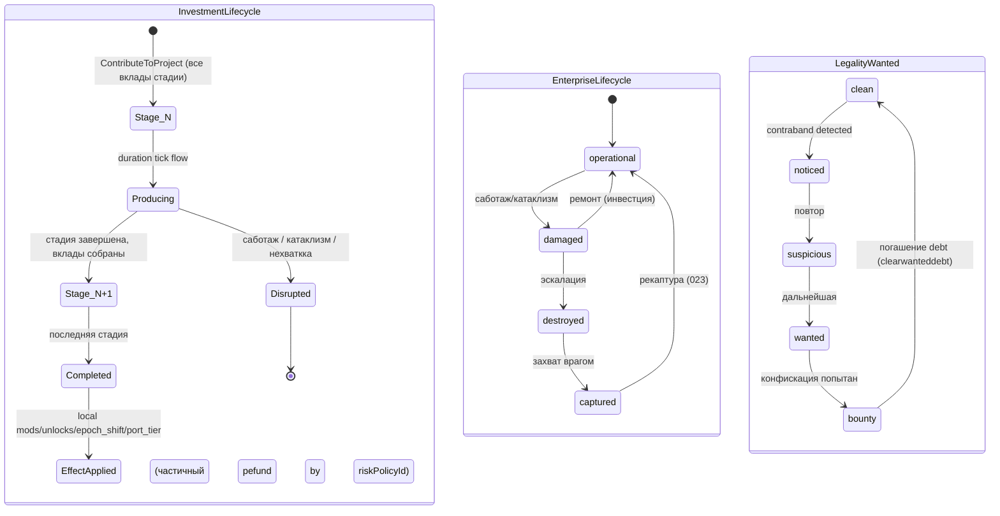
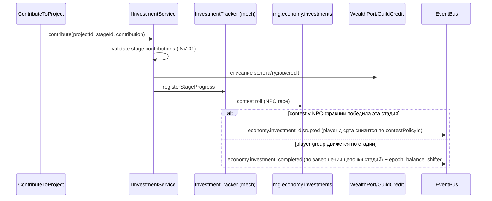
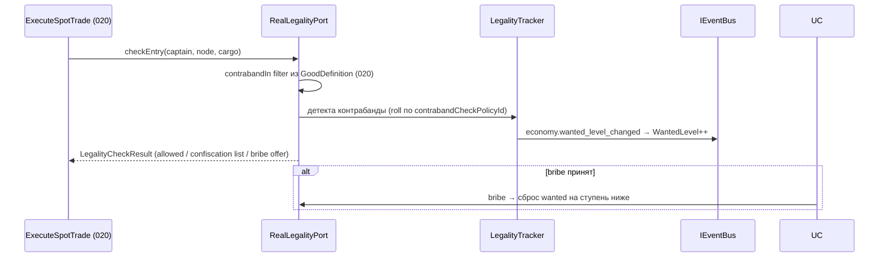

# DEV-SPEC-022 v1.0 — «Investments, Enterprises & Legality»

**Тип документа:** Спецификация к разработке  
**Дата:** 2026-11-03  
**Статус:** draft  
**Волна:** Wave 3 (Economy core, завершающая — после DEV-SPEC-020/021)  
**Зависит от:** `DEV-SPEC-020` (MarketState, InventoryOps, TradeService, EnterpriseDefinition-ссылки, механики scope economy), `DEV-SPEC-021` (GuildService, guild-credit, reputation-шрамы)  
**Блокирует:** `DEV-SPEC-023` (мир читает легальность/шок-состояния узлов, epoch_shift), `DEV-SPEC-025/026` (экономические шоки → катаклизм-мост), `DEV-SPEC-033` (скрытые ветки: экономические hooks), `DEV-SPEC-039`  
**Основана на:** `DESIGN v1.0 — «Экономика (цепочки, гильдии, рынки, инвестиции)»` (SPEC-ECON-002, 036, 038, 039, 041…046, 070…072, 074, 081, 084, 091, 098, 110…114), `GENERAL DESIGN v1.0` (GD-04, GD-07/08, GD-17), `INTENT v1.0` (INT-27, INT-33.2)  
**Связанные DEV-SPEC:** `DEV-SPEC-021` (ILegalityPort контракт, guild-credit), `DEV-SPEC-025/026` (потребление катаклизмов), `DEV-SPEC-029/031` (боевой шаг-ответ redirect для саботажей), `DEV-SPEC-036` (факты `invested_in_epoch_shift`, `ruined_node`).

---

## 1. Назначение и границы

### 1.1. Что спецификация делает
Определяет третью (последнюю) часть Trade-контекста: инвестиционный контур (`InvestmentProjectDefinition` со стадиями, вкладами, эффектами, контестом и доходностью), модель NPC-предприятий (`EnterpriseDefinition` с ownership-долями и состоянием), персистентные «шрамы узла» (`NodeScarDefinition`), подсистему легальности/контрабанды/розыска (`LegalityDefinition` + реализация `ILegalityPort`), экономические доктрины фракций (`EconomyDoctrineDefinition` — данные + правила потребления механиками), экономические шоки (кратковременные, сочетаются с катаклизмами) и декларативные хуки скрытых веток трансформации.

### 1.2. Что спецификация НЕ делает
- Не реализует катаклизмы (только мост: потребление `cataclysm.triggered/escalated/ended` → шоки/шрамы); детали → `DEV-SPEC-025/026`.
- Не определяет рендер инвестиций/легальности (→ 010–013), числовой баланс, лорные тексты.
- Не реализует сам бой в саботажах (→ `BattlePort` из 021, impl 029/031).
- Не реализует скрытые ветки трансформации (→ `DEV-SPEC-033`): только hooks.
- Не наследует расчёты epilogue (только 2 факта).

### 1.3. Связь с DESIGN

| DESIGN-блок | Реализация | Расхождения |
|---|---|---|
| `SPEC-ECON-041` | 4 класса объектов инвестиций | нет |
| `SPEC-ECON-042` | Стадии + вклады (gold/good/service) | нет |
| `SPEC-ECON-043` | Локальные модификаторы + unlock + epoch_shift + port_tier | нет |
| `SPEC-ECON-044` | Гонка, саботаж, утрата (contest/risk policy) | нет |
| `SPEC-ECON-045` | `yield_policy`: passive_income/unlock_only/hybrid | нет |
| `SPEC-ECON-046` | Hooks скрытых веток (cataclysm-pressure; monopolist-paths) | нет |
| `SPEC-ECON-036` | Легальность: досмотры, розыск, конфискация | нет |
| `SPEC-ECON-038` | `NodeScarDefinition` — элементы шока/шрама | нет |
| `SPEC-ECON-039` | Блокады/фронты как состояния узлов/рёбер | нет |
| `SPEC-ECON-002/070` | `EconomyDoctrineDefinition` — уникальные правила фракций | нет |
| `SPEC-ECON-071` | `EnterpriseDefinition`: состояния + доли ≤ 1 | нет |
| `SPEC-ECON-072` | `duration_policy/removable_by` шрамов | нет |
| `SPEC-ECON-074` | `LegalityDefinition`: check/bribe/wanted/confiscation | нет |
| `SPEC-ECON-084` | Мост economy ↔ cataclysm (шоки) | нет |
| `SPEC-ECON-114` | 4 доктрины первой волны | нет |

---

## 2. Зависимости

### 2.1. Обязательные
- `DEV-SPEC-020` — механическая база (scope `economy`, фазовый конвейер), `MarketState` (влияние эффектов инвестиций и шрамов на цены/потребление), `ICargoCapacityPort`, TradeService.
- `DEV-SPEC-021` — `GuildService` (гильдия-цели инвестиций), `guild-credit` (расход, Q-01 из 021 закрыт здесь), `ILegalityPort` контракт и passthrough-заглушка.
- `DEV-SPEC-002` — EventRegistry (новые ядра расширений, §6.3).
- `DEV-SPEC-004` — 3 новых mechanical tracker'а (investments, legality, node-scars).
- `DEV-SPEC-001/003/005/006` — Result, контент-режимы, RNG-поток `rng.economy.investments` + `rng.economy.shocks`, memento.

### 2.2. Мягкие
- `DEV-SPEC-025/026` — катаклизм-детали; спека определяет контракт моста и заглушку `FixtureCataclysmPort`.
- `DEV-SPEC-023` — `WorldContextPort` (из 021) даёт warFronts/статусы узлов; реализация — мир.
- `DEV-SPEC-033` — hook события повышают `cataclysm_pressure` (счётчик) только если домен добавлен; хранится в App state с потолком.

### 2.3. Внешние
Новых зависимостей нет.

---

## 3. Термины

| Термин | Определение |
|---|---|
| Инвестиция | проект развития с стадиями; вклад золотом/товарами/услугами |
| Стадия | этап проекта: набор вкладов + длительность + эффекты по завершении |
| Контест | параллельная гонка NPC-фракций за контроль проекта; уронологическая |
| Саботаж | активное разрушение инвестции (NPC) или через катаклизм |
| Предприятие | data-driven бизнес на узле: `operational/damaged/destroyed/captured` |
| Доля | ownership share игрока/NPC в предприятии; Σ ≤ 1 |
| Шок | восстановимый экономический эффект (дефицит/устойчивый surge) |
| Шрам узла | персистентный эффект (цены/цепочки/население) до явного снятия |
| Легальность | контрольно-розыскная подсистема узла: досмотры, взятка, wanted, конфискация |
| Экономическая доктрина | unique_rule набор фракции (ресурс/обмен/риски/взаимоотношения) |

---

## 4. Архитектурное размещение

### 4.1. Слои
- `domain/economy/` — инвестиционные/легальные/шоковые типы + порты;
- `application/investments/`, `application/legality/` — use cases;
- `infrastructure/economy/` — mechanical tracker'ы + memento + `RealLegalityPort`;
- контент — kinds `investmentProject`, `enterprise`, `nodeScar`, `legality`, `economyDoctrine`, `priceModifier` (только инвестиционные политические).

### 4.2. Файлы

```text
src/
├── domain/economy/
│   ├── InvestmentProjectDefinition.ts
│   ├── InvestmentState.ts        // runtime: started stage, вклады, contest_state
│   ├── EnterpriseDefinition.ts
│   ├── EnterpriseState.ts
│   ├── NodeScarDefinition.ts
│   ├── NodeScarState.ts
│   ├── LegalityDefinition.ts
│   ├── LegalityState.ts          // wanted-debt, контрабандные отметки игрока
│   ├── EconomyDoctrineDefinition.ts
│   ├── EconomicShock.ts          // взвеси шока/шрама
│   ├── ILegalityPort.ts          // Endpoint-Контракт (замена 020/021 stublo)
│   ├── IInvestmentService.ts
│   └── ICataclysmEconomyPort.ts  // мост 025/026
├── application/investments/
│   ├── ListInvestmentProjects.ts
│   ├── ContributeToProject.ts
│   ├── AbandonOrSabotageProject.ts   // только игрок-версия (NPC — механика)
│   └── ClaimEnterpriseShare.ts
├── application/legality/
│   ├── PayBribe.ts
│   ├── ReportContrabandAttempt.ts
│   ├── ClearWantedDebt.ts
│   └── GetLegalityStatus.ts
├── infrastructure/economy/
│   ├── mechanics/
│   │   ├── InvestmentTracker.ts        // стадии/контест/доходность
│   │   ├── NodeScarTracker.ts          // шрамы и шоки
│   │   └── LegalityTracker.ts          // розыск/досмотры/конфискация
│   ├── RealLegalityPort.ts             // реализация ILegalityPort
│   ├── InvestmentStateMementoProvider.ts
│   ├── EnterpriseStateMementoProvider.ts
│   ├── NodeScarStateMementoProvider.ts
│   └── LegalityStateMementoProvider.ts
content/
├── investmentProject/investments-core.json
├── enterprise/enterprises-core.json
├── nodeScar/scars-core.json
├── legality/legality-core.json
└── economyDoctrine/doctrines-core.json
content/schemas/
├── investment-project-definition.json
├── enterprise-definition.json
├── node-scar-definition.json
├── legality-definition.json
├── economy-doctrine-definition.json
├── investment-state.json / enterprise-state.json  // снимки
├── node-scar-state.json / legality-state.json     // снимки
└── economic-shock.json
tools/ci/rules/economy/investments-graph.ts
```

Контент кладётся по kind-имя директории (как 020/021); `schemaNameForKind` расширяется на 5 kinds; файлы списки — пакет `economy-3` (завершение Wave 3).

### 4.3. DI
- `IInvestmentService` → `InvestmentService`.
- `ILegalityPort` → `RealLegalityPort` (**замена** pasa-ta из 020/021, глобальная точка).
- `ICataclysmEconomyPort` → `FixtureCataclysmEconomyPort` (мост-снаряжение, до 025).
- 3 новых tracker'а → `MechanicRegistry` (scope `economy`);
- 4 новых memento-провайдера → `MementoRegistry`.

---

## 5. Domain-модель

### 5.1. InvestmentProjectDefinition (SPEC-ECON-069)

```ts
export type InvestmentTargetKind = 'infrastructure' | 'tech' | 'magic-school' | 'guild' | 'enterprise';
export type ContributionKind = 'gold' | 'good' | 'service' | 'guild-credit'; // guild-credit — из 021
export type YieldPolicy = 'passive_income' | 'unlock_only' | 'hybrid';

export interface InvestmentStage {
  readonly id: string;
  readonly displayNameKey: string;
  readonly contributions: readonly {
    readonly kind: ContributionKind;
    readonly goodId?: string;          // для kind 'good'
    readonly serviceRefId?: string;    // для kind 'service' (например, услуга агент/задание)
    readonly quantityPolicyId: string;
  }[];
  readonly durationPolicyId: string;
}

export interface InvestmentProjectDefinition {
  readonly id: string;
  readonly displayNameKey: string;
  readonly targetKind: InvestmentTargetKind;
  readonly targetId: string;          // enterprise / guild / tech-id data-driven
  readonly nodeId: string;            // где расположено
  readonly stages: readonly InvestmentStage[];  // ≥ 1
  readonly effects: {
    readonly localModifiers: readonly string[];   // id политик priceModifier → 020 market
    readonly globalUnlocks: readonly string[];    // tech/policy ids data-driven
    readonly epochShiftPolicyId: string;          // science/magic сдвиг (INT: конфликт эпох)
    readonly portTierChange: number;              // int, может быть 0
  };
  readonly contestPolicyId: string;
  readonly riskPolicyId: string;                  // саботаж/валидация‍т за канал
  readonly yieldPolicy: YieldPolicy;
  readonly factionVisible: readonly string[];     // кто видит проект (fictional-cli или public)
}
```

**Инварианты:**
- `INV-01`: `stages.length ≥ 1`; каждый вклад имеет quantityPolicyId.
- `INV-02`: effects — только декларации, ни одного числа баланса в типе (все числа — политики).
- `INV-03`: игрок может иметь сколько угодно проектов; NPC frayance — та же модель, когда это видно.

### 5.2. EnterpriseDefinition / EnterpriseState (SPEC-ECON-071)

```ts
export type EnterpriseKind = 'shipyard' | 'refinery' | 'workshop' | 'farm' | 'extraction' | 'market-hall';
export type EnterpriseStatus = 'operational' | 'damaged' | 'destroyed' | 'captured';

export interface EnterpriseDefinition {
  readonly id: string;
  readonly displayNameKey: string;
  readonly nodeId: string;
  readonly kind: EnterpriseKind;
  readonly chainIds: readonly string[];       // которые работают производственные цепочки
  readonly ownershipPolicyId: string;
  readonly statePolicyId: string;             // переходы статус-ов
  readonly capacityPolicyId: string;          // пропеntность производственных цепочек
}

export interface EnterpriseState {
  readonly enterpriseId: string;
  readonly status: EnterpriseStatus;
  readonly shares: Record<string /*ownerId*/, number>; // Σ ≤ 1; включает 'player'
  readonly activeChainRuns: readonly string[];     // ids runs из 020
  readonly damagedSince?: number;
}
```

**Инварианты:**
- `INV-04`: `Σ shares ≤ 1` (с точностью 1e-9); доля игрока учитывается как `shares['player']`.
- `INV-05`: предприятие живёт только в связке узла (nodeId существует).

### 5.3. NodeScarDefinition / NodeScarState (SPEC-ECON-072)

```ts
export interface NodeScarDefinition {
  readonly id: string;
  readonly displayNameKey: string;
  readonly nodeFilterTags: readonly string[];
  readonly effects: {
    readonly priceModifierIds: readonly string[];    // → 020 market (цены)
    readonly chainDisruptionIds: readonly string[];  // disruption правил для цепочек
    readonly populationEffectPolicyId?: string;      // мир (023)
  };
  readonly durationPolicyId: 'permanent' | 'ticks';
  readonly removableBy: readonly string[];   // id услуг/ritualов (data-driven, не обязательно реализация)
}

export interface NodeScarState {
  readonly nodeScars: Record<string /*nodeId*/, readonly string[]>;
  readonly activeShocks: readonly EconomicShockInstance[];
}

export interface EconomicShockInstance {
  readonly shockId: string;
  readonly nodeId: string;
  readonly kind: 'price-spike' | 'shortage' | 'surplus' | 'famine' | 'hyperinflation' | 'crash';
  readonly sourceEvent: 'cataclysm' | 'war' | 'player' | 'systemic';
  readonly sinceTick: number;
  readonly durationTicks: number;      // восстановимый
  readonly magnitudePolicyId: string;
}
```

- Шок — ограничит ель времени; по истечении — снятие. Шрам — персистен до `removable_by службы`.
- Шоки eмит `economy.shock_generated` (SPEC-ECON-084) и потребляются 025/026 + 023.

### 5.4. LegalityDefinition / LegalityState (SPEC-ECON-074, 036)

```ts
export interface LegalityDefinition {
  readonly id: string;
  readonly displayNameKey: string;
  readonly contrabandCheckPolicyId: string;   // вероятность/условия досмотра при входе с cargo
  readonly bribePolicyId: string;             // стоимость/эффекты взятки
  readonly wantedPolicyId: string;            // рост wanted за нарушения
  readonly confiscationPolicyId: string;      // правила конфискации контрабанды
}

export type WantedLevel = 'clean' | 'noticed' | 'suspicious' | 'wanted' | 'bounty';

export interface LegalityState {
  readonly nodeId: string;
  readonly wantedLevels: Record<string /*captainId*/, WantedLevel>;
  readonly captainContrabandRecord: Record<string /*captainId*/, readonly {
    readonly goodId: string;
    readonly quantity: number;
    readonly detectedTick: number;
  }>;
}
```

**Reализация ILegalityPort (замена заглушки 020/021):**

```ts
export interface ILegalityPort {
  checkEntry(captainId: string, nodeId: string, cargo: readonly { readonly goodId: string; readonly quantity: number }[]):
    Result<LegalityCheckResult, ECON_E>;
  bribe(captainId: string, nodeId: string, amountPolicyId: string): Result<LegalityCheckResult, ECON_E>;
  wantedOf(captainId: string, nodeId: string): WantedLevel;
  confiscate(captainId: string, nodeId: string, plan: readonly string[]): Result<void, ECON_E>;
}
export interface LegalityCheckResult {
  readonly allowed: boolean;
  readonly contrabandFound: readonly { readonly goodId: string; readonly quantity: number }[];
  readonly wantedAfter: WantedLevel;
  readonly bribeOffered: number;    // 0 если не предлагается
}
```

- Старается видеть контрабандные пакеты из `GoodDefinition.contrabandIn` (020) при входе в узел, где товар нелегален.
- Рост wanted по policy; bounty — статус, при котором возможна конфискация; дальнейшая эскалация — вопрос мира (023/025), охота — через квестовую систему 021/023.

### 5.5. EconomyDoctrineDefinition (SPEC-ECON-002, 070)

```ts
export interface EconomyDoctrineDefinition {
  readonly id: string;
  readonly factionId: string;
  readonly displayNameKey: string;
  readonly uniqueResourceId: string;      // goodId-ресурс или "нет" (neutral)
  readonly productionRulesPolicyId: string;  // правила генерации/расхода уникального ресурса
  readonly exchangeRulesPolicyId: string;    // уникальный exchange (бар­тер условия и т.п.)
  readonly riskRulesPolicyId: string;        // риск-профили, специф. доктрине
  readonly marketRelationsPolicyId: string;  // отношения с рынками/узлами (алBoard, price empathy)
}
```

Правила: одна доктрина на фракцию (в уникальная dip: 4 на Wave 3: steam/arcane/necrotic/relic); механизм экономических механик **должен** читать политику доктрины при расчёте статуса, если это фракция-расширенные ветки. В 022 фиксируется: как механики (020/021/22) получают докстриц aconomic вしい контент → после основания. Тонкая настройка — policies.

### 5.6. Economic hooks скрытых веток (SPEC-ECON-046)

```ts
export interface EconomyHiddenBranchHook {
  readonly id: string;                  // e.g. 'monopolist-arc-hook'
  readonly triggerEvent: string;        // e.g. 'economy.good_monopolized'
  readonly cataclysmPressureDelta: number;  // data-driven код, обычно +1..3
  readonly branchTags: readonly string[]; // совместимость с трансформационными ветками (033)
}
```

- hook'и — контент; активация по триггер-событие увеличивает **глобальный** `cataclysm_pressure` (счётчик в AppHandle state; от 033/025 Те كم); события монополии/разорения — через 020/023 (monopolized_good — 020 compute ак).
- Само дерево веток — 033; здесь только «давление и сигнал».

---

## 6. Data-контракты и схемы

### 6.1. Механики (plugin'ы scope economy)

| id | kind | priority | consumes | emits |
|---|---|---|---|---|
| `economy-investment-tracker` | tracker | 280 | `economy.tick_advanced`, `economy.trade_executed` (только набlay проектных поставок), `cataclysm.triggered/escalated/ended` | `economy.investment_started/completed/disrupted`, `economy.epoch_balance_shifted` |
| `economy-node-scar-tracker` | tracker | 270 | `economy.tick_advanced`, `cataclysm.triggered/escalated/ended`, `economy.shock_generated` | `economy.scar_applied/removed`, `economy.shock_generated` (для системных шоков), `economy.shock_expired` |
| `economy-legality-tracker` | tracker | 260 | `economy.tick_advanced`, `economy.trade_executed` (контрабандные сделки), `player.entered_node` (023 мост) | `economy.wanted_level_changed`, `economy.legality_changed`, `economy.good_confiscated` |

Порядок приоритетов социальной фазы: 300 (prices) → 280 (investments) → 270 (scars) → 260 (legality) → 250 (reputation) → 200 (chain) → 150 (board) → 100 (agents).

### 6.2. JSON Schema (content/schemas/)
- `investment-project-definition.json` — kind/стадии/вклады/эффекты (additionalProperties false; `port_tier_change` int; refs на enterprise/guild/tech});
- `enterprise-definition.json` (kind enum, refs chain/node/policy);
- `node-scar-definition.json` (refs priceModifier/chainDistruption policy-ids);
- `legality-definition.json`, `economy-doctrine-definition.json`;
- `investment-state.json`, `enterprise-state.json`, `node-scar-state.json`, `legality-state.json`, `economic-shock.json` — снимки.

### 6.3. События
- Ядро, эмитящее впервые 022: `economy.investment_started/completed/disrupted`, `economy.scar_applied/removed`, `economy.legality_changed`, `economy.wanted_level_changed`, `economy.epoch_balance_shifted`, `economy.blockade_applied/lifted` (блокады 039 — обновление data-driven состояния узлов/рёбер, следование 023 mute), `economy.good_confiscated`, `economy.shock_generated/expired`, `economy.good_monopolized`.
- Мост: `cataclysm.triggered/escalated/ended` суммарно (уже declared),
- Факты эпилога: `epilogue.economy.invested_in_epoch_shift` (при первом завершении проекта с non-0 epoch_shift), `epilogue.economy.ruined_node` (истощении node через шрамы/шоки по вине игрока — policy-define threshold).

---

## 7. Рантайм-поведение

### 7.1. State machines



### 7.2. Sequence: инвестиция с контестом



### 7.3. Legality flow



### 7.4. Детерминизм
- RNG: `rng.economy.investments` (контест/саботажи), `rng.economy.shocks` (системные шоки, дело 025 потребления). Потоки изолированы.
- Все snapshot'ы canonicalJson; save/load идентичность обязана поддерживаться.

---

## 8. Порты и адаптеры

### 8.1. Порты
- `ILegalityPort` — реализуется здесь (полная замена pasa-ta 020/021).
- `ICataclysmEconomyPort` — мост к 025/026 (сейчас fixture-заглушка: событие-рычаг для шоков).
- `IWealthPort` — продолжение 021 Q-02: списание золота/credit/товпро кистолятe инвестиций.
- `IEpilogueFactPort` (036) — 2 факта.

### 8.2. Ошибки (добавление к EconomyErrors)

| Код | Когда |
|---|---|
| `INVESTMENT_UNKNOWN` | ref несуществующий проект |
| `STAGE_NOT_READY` | вклады не собраны в требуемом составе |
| `CONTRIBUTION_MISMATCH` | kind/quantity не соответствует стадии |
| `ENTERPRISE_SHARE_CAP` | Σ долей > 1 при приобретении |
| `SCAR_NOT_REMOVABLE` | попытка снять без removable_by Service |
| `WANTED_MAXED` | функциональность недоступна при bounty |
| `BRIBE_REJECTED` | политика не позволяет сцену (data-driven) |
| `CREDIT_INSUFFICIENT_INVESTMENT` | не хватка guild-credit на вклад kind 'guild-credit' |

Все через `Result<T, E>`.

---

## 9. Интеграционные точки

### 9.1. Потребляемые события
- От 020: `economy.tick_advanced`, `economy.trade_executed` (проектные поставки, контрабанда), `economy.good_produced` (производственные donation).
- От 025/026 (мост): `cataclysm.triggered/escalated/ended` → шоки/шрамы/ушерб предприятий.
- От 021: гильдии-цели инвестиций, credit.

### 9.2. Эмитируемые события
См. §6.3 + взамодействие с 023 (blockade states, epoch shift сигналы).

### 9.3. Use cases
- `ListInvestmentProjects`, `ContributeToProject`, `AbandonOrSabotageProject` (игрок может отказаться/sabotage собственный), `ClaimEnterpriseShare` (возврат доли при выходе);
- `PayBribe`, `ReportContrabandAttempt` (само-отражение 020-сделки), `ClearWantedDebt`, `GetLegalityStatus`.

### 9.4. Presentation
Инвестиционный screen и `wanted`-HUD — через 013; здесь только Result API.

---

## 10. Обработка ошибок
Общая Result-модель; механический rollback полной стадии неудача (возвращаются вклады по riskPolicyId); конфискация — irreversибельная (только через нарратив-услугу).

---

## 11. Критерии приёмки

### `R01` — Стадии и вклады
**Given** проект с двух стадий, вклад стdía 1: gold + steel  
**When** ContributeToProject только gold qty от policy  
**Then** `Err(CONTRIBUTION_MISMATCH)`, никакая сумма не списанa

**AC:**
- `AC01`: полный набор вкладов → стадия закрывается, начинается очистка vtabов;
- `AC02`: попытка «вложить меньше» не частично списывается (atomика).

### `R02` — Контест ускорения NPC
**Given** contestPolicyId с шансом NPC за тик  
**When** 10 тиков, seed фиксирован  
**Then** NPC может завершить свою срессию раньше и снабдить `investment_disrupted` игроку (частичное возвращение по riskPolicyId)

**AC:**
- `AC03`: contest вытеснение детерминировано от seed (double-run identical);
- `AC04`: экономический ущерб = policy-определённый (никаких чисел в коде).

### `R03` — Шрамы/шоки узла
**Given** катаклизм событие → economy shock → прогресс к шраму  
**When** шок истёк / шрам применён  
**Then** `economy.shock_generated`→`shock_expired` или `economy.scar_applied`; цены узла от.branch policy changed (020)

**AC:**
- `AC05`: шрам персистен через save/load; шок — исчезает по длительности;
- `AC06`: снятие шрама невозможно без услуги из removable_by.

### `R04` — Легальность при входе
**Given** контрабандный товар на борту, узел с contrabandIn  
**When** checkEntry  
**Then** вероятностный детект (seed), рост wanted, предложение взятки, конфискация при bounty

**AC:**
- `AC07`: double-run детерминирован;
- `AC08`: `wanted_levels` растёг по policy, max bounty; погашение через ClearWantedDebt.

### `R05` — Предприятия и доли
**Given** enterprise с shares {npc1: 0.4, npc2: 0.3}  
**When** ClaimEnterpriseShare(player, 0.4)  
**Then** Ok: Σ = 1.0; попытка 0.5 → `Err(ENTERPRISE_SHARE_CAP)`

**AC:** `AC09`: Σ всегда ≤ 1 после любого управления;аа повреждённый state не грузится (INV-04).

### `R06` — Epoch и скльт hidden hooks
**Given** проект завершён с epochShiftPolicyId non-zero  
**When** investment_completed  
**Then** `economy.epoch_balance_shifted` опубликован + `cataclysm_pressure` +N по hook + факт `epilogue.economy.invested_in_epoch_shift` one-shot

**AC:** `AC10`: давление и факт накапливаются корректно, повторный факт — не дела dup икате.

---

## 12. Тест-план

### 12.1. Unit
- Схемы (5 план + 5_snapshot).
- `InvestmentService`: стадии/вклады/atomика/внутренние refunds.
- `LegalityPort`: детект/взятка/wanted/confiscation; конт ввсека (020 GoodDefinition.contrabandIn).
- `NodeScarTracker`: шок/шрам transitions.
- `EnterpriseState`: доли Σ ≤ 1, статусы переходы.

### 12.2. Integration
- `ContributeToProject` → mechanical tracker → epoch_balance_shifted → `MarketState` (020) modifiers applied.
- Саботná → enterprise damaged → production chain из 020 disruption.
- legality с другими systems: trade с contraband → confiscation → trade_executed входит баланс.

### 12.3. Contract
- Все контентные сущности проходят 5 схем.
- Все упоминания политики refs существуют.
- 11+ новых событий зарегистрировены; фкаkты 036 подписаны.

### 12.4. Determinism / E2E
- Сценарий 6: инвестиция с контестом + контрабанда 20 тиков → save/load идентичен.
- demo:m7 (§16 slice): 4 узла сцены → инвестиция shipyard (2 стадии) → wanted cycle → save/load → идентично.

### 12.6. CI
- graph: новая пятерка kinds, refs policies/settlement; `≥ 4` doctrines; EnterpriseDefinition ref-chain проверка.
- events: все новые события в реестре; deterministic snapshot сценарий 6.
- rng-streams: только investments/shocks; запрет Math.random.

---

## 13. Производительность
- `TickBudgetPort`: инвестиции — O(active projects); легальность — O(ports) + rolls on entry; сконстары — O(node scars × node goods).
- LOD: контест/шоки можно батчить (по данным policy).

---

## 14. Миграции
Снимки версионируются в `$id`; миграция — вне scope (как 020/021).

---

## 15. Открытые вопросы

| ID | Вопрос | Блокер? | Решение / статус |
|---|---|---|---|
| `Q-01` | Guild-credit расход:NPC props for 022 vs 021 | нет | 022 реализует списание через `IWealthPort`/`GuildService.spendCredit` API, добавленного в 021 |
| `Q-02` | Рекаптура enterprise из captured | нет | Оставлена 023 (мир/война); в 022 — state transition, без автоматического восстановления |
| `Q-03` | Блокады узлов: данные против акторной политики | нет | Блокада = state of node/route; политика — контент, применяют 020/023; событие здесь |
| `Q-04` | Уникальный ресурс доктрины: чей good? | нет | `uniqueResourceId` ссылается на goodDefinition; если null — доктрина нейтральна (steam-credit — контентная новая сущность до factory) |

---

## 16. Что остаётся вне scope
- Полная реализация катаклизмов (025/026) и мир-морг (023); бой (029/031);Рtypeid branches (033); фаkты-генератор (036).
- Числовой баланс; лорные названия; art/VFX/audio; mobile UX.
- Мультиplayer/сервер — INTENT out of scope.

Направленный скелет Wave 3 (актуализация SPEC-ECON-110…114): инвестиции — `investment-shipyard-expansion` (≥ 1 проект); 4 доктрины (`steam/arcane/necrotic/relic`); шрамы — срез ≥ 2 (plague из примера + blockade); предприятия — ≥ 4 (по узлу первой личности). Vertical slice SPEC-ECON-120 завершается этим пакетом.

---

## 17. Трассировка на DESIGN

| DESIGN-блок | Требование | AC | Тест |
|---|---|---|---|
| `SPEC-ECON-041/042` | `-R01` | `AC01/02` | `investment-service.test.ts` |
| `SPEC-ECON-044` | `-R02` | `AC03/04` | `investment-tracker.test.ts` + determinism |
| `SPEC-ECON-038/072` | `-R03` | `AC05/06` | `node-scar-tracker.test.ts` |
| `SPEC-ECON-036/074` | `-R04` | `AC07/08` | `legality-port.test.ts` |
| `SPEC-ECON-071` | `-R05` | `AC09` | `enterprise-state.test.ts` |
| `SPEC-ECON-043/045/046` | `-R06` | `AC10` | `epoch-shift.test.ts` |
| `SPEC-ECON-002/070/114` | §5.5 | — | `doctrine-content.test.ts` |
| `SPEC-ECON-084/091` | §6.3/§7.4 | — | determinism scenario 6 |
