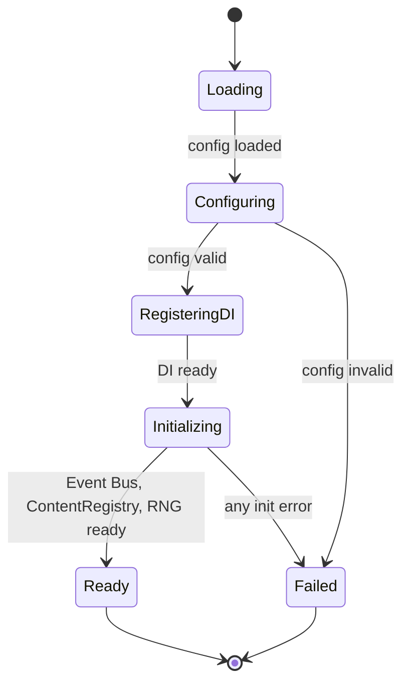
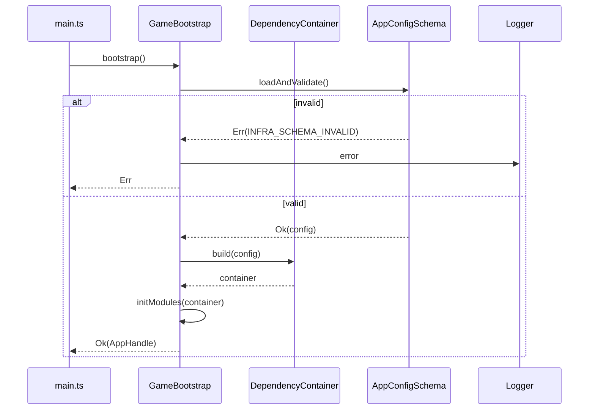

# DEV-SPEC-001 v1.0 — «Core Primitives, Result, DI & Bootstrap»

**Тип документа:** Спецификация к разработке (Development Specification)  
**Дата:** 2026-11-02  
**Статус:** ✅ реализовано в Wave 0  
**Реализация:** подтверждена 2026-11-14 — `bun run t:check` (117 тестов), `bun run ci:validate` (8/8 стадий)  
**Волна:** Wave 0  
**Зависит от:** —  
**Блокирует:** `DEV-SPEC-002…009`, все доменные `DEV-SPEC`  
**Основана на:**  
`GENERAL DESIGN v1.0 — «Наука против Магии»` (GD-01, GD-02, GD-03, GD-16, GD-17)  
**Покрываемые DESIGN-блоки:** `GD-01`, `GD-02`, `GD-03`, `GD-16`, `GD-17`  
**Связанные DESIGN-документы:** `GENERAL DESIGN v1.0`

---

## 1. Назначение и границы

### 1.1. Что спецификация делает
Фиксирует фундаментальные примитивы проекта: брендированные ID, тип `Result<T, E>`, иерархию ошибок, конфигурацию приложения, `Logger`, DI-контейнер и последовательность `Bootstrap`. Всё, что ниже, обязано использоваться всеми последующими `DEV-SPEC` без локальных вариаций.

### 1.2. Что спецификация НЕ делает
- Не описывает Event Bus (→ `DEV-SPEC-002`).
- Не описывает Content Registry (→ `DEV-SPEC-003`).
- Не описывает Mechanic Runtime (→ `DEV-SPEC-004`).
- Не описывает RNG (→ `DEV-SPEC-005`).
- Не описывает Save/Load (→ `DEV-SPEC-006`).
- Не описывает Game Clock (→ `DEV-SPEC-007`).
- Не описывает UI, сцены, рендер.

### 1.3. Связь с DESIGN

| DESIGN-блок | Как реализуется | Расхождения |
|---|---|---|
| `GD-01` | TS strict, Vite, DI через tsyringe | нет |
| `GD-02` | Луковая архитектура: domain / application / infrastructure / presentation | нет |
| `GD-03` | Структура пакетов из GD-03 | нет |
| `GD-16` | tsyringe, `@injectable` / `@inject` | нет |
| `GD-17` | `Result<T, E>` вместо исключений | нет |

---

## 2. Зависимости

### 2.1. Обязательные зависимости
Нет. Это корневая спека.

### 2.2. Мягкие зависимости
Нет.

### 2.3. Внешние контракты
Внешние библиотеки: `tsyringe`, `reflect-metadata`, `zod` (для config), `pino` (для logger).

---

## 3. Термины и сокращения

| Термин | Определение |
|---|---|
| Branded Type | TS-тип с фантомным брендом для номинальной типизации ID |
| Result | Дискриминированный union `Ok` / `Err` |
| Bootstrap | Последовательность инициализации приложения |
| DI Container | Контейнер зависимостей tsyringe |

---

## 4. Архитектурное размещение

### 4.1. Слои
`shared/` (без слоя), `bootstrap/` (композиция). `shared/` не зависит ни от одного слоя.

### 4.2. Пакеты и файлы

```text
src/
├── shared/
│   ├── types/
│   │   ├── EntityId.ts
│   │   ├── Result.ts
│   │   └── Brand.ts
│   ├── errors/
│   │   ├── AppError.ts
│   │   ├── DomainError.ts
│   │   ├── InfrastructureError.ts
│   │   └── PresentationError.ts
│   ├── logging/
│   │   ├── Logger.ts
│   │   └── PinoLogger.ts
│   ├── config/
│   │   ├── AppConfig.ts
│   │   └── AppConfigSchema.ts
│   └── utils/
│       ├── assertNever.ts
│       └── invariant.ts
├── bootstrap/
│   ├── DependencyContainer.ts
│   ├── GameBootstrap.ts
│   └── main.ts
└── content/
    └── config/
        └── app-config.json
```

### 4.3. DI-регистрация
В `DependencyContainer.ts` регистрируются:
- `Logger` — singleton.
- `AppConfig` — singleton (из JSON).
- `IEventBus` (в `DEV-SPEC-002`) — singleton.
- `SeededRngService` (в `DEV-SPEC-005`) — singleton.
- `ContentRegistry` (в `DEV-SPEC-003`) — singleton.

---

## 5. Domain-модель

### 5.1. Branded types

```ts
// shared/types/Brand.ts
declare const __brand: unique symbol;
export type Brand<T, B extends string> = T & { readonly [__brand]: B };
```

```ts
// shared/types/EntityId.ts
import type { Brand } from './Brand';

export type EntityId = string & Brand<string, 'EntityId'>;
export type PlayerId = EntityId & Brand<string, 'PlayerId'>;
export type CaptainId = EntityId & Brand<string, 'CaptainId'>;
export type ShipId = EntityId & Brand<string, 'ShipId'>;
export type CompanionId = EntityId & Brand<string, 'CompanionId'>;
export type CrewMemberId = EntityId & Brand<string, 'CrewMemberId'>;
export type CityId = EntityId & Brand<string, 'CityId'>;
export type TradeNodeId = EntityId & Brand<string, 'TradeNodeId'>;
export type FactionId = EntityId & Brand<string, 'FactionId'>;
export type CataclysmId = EntityId & Brand<string, 'CataclysmId'>;
export type QuestId = EntityId & Brand<string, 'QuestId'>;
export type DialogueId = EntityId & Brand<string, 'DialogueId'>;
export type MechanicId = EntityId & Brand<string, 'MechanicId'>;
export type EventType = string & Brand<string, 'EventType'>;

export function makeEntityId<T extends EntityId>(raw: string): T {
  if (!/^[a-z0-9][a-z0-9-]*$/.test(raw)) {
    throw new Error(`Invalid entity id: ${raw}`);
  }
  return raw as T;
}

export const asEntityId = (s: string): EntityId => s as EntityId;
```

**Инварианты:**
- `INV-01`: `makeEntityId` принимает только `kebab-case` (совпадает с `SPEC-*-051`).
- `INV-02`: `EntityId` нельзя создать без проверки через `makeEntityId` — все остальные места используют `asEntityId` только для десериализации.

### 5.2. Result

```ts
// shared/types/Result.ts
export type Result<T, E> = Ok<T> | Err<E>;

export interface Ok<T> {
  readonly kind: 'ok';
  readonly value: T;
}

export interface Err<E> {
  readonly kind: 'err';
  readonly error: E;
}

export const ok = <T>(value: T): Ok<T> => ({ kind: 'ok', value });
export const err = <E>(error: E): Err<E> => ({ kind: 'err', error });

export function isOk<T, E>(r: Result<T, E>): r is Ok<T> {
  return r.kind === 'ok';
}

export function isErr<T, E>(r: Result<T, E>): r is Err<E> {
  return r.kind === 'err';
}

export function unwrap<T, E>(r: Result<T, E>): T {
  if (isOk(r)) return r.value;
  throw new Error(`Unwrap on Err: ${JSON.stringify(r.error)}`);
}

export function mapResult<T, U, E>(
  r: Result<T, E>,
  f: (v: T) => U,
): Result<U, E> {
  return isOk(r) ? ok(f(r.value)) : r;
}

export function flatMapResult<T, U, E>(
  r: Result<T, E>,
  f: (v: T) => Result<U, E>,
): Result<U, E> {
  return isOk(r) ? f(r.value) : r;
}

export function combineResults<T, E>(results: Result<T, E>[]): Result<T[], E> {
  const out: T[] = [];
  for (const r of results) {
    if (isErr(r)) return r;
    out.push(r.value);
  }
  return ok(out);
}
```

**Инварианты:**
- `INV-03`: Use Cases и доменные сервисы возвращают `Result<T, E>`; исключения не бросаются.
- `INV-04`: `unwrap` используется только на уровне заведомо известного `Ok` (например, в тестах).

### 5.3. Ошибки

```ts
// shared/errors/AppError.ts
export interface AppErrorBase {
  readonly code: string;
  readonly message: string;
  readonly cause?: unknown;
  readonly meta?: Readonly<Record<string, unknown>>;
}

export type AppError =
  | DomainError
  | InfrastructureError
  | PresentationError;

export function makeError<E extends AppErrorBase>(e: E): E {
  return Object.freeze(e);
}
```

```ts
// shared/errors/DomainError.ts
export type DomainErrorCode =
  | 'DOMAIN_INVARIANT_VIOLATION'
  | 'DOMAIN_ENTITY_NOT_FOUND'
  | 'DOMAIN_INVALID_STATE'
  | 'DOMAIN_RULE_VIOLATION';

export interface DomainError extends AppErrorBase {
  readonly layer: 'domain';
  readonly code: DomainErrorCode;
}

export const domainError = (
  code: DomainErrorCode,
  message: string,
  meta?: Record<string, unknown>,
): DomainError => makeError({ layer: 'domain', code, message, meta });
```

```ts
// shared/errors/InfrastructureError.ts
export type InfrastructureErrorCode =
  | 'INFRA_SCHEMA_INVALID'
  | 'INFRA_STORAGE_FAILED'
  | 'INFRA_CONTENT_NOT_FOUND'
  | 'INFRA_EVENT_UNKNOWN'
  | 'INFRA_NETWORK_NOT_ALLOWED';

export interface InfrastructureError extends AppErrorBase {
  readonly layer: 'infrastructure';
  readonly code: InfrastructureErrorCode;
}

export const infrastructureError = (
  code: InfrastructureErrorCode,
  message: string,
  meta?: Record<string, unknown>,
): InfrastructureError => makeError({ layer: 'infrastructure', code, message, meta });
```

```ts
// shared/errors/PresentationError.ts
export type PresentationErrorCode =
  | 'PRES_SCENE_NOT_FOUND'
  | 'PRES_INPUT_UNSUPPORTED'
  | 'PRES_RENDER_FAILED';

export interface PresentationError extends AppErrorBase {
  readonly layer: 'presentation';
  readonly code: PresentationErrorCode;
}

export const presentationError = (
  code: PresentationErrorCode,
  message: string,
  meta?: Record<string, unknown>,
): PresentationError => makeError({ layer: 'presentation', code, message, meta });
```

### 5.4. Logger

```ts
// shared/logging/Logger.ts
export type LogLevel = 'trace' | 'debug' | 'info' | 'warn' | 'error';

export interface LogFields {
  readonly [key: string]: unknown;
}

export interface Logger {
  trace(msg: string, fields?: LogFields): void;
  debug(msg: string, fields?: LogFields): void;
  info(msg: string, fields?: LogFields): void;
  warn(msg: string, fields?: LogFields): void;
  error(msg: string, fields?: LogFields): void;
  child(bindings: LogFields): Logger;
}
```

`PinoLogger` реализует `Logger` через `pino`. В dev — `pino-pretty`. В production — JSON в консоль (никакой телеметрии, `INT-05`).

### 5.5. Config

```ts
// shared/config/AppConfig.ts
export interface AppConfig {
  readonly version: string;
  readonly environment: 'dev' | 'production';
  readonly seed: string;
  readonly qualityTier: 'low' | 'medium' | 'high';
  readonly language: 'en' | 'ru';
  readonly mobile: boolean;
  readonly debug: {
    readonly showTickCounter: boolean;
    readonly verboseEvents: boolean;
  };
}
```

Загружается из `content/config/app-config.json` и валидируется через `zod` (`AppConfigSchema`).

---

## 6. Data-контракты и схемы

### 6.1. Пакет JSON Schema
Спека не добавляет JSON Schema. Пакет — в `DEV-SPEC-003`.

### 6.2. TypeScript-типы контента
`AppConfig` (см. §5.5) — единственный контент этой спеки.

### 6.3. Runtime-состояния
Нет.

### 6.4. Связь definition ↔ instance
Не применимо.

---

## 7. Рантайм-поведение

### 7.1. State machines

Bootstrap:



### 7.2. Sequence diagrams



### 7.3. Tick-контракт
Не применимо (нет такта).

### 7.4. Порядок обработки
Bootstrap строго последовательный:
1. `loadAppConfig()` → `Result<AppConfig, InfrastructureError>`.
2. `DependencyContainer.build(config)` — регистрирует `Logger`, `AppConfig`.
3. `initFoundation()` — регистрирует `IEventBus`, `SeededRngService`, `ContentRegistry` (в порядке волн).
4. `initDomains()` — регистрирует доменные сервисы (появляются в следующих `DEV-SPEC`).
5. `initPresentation()` — создаёт `SceneManager` (в `DEV-SPEC-010`).

Порядок строгий. Если любой шаг возвращает `Err` — `bootstrap` возвращает `Err`, приложение не запускается.

### 7.5. Идемпотентность и детерминизм
- `bootstrap` не идемпотентен (создаёт runtime).
- RNG не используется в этой спеке.

---

## 8. Порты и адаптеры

### 8.1. Порты
Не применимо.

### 8.2. Адаптеры
- `PinoLogger` — production.
- `NoopLogger` — для unit-тестов.

### 8.3. Контракт ошибок
`AppConfig` ошибки → `InfrastructureError` с кодом `INFRA_SCHEMA_INVALID`. `meta` содержит `zod`-issues.

---

## 9. Интеграционные точки

### 9.1. Потребляемые события
Нет.

### 9.2. Эмитируемые события
Нет.

### 9.3. Порты других доменов
Нет.

### 9.4. Мосты
Нет.

---

## 10. Обработка ошибок

### 10.1. Result-контракт
`bootstrap(): Promise<Result<AppHandle, AppError>>`.

### 10.2. Таблица ошибок

| Код | Когда | Что видит игрок | Что логируем |
|---|---|---|---|
| `INFRA_SCHEMA_INVALID` | `app-config.json` невалиден | «Не удалось запустить игру» | issues из zod |
| `INFRA_STORAGE_FAILED` | LocalStorage недоступен | «Не удалось загрузить сохранение» | raw exception |
| `DOMAIN_INVARIANT_VIOLATION` | Нарушен инвариант | «Внутренняя ошибка» | stack + meta |

### 10.3. Восстановление
При `INFRA_SCHEMA_INVALID` — fallback на `AppConfigSchema.defaults`, с предупреждением в логе. Если defaults тоже невалидны — приложение не запускается.

---

## 11. Критерии приёмки

### `DEV-SPEC-001-R01` — EntityId валидируется при создании
**Given** строку `"industrial-steam"`  
**When** вызываю `makeEntityId`  
**Then** возвращается валидный `EntityId`

**AC:**
- `DEV-SPEC-001-AC01`: `"Industrial-Steam"` бросает ошибку.
- `DEV-SPEC-001-AC02`: `"a1-b2"` проходит.
- `DEV-SPEC-001-AC03`: `""` бросает ошибку.

### `DEV-SPEC-001-R02` — Result не бросает исключений
**Given** `Err<{code:string}>`  
**When** вызываю `mapResult`  
**Then** возвращается тот же `Err`, исключение не бросается

**AC:**
- `DEV-SPEC-001-AC04`: `mapResult(err(e), f)` возвращает `err(e)`, `f` не вызывается.
- `DEV-SPEC-001-AC05`: `flatMapResult` аналогично.

### `DEV-SPEC-001-R03` — Bootstrap детерминирован по порядку
**Given** валидный `AppConfig`  
**When** вызываю `bootstrap`  
**Then** шаги выполняются в порядке `load → build → initFoundation → initDomains → initPresentation`

**AC:**
- `DEV-SPEC-001-AC06`: mock-модули логируют вызовы, порядок совпадает.
- `DEV-SPEC-001-AC07`: при ошибке на шаге `N` шаги `>N` не вызываются.

### `DEV-SPEC-001-R04` — DI-контейнер регистрирует все foundation-сервисы
**Given** `DependencyContainer.build(config)`  
**When** резолвлю `Logger`, `AppConfig`  
**Then** получаю singleton-экземпляры

**AC:**
- `DEV-SPEC-001-AC08`: повторный resolve даёт тот же экземпляр.
- `DEV-SPEC-001-AC09`: resolve незарегистрированного типа бросает `tsyringe` error.

---

## 12. Тест-план

### 12.1. Unit-тесты
- `EntityId`: валидные и невалидные строки (10 кейсов).
- `Result`: `ok`, `err`, `map`, `flatMap`, `combine` (15 кейсов).
- `makeError`: freeze, поля сохраняются.
- `AppConfigSchema`: валидный конфиг, каждое обязательное поле, defaults.

### 12.2. Integration-тесты
- `DependencyContainer.build` + resolve всех зарегистрированных.
- `bootstrap` с валидным конфигом → `Ok(AppHandle)`.
- `bootstrap` с невалидным конфигом → `Err(INFRA_SCHEMA_INVALID)`.
- `bootstrap` с падающим `initFoundation` → `Err`, порядок вызовов сохранён.

### 12.3. Contract-тесты
- `AppConfigSchema` соответствует `app-config.json` в `content/`.

### 12.4. Determinism-тесты
- `bootstrap` дважды с одинаковым конфигом даёт идентичный `AppHandle`.

### 12.5. E2E-тесты
Не применимо (нет UI).

### 12.6. CI-проверки
- TS strict проходит.
- `app-config.json` валиден по `AppConfigSchema`.
- `Logger` не используется вне `shared/` для прямого `console.*` (lint rule).

---

## 13. Производительность

### 13.1. Бюджет
- `bootstrap` ≤ 50 мс на десктопе, ≤ 150 мс на мобильном.
- `AppConfig` ≤ 4 КБ.

### 13.2. LOD
Не применимо.

### 13.3. Профилирование
`bootstrap` логирует `t0` и `t1` на каждом шаге; агрегированный отчёт пишется один раз в `info`.

---

## 14. Миграции и совместимость

- `AppConfigSchema` версионируется через `version` в `AppConfig`.
- Миграции `AppConfig` — вне scope этой спеки.

---

## 15. Открытые вопросы

| ID | Вопрос | Блокер? | Владелец | Решение |
|---|---|---|---|---|
| `Q-01` | `pino` или `winston`? | нет | — | `pino` (меньше, быстрее) |
| `Q-02` | `zod` или `ajv` для config? | нет | — | `zod` (типы бесплатно) |

---

## 16. Что остаётся вне scope

- Event Bus (→ `DEV-SPEC-002`).
- Content Registry (→ `DEV-SPEC-003`).
- Mechanic Runtime (→ `DEV-SPEC-004`).
- RNG (→ `DEV-SPEC-005`).
- Save/Load (→ `DEV-SPEC-006`).
- Game Clock (→ `DEV-SPEC-007`).
- CI Pipeline (→ `DEV-SPEC-008`).
- Localization (→ `DEV-SPEC-009`).
- Все доменные спеки.
- UI и рендер.

---

## 17. Приложение. Трассировка на DESIGN

| DESIGN-блок | Покрывающее требование | Покрывающий AC | Покрывающий тест |
|---|---|---|---|
| `GD-01` | `DEV-SPEC-001-R01` | `DEV-SPEC-001-AC01` | `EntityId.test.ts` |
| `GD-16` | `DEV-SPEC-001-R04` | `DEV-SPEC-001-AC08` | `DependencyContainer.test.ts` |
| `GD-17` | `DEV-SPEC-001-R02` | `DEV-SPEC-001-AC04` | `Result.test.ts` |
| `GD-02` | `DEV-SPEC-001-R03` | `DEV-SPEC-001-AC06` | `GameBootstrap.test.ts` |