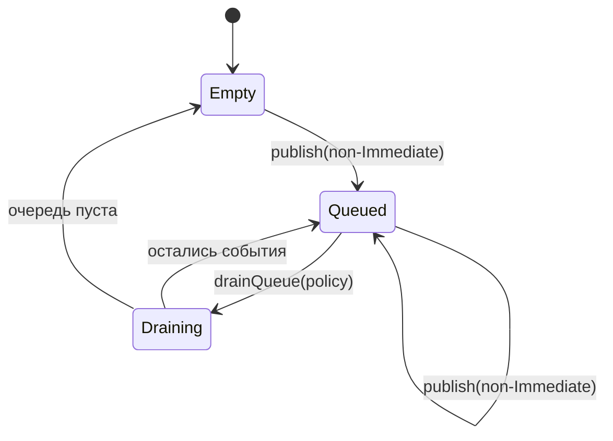
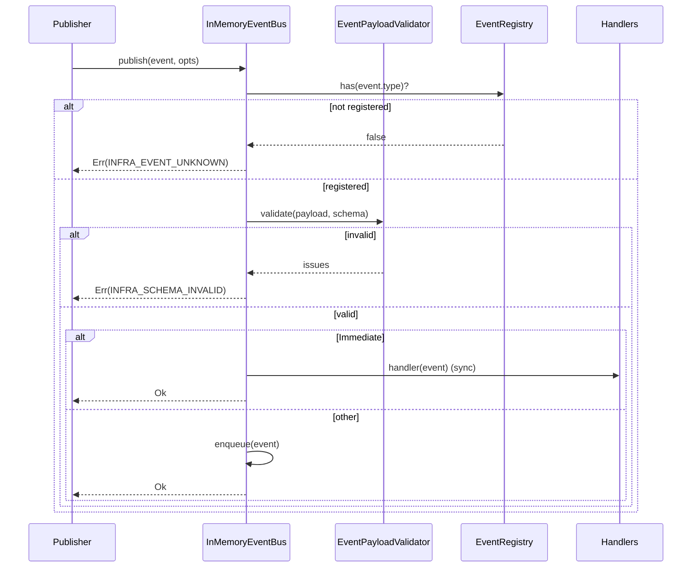

# DEV-SPEC-002 v1.0 — «Event Bus & Event Registry»

**Тип документа:** Спецификация к разработке  
**Дата:** 2026-11-02  
**Статус:** draft  
**Волна:** Wave 0  
**Зависит от:** `DEV-SPEC-001`  
**Блокирует:** `DEV-SPEC-003`, `DEV-SPEC-004`, `DEV-SPEC-006`, `DEV-SPEC-007`, все доменные `DEV-SPEC`  
**Основана на:** `GENERAL DESIGN v1.0` (GD-04, GD-05, GD-06), `DESIGN — «…»` (все разделы «Событийная модель»)  
**Покрываемые DESIGN-блоки:** `GD-04`, `GD-05.1`, `GD-06`, `SPEC-FLEET-040…042`, `SPEC-ECON-080…082`, `SPEC-CATA-050…052`, `SPEC-COMBAT-030…032`, `SPEC-PARTY-030…032`, `SPEC-COMP-030…032`, `SPEC-TRANS-030…032`, `SPEC-LORE-040…042`, `SPEC-EPI-030…032`, `SPEC-ART-040…042`  
**Связанные DESIGN-документы:** все `DESIGN v1.0`, содержащие событийную модель.

---

## 1. Назначение и границы

### 1.1. Что спецификация делает
Фиксирует единый `EventDefinition`-контракт, канонический реестр событий, `IEventBus`, семантику `DeliveryPolicy`, порядок доставки, namespace-разделение `core` / `faction_extension`, контракт payload schema и правила регистрации событий в CI.

### 1.2. Что спецификация НЕ делает
- Не описывает Content Registry (→ `DEV-SPEC-003`).
- Не описывает Mechanic Runtime (→ `DEV-SPEC-004`).
- Не описывает подписки в конкретных доменах (каждый домен — в своей `DEV-SPEC`).
- Не описывает UI-реакции на события (→ `DEV-SPEC-013`).

### 1.3. Связь с DESIGN

| DESIGN-блок | Как реализуется | Расхождения |
|---|---|---|
| `GD-04` | `IEventBus` — основа коммуникации | нет |
| `GD-05.1` | Единая очередь событий, равные права | нет |
| `GD-06` | `DeliveryPolicy` с 4 значениями | нет |
| `SPEC-FLEET-040…042` | Каноническое ядро + фракционные расширения | нет |
| `SPEC-ECON-080…085` | То же | нет |
| `SPEC-CATA-050…052` | То же | нет |
| `SPEC-COMBAT-030…032` | То же | нет |
| `SPEC-PARTY-030…032` | То же | нет |
| `SPEC-COMP-030…032` | То же | нет |
| `SPEC-TRANS-030…032` | То же | нет |
| `SPEC-LORE-040…042` | То же | нет |
| `SPEC-EPI-030…032` | То же | нет |
| `SPEC-ART-040…042` | То же | нет |

---

## 2. Зависимости

### 2.1. Обязательные
`DEV-SPEC-001` — `Result`, `EntityId`, `EventType`, `AppError`, `Logger`.

### 2.2. Мягкие
Нет.

### 2.3. Внешние контракты
`ajv` для payload schema validation (используется совместно с `DEV-SPEC-003`).

---

## 3. Термины и сокращения

| Термин | Определение |
|---|---|
| Каноническое ядро | События с `source: 'core'`, обязательные для ContentRegistry |
| Фракционное расширение | События с `source: 'faction_extension'`, в namespace фракции |
| DeliveryPolicy | Политика доставки события: `Immediate`, `NextTick`, `AfterScene`, `WarningThenImpact` |
| Payload schema | JSON Schema для `payload` события |

---

## 4. Архитектурное размещение

### 4.1. Слои
`domain/events/` (контракты), `infrastructure/events/` (реализация), `shared/events/` (типы).

### 4.2. Пакеты и файлы

```text
src/
├── shared/
│   └── events/
│       ├── EventType.ts
│       ├── DomainEvent.ts
│       └── DeliveryPolicy.ts
├── domain/
│   └── events/
│       ├── EventDefinition.ts
│       ├── IEventBus.ts
│       ├── EventRegistry.ts
│       └── catalog/
│           ├── core.ts
│           ├── faction-extensions.ts
│           └── bridges.ts
├── infrastructure/
│   └── events/
│       ├── InMemoryEventBus.ts
│       └── EventPayloadValidator.ts
└── content/
    └── events/
        ├── core.json
        └── faction-extensions.json
```

### 4.3. DI-регистрация
- `IEventBus` → `InMemoryEventBus` (singleton).
- `EventRegistry` (singleton).

---

## 5. Domain-модель

### 5.1. EventType и DeliveryPolicy

```ts
// shared/events/EventType.ts
import type { Brand } from '../types/Brand';
export type EventType = string & Brand<string, 'EventType'>;

export function makeEventType(s: string): EventType {
  if (!/^[a-z][a-z0-9-]*(\.[a-z0-9-]+)+$/.test(s)) {
    throw new Error(`Invalid event type: ${s}`);
  }
  return s as EventType;
}
```

```ts
// shared/events/DeliveryPolicy.ts
export type DeliveryPolicy =
  | 'Immediate'
  | 'NextTick'
  | 'AfterScene'
  | 'WarningThenImpact';
```

### 5.2. DomainEvent

```ts
// shared/events/DomainEvent.ts
import type { EventType } from './EventType';

export interface DomainEvent<TType extends EventType = EventType, TPayload = unknown> {
  readonly type: TType;
  readonly payload: TPayload;
  readonly emittedAtTick: number;
  readonly emittedAtMs: number;
  readonly source: 'core' | 'faction_extension' | 'mechanic';
  readonly correlationId?: string;
}
```

### 5.3. EventDefinition

```ts
// domain/events/EventDefinition.ts
import type { EventType } from '../../shared/events/EventType';
import type { DeliveryPolicy } from '../../shared/events/DeliveryPolicy';

export interface EventDefinition {
  readonly id: EventType;
  readonly namespace: string;
  readonly source: 'core' | 'faction_extension';
  readonly descriptionKey: string;
  readonly payloadSchema: unknown;
  readonly tags: readonly string[];
  readonly defaultDeliveryPolicy: DeliveryPolicy;
  readonly ownerSpec: string;
}
```

**Инварианты:**
- `INV-01`: `id` уникален в реестре.
- `INV-02`: `id` не может совпадать у `core` и `faction_extension`.
- `INV-03`: `payloadSchema` обязателен, даже если `{ type: 'object' }`.
- `INV-04`: `ownerSpec` указывает на `DEV-SPEC`, владеющую событием.

### 5.4. EventRegistry

```ts
// domain/events/EventRegistry.ts
import type { EventDefinition } from './EventDefinition';
import type { EventType } from '../../shared/events/EventType';

export interface EventRegistry {
  register(def: EventDefinition): void;
  has(type: EventType): boolean;
  get(type: EventType): EventDefinition;
  list(): readonly EventDefinition[];
  listByOwner(ownerSpec: string): readonly EventDefinition[];
}
```

### 5.5. IEventBus

```ts
// domain/events/IEventBus.ts
import type { DomainEvent } from '../../shared/events/DomainEvent';
import type { EventType } from '../../shared/events/EventType';
import type { DeliveryPolicy } from '../../shared/events/DeliveryPolicy';
import type { Result } from '../../shared/types/Result';
import type { InfrastructureError } from '../../shared/errors/InfrastructureError';

export type EventHandler<T extends DomainEvent = DomainEvent> =
  (event: T) => void;

export interface SubscribeOptions {
  readonly priority?: number;
  readonly once?: boolean;
}

export interface PublishOptions {
  readonly deliveryPolicy?: DeliveryPolicy;
  readonly correlationId?: string;
}

export interface IEventBus {
  publish<T extends DomainEvent>(
    event: T,
    options?: PublishOptions,
  ): Result<void, InfrastructureError>;

  subscribe<T extends DomainEvent>(
    type: EventType,
    handler: EventHandler<T>,
    options?: SubscribeOptions,
  ): () => void;

  drainQueue(policy: DeliveryPolicy): readonly DomainEvent[];

  peekQueue(): readonly DomainEvent[];
}
```

**Инварианты:**
- `INV-05`: `publish` валидирует payload по `payloadSchema`; при нарушении возвращает `Err(INFRA_SCHEMA_INVALID)`.
- `INV-06`: `publish` при `Immediate` вызывает хендлеры синхронно.
- `INV-07`: При `NextTick`, `AfterScene`, `WarningThenImpact` событие кладётся в очередь, вызов — при `drainQueue`.
- `INV-08`: Хендлеры вызываются в порядке `priority` (по убыванию), tie-breaker — порядок подписки.
- `INV-09`: Исключение в хендлере не ломает остальные хендлеры; логируется через `Logger`.

---

## 6. Data-контракты и схемы

### 6.1. Пакет JSON Schema
Эта спека добавляет в пакет `DEV-SPEC-003` схему:

```json
{
  "$id": "https://game/schemas/event-definition.json",
  "type": "object",
  "required": ["id", "namespace", "source", "descriptionKey", "payloadSchema", "tags", "defaultDeliveryPolicy", "ownerSpec"],
  "properties": {
    "id": { "type": "string", "pattern": "^[a-z][a-z0-9-]*(\\.[a-z0-9-]+)+$" },
    "namespace": { "type": "string" },
    "source": { "enum": ["core", "faction_extension"] },
    "descriptionKey": { "type": "string" },
    "payloadSchema": { "type": "object" },
    "tags": { "type": "array", "items": { "type": "string" }, "minItems": 1 },
    "defaultDeliveryPolicy": { "enum": ["Immediate", "NextTick", "AfterScene", "WarningThenImpact"] },
    "ownerSpec": { "type": "string", "pattern": "^DEV-SPEC-[0-9]{3}$" }
  },
  "additionalProperties": false
}
```

### 6.2. TypeScript-типы контента
`EventDefinition` (см. §5.3).

### 6.3. Runtime-состояния
Не применимо.

### 6.4. Связь definition ↔ instance
`EventDefinition` — контент. `DomainEvent` — runtime-экземпляр. Связь: `event.type` → `definition.id`.

---

## 7. Рантайм-поведение

### 7.1. State machines

Очередь:



### 7.2. Sequence diagrams



### 7.3. Tick-контракт
`drainQueue` вызывается из `DEV-SPEC-007` (Game Clock) в порядке:
1. `WarningThenImpact` — фаза warning.
2. `NextTick` — фаза tick.
3. `AfterScene` — фаза scene-end (вызывается из SceneManager, `DEV-SPEC-010`).
4. `Immediate` — не в очереди.

### 7.4. Порядок обработки
Внутри `drainQueue(policy)`:
1. Отсортировать по `emittedAtMs`, затем по `priority`.
2. Вызвать хендлеры по `priority` убыванию.
3. При исключении — лог `error`, продолжить.

### 7.5. Идемпотентность и детерминизм
- `drainQueue` не идемпотентен (опустошает очередь).
- `Immediate` синхронен, порядок — порядок вызова `publish`.
- RNG не используется.

---

## 8. Порты и адаптеры

### 8.1. Порты
`IEventBus` (см. §5.5).

### 8.2. Адаптеры
- `InMemoryEventBus` — production и dev.
- `RecordingEventBus` — для тестов (сохраняет все события).

### 8.3. Контракт ошибок
`publish` возвращает `InfrastructureError` с кодом `INFRA_EVENT_UNKNOWN` или `INFRA_SCHEMA_INVALID`. `meta` содержит `eventType` и `issues`.

---

## 9. Интеграционные точки

### 9.1. Потребляемые события
Нет.

### 9.2. Эмитируемые события
Все события, зарегистрированные в реестре.

### 9.3. Порты других доменов
Нет.

### 9.4. Мосты
Спека фиксирует **формат** мостов, но не их содержимое. Содержимое мостов — в `catalog/bridges.ts` и обновляется каждой доменной `DEV-SPEC`.

Начальный каталог ядра (полный список в `content/events/core.json`), минимум:

- `world.tick_advanced`
- `combat.started`, `combat.ended`, `combat.tick_advanced`
- `combat.duel_action_executed`, `combat.duel_damage_dealt`, `combat.duel_stamina_changed`
- `combat.duel_captain_wounded`, `combat.duel_captain_defeated`
- `combat.party_tick_advanced`, `combat.party_action_executed`, `combat.party_damage_dealt`
- `combat.party_morale_changed`, `combat.crew_casualty_occurred`, `combat.crew_wounded`, `combat.crew_traumatized`, `combat.crew_died`
- `combat.transition_to_boarding`, `combat.transition_to_duel`, `combat.resolution_triggered`
- `combat.rout_occurred`, `combat.surrender_occurred`, `combat.negotiation_started`
- `ship.maneuver_executed`, `ship.position_changed`, `ship.damaged`, `ship.destroyed`, `ship.repaired`
- `ship.module_state_changed`, `ship.resource_changed`, `ship.mechanic_activated`, `ship.mechanic_deactivated`
- `ship.facet_state_changed`, `ship.acquired`, `ship.lost`, `ship.refit_completed`, `ship.primary_slot_changed`
- `counterplay.applied`
- `captain.status_changed`, `captain.reputation_changed`, `captain.oath_state_changed`
- `crew.morale_changed`, `crew.casualty_occurred`
- `world.event_occurred`, `world.faction_relation_changed`
- `economy.port_service_available`
- `narrative.memory_signal_emitted`
- `economy.tick_advanced`, `economy.good_produced`, `economy.good_consumed`, `economy.trade_executed`, `economy.price_changed`, `economy.inventory_changed`
- `economy.chain_started`, `economy.chain_completed`, `economy.chain_disrupted`
- `economy.quest_generated`, `economy.quest_accepted`, `economy.quest_completed`, `economy.quest_failed`
- `economy.investment_started`, `economy.investment_completed`, `economy.investment_disrupted`
- `economy.agent_dispatched`, `economy.agent_arrived`, `economy.agent_lost`
- `economy.scar_applied`, `economy.scar_removed`, `economy.legality_changed`, `economy.wanted_level_changed`
- `economy.epoch_balance_shifted`, `economy.blockade_applied`, `economy.blockade_lifted`
- `cataclysm.triggered`, `cataclysm.stage_changed`, `cataclysm.escalated`, `cataclysm.effect_applied`, `cataclysm.ended`
- `cataclysm.scar_applied`, `cataclysm.scar_removed`, `cataclysm.political_impact_applied`
- `cataclysm.player_intervention_attempted`, `cataclysm.faction_interaction_applied`
- `cataclysm.hidden_branch_opened`, `cataclysm.player_transformed`
- `party.companion_recruited`, `party.companion_dismissed`, `party.companion_died`, `party.companion_wounded`, `party.companion_traumatized`
- `party.companion_equipment_changed`, `party.companion_skill_improved`, `party.companion_relationship_changed`, `party.companion_mood_changed`
- `party.companion_scar_applied`, `party.companion_scar_removed`
- `party.morale_changed`, `party.salary_paid`, `party.salary_overdue`, `party.reaction_triggered`, `party.personal_arc_advanced`
- `companion.acquisition_hook_triggered`, `companion.acquisition_hook_completed`, `companion.acquisition_hook_failed`
- `companion.relationship_threshold_crossed`
- `companion.synergy_activated`, `companion.synergy_deactivated`, `companion.conflict_activated`, `companion.conflict_deactivated`
- `companion.quarrel_occurred`, `companion.reaction_triggered_daily`, `companion.reaction_triggered_macro`, `companion.reaction_triggered_player_action`
- `companion.disobeyed_order`, `companion.sabotage_attempted`, `companion.betrayal_triggered`
- `companion.legacy_enemy_spawned`, `companion.legacy_transform_unlocked`
- `hidden_branch.trigger_evaluated`, `hidden_branch.activated`, `hidden_branch.state_transitioned`
- `hidden_branch.node_activated`, `hidden_branch.node_deactivated`, `hidden_branch.combination_formed`
- `hidden_branch.final_state_reached`, `hidden_branch.meta_epilogue_unlocked`, `hidden_branch.symptom_triggered`
- `narrative.story_beacon_activated`, `narrative.story_beacon_completed`, `narrative.arc_activated`, `narrative.arc_completed`
- `narrative.faction_arc_activated`, `narrative.faction_arc_completed`
- `narrative.dialogue_started`, `narrative.dialogue_choice_made`, `narrative.dialogue_ended`
- `narrative.npc_state_changed`, `narrative.npc_died`, `narrative.lore_layer_revealed`, `narrative.lore_fragment_discovered`
- `narrative.prologue_completed`, `narrative.ending_reached`
- `epilogue.generation_started`, `epilogue.facts_collected`, `epilogue.facts_filtered`, `epilogue.facts_sorted`
- `epilogue.narrative_threads_formed`, `epilogue.text_composed`, `epilogue.scenes_generated`
- `epilogue.final_choice_presented`, `epilogue.final_choice_made`, `epilogue.meta_threat_generated`, `epilogue.generation_completed`
- `epilogue.fact_published`
- `visual.quality_tier_changed`, `visual.material_parameter_changed`, `visual.shader_uniform_updated`
- `visual.post_process_profile_activated`, `visual.post_process_profile_deactivated`
- `visual.local_override_activated`, `visual.local_override_deactivated`, `visual.override_intensity_changed`
- `visual.transition_started`, `visual.transition_completed`
- `visual.vfx_system_spawned`, `visual.vfx_system_destroyed`
- `visual.faction_visual_dominance_changed`, `visual.cataclysm_visual_manifested`, `visual.narrative_visual_cue_triggered`
- `visual.fact_recorded`
- `shader.graph_switched`, `shader.technique_activated`

Полный список — в `content/events/core.json`, обновляется по мере готовности доменных `DEV-SPEC`. CI проверяет, что все события из DESIGN-документов присутствуют.

---

## 10. Обработка ошибок

### 10.1. Result-контракт
`publish` → `Result<void, InfrastructureError>`.

### 10.2. Таблица ошибок

| Код | Когда | Что видит игрок | Что логируем |
|---|---|---|---|
| `INFRA_EVENT_UNKNOWN` | `publish` для незарегистрированного типа | «Внутренняя ошибка» | `eventType` |
| `INFRA_SCHEMA_INVALID` | payload не проходит схему | «Внутренняя ошибка» | `eventType`, `issues` |

### 10.3. Восстановление
- `INFRA_EVENT_UNKNOWN` в dev — падение; в production — `error` в лог, событие отбрасывается.
- `INFRA_SCHEMA_INVALID` — всегда отбрасывается, `error` в лог.

---

## 11. Критерии приёмки

### `DEV-SPEC-002-R01` — Реестр обязателен
**Given** `publish({type: 'unknown.event'})`  
**When** событие не зарегистрировано  
**Then** `Err(INFRA_EVENT_UNKNOWN)`

**AC:**
- `DEV-SPEC-002-AC01`: зарегистрированное событие → `Ok`.
- `DEV-SPEC-002-AC02`: незарегистрированное → `Err`.

### `DEV-SPEC-002-R02` — Payload валидируется
**Given** событие с `payloadSchema: { type: 'object', required: ['x'] }`  
**When** `publish({type, payload: {}})`  
**Then** `Err(INFRA_SCHEMA_INVALID)`, `meta.issues` содержит `x`

**AC:**
- `DEV-SPEC-002-AC03`: валидный payload → `Ok`.
- `DEV-SPEC-002-AC04`: невалидный → `Err` с issues.

### `DEV-SPEC-002-R03` — DeliveryPolicy
**Given** `publish(event, {deliveryPolicy: 'NextTick'})`  
**When** вызов завершён  
**Then** событие в очереди, хендлеры не вызваны

**AC:**
- `DEV-SPEC-002-AC05`: `Immediate` — хендлеры вызваны синхронно.
- `DEV-SPEC-002-AC06`: `NextTick` — только после `drainQueue('NextTick')`.
- `DEV-SPEC-002-AC07`: `drainQueue` возвращает события и очищает очередь.

### `DEV-SPEC-002-R04` — Порядок хендлеров
**Given** два хендлера с `priority: 10` и `priority: 5`  
**When** `Immediate` публикация  
**Then** хендлер `priority: 10` вызван первым

**AC:**
- `DEV-SPEC-002-AC08`: при равных `priority` — порядок подписки.
- `DEV-SPEC-002-AC09`: исключение в первом хендлере не мешает второму (оба вызваны, ошибка залогирована).

### `DEV-SPEC-002-R05` — Namespace
**Given** `faction_extension` событие `industrial-steam.boiler.stress_changed`  
**When** регистрируется  
**Then** `id` не конфликтует с `core`

**AC:**
- `DEV-SPEC-002-AC10`: дубль `id` → ошибка регистрации.
- `DEV-SPEC-002-AC11`: `industrial-steam.*` не может быть `core`.

---

## 12. Тест-план

### 12.1. Unit
- `makeEventType`: валидные/невалидные (10).
- `InMemoryEventBus.publish`: unknown, invalid payload, valid, Immediate.
- `subscribe` / unsubscribe.
- `drainQueue`: порядок, очистка.
- Порядок хендлеров по `priority`.

### 12.2. Integration
- `EventRegistry` + `InMemoryEventBus` + `EventPayloadValidator`.
- Мост: `cataclysm.triggered` → `visual.cataclysm_visual_manifested` (заглушки хендлеров).

### 12.3. Contract
- Все события из `content/events/core.json` проходят `EventDefinition` schema.
- Все `payloadSchema` — валидные JSON Schema.
- Нет дублей `id`.
- Каждое событие из DESIGN присутствует (по списку в §9.4).

### 12.4. Determinism
- `publish` + `drainQueue` в одном seed даёт одинаковый порядок.

### 12.5. E2E
Не применимо.

### 12.6. CI
- `content/events/*.json` валидны.
- Все `ownerSpec` указывают на существующий `DEV-SPEC`.
- События из DESIGN покрыты (по чек-листу).

---

## 13. Производительность

### 13.1. Бюджет
- `publish(Immediate)` ≤ 0.1 мс на 10 хендлеров.
- `drainQueue` ≤ 1 мс на 100 событий.
- Память очереди ≤ 1 МБ.

### 13.2. LOD
Не применимо.

### 13.3. Профилирование
Метрики: `publish` count, `drainQueue` time, handler failures. Логируются в `debug`.

---

## 14. Миграции
Payload schema версионируется через `version` в `EventDefinition` (поле добавляется при необходимости). Миграции — вне scope.

---

## 15. Открытые вопросы

| ID | Вопрос | Блокер? | Решение |
|---|---|---|---|
| `Q-01` | Формат `correlationId` | нет | `ulid` |
| `Q-02` | Лимит очереди | нет | 10000, при переполнении — drop с логом |

---

## 16. Что остаётся вне scope
- Конкретные хендлеры доменов.
- Механизмы `MechanicDefinition` (→ `DEV-SPEC-004`).
- Мосты с конкретной семантикой (→ доменные `DEV-SPEC`).
- UI-реакции на события (→ `DEV-SPEC-013`).

---

## 17. Трассировка на DESIGN

| DESIGN-блок | Требование | AC | Тест |
|---|---|---|---|
| `GD-04` | `DEV-SPEC-002-R01` | `DEV-SPEC-002-AC01` | `InMemoryEventBus.test.ts` |
| `GD-06` | `DEV-SPEC-002-R03` | `DEV-SPEC-002-AC05` | `DeliveryPolicy.test.ts` |
| `SPEC-FLEET-042` | `DEV-SPEC-002-R05` | `DEV-SPEC-002-AC10` | `EventRegistry.test.ts` |
| `SPEC-ECON-082` | `DEV-SPEC-002-R05` | `DEV-SPEC-002-AC11` | `EventRegistry.test.ts` |