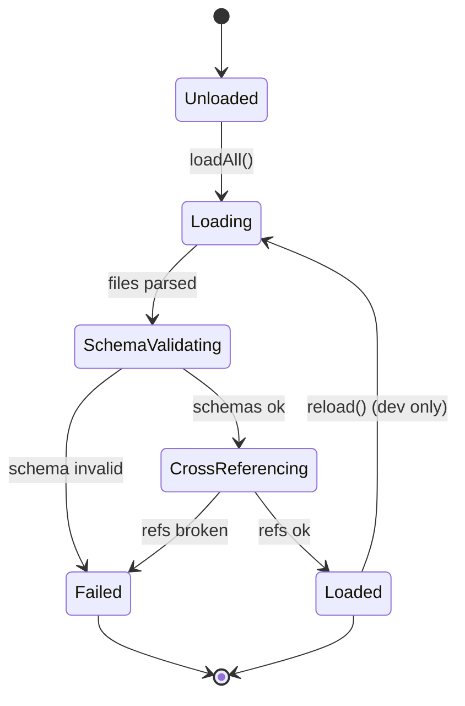
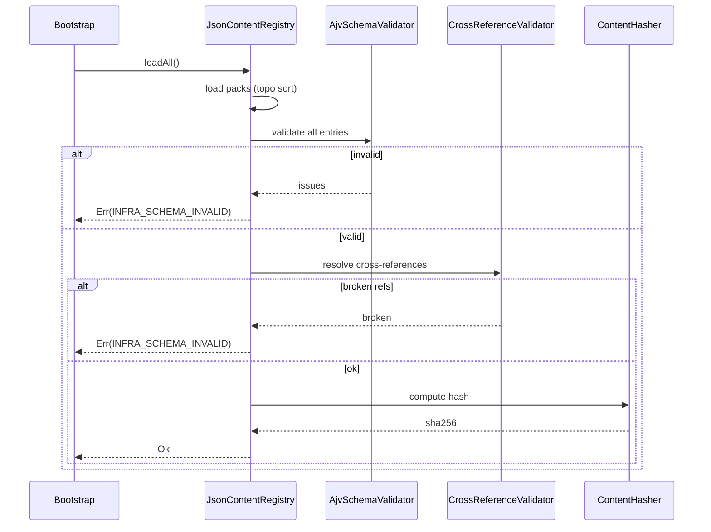

# DEV-SPEC-003 v1.0 — «Content Registry & JSON Schema Package»

**Тип документа:** Спецификация к разработке  
**Дата:** 2026-11-02  
**Статус:** ✅ реализовано в Wave 0  
**Реализация:** подтверждена 2026-11-14 — `bun run t:check` (117 тестов), `bun run ci:validate` (8/8 стадий)  
**Волна:** Wave 0  
**Зависит от:** `DEV-SPEC-001`, `DEV-SPEC-002`  
**Блокирует:** `DEV-SPEC-004`, `DEV-SPEC-006`, `DEV-SPEC-008`, все доменные `DEV-SPEC`  
**Основана на:** `GENERAL DESIGN v1.0` (GD-07, GD-08)  
**Покрываемые DESIGN-блоки:** `GD-07`, `GD-08`, все разделы «Data-контракты» и «Валидация и CI» из `DESIGN v1.0`  
**Связанные DESIGN-документы:** все `DESIGN v1.0`.

---

## 1. Назначение и границы

### 1.1. Что спецификация делает
Фиксирует `ContentRegistry` как единый загрузчик, валидатор и резолвер контента по ID. Определяет пакет JSON Schema, версионирование, content packs, порядок загрузки, кросс-валидацию ссылок между сущностями и правила hot reload (только dev).

### 1.2. Что спецификация НЕ делает
- Не описывает `MechanicRuntime` (→ `DEV-SPEC-004`).
- Не описывает доменные правила валидации (gameplay lint) — каждый домен даёт свои правила, а CI-обвязка — в `DEV-SPEC-008`.
- Не описывает рендер контента.
- Не описывает конкретные content packs (они — данные, не спека).

### 1.3. Связь с DESIGN

| DESIGN-блок | Реализация | Расхождения |
|---|---|---|
| `GD-07` | ContentRegistry, data-driven | нет |
| `GD-08` | Пакет JSON Schema в этой спеке | нет |
| Все «Data-контракты» | Schemas в пакете | нет |

---

## 2. Зависимости

### 2.1. Обязательные
`DEV-SPEC-001`, `DEV-SPEC-002`.

### 2.2. Мягкие
Нет.

### 2.3. Внешние контракты
`ajv` (валидация), `ajv-formats`.

---

## 3. Термины

| Термин | Определение |
|---|---|
| Content Pack | Набор JSON-файлов одной предметной области |
| Schema Package | Набор JSON Schema для всех Definition |
| Cross-reference | Ссылка одной сущности на другую по ID |
| Content Hash | Детерминированный хеш контента для совместимости save |

---

## 4. Архитектурное размещение

### 4.1. Слои
`domain/content/` (интерфейсы), `infrastructure/content/` (реализация).

### 4.2. Файлы

```text
src/
├── domain/
│   └── content/
│       ├── IContentRegistry.ts
│       ├── ContentKind.ts
│       └── ContentPack.ts
├── infrastructure/
│   └── content/
│       ├── JsonContentRegistry.ts
│       ├── AjvSchemaValidator.ts
│       ├── CrossReferenceValidator.ts
│       └── ContentHasher.ts
├── content/
│   ├── schemas/
│   │   ├── index.ts
│   │   └── package.json
│   ├── factions/
│   ├── ships/
│   ├── companions/
│   ├── quests/
│   ├── cataclysms/
│   ├── events/
│   ├── economy/
│   ├── narrative/
│   ├── epilogue/
│   └── art/
```

### 4.3. DI
- `IContentRegistry` → `JsonContentRegistry` (singleton).

---

## 5. Domain-модель

### 5.1. ContentKind

```ts
// domain/content/ContentKind.ts
export type ContentKind =
  | 'event'
  | 'mechanic'
  | 'faction'
  | 'doctrine'
  | 'shipBranch'
  | 'ship'
  | 'good'
  | 'recipe'
  | 'productionChain'
  | 'tradeNode'
  | 'tradeRoute'
  | 'market'
  | 'guild'
  | 'guildChapter'
  | 'guildQuestTemplate'
  | 'investmentProject'
  | 'enterprise'
  | 'nodeScar'
  | 'economyDoctrine'
  | 'tradeAgent'
  | 'legality'
  | 'contract'
  | 'priceModifier'
  | 'cataclysm'
  | 'cataclysmDoctrine'
  | 'cataclysmQuestTemplate'
  | 'companion'
  | 'equipment'
  | 'relationshipThresholds'
  | 'companionSynergy'
  | 'permadeathLegacy'
  | 'acquisitionHook'
  | 'reactionGranularity'
  | 'combat'
  | 'duelDoctrine'
  | 'crewMember'
  | 'captain'
  | 'transformationBranch'
  | 'transformationNode'
  | 'transformationTree'
  | 'transformationTrigger'
  | 'background'
  | 'storyBeacon'
  | 'narrativeArc'
  | 'factionNarrativeArc'
  | 'loreLayer'
  | 'keyNpc'
  | 'dialogue'
  | 'prologue'
  | 'ending'
  | 'loreRevelationLayer'
  | 'epilogueFact'
  | 'epilogueTemplate'
  | 'narrativeStyle'
  | 'epilogueScene'
  | 'finalChoice'
  | 'metaThreat'
  | 'stylizationProfile'
  | 'shaderQualityTier'
  | 'factionVisualDoctrine'
  | 'material'
  | 'shaderGraph'
  | 'globalPostProcessProfile'
  | 'localShaderOverride'
  | 'shaderTransitionPolicy'
  | 'vfxSystem';
```

### 5.2. ContentPack

```ts
// domain/content/ContentPack.ts
import type { ContentKind } from './ContentKind';

export interface ContentPack {
  readonly id: string;
  readonly version: string;
  readonly kinds: readonly ContentKind[];
  readonly files: readonly string[];
  readonly dependencies: readonly string[];
}
```

### 5.3. IContentRegistry

```ts
// domain/content/IContentRegistry.ts
import type { ContentKind } from './ContentKind';
import type { Result } from '../../shared/types/Result';
import type { InfrastructureError } from '../../shared/errors/InfrastructureError';

export interface ContentEntry<T = unknown> {
  readonly kind: ContentKind;
  readonly id: string;
  readonly value: T;
  readonly sourcePack: string;
}

export interface IContentRegistry {
  loadAll(): Promise<Result<void, InfrastructureError>>;

  get<T>(kind: ContentKind, id: string): Result<T, InfrastructureError>;

  list<T>(kind: ContentKind): readonly ContentEntry<T>[];

  has(kind: ContentKind, id: string): boolean;

  contentHash(): string;

  reload(): Promise<Result<void, InfrastructureError>>;
}
```

**Инварианты:**
- `INV-01`: `loadAll` загружает все packs в порядке топологической сортировки по `dependencies`.
- `INV-02`: Каждый `id` уникален в пределах `kind`; при дубле — `Err(INFRA_SCHEMA_INVALID)`.
- `INV-03`: Все `cross-reference` разрешаются после загрузки всех packs; неразрешённая ссылка → `Err`.
- `INV-04`: `contentHash` — SHA-256 от детерминированно отсортированного канонического JSON всех сущностей.
- `INV-05`: `reload` доступен только в `environment: 'dev'`.

---

## 6. Data-контракты и схемы

### 6.1. Пакет JSON Schema
Пакет лежит в `content/schemas/`. Каждая схема — отдельный файл. `index.ts` собирает их в `Record<string, JSONSchema>`.

Обязательные схемы (по `ContentKind`):

Полный список — 64 схемы (по числу `ContentKind`). Каждая реализует правила из соответствующего `DESIGN`-блока.

Пример `event-definition.json` — уже в `DEV-SPEC-002`.

Пример `companion-definition.json` — должен включать все поля из `SPEC-PARTY-021` + `SPEC-COMP-021`.

**Правило:** если `DESIGN` описывает поле — оно обязано быть в схеме; если схема не описана — `DEV-SPEC-008` не пропускает merge.

### 6.2. TypeScript-типы контента
Для каждого `ContentKind` — `TS`-интерфейс в `content/types/<kind>.ts`. Генерируется из схемы вручную (по мере готовности) или через `json-schema-to-typescript` (опционально, но контракт — ручной).

### 6.3. Runtime-состояния
Не применимо (registry — контент, не runtime).

### 6.4. Связь definition ↔ instance
`ContentEntry<T>` — обёртка. Runtime-экземпляры (`Ship`, `Companion`, `CataclysmInstance` и т.п.) создаются в доменных `DEV-SPEC` на основе `ContentEntry<T>.value`.

---

## 7. Рантайм-поведение

### 7.1. State machines



### 7.2. Sequence



### 7.3. Tick-контракт
Не применимо. Content Registry не участвует в такте.

### 7.4. Порядок
1. Парсинг всех файлов packs.
2. Валидация каждого по схеме.
3. Разрешение cross-references.
4. Вычисление `contentHash`.
5. Регистрация `EventDefinition` в `EventRegistry` (из `DEV-SPEC-002`).

### 7.5. Идемпотентность и детерминизм
- `contentHash` детерминирован.
- Порядок загрузки packs детерминирован топологической сортировкой.
- Hot reload не детерминирован (dev only).

---

## 8. Порты и адаптеры

### 8.1. Порты
`IContentRegistry` (см. §5.3).

### 8.2. Адаптеры
- `JsonContentRegistry` — production.
- `InMemoryContentRegistry` — тесты.

### 8.3. Ошибки
`InfrastructureError` коды:
- `INFRA_SCHEMA_INVALID` — schema mismatch, duplicate id, broken ref.
- `INFRA_CONTENT_NOT_FOUND` — `get` для отсутствующего id.

---

## 9. Интеграционные точки

### 9.1. Потребляемые события
Нет.

### 9.2. Эмитируемые события
Нет (content — статика).

### 9.3. Порты других доменов
Регистрирует `EventDefinition` в `EventRegistry` из `DEV-SPEC-002`.

### 9.4. Мосты
Не применимо.

---

## 10. Обработка ошибок

### 10.1. Result
Все методы → `Result<T, InfrastructureError>`.

### 10.2. Таблица

| Код | Когда | Лог |
|---|---|---|
| `INFRA_SCHEMA_INVALID` | schema / duplicate / broken ref | issues |
| `INFRA_CONTENT_NOT_FOUND` | get missing id | kind + id |

### 10.3. Восстановление
- При `INFRA_SCHEMA_INVALID` в dev — падение.
- В production — падение (контент критичен). Fallback не предусмотрен: невалидный контент = не запускаемся.

---

## 11. Критерии приёмки

### `DEV-SPEC-003-R01` — Валидация схем
**Given** pack с невалидным `CompanionDefinition`  
**When** `loadAll`  
**Then** `Err(INFRA_SCHEMA_INVALID)`, `meta.issues` содержит путь

**AC:**
- `DEV-SPEC-003-AC01`: валидный pack → `Ok`.
- `DEV-SPEC-003-AC02`: отсутствует обязательное поле → `Err`.
- `DEV-SPEC-003-AC03`: неверный enum → `Err`.

### `DEV-SPEC-003-R02` — Дубликаты
**Given** два `CompanionDefinition` с одинаковым `id`  
**When** `loadAll`  
**Then** `Err(INFRA_SCHEMA_INVALID)`

**AC:**
- `DEV-SPEC-003-AC04`: `meta.issues` содержит kind и id.
- `DEV-SPEC-003-AC05`: дубликат между packs тоже ловится.

### `DEV-SPEC-003-R03` — Cross-references
**Given** `MaterialDefinition.shader_graph_id` ссылается на несуществующий граф  
**When** `loadAll`  
**Then** `Err(INFRA_SCHEMA_INVALID)`

**AC:**
- `DEV-SPEC-003-AC06`: `material → shaderGraph` broken ref → `Err`.
- `DEV-SPEC-003-AC07`: `cataclysm → nodeScar` broken ref → `Err`.
- `DEV-SPEC-003-AC08`: валидные refs → `Ok`.

### `DEV-SPEC-003-R04` — Content Hash
**Given** два запуска с одинаковым контентом  
**When** `contentHash()`  
**Then** хеши идентичны

**AC:**
- `DEV-SPEC-003-AC09`: изменение любого поля меняет хеш.
- `DEV-SPEC-003-AC10`: порядок файлов в ФС не влияет на хеш.

### `DEV-SPEC-003-R05` — Hot reload только в dev
**Given** `environment: 'production'`  
**When** `reload()`  
**Then** `Err`

**AC:**
- `DEV-SPEC-003-AC11`: dev → `Ok`, контент обновлён.

---

## 12. Тест-план

### 12.1. Unit
- `JsonContentRegistry.loadAll` — валидный/невалидный.
- `AjvSchemaValidator` — каждая схема на минимальном валидном примере.
- `CrossReferenceValidator` — 10 типов ссылок.
- `ContentHasher` — детерминизм.

### 12.2. Integration
- Загрузка всех packs из `content/` → `Ok`.
- `EventRegistry` получает все `EventDefinition` из packs.

### 12.3. Contract
- Каждая сущность из DESIGN имеет схему.
- Минимальные валидные примеры проходят.
- Content hash совпадает при повторной загрузке.

### 12.4. Determinism
- `loadAll` дважды → одинаковый `contentHash`.
- `loadAll` в разном порядке файлов → одинаковый `contentHash`.

### 12.5. E2E
Не применимо.

### 12.6. CI
- Все схемы валидны как JSON Schema.
- Все packs проходят `loadAll`.
- `contentHash` записывается в build artifact.

---

## 13. Производительность

### 13.1. Бюджет
- `loadAll` ≤ 500 мс на десктопе, ≤ 1500 мс на мобильном.
- Память контента ≤ 20 МБ.

### 13.2. LOD
Не применимо.

### 13.3. Профилирование
Логируется время на каждый pack, общее время, размер.

---

## 14. Миграции
- `contentHash` пишется в save. При несовпадении при загрузке — save несовместим.
- Миграции схем — вне scope, отмечены как открытый вопрос.

---

## 15. Открытые вопросы

| ID | Вопрос | Блокер? | Решение |
|---|---|---|---|
| `Q-01` | Генерация TS-типов из схем | нет | ручная на первой волне |
| `Q-02` | Lazy loading packs | нет | нет на первой волне |
| `Q-03` | Миграции схем | да, но не для Wave 0 | отдельная спека позже |

---

## 16. Что остаётся вне scope
- Конкретные content packs (это данные).
- Gameplay lint (→ `DEV-SPEC-008`).
- MechanicRuntime (→ `DEV-SPEC-004`).
- Save/Load (→ `DEV-SPEC-006`).
- Миграции схем.

---

## 17. Трассировка на DESIGN

| DESIGN-блок | Требование | AC | Тест |
|---|---|---|---|
| `GD-07` | `DEV-SPEC-003-R01` | `DEV-SPEC-003-AC01` | `JsonContentRegistry.test.ts` |
| `GD-08` | `DEV-SPEC-003-R01` | `DEV-SPEC-003-AC02` | `AjvSchemaValidator.test.ts` |
| все «Data-контракты» | `DEV-SPEC-003-R03` | `DEV-SPEC-003-AC06` | `CrossReferenceValidator.test.ts` |