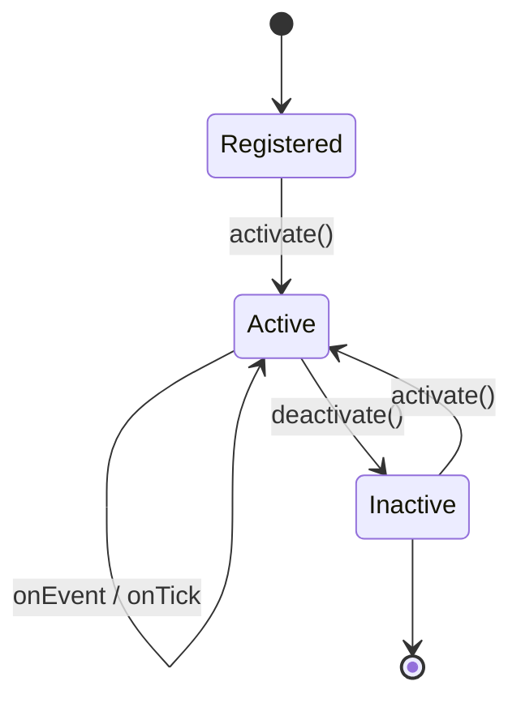
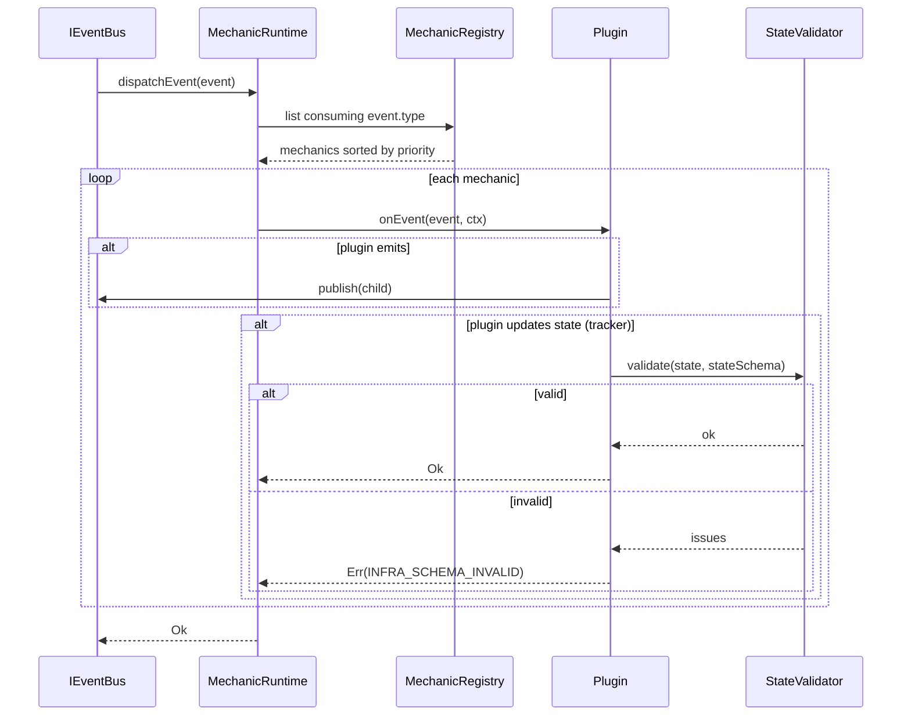

# DEV-SPEC-004 v1.0 — «Mechanic Runtime»

**Тип документа:** Спецификация к разработке  
**Дата:** 2026-11-02  
**Статус:** draft  
**Волна:** Wave 0  
**Зависит от:** `DEV-SPEC-001`, `DEV-SPEC-002`, `DEV-SPEC-003`  
**Блокирует:** все доменные `DEV-SPEC`, `DEV-SPEC-008`, `DEV-SPEC-039`  
**Основана на:** `DESIGN — «Механики корабельных веток фракций»` (SPEC-FLEET-010, 035–038), все разделы `MechanicDefinition` в `DESIGN v1.0`  
**Покрываемые DESIGN-блоки:** `SPEC-FLEET-010`, `SPEC-FLEET-035`, `SPEC-FLEET-036`, `SPEC-FLEET-037`, `SPEC-FLEET-038`, `SPEC-FLEET-083`, аналогичные блоки во всех `DESIGN`  
**Связанные DESIGN-документы:** все `DESIGN v1.0`.

---

## 1. Назначение и границы

### 1.1. Что спецификация делает
Фиксирует единый runtime для `MechanicDefinition`: plugin registry, resolver/tracker модель, lifecycle, priority, state schema, контекст исполнения, потребление и эмиссию событий, обработку ошибок, интеграцию с `EventBus` и `ContentRegistry`. Обеспечивает, что все домены используют один и тот же контракт, а не «похожие».

### 1.2. Что спецификация НЕ делает
- Не определяет механики конкретных доменов (каждая — в своей `DEV-SPEC`).
- Не описывает `MechanicDefinition` схемы отдельных доменов (они — расширения базовой схемы).
- Не описывает UI.
- Не описывает рендер.

### 1.3. Связь с DESIGN

| DESIGN-блок | Реализация | Расхождения |
|---|---|---|
| `SPEC-FLEET-035` | `MechanicDefinition` в §5 | нет |
| `SPEC-FLEET-036` | resolver / tracker модель в §7 | нет |
| `SPEC-FLEET-037` | Граница resolver / tracker в §5.4 | нет |
| `SPEC-FLEET-038` | Plugin-архитектура в §8 | нет |
| `SPEC-*-030…032` | Потребление/эмиссия через EventBus | нет |

---

## 2. Зависимости

### 2.1. Обязательные
`DEV-SPEC-001` (`Result`, `EntityId`, `MechanicId`), `DEV-SPEC-002` (`IEventBus`), `DEV-SPEC-003` (`IContentRegistry`).

### 2.2. Мягкие
Нет.

### 2.3. Внешние
`ajv` (для `state_schema` и `params_schema`).

---

## 3. Термины

| Термин | Определение |
|---|---|
| Resolver | Stateless-механика: реагирует на события, мгновенно эмитит эффекты |
| Tracker | Stateful-механика: хранит `state_schema`, тикает, эмитит изменения |
| Plugin | Реализация механики в коде |
| MechanicContext | Объект, передаваемый в plugin при вызове |
| Lifecycle | Область жизни механики: `scope`, `persisted` |

---

## 4. Архитектурное размещение

### 4.1. Слои
`domain/mechanics/`, `infrastructure/mechanics/`.

### 4.2. Файлы

```text
src/
├── domain/
│   └── mechanics/
│       ├── MechanicDefinition.ts
│       ├── MechanicContext.ts
│       ├── IMechanicPlugin.ts
│       ├── IMechanicRegistry.ts
│       ├── IMechanicRuntime.ts
│       └── MechanicErrors.ts
├── infrastructure/
│   └── mechanics/
│       ├── MechanicRegistry.ts
│       ├── MechanicRuntime.ts
│       ├── StateSchemaValidator.ts
│       └── plugins/
│           └── (по доменам)
```

### 4.3. DI
- `IMechanicRegistry` → `MechanicRegistry` (singleton).
- `IMechanicRuntime` → `MechanicRuntime` (singleton).
- Плагины регистрируются на bootstrap.

---

## 5. Domain-модель

### 5.1. MechanicDefinition

```ts
// domain/mechanics/MechanicDefinition.ts
import type { EventType } from '../../shared/events/EventType';

export interface MechanicDefinition {
  readonly id: string;
  readonly kind: 'resolver' | 'tracker';
  readonly factionTags: readonly string[];
  readonly branchTags: readonly string[];
  readonly shipClassTags: readonly string[];
  readonly facetTags: readonly string[];
  readonly roleTags: readonly string[];
  readonly params: Record<string, unknown>;
  readonly consumes: readonly EventType[];
  readonly emits: readonly EventType[];
  readonly stateSchema: object | null;
  readonly counterplayTags: readonly string[];
  readonly validationRules: {
    readonly paramsSchema: object;
  };
  readonly priority: number;
  readonly lifecycle: {
    readonly scope:
      | 'ship'
      | 'companion'
      | 'party'
      | 'combat'
      | 'captain'
      | 'narrative'
      | 'visual'
      | 'cataclysm'
      | 'economy'
      | 'epilogue'
      | 'world';
    readonly persisted: boolean;
  };
}
```

**Инварианты:**
- `INV-01`: `kind === 'resolver'` ⇒ `stateSchema === null` И `lifecycle.persisted === false`.
- `INV-02`: `kind === 'tracker'` ⇒ `stateSchema !== null`.
- `INV-03`: `roleTags.length >= 1`.
- `INV-04`: Все `consumes` и `emits` зарегистрированы в `EventRegistry`.
- `INV-05`: `params` валиден по `validationRules.paramsSchema`.

### 5.2. MechanicContext

```ts
// domain/mechanics/MechanicContext.ts
import type { MechanicDefinition } from './MechanicDefinition';
import type { IEventBus } from '../events/IEventBus';
import type { SeededRngService } from '../rng/SeededRngService';
import type { Logger } from '../../shared/logging/Logger';
import type { Result } from '../../shared/types/Result';
import type { AppError } from '../../shared/errors/AppError';

export interface MechanicContext {
  readonly mechanic: MechanicDefinition;
  readonly eventBus: IEventBus;
  readonly rng: SeededRngService;
  readonly logger: Logger;
  readonly tick: number;
  emit(type: string, payload: unknown): Result<void, AppError>;
  getState<T>(): T | null;
  setState<T>(state: T): Result<void, AppError>;
}
```

### 5.3. IMechanicPlugin

```ts
// domain/mechanics/IMechanicPlugin.ts
import type { MechanicContext } from './MechanicContext';
import type { DomainEvent } from '../../shared/events/DomainEvent';
import type { Result } from '../../shared/types/Result';
import type { AppError } from '../../shared/errors/AppError';

export interface IMechanicPlugin {
  readonly definitionId: string;

  onEvent(
    event: DomainEvent,
    ctx: MechanicContext,
  ): Result<void, AppError>;

  onTick(ctx: MechanicContext): Result<void, AppError>;

  onActivate(ctx: MechanicContext): Result<void, AppError>;

  onDeactivate(ctx: MechanicContext): Result<void, AppError>;
}
```

**Инварианты:**
- `INV-06`: `definitionId` совпадает с `MechanicDefinition.id` в registry.
- `INV-07`: `onEvent` вызывается только для событий из `definition.consumes`.
- `INV-08`: `onTick` вызывается только для `kind === 'tracker'`, и только если `lifecycle.scope` совпадает с активным scope.

### 5.4. IMechanicRegistry

```ts
// domain/mechanics/IMechanicRegistry.ts
import type { MechanicDefinition } from './MechanicDefinition';
import type { IMechanicPlugin } from './IMechanicPlugin';
import type { Result } from '../../shared/types/Result';
import type { AppError } from '../../shared/errors/AppError';

export interface IMechanicRegistry {
  register(plugin: IMechanicPlugin, definition: MechanicDefinition): Result<void, AppError>;
  get(id: string): Result<MechanicDefinition, AppError>;
  getPlugin(id: string): Result<IMechanicPlugin, AppError>;
  list(): readonly MechanicDefinition[];
  listByScope(scope: MechanicDefinition['lifecycle']['scope']): readonly MechanicDefinition[];
}
```

### 5.5. IMechanicRuntime

```ts
// domain/mechanics/IMechanicRuntime.ts
import type { DomainEvent } from '../../shared/events/DomainEvent';
import type { Result } from '../../shared/types/Result';
import type { AppError } from '../../shared/errors/AppError';

export interface IMechanicRuntime {
  dispatchEvent(event: DomainEvent): Result<void, AppError>;
  tickScope(scope: string): Result<void, AppError>;
  activate(mechanicId: string, initialState?: unknown): Result<void, AppError>;
  deactivate(mechanicId: string): Result<void, AppError>;
  getState(mechanicId: string): Result<unknown, AppError>;
}
```

**Инварианты:**
- `INV-09`: `dispatchEvent` вызывает `onEvent` всех механик, у которых `consumes` содержит `event.type`, в порядке убывания `priority`, tie-breaker — `id`.
- `INV-10`: `tickScope` вызывает `onTick` всех активных tracker'ов scope в порядке убывания `priority`, tie-breaker — `id`.
- `INV-11`: `activate` валидирует `initialState` по `stateSchema`; ошибка → `Err`.
- `INV-12`: Исключение в плагине ловится, логируется, `dispatchEvent`/`tickScope` продолжают работу с другими плагинами.

---

## 6. Data-контракты и схемы

### 6.1. Пакет JSON Schema
Спека добавляет в `content/schemas/`:

```json
{
  "$id": "https://game/schemas/mechanic-definition.json",
  "type": "object",
  "required": ["id","kind","factionTags","branchTags","shipClassTags","facetTags","roleTags","params","consumes","emits","stateSchema","counterplayTags","validationRules","priority","lifecycle"],
  "properties": {
    "id": { "type": "string", "pattern": "^[a-z0-9][a-z0-9-]*$" },
    "kind": { "enum": ["resolver","tracker"] },
    "factionTags": { "type": "array", "items": { "type": "string" } },
    "branchTags": { "type": "array", "items": { "type": "string" } },
    "shipClassTags": { "type": "array", "items": { "type": "string" } },
    "facetTags": { "type": "array", "items": { "type": "string" } },
    "roleTags": { "type": "array", "items": { "type": "string" }, "minItems": 1 },
    "params": { "type": "object" },
    "consumes": { "type": "array", "items": { "type": "string" } },
    "emits": { "type": "array", "items": { "type": "string" } },
    "stateSchema": { "type": ["object","null"] },
    "counterplayTags": { "type": "array", "items": { "type": "string" } },
    "validationRules": {
      "type": "object",
      "required": ["paramsSchema"],
      "properties": { "paramsSchema": { "type": "object" } }
    },
    "priority": { "type": "integer" },
    "lifecycle": {
      "type": "object",
      "required": ["scope","persisted"],
      "properties": {
        "scope": { "enum": ["ship","companion","party","combat","captain","narrative","visual","cataclysm","economy","epilogue","world"] },
        "persisted": { "type": "boolean" }
      }
    }
  },
  "additionalProperties": false
}
```

### 6.2. TS-типы
`MechanicDefinition` (§5.1).

### 6.3. Runtime-состояния
`MechanicRuntime` хранит `Map<mechanicId, unknown>` (state). Сериализуется через `DEV-SPEC-006`.

### 6.4. Связь
`MechanicDefinition` — контент. `IMechanicPlugin` — код. `stateSchema` валидирует runtime-state.

---

## 7. Рантайм-поведение

### 7.1. State machines

Механика:



### 7.2. Sequence



### 7.3. Tick-контракт
`tickScope` вызывается из `DEV-SPEC-007` (Game Clock) для каждого scope в порядке:
1. `world`
2. `economy`
3. `cataclysm`
4. `party`
5. `combat`
6. `captain`
7. `narrative`
8. `visual`
9. `epilogue`

Порядок фиксирован. Внутри scope — по `priority`, tie-breaker `id`.

### 7.4. Порядок
См. `INV-09`, `INV-10`.

### 7.5. Идемпотентность и детерминизм
- `dispatchEvent` не идемпотентен (эмитит события).
- `tickScope` не идемпотентен.
- RNG — только через `ctx.rng` с явным именованным потоком; смешение запрещено.
- Два прогона с одинаковым seed и одинаковой последовательностью событий — идентичный результат.

---

## 8. Порты и адаптеры

### 8.1. Порты
`IMechanicRegistry`, `IMechanicRuntime`, `IMechanicPlugin`.

### 8.2. Адаптеры
- `MechanicRegistry` — production.
- `MechanicRuntime` — production.
- `RecordingMechanicRuntime` — для тестов.

### 8.3. Ошибки
Коды:
- `DOMAIN_INVARIANT_VIOLATION` — нарушение `INV-*`.
- `INFRA_SCHEMA_INVALID` — `stateSchema` / `paramsSchema`.
- `INFRA_EVENT_UNKNOWN` — из EventBus.

---

## 9. Интеграционные точки

### 9.1. Потребляемые события
Все `consumes` механик.

### 9.2. Эмитируемые события
Все `emits` механик.

### 9.3. Порты других доменов
- `IEventBus` (из `DEV-SPEC-002`).
- `IContentRegistry` (из `DEV-SPEC-003`).
- `SeededRngService` (из `DEV-SPEC-005`, заглушка до готовности).

### 9.4. Мосты
Спека не описывает мосты. Мосты — комбинация событий + хендлеров в доменных `DEV-SPEC`.

---

## 10. Обработка ошибок

### 10.1. Result
Все методы → `Result<void | T, AppError>`.

### 10.2. Таблица

| Код | Когда | Лог |
|---|---|---|
| `DOMAIN_INVARIANT_VIOLATION` | `INV-01`…`INV-12` | `mechanicId`, `invariant` |
| `INFRA_SCHEMA_INVALID` | state / params | `mechanicId`, `issues` |
| `INFRA_EVENT_UNKNOWN` | emit в незарегистрированное | `mechanicId`, `eventType` |

### 10.3. Восстановление
- `DOMAIN_INVARIANT_VIOLATION` — падение в dev, в production — деактивация механики с логом.
- `INFRA_SCHEMA_INVALID` — падение в dev, в production — отбрасывание state update.
- `INFRA_EVENT_UNKNOWN` — отбрасывание emit с логом.

---

## 11. Критерии приёмки

### `DEV-SPEC-004-R01` — Resolver без persisted state
**Given** `MechanicDefinition { kind: 'resolver', stateSchema: {...}, lifecycle: { persisted: true } }`  
**When** регистрация  
**Then** `Err(DOMAIN_INVARIANT_VIOLATION)`

**AC:**
- `DEV-SPEC-004-AC01`: resolver + stateSchema ≠ null → `Err`.
- `DEV-SPEC-004-AC02`: resolver + persisted true → `Err`.
- `DEV-SPEC-004-AC03`: tracker + stateSchema null → `Err`.

### `DEV-SPEC-004-R02` — Priority order
**Given** две механики с `priority: 100` и `priority: 50`, обе consume `event.x`  
**When** `dispatchEvent({type: 'event.x'})`  
**Then** `priority: 100` вызвана первой

**AC:**
- `DEV-SPEC-004-AC04`: при равных `priority` — порядок по `id` (лексикографический).
- `DEV-SPEC-004-AC05`: `tickScope` — то же правило.

### `DEV-SPEC-004-R03` — Consumed events only
**Given** механика consume `event.a`, `event.b`  
**When** `dispatchEvent({type: 'event.c'})`  
**Then** `onEvent` не вызван

**AC:**
- `DEV-SPEC-004-AC06`: `onEvent` вызван для `event.a`.
- `DEV-SPEC-004-AC07`: `onEvent` не вызван для `event.c`.

### `DEV-SPEC-004-R04` — State validation
**Given** tracker со `stateSchema: { required: ['x'] }`  
**When** `setState({})`  
**Then** `Err(INFRA_SCHEMA_INVALID)`

**AC:**
- `DEV-SPEC-004-AC08`: валидный state → `Ok`.
- `DEV-SPEC-004-AC09`: невалидный → `Err`, state не изменён.

### `DEV-SPEC-004-R05` — Plugin isolation
**Given** плагин бросает исключение в `onEvent`  
**When** `dispatchEvent`  
**Then** `Logger.error`, другие плагины вызваны, `dispatchEvent` возвращает `Ok`

**AC:**
- `DEV-SPEC-004-AC10`: падение плагина A не мешает плагину B.
- `DEV-SPEC-004-AC11`: ошибка залогирована с `mechanicId`.

---

## 12. Тест-план

### 12.1. Unit
- `MechanicRegistry`: register, duplicate, get, listByScope.
- `MechanicRuntime.dispatchEvent`: порядок, consumed events, plugin isolation.
- `MechanicRuntime.tickScope`: scope filtering, порядок.
- `MechanicRuntime.activate/deactivate`: state validation.
- `StateSchemaValidator`: валидный/невалидный.

### 12.2. Integration
- `EventBus` + `MechanicRuntime`: emit → dispatch.
- `ContentRegistry` + `MechanicRegistry`: все `MechanicDefinition` из packs загружаются.

### 12.3. Contract
- Каждая `MechanicDefinition` проходит `mechanic-definition.json`.
- Все `consumes`/`emits` зарегистрированы.
- Все `params` валидны по `paramsSchema`.

### 12.4. Determinism
- `dispatchEvent` + `tickScope` дважды — идентичный результат.
- RNG через `ctx.rng` не смешивается с другими потоками.

### 12.5. E2E
Не применимо.

### 12.6. CI
- Все `MechanicDefinition` из `content/` проходят schema.
- Все `stateSchema` — валидные JSON Schema.
- Все `paramsSchema` — валидные JSON Schema.
- Все `consumes`/`emits` ссылаются на зарегистрированные события.
- Все `roleTags` содержат хотя бы один из доменных тегов (`visual`, `combat`, `economy`, `cataclysm`, `companion`, `transformation`, `narrative`, `epilogue`, `shader`, `cataclysm-override`, `amplifier`, `counterplay`, `support`).

---

## 13. Производительность

### 13.1. Бюджет
- `dispatchEvent` ≤ 0.5 мс на 10 механик.
- `tickScope` ≤ 2 мс на 10 активных tracker'ов.
- Память `MechanicRuntime` ≤ 5 МБ.

### 13.2. LOD
Не применимо.

### 13.3. Профилирование
Метрики: `dispatchEvent` count, `tickScope` time, plugin failures.

---

## 14. Миграции
`stateSchema` версионируется через `$id` (как в `SPEC-FLEET-035`). Миграции state — вне scope.

---

## 15. Открытые вопросы

| ID | Вопрос | Блокер? | Решение |
|---|---|---|---|
| `Q-01` | Где хранятся состояния — в runtime или в `PartyInstance`/`CombatInstance`? | да | В runtime, но сериализуются вместе с `MechanicRuntimeState` в save (см. `DEV-SPEC-006`) |
| `Q-02` | Порядок `tickScope` фиксирован или data-driven? | нет | Фиксирован (см. §7.3) |

---

## 16. Что остаётся вне scope
- Конкретные плагины (→ доменные `DEV-SPEC`).
- Рендер визуальных эффектов механик (→ `DEV-SPEC-011`, `DEV-SPEC-012`).
- Мосты (→ доменные `DEV-SPEC`).
- Миграции state.

---

## 17. Трассировка на DESIGN

| DESIGN-блок | Требование | AC | Тест |
|---|---|---|---|
| `SPEC-FLEET-035` | `DEV-SPEC-004-R01` | `DEV-SPEC-004-AC01` | `MechanicRegistry.test.ts` |
| `SPEC-FLEET-036` | `DEV-SPEC-004-R02` | `DEV-SPEC-004-AC04` | `MechanicRuntime.test.ts` |
| `SPEC-FLEET-037` | `DEV-SPEC-004-R03` | `DEV-SPEC-004-AC06` | `MechanicRuntime.test.ts` |
| `SPEC-FLEET-038` | `DEV-SPEC-004-R05` | `DEV-SPEC-004-AC10` | `MechanicRuntime.test.ts` |
| `SPEC-*-030…032` | `DEV-SPEC-004-R04` | `DEV-SPEC-004-AC08` | `StateSchemaValidator.test.ts` |