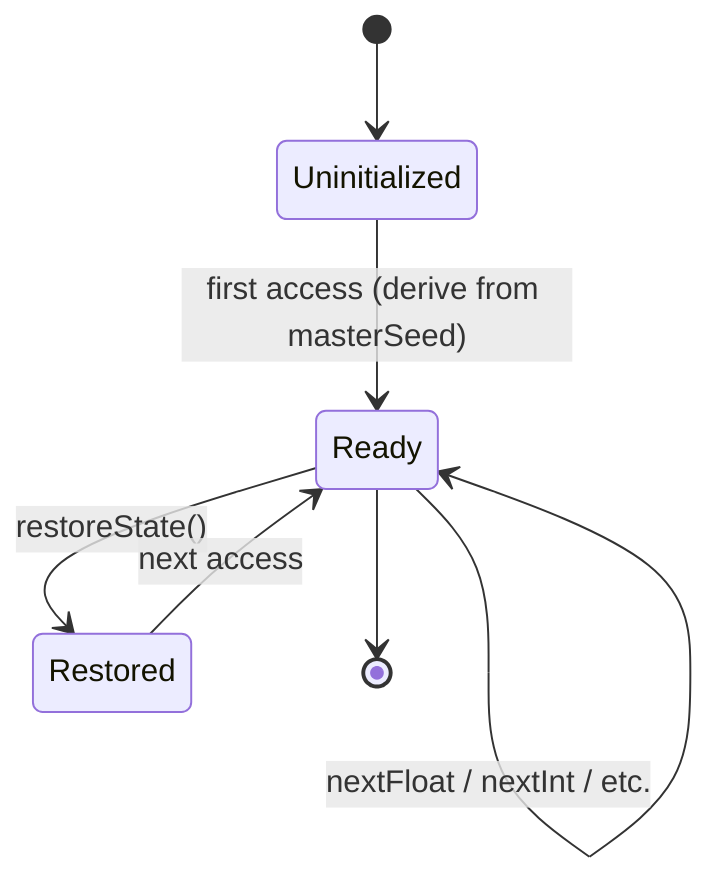
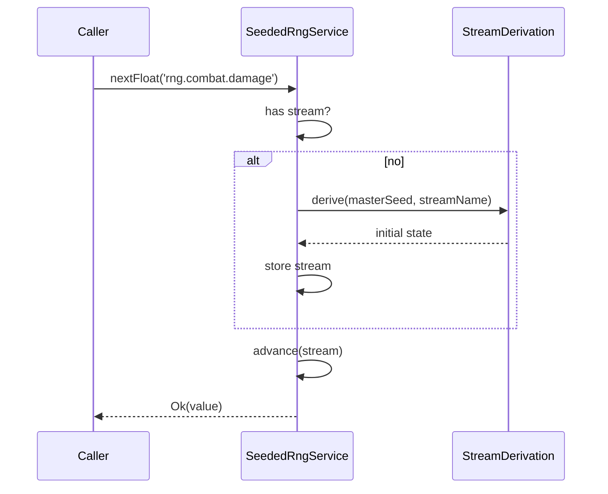

# DEV-SPEC-005 v1.0 — «Seeded RNG Service & Named Streams»

**Тип документа:** Спецификация к разработке  
**Дата:** 2026-11-02  
**Статус:** ✅ реализовано в Wave 0  
**Реализация:** подтверждена 2026-11-14 — `bun run t:check` (117 тестов), `bun run ci:validate` (8/8 стадий)  
**Волна:** Wave 0  
**Зависит от:** `DEV-SPEC-001`  
**Блокирует:** `DEV-SPEC-006`, `DEV-SPEC-007`, все доменные `DEV-SPEC` (любая случайность)  
**Основана на:** `GENERAL DESIGN v1.0` (GD-05, GD-08), все разделы «Детерминизм и RNG» в `DESIGN v1.0`  
**Покрываемые DESIGN-блоки:** `GD-05`, `GD-08`, `SPEC-FLEET-041`, `SPEC-ECON-090…091`, `SPEC-CATA-060…061`, `SPEC-COMBAT-040…041`, `SPEC-PARTY-040…041`, `SPEC-COMP-040…041`, `SPEC-TRANS-040…041`, `SPEC-LORE-050…051`, `SPEC-EPI-040…041`, `SPEC-ART-050…051`  
**Связанные DESIGN-документы:** все `DESIGN v1.0`.

---

## 1. Назначение и границы

### 1.1. Что спецификация делает
Фиксирует единый `SeededRngService` с именованными изолированными потоками, детерминизм от seed, правила создания потоков, запрет смешения, сериализацию состояния RNG в save, контракт использования в механиках и доменах.

### 1.2. Что спецификация НЕ делает
- Не фиксирует алгоритмы конкретных доменов (они — в доменных `DEV-SPEC`).
- Не описывает вероятностные таблицы баланса (вне scope).
- Не описывает Save/Load (→ `DEV-SPEC-006`).
- Не описывает Game Clock (→ `DEV-SPEC-007`).

### 1.3. Связь с DESIGN

| DESIGN-блок | Реализация | Расхождения |
|---|---|---|
| `GD-05` | Не зависит от такта, работает по запросу | нет |
| `GD-08` | data-driven seed, named streams | нет |
| `SPEC-FLEET-041` | Именованные потоки | нет |
| `SPEC-ECON-091` | Именованные потоки | нет |
| `SPEC-CATA-061` | Именованные потоки | нет |
| `SPEC-COMBAT-041` | Именованные потоки | нет |
| `SPEC-PARTY-041` | Именованные потоки | нет |
| `SPEC-COMP-041` | Именованные потоки | нет |
| `SPEC-TRANS-041` | Именованные потоки | нет |
| `SPEC-LORE-051` | Именованные потоки | нет |
| `SPEC-EPI-041` | Именованные потоки | нет |
| `SPEC-ART-051` | Именованные потоки | нет |

---

## 2. Зависимости

### 2.1. Обязательные
`DEV-SPEC-001` — `Result`, `AppConfig.seed`, `Logger`, `AppError`.

### 2.2. Мягкие
Нет.

### 2.3. Внешние контракты
`seedrandom` (или эквивалент). Выбор библиотеки — открытый вопрос `Q-01`.

---

## 3. Термины

| Термин | Определение |
|---|---|
| Stream | Именованный изолированный генератор с собственным состоянием |
| Seed | Базовая строка, из которой детерминированно выводятся все streams |
| Master Seed | `AppConfig.seed`, единственный источник энтропии |
| Stream State | Сериализуемое состояние генератора потока |

---

## 4. Архитектурное размещение

### 4.1. Слои
`domain/rng/` (интерфейс), `infrastructure/rng/` (реализация).

### 4.2. Файлы

```text
src/
├── domain/
│   └── rng/
│       ├── SeededRngService.ts
│       ├── RngStreamName.ts
│       └── RngStreamState.ts
├── infrastructure/
│   └── rng/
│       ├── XorShift128PlusService.ts
│       └── StreamDerivation.ts
└── shared/
    └── rng/
        └── stream-names.ts
```

### 4.3. DI
- `SeededRngService` — singleton.

---

## 5. Domain-модель

### 5.1. RngStreamName

```ts
// domain/rng/RngStreamName.ts
import type { Brand } from '../../shared/types/Brand';

export type RngStreamName = string & Brand<string, 'RngStreamName'>;

export function makeStreamName(s: string): RngStreamName {
  if (!/^rng\.[a-z][a-z0-9_]*(\.[a-z][a-z0-9_]*)+$/.test(s)) {
    throw new Error(`Invalid rng stream name: ${s}`);
  }
  return s as RngStreamName;
}
```

### 5.2. SeededRngService

```ts
// domain/rng/SeededRngService.ts
import type { RngStreamName } from './RngStreamName';
import type { RngStreamState } from './RngStreamState';
import type { Result } from '../../shared/types/Result';
import type { AppError } from '../../shared/errors/AppError';

export interface SeededRngService {
  readonly masterSeed: string;

  nextFloat(stream: RngStreamName): Result<number, AppError>;

  nextInt(stream: RngStreamName, minInclusive: number, maxInclusive: number): Result<number, AppError>;

  pickOne<T>(stream: RngStreamName, items: readonly T[]): Result<T, AppError>;

  shuffle<T>(stream: RngStreamName, items: readonly T[]): Result<readonly T[], AppError>;

  chance(stream: RngStreamName, probability: number): Result<boolean, AppError>;

  getState(stream: RngStreamName): Result<RngStreamState, AppError>;

  restoreState(stream: RngStreamName, state: RngStreamState): Result<void, AppError>;

  listStreams(): readonly RngStreamName[];

  serializeAll(): Readonly<Record<string, RngStreamState>>;
}
```

**Инварианты:**
- `INV-01`: Один и тот же `masterSeed` + одинаковый порядок вызовов в каждом потоке даёт идентичные результаты.
- `INV-02`: Каждый `stream` изолирован; вызовы в одном потоке не влияют на другой.
- `INV-03`: `nextInt(min, max)` возвращает целое в `[min, max]` включительно.
- `INV-04`: `nextFloat()` возвращает `[0, 1)`.
- `INV-05`: `shuffle` не мутирует входной массив.
- `INV-06`: `chance(p)` при `p=0` всегда `false`, при `p=1` всегда `true`, `p` вне `[0,1]` → `Err`.
- `INV-07`: `pickOne` при пустом массиве → `Err`.
- `INV-08`: `getState`/`restoreState` позволяют точно восстановить продолжение.
- `INV-09`: Все streams используют один и тот же детерминированный алгоритм.
- `INV-10`: Смешение потоков невозможно на уровне API — нет метода, который «смешивает» результаты двух потоков.

### 5.3. RngStreamState

```ts
// domain/rng/RngStreamState.ts
export interface RngStreamState {
  readonly algorithm: 'xor-shift-128-plus';
  readonly s0: string;
  readonly s1: string;
  readonly s2: string;
  readonly s3: string;
  readonly callCount: number;
}
```

**Обоснование выбора `xor-shift-128-plus`:**
- Быстрый.
- 128-битное состояние — сериализуется в 4 строки.
- Детерминирован.
- Не требует криптостойкости (это не криптография).

### 5.4. Каталог потоков

Полный список `RngStreamName`, собираемый из DESIGN:

**Fleet / Ship**
- `rng.fleet.maneuver`
- `rng.fleet.damage`
- `rng.fleet.resource`
- `rng.fleet.acquisition`

**Combat**
- `rng.combat.duel`
- `rng.combat.party`
- `rng.combat.damage`
- `rng.combat.resolution`

**Economy**
- `rng.economy.market`
- `rng.economy.quests`
- `rng.economy.risk`
- `rng.economy.agents`
- `rng.economy.investments`
- `rng.economy.shocks`

**Cataclysm**
- `rng.cataclysm.spawn`
- `rng.cataclysm.escalation`
- `rng.cataclysm.effects`
- `rng.cataclysm.resolution`
- `rng.cataclysm.hidden_branch`

**Party**
- `rng.party.morale`
- `rng.party.progression`
- `rng.party.reactions`
- `rng.party.recruitment`

**Companion**
- `rng.companion.acquisition_hook`
- `rng.companion.relationship`
- `rng.companion.daily_reaction`
- `rng.companion.synergy_activation`
- `rng.companion.legacy_outcome`

**Hidden branches**
- `rng.hidden_branch.trigger`
- `rng.hidden_branch.progression`
- `rng.hidden_branch.combination`
- `rng.hidden_branch.outcome`
- `rng.hidden_branch.symptom`

**Narrative**
- `rng.narrative.beacon_activation`
- `rng.narrative.arc_activation`
- `rng.narrative.dialogue_outcome`
- `rng.narrative.npc_state`
- `rng.narrative.lore_revelation`

**Epilogue**
- `rng.epilogue.fact_collection`
- `rng.epilogue.fact_filtering`
- `rng.epilogue.thread_weaving`
- `rng.epilogue.style_selection`
- `rng.epilogue.scene_selection`
- `rng.epilogue.fact_interpretation`
- `rng.epilogue.meta_threat_generation`

**Visual**
- `rng.visual.vfx_variation`
- `rng.visual.transition_jitter`
- `rng.visual.material_wear`
- `rng.visual.faction_visual_mix`

**Правило:** новый поток может быть добавлен только через `shared/rng/stream-names.ts` и CI-проверку, что он не дублирует существующий.

---

## 6. Data-контракты и схемы

### 6.1. Пакет JSON Schema
Спека добавляет в `content/schemas/`:

```json
{
  "$id": "https://game/schemas/rng-stream-state.json",
  "type": "object",
  "required": ["algorithm", "s0", "s1", "s2", "s3", "callCount"],
  "properties": {
    "algorithm": { "enum": ["xor-shift-128-plus"] },
    "s0": { "type": "string" },
    "s1": { "type": "string" },
    "s2": { "type": "string" },
    "s3": { "type": "string" },
    "callCount": { "type": "integer", "minimum": 0 }
  },
  "additionalProperties": false
}
```

### 6.2. TypeScript-типы
`RngStreamState` (§5.3).

### 6.3. Runtime-состояния
`Map<RngStreamName, RngStreamState>` — сериализуется в save (`DEV-SPEC-006`).

### 6.4. Связь
`RngStreamName` — идентификатор. `RngStreamState` — runtime. `SeededRngService` — владелец.

---

## 7. Рантайм-поведение

### 7.1. State machines

Поток:



### 7.2. Sequence



### 7.3. Tick-контракт
RNG не тикает. Вызывается по требованию из механик и доменов.

### 7.4. Порядок
- Производный поток создаётся лениво при первом обращении.
- Порядок обращения определяет последовательность значений — это ожидаемо и детерминировано.

### 7.5. Идемпотентность и детерминизм
- `nextFloat` и все остальные методы **не идемпотентны** (продвигают состояние).
- Два прогона с одинаковым `masterSeed` и одинаковой последовательностью обращений — идентичны.
- Сохранение + загрузка дают идентичное продолжение.
- Восстановление состояния через `restoreState` — идемпотентно (не продвигает).

---

## 8. Порты и адаптеры

### 8.1. Порты
`SeededRngService` (§5.2).

### 8.2. Адаптеры
- `XorShift128PlusService` — production.
- `FixedRngService` — тесты (возвращает заранее заданную последовательность).

### 8.3. Ошибки
- `DOMAIN_INVARIANT_VIOLATION` — некорректные аргументы (`min > max`, `p` вне `[0,1]`, пустой массив в `pickOne`).
- `INFRA_STORAGE_FAILED` — при восстановлении некорректного состояния.

---

## 9. Интеграционные точки

### 9.1. Потребляемые события
Нет.

### 9.2. Эмитируемые события
Нет.

### 9.3. Порты других доменов
Предоставляется всем доменам как `SeededRngService`.

### 9.4. Мосты
Не применимо.

---

## 10. Обработка ошибок

### 10.1. Result
Все методы → `Result<T, AppError>`.

### 10.2. Таблица

| Код | Когда | Лог |
|---|---|---|
| `DOMAIN_INVARIANT_VIOLATION` | `min > max`, `p` вне `[0,1]`, пустой массив | аргументы |
| `INFRA_STORAGE_FAILED` | битое состояние при `restoreState` | stream, state |

### 10.3. Восстановление
- При ошибке `nextFloat` в dev — падение.
- В production — `error` в лог, возврат `Err`.

---

## 11. Критерии приёмки

### `DEV-SPEC-005-R01` — Детерминизм
**Given** `masterSeed: "abc"`  
**When** дважды создаём сервис и 10 раз вызываем `nextFloat('rng.combat.damage')`  
**Then** последовательности идентичны

**AC:**
- `DEV-SPEC-005-AC01`: `masterSeed: "abc"` ≠ `masterSeed: "abd"` по первой же дельте.

### `DEV-SPEC-005-R02` — Изоляция потоков
**Given** два потока `rng.combat.damage` и `rng.combat.duel`  
**When** 100 вызовов в первом, затем 1 вызов во втором  
**Then** результат второго совпадает с результатом первого вызова во втором потоке в «чистом» сервисе

**AC:**
- `DEV-SPEC-005-AC02`: значения потоков не коррелируют.

### `DEV-SPEC-005-R03` — Валидация аргументов
**Given** `nextInt('rng.combat.damage', 10, 5)`  
**When** вызов  
**Then** `Err(DOMAIN_INVARIANT_VIOLATION)`

**AC:**
- `DEV-SPEC-005-AC03`: `chance(stream, -0.1)` → `Err`.
- `DEV-SPEC-005-AC04`: `chance(stream, 1.1)` → `Err`.
- `DEV-SPEC-005-AC05`: `pickOne(stream, [])` → `Err`.

### `DEV-SPEC-005-R04` — Save/restore
**Given** 100 вызовов `nextFloat('rng.combat.damage')`  
**When** `getState` → `restoreState` в новом сервисе  
**Then** 101-й вызов даёт тот же результат, что в исходном

**AC:**
- `DEV-SPEC-005-AC06`: `serializeAll` возвращает все использованные streams.
- `DEV-SPEC-005-AC07`: после `restoreState` `getState` совпадает.

### `DEV-SPEC-005-R05` — `chance` граничные случаи
**Given** `chance(stream, 0)`  
**When** 100 вызовов  
**Then** всегда `false`

**AC:**
- `DEV-SPEC-005-AC08`: `chance(stream, 1)` — всегда `true`.

---

## 12. Тест-план

### 12.1. Unit
- `makeStreamName`: валидные/невалидные.
- `nextFloat`: диапазон `[0, 1)`.
- `nextInt`: диапазон, границы.
- `pickOne`: пустой массив, 1 элемент, N элементов.
- `shuffle`: не мутирует, permutation of input.
- `chance`: 0, 1, 0.5.
- `getState`/`restoreState`.
- `serializeAll`.

### 12.2. Integration
- Два прогона с одинаковым seed + одинаковой последовательностью — идентичны.
- Два потока не влияют друг на друга.

### 12.3. Contract
- `RngStreamState` проходит схему.
- Все `RngStreamName` из каталога (§5.4) зарегистрированы.

### 12.4. Determinism
- Save → Load → продолжение идентично без save/load.

### 12.5. E2E
Не применимо.

### 12.6. CI
- Все `rng.*` из DESIGN покрыты в `stream-names.ts`.
- Нет дублей.
- Все обращения к RNG — через `SeededRngService` (lint rule: запрет `Math.random` в домене).

---

## 13. Производительность

### 13.1. Бюджет
- `nextFloat` ≤ 50 нс.
- `nextInt` ≤ 100 нс.
- Память на stream ≤ 100 байт.

### 13.2. LOD
Не применимо.

### 13.3. Профилирование
Метрики: count calls per stream, total calls. Логируются в `debug`.

---

## 14. Миграции
- `algorithm: 'xor-shift-128-plus'` — версия зафиксирована в state.
- При смене алгоритма — новая спека + миграция state.

---

## 15. Открытые вопросы

| ID | Вопрос | Блокер? | Решение |
|---|---|---|---|
| `Q-01` | `seedrandom` или собственная реализация? | нет | собственная (контроль над state) |
| `Q-02` | Динамическое создание streams во время runtime? | нет | нет, только из каталога |

---

## 16. Что остаётся вне scope
- Конкретные распределения для доменов.
- Таблицы баланса.
- Save/Load (→ `DEV-SPEC-006`).
- Game Clock (→ `DEV-SPEC-007`).

---

## 17. Трассировка на DESIGN

| DESIGN-блок | Требование | AC | Тест |
|---|---|---|---|
| `GD-08` | `DEV-SPEC-005-R01` | `DEV-SPEC-005-AC01` | `XorShift128PlusService.test.ts` |
| `SPEC-FLEET-041` | `DEV-SPEC-005-R02` | `DEV-SPEC-005-AC02` | `StreamIsolation.test.ts` |
| `SPEC-COMBAT-041` | `DEV-SPEC-005-R03` | `DEV-SPEC-005-AC03` | `ArgumentValidation.test.ts` |
| `SPEC-PARTY-041` | `DEV-SPEC-005-R04` | `DEV-SPEC-005-AC06` | `SaveRestore.test.ts` |
| `SPEC-COMP-041` | `DEV-SPEC-005-R04` | `DEV-SPEC-005-AC07` | `SaveRestore.test.ts` |