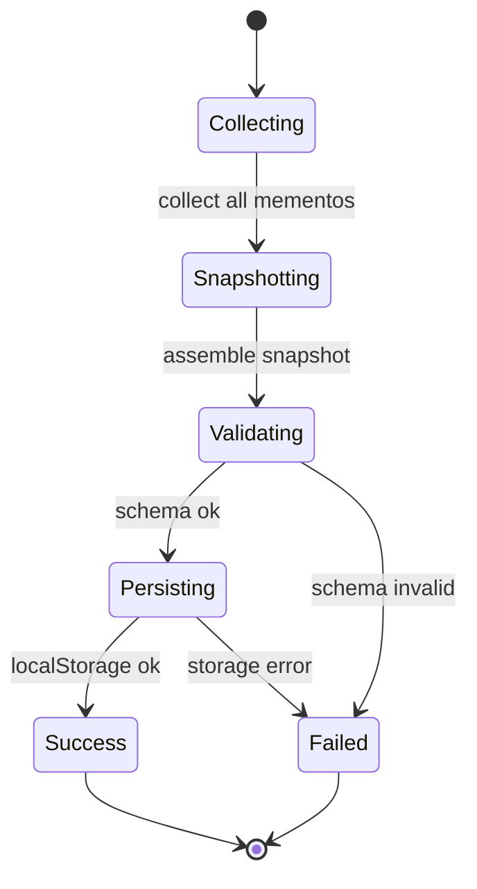
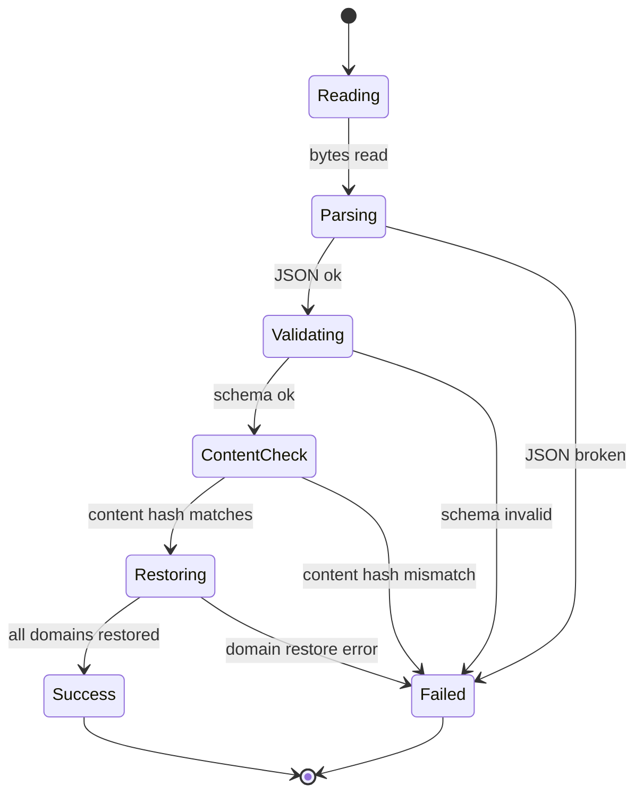
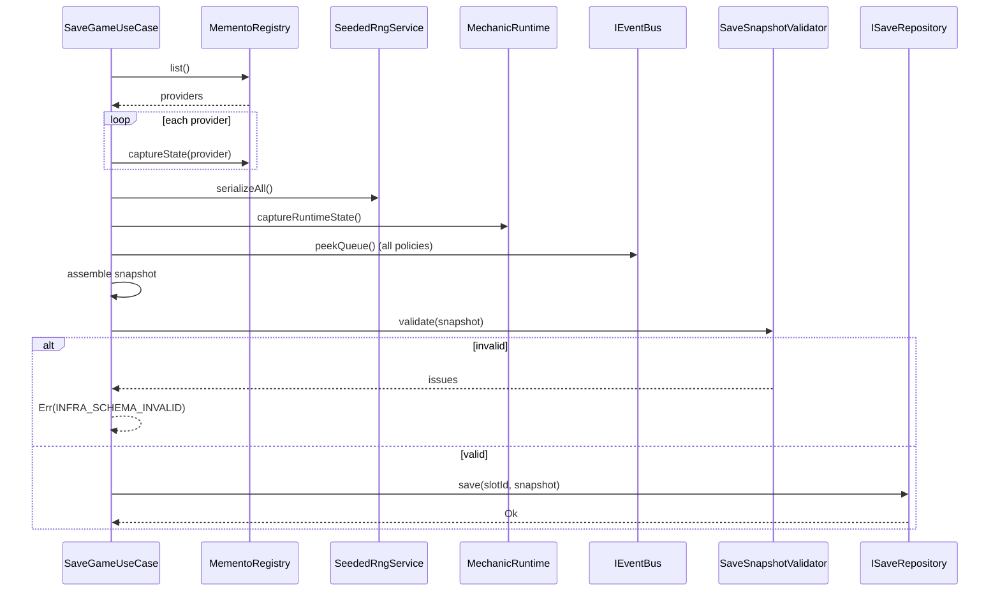

# DEV-SPEC-006 v1.0 — «Save/Load & Memento Composition»

**Тип документа:** Спецификация к разработке  
**Дата:** 2026-11-02  
**Статус:** ✅ реализовано в Wave 0  
**Реализация:** подтверждена 2026-11-14 — `bun run t:check` (117 тестов), `bun run ci:validate` (8/8 стадий)  
**Волна:** Wave 0  
**Зависит от:** `DEV-SPEC-001`, `DEV-SPEC-002`, `DEV-SPEC-003`, `DEV-SPEC-004`, `DEV-SPEC-005`  
**Блокирует:** `DEV-SPEC-039`, все доменные `DEV-SPEC` (у которых есть persisted state)  
**Основана на:** `GENERAL DESIGN v1.0` (GD-09, GD-10), все разделы «Сохранения и состояние» в `DESIGN v1.0`  
**Покрываемые DESIGN-блоки:** `GD-09`, `GD-10`, `SPEC-FLEET-070…071`, `SPEC-ECON-092…093`, `SPEC-CATA-070…071`, `SPEC-COMBAT-050…051`, `SPEC-PARTY-050…051`, `SPEC-COMP-050…051`, `SPEC-TRANS-050…051`, `SPEC-LORE-060…061`, `SPEC-EPI-050…051`, `SPEC-ART-060…061`  
**Связанные DESIGN-документы:** все `DESIGN v1.0`.

---

## 1. Назначение и границы

### 1.1. Что спецификация делает
Фиксирует единый механизм сохранения и загрузки игры: композицию Memento-снимков всех доменов, версионирование формата, интеграцию с `ContentHash`, LocalStorage-адаптер, правила валидации при загрузке, обработку повреждённых сохранений, ручные и автосохранения.

### 1.2. Что спецификация НЕ делает
- Не описывает миграции между версиями (→ отдельная будущая спека).
- Не описывает UI сохранений (→ `DEV-SPEC-013`).
- Не описывает `MementoState` конкретных доменов (каждый домен описывает свой снимок в своей `DEV-SPEC`).
- Не описывает облачные сохранения (вне scope по `INT-05`).

### 1.3. Связь с DESIGN

| DESIGN-блок | Реализация | Расхождения |
|---|---|---|
| `GD-09` | Memento pattern, композиция снимков | нет |
| `GD-10` | Ручные сохранения, автосейв off by default | нет |
| `SPEC-FLEET-070` | Полные JSON-снимки трекеров | нет |
| `SPEC-ECON-092` | Полные JSON-снимки | нет |
| `SPEC-CATA-070` | Полные JSON-снимки + журнал | нет |
| `SPEC-COMBAT-050` | Полные JSON-снимки + журнал | нет |
| `SPEC-PARTY-050` | Полные JSON-снимки + журнал | нет |
| `SPEC-COMP-050` | Расширение `PartyInstance` | нет |
| `SPEC-TRANS-050` | Полные JSON-снимки + журнал | нет |
| `SPEC-LORE-060` | Полные JSON-снимки + журнал | нет |
| `SPEC-EPI-050` | Полные JSON-снимки + журнал | нет |
| `SPEC-ART-060` | Полные JSON-снимки | нет |

---

## 2. Зависимости

### 2.1. Обязательные
`DEV-SPEC-001` (`Result`, `AppError`), `DEV-SPEC-002` (`IEventBus` для журнала), `DEV-SPEC-003` (`IContentRegistry`, `contentHash`), `DEV-SPEC-004` (`MechanicRuntime` state), `DEV-SPEC-005` (`SeededRngService` state).

### 2.2. Мягкие
Нет.

### 2.3. Внешние контракты
`ajv` для валидации снимка, `LocalStorage` (браузерный API).

---

## 3. Термины

| Термин | Определение |
|---|---|
| Memento | Снимок состояния домена |
| MementoProvider | Домен, который умеет отдавать / принимать снимок |
| Save Snapshot | Агрегированный снимок всей игры |
| Save Slot | Именованный слот в LocalStorage |
| ContentHash | Хеш контента на момент сохранения (из `DEV-SPEC-003`) |

---

## 4. Архитектурное размещение

### 4.1. Слои
`domain/save/` (интерфейсы), `application/save/` (Use Cases), `infrastructure/save/` (LocalStorage).

### 4.2. Файлы

```text
src/
├── domain/
│   └── save/
│       ├── IMementoProvider.ts
│       ├── ISaveRepository.ts
│       ├── SaveSnapshot.ts
│       └── SaveErrors.ts
├── application/
│   └── save/
│       ├── SaveGameUseCase.ts
│       ├── LoadGameUseCase.ts
│       ├── ListSavesUseCase.ts
│       └── DeleteSaveUseCase.ts
├── infrastructure/
│   └── save/
│       ├── LocalStorageSaveRepository.ts
│       ├── InMemorySaveRepository.ts
│       ├── SaveSnapshotValidator.ts
│       └── MementoRegistry.ts
```

### 4.3. DI
- `ISaveRepository` → `LocalStorageSaveRepository` (singleton).
- `MementoRegistry` (singleton) — собирает `IMementoProvider`.

---

## 5. Domain-модель

### 5.1. IMementoProvider

```ts
// domain/save/IMementoProvider.ts
import type { Result } from '../../shared/types/Result';
import type { AppError } from '../../shared/errors/AppError';

export interface IMementoProvider<TState = unknown> {
  readonly domainId: string;

  captureState(): Result<TState, AppError>;

  restoreState(state: TState): Result<void, AppError>;
}
```

**Инварианты:**
- `INV-01`: `domainId` уникален в `MementoRegistry`.
- `INV-02`: `captureState` не мутирует состояние.
- `INV-03`: `restoreState` идемпотентен.
- `INV-04`: `restoreState` валидирует `state` по схеме домена.

### 5.2. SaveSnapshot

```ts
// domain/save/SaveSnapshot.ts
export interface SaveSnapshot {
  readonly formatVersion: 1;
  readonly savedAtMs: number;
  readonly contentHash: string;
  readonly rngState: Readonly<Record<string, unknown>>;
  readonly mechanicRuntimeState: Readonly<Record<string, unknown>>;
  readonly domainStates: Readonly<Record<string, unknown>>;
  readonly eventQueueState: Readonly<{
    nextTick: readonly unknown[];
    afterScene: readonly unknown[];
    warning: readonly unknown[];
  }>;
  readonly completedCombatsJournal: readonly unknown[];
  readonly completedCataclysmsJournal: readonly unknown[];
  readonly epilogueEventsJournal: readonly unknown[];
  readonly transformationEventsJournal: readonly unknown[];
  readonly narrativeEventsJournal: readonly unknown[];
  readonly partyEventsJournal: readonly unknown[];
}
```

**Инварианты:**
- `INV-05`: `formatVersion` — константа 1 на первой волне.
- `INV-06`: `contentHash` совпадает с `IContentRegistry.contentHash()` на момент сохранения.
- `INV-07`: Все поля обязательны (могут быть пустыми массивами/объектами).
- `INV-08`: Все массивы журналов детерминированно отсортированы (по `tick`, затем по исходному порядку).

### 5.3. ISaveRepository

```ts
// domain/save/ISaveRepository.ts
import type { SaveSnapshot } from './SaveSnapshot';
import type { Result } from '../../shared/types/Result';
import type { AppError } from '../../shared/errors/AppError';

export interface SaveSlotMeta {
  readonly slotId: string;
  readonly savedAtMs: number;
  readonly contentHash: string;
  readonly formatVersion: 1;
}

export interface ISaveRepository {
  list(): Promise<Result<readonly SaveSlotMeta[], AppError>>;

  save(slotId: string, snapshot: SaveSnapshot): Promise<Result<void, AppError>>;

  load(slotId: string): Promise<Result<SaveSnapshot, AppError>>;

  delete(slotId: string): Promise<Result<void, AppError>>;

  exists(slotId: string): Promise<Result<boolean, AppError>>;
}
```

### 5.4. MementoRegistry

```ts
// infrastructure/save/MementoRegistry.ts
import type { IMementoProvider } from '../../domain/save/IMementoProvider';

export interface MementoRegistry {
  register(provider: IMementoProvider): void;
  list(): readonly IMementoProvider[];
  get(domainId: string): IMementoProvider | null;
}
```

**Инварианты:**
- `INV-09`: `register` при дублирующем `domainId` → исключение на bootstrap.
- `INV-10`: Порядок `list()` детерминирован (по `domainId`, лексикографически).

---

## 6. Data-контракты и схемы

### 6.1. Пакет JSON Schema
Спека добавляет в `content/schemas/`:

```json
{
  "$id": "https://game/schemas/save-snapshot.json",
  "type": "object",
  "required": ["formatVersion", "savedAtMs", "contentHash", "rngState", "mechanicRuntimeState", "domainStates", "eventQueueState", "completedCombatsJournal", "completedCataclysmsJournal", "epilogueEventsJournal", "transformationEventsJournal", "narrativeEventsJournal", "partyEventsJournal"],
  "properties": {
    "formatVersion": { "const": 1 },
    "savedAtMs": { "type": "integer", "minimum": 0 },
    "contentHash": { "type": "string", "pattern": "^[a-f0-9]{64}$" },
    "rngState": { "type": "object" },
    "mechanicRuntimeState": { "type": "object" },
    "domainStates": { "type": "object" },
    "eventQueueState": {
      "type": "object",
      "required": ["nextTick", "afterScene", "warning"],
      "properties": {
        "nextTick": { "type": "array" },
        "afterScene": { "type": "array" },
        "warning": { "type": "array" }
      }
    },
    "completedCombatsJournal": { "type": "array" },
    "completedCataclysmsJournal": { "type": "array" },
    "epilogueEventsJournal": { "type": "array" },
    "transformationEventsJournal": { "type": "array" },
    "narrativeEventsJournal": { "type": "array" },
    "partyEventsJournal": { "type": "array" }
  },
  "additionalProperties": false
}
```

### 6.2. TypeScript-типы
`SaveSnapshot` (§5.2).

### 6.3. Runtime-состояния
Сам `SaveSnapshot` — runtime-снимок.

### 6.4. Связь definition ↔ instance
`SaveSnapshot` — агрегат. Каждый `domainStates[domainId]` — снимок домена, валидируется доменной схемой.

---

## 7. Рантайм-поведение

### 7.1. State machines

Сохранение:



Загрузка:



### 7.2. Sequence



### 7.3. Tick-контракт
Сохранение и загрузка не привязаны к такту. Вызываются через Use Cases.

### 7.4. Порядок
- Захват снимков: `world → economy → cataclysm → party → combat → captain → narrative → visual → epilogue` (детерминированный порядок).
- Восстановление: обратный порядок.
- Регистрация providers в `MementoRegistry` происходит на bootstrap.

### 7.5. Идемпотентность и детерминизм
- `captureState` идемпотентен.
- `restoreState` идемпотентен.
- Save → Load → Save даёт идентичный `SaveSnapshot` (по содержимому, кроме `savedAtMs`).

---

## 8. Порты и адаптеры

### 8.1. Порты
- `IMementoProvider` (домен)
- `ISaveRepository` (persistence)
- `MementoRegistry`

### 8.2. Адаптеры
- `LocalStorageSaveRepository` — production.
- `InMemorySaveRepository` — тесты.

### 8.3. Ошибки
- `INFRA_SCHEMA_INVALID` — невалидный снимок.
- `INFRA_STORAGE_FAILED` — LocalStorage недоступен, quota exceeded, corrupted JSON.
- `INFRA_CONTENT_NOT_FOUND` — `contentHash` mismatch.

---

## 9. Интеграционные точки

### 9.1. Потребляемые события
- `world.tick_advanced` — для журналов (read-only).

### 9.2. Эмитируемые события
- `save.completed` (внутреннее, не обязательное для ContentRegistry — вводится этой спекой опционально).
- `save.failed`.
- `load.completed`.
- `load.failed`.

**Правило:** эти события не обязательны для core catalog, но регистрируются в `content/events/core.json` как `core` — они нужны UI и аудио для индикации.

### 9.3. Порты других доменов
Все домены реализуют `IMementoProvider` и регистрируются в `MementoRegistry`.

### 9.4. Мосты
Не применимо.

---

## 10. Обработка ошибок

### 10.1. Result
Все методы Use Cases и Repository → `Result<T, AppError>`.

### 10.2. Таблица

| Код | Когда | Что видит игрок | Лог |
|---|---|---|---|
| `INFRA_SCHEMA_INVALID` | снимок не проходит схему | «Сохранение повреждено» | `issues` |
| `INFRA_STORAGE_FAILED` | LocalStorage ошибка | «Не удалось сохранить» | raw exception |
| `INFRA_CONTENT_NOT_FOUND` | `contentHash` mismatch | «Сохранение несовместимо с текущей версией контента» | оба хеша |

### 10.3. Восстановление
- `INFRA_SCHEMA_INVALID` → не загружаем, показываем ошибку.
- `INFRA_STORAGE_FAILED` → не загружаем, показываем ошибку.
- `INFRA_CONTENT_NOT_FOUND` → не загружаем, показываем ошибку. В dev — предупреждение с предложением продолжить (для отладки).

### 10.4. Автосохранения
По `GD-10`: **отключены по умолчанию**. Включаются явно в настройках. Реализуются как `SaveGameUseCase` с фиксированным `slotId = "autosave"`. Частота — настраиваемая, но не чаще чем раз в N тактов (конкретное N — data-driven, задаётся в `AppConfig` позже).

---

## 11. Критерии приёмки

### `DEV-SPEC-006-R01` — Save/Load roundtrip
**Given** полностью инициализированная игра  
**When** `SaveGameUseCase` → `LoadGameUseCase`  
**Then** состояние домена идентично до сохранения

**AC:**
- `DEV-SPEC-006-AC01`: `RngState` идентичен.
- `DEV-SPEC-006-AC02`: `domainStates` идентичны по содержимому.
- `DEV-SPEC-006-AC03`: журналы идентичны.

### `DEV-SPEC-006-R02` — ContentHash
**Given** save с `contentHash` X  
**When** загрузка в билд с `contentHash` Y ≠ X  
**Then** `Err(INFRA_CONTENT_NOT_FOUND)`

**AC:**
- `DEV-SPEC-006-AC04`: `contentHash` совпадает → `Ok`.

### `DEV-SPEC-006-R03` — Schema validation
**Given** save с некорректным полем  
**When** загрузка  
**Then** `Err(INFRA_SCHEMA_INVALID)`, `meta.issues` содержит путь

**AC:**
- `DEV-SPEC-006-AC05`: отсутствует обязательное поле → `Err`.
- `DEV-SPEC-006-AC06`: `formatVersion: 2` → `Err`.

### `DEV-SPEC-006-R04` — Memento providers
**Given** два провайдера с одинаковым `domainId`  
**When** регистрация в `MementoRegistry`  
**Then** исключение на bootstrap

**AC:**
- `DEV-SPEC-006-AC07`: все зарегистрированные провайдеры вызываются при save.
- `DEV-SPEC-006-AC08`: при ошибке одного провайдера save падает с ошибкой.

### `DEV-SPEC-006-R05` — Автосохранения off by default
**Given** свежий старт игры  
**When** игрок не включал автосейв  
**Then** автосохранений не происходит

**AC:**
- `DEV-SPEC-006-AC09`: включение автосейва в настройках → автосейв срабатывает.
- `DEV-SPEC-006-AC10`: `slotId = "autosave"` не конфликтует с ручными.

---

## 12. Тест-план

### 12.1. Unit
- `SaveSnapshotValidator`: валидный/невалидный снимок.
- `LocalStorageSaveRepository`: save/load/delete/list.
- `InMemorySaveRepository`: то же.
- `MementoRegistry`: register, duplicate, list, get.

### 12.2. Integration
- `SaveGameUseCase` + `LoadGameUseCase` на полном наборе провайдеров.
- `SaveGameUseCase` при ошибке провайдера → `Err`.
- `LoadGameUseCase` при `contentHash` mismatch → `Err`.

### 12.3. Contract
- `SaveSnapshot` проходит `save-snapshot.json`.
- Каждый доменный снимок проходит свою схему.
- Все `domainId` из DESIGN присутствуют в `MementoRegistry` после bootstrap.

### 12.4. Determinism
- Save → Load → Save даёт идентичный `SaveSnapshot` (кроме `savedAtMs`).
- RNG state восстанавливается точно.

### 12.5. E2E
- Полный цикл: старт → N тактов → save → reload → ещё M тактов → save → reload → сравнение.

### 12.6. CI
- `save-snapshot.json` валиден.
- Все `IMementoProvider` реализуют интерфейс.
- `LocalStorageSaveRepository` не работает вне браузера (не падает в SSR).

---

## 13. Производительность

### 13.1. Бюджет
- Save ≤ 200 мс на десктопе, ≤ 600 мс на мобильном.
- Load ≤ 200 мс / 600 мс.
- Размер снимка ≤ 5 МБ в LocalStorage.
- Если размер превышает лимит — `Err(INFRA_STORAGE_FAILED)` с `meta.reason: 'quota_exceeded'`.

### 13.2. LOD
Не применимо.

### 13.3. Профилирование
Логируется размер снимка, время save, время load.

---

## 14. Миграции
- `formatVersion: 1` — текущая.
- Миграции — вне scope, будут в отдельной `DEV-SPEC-xxx` при необходимости.

---

## 15. Открытые вопросы

| ID | Вопрос | Блокер? | Решение |
|---|---|---|---|
| `Q-01` | Формат `save.completed` payload | нет | `{ slotId, sizeBytes, elapsedMs }` |
| `Q-02` | Сжатие снимка | нет | нет на первой волне |
| `Q-03` | Ограничение числа ручных слотов | нет | 10 |

---

## 16. Что остаётся вне scope
- UI сохранений (→ `DEV-SPEC-013`).
- Миграции.
- Облачные сохранения.
- Автосохранения по таймеру (только триггер `world.tick_advanced`, реализуется в `DEV-SPEC-039`).

---

## 17. Трассировка на DESIGN

| DESIGN-блок | Требование | AC | Тест |
|---|---|---|---|
| `GD-09` | `DEV-SPEC-006-R01` | `DEV-SPEC-006-AC01` | `SaveLoad.test.ts` |
| `GD-10` | `DEV-SPEC-006-R05` | `DEV-SPEC-006-AC09` | `Autosave.test.ts` |
| `SPEC-FLEET-070` | `DEV-SPEC-006-R01` | `DEV-SPEC-006-AC02` | `SaveLoad.test.ts` |
| `SPEC-CATA-070` | `DEV-SPEC-006-R01` | `DEV-SPEC-006-AC03` | `SaveLoad.test.ts` |
| `GD-07` | `DEV-SPEC-006-R02` | `DEV-SPEC-006-AC04` | `ContentHash.test.ts` |