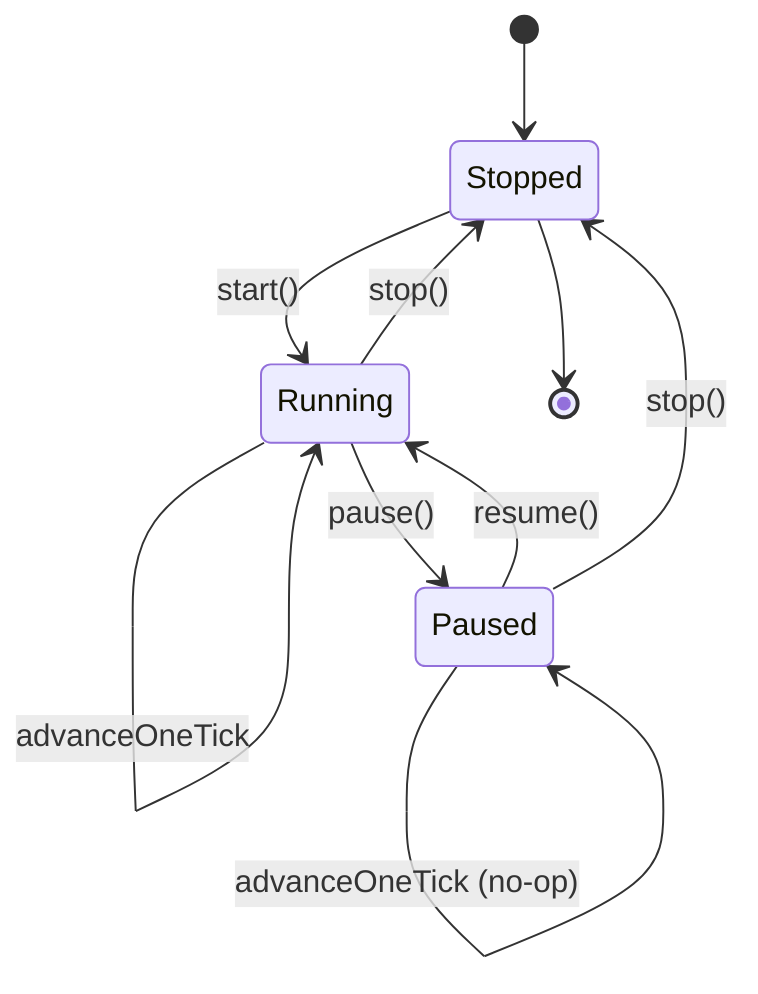
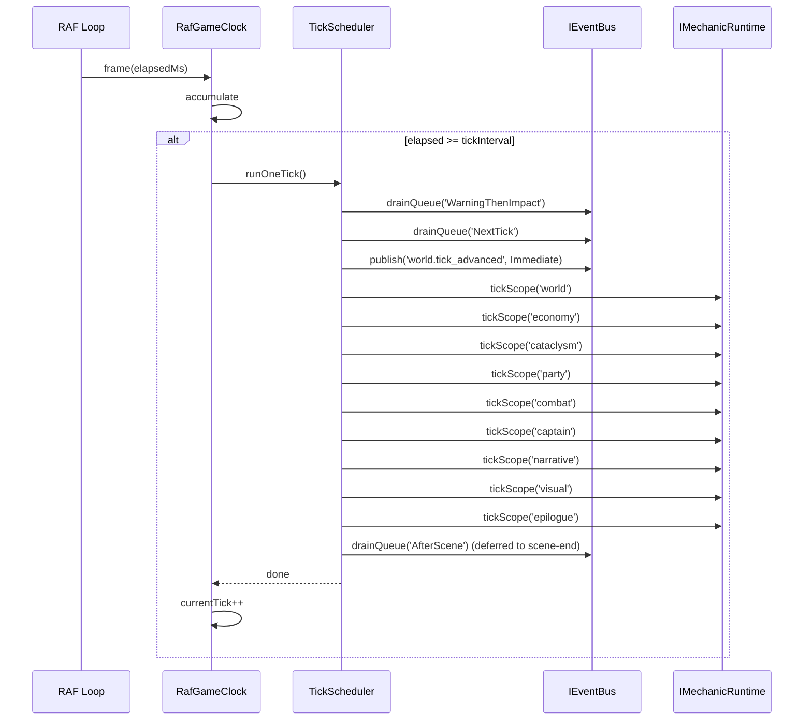

# DEV-SPEC-007 v1.0 — «Game Clock & World Tick Pipeline»

**Тип документа:** Спецификация к разработке  
**Дата:** 2026-11-02  
**Статус:** ✅ реализовано в Wave 0  
**Реализация:** подтверждена 2026-11-14 — `bun run t:check` (117 тестов), `bun run ci:validate` (8/8 стадий)  
**Волна:** Wave 0  
**Зависит от:** `DEV-SPEC-001`, `DEV-SPEC-002`, `DEV-SPEC-004`, `DEV-SPEC-005`  
**Блокирует:** `DEV-SPEC-039`, все доменные `DEV-SPEC`, `DEV-SPEC-010`  
**Основана на:** `GENERAL DESIGN v1.0` (GD-05, GD-05.1, GD-06)  
**Покрываемые DESIGN-блоки:** `GD-05`, `GD-05.1`, `GD-06`  
**Связанные DESIGN-документы:** `GENERAL DESIGN v1.0`, все `DESIGN v1.0` (разделы «Модель времени» / «Tick-контракт»).

---

## 1. Назначение и границы

### 1.1. Что спецификация делает
Фиксирует единый источник времени (`GameClock`), гибридную модель «фоновая симуляция + активная симуляция», порядок обработки такта (drain queues + tick scopes), испускание `world.tick_advanced`, контракт `DeliveryPolicy`, интерполяцию рендера, паузу, ускорение, интеграцию с Event Bus, Mechanic Runtime и Save/Load.

### 1.2. Что спецификация НЕ делает
- Не описывает конкретные механики доменов (они — в доменных `DEV-SPEC`).
- Не описывает рендер (→ `DEV-SPEC-010`, `DEV-SPEC-011`).
- Не описывает сцены (→ `DEV-SPEC-010`).
- Не описывает UI (→ `DEV-SPEC-013`).

### 1.3. Связь с DESIGN

| DESIGN-блок | Реализация | Расхождения |
|---|---|---|
| `GD-05` | Гибридная модель: `tick()` + активные сцены | нет |
| `GD-05.1` | Единая очередь событий, равные права | нет |
| `GD-06` | `DeliveryPolicy` с 4 значениями | нет |

---

## 2. Зависимости

### 2.1. Обязательные
`DEV-SPEC-001` (`Result`, `AppConfig`), `DEV-SPEC-002` (`IEventBus`, `drainQueue`), `DEV-SPEC-004` (`IMechanicRuntime.tickScope`), `DEV-SPEC-005` (`SeededRngService`).

### 2.2. Мягкие
Нет.

### 2.3. Внешние контракты
`requestAnimationFrame` (браузер), `performance.now()`.

---

## 3. Термины

| Термин | Определение |
|---|---|
| World Tick | Атомарная единица фоновой симуляции |
| Active Simulation | Активная сцена (combat, duel, trade) — своя частота обновления |
| Delivery Policy | Политика доставки события (см. `DEV-SPEC-002`) |
| Tick Phase | Фаза обработки такта (см. §7.3) |
| Render Interpolation | Сглаживание между тиками для 60 FPS |

---

## 4. Архитектурное размещение

### 4.1. Слои
`domain/clock/` (интерфейсы), `infrastructure/clock/` (реализация).

### 4.2. Файлы

```text
src/
├── domain/
│   └── clock/
│       ├── IGameClock.ts
│       ├── TickPhase.ts
│       └── ClockState.ts
├── infrastructure/
│   └── clock/
│       ├── RafGameClock.ts
│       ├── TickScheduler.ts
│       └── InterpolationClock.ts
```

### 4.3. DI
- `IGameClock` → `RafGameClock` (singleton).

---

## 5. Domain-модель

### 5.1. TickPhase

```ts
// domain/clock/TickPhase.ts
export type TickPhase =
  | 'warning-drain'
  | 'tick-drain'
  | 'world-tick-advance'
  | 'scope:world'
  | 'scope:economy'
  | 'scope:cataclysm'
  | 'scope:party'
  | 'scope:combat'
  | 'scope:captain'
  | 'scope:narrative'
  | 'scope:visual'
  | 'scope:epilogue'
  | 'after-scene-drain';
```

### 5.2. IGameClock

```ts
// domain/clock/IGameClock.ts
import type { Result } from '../../shared/types/Result';
import type { AppError } from '../../shared/errors/AppError';
import type { TickPhase } from './TickPhase';

export interface ClockState {
  readonly currentTick: number;
  readonly currentTickProgress: number; // [0, 1)
  readonly paused: boolean;
  readonly speedMultiplier: number;
}

export interface IGameClock {
  readonly state: ClockState;

  start(): Result<void, AppError>;
  stop(): Result<void, AppError>;
  pause(): Result<void, AppError>;
  resume(): Result<void, AppError>;
  setSpeedMultiplier(multiplier: number): Result<void, AppError>;

  advanceOneTick(): Result<void, AppError>;

  onTick(callback: (tick: number) => void): () => void;
  onTickPhase(callback: (tick: number, phase: TickPhase) => void): () => void;
}
```

**Инварианты:**
- `INV-01`: `currentTick` монотонно возрастает на 1 за такт.
- `INV-02`: `currentTickProgress` ∈ `[0, 1)`.
- `INV-03`: `paused === true` ⇒ `advanceOneTick` не продвигает `currentTick`, но возвращает `Ok` (no-op).
- `INV-04`: `speedMultiplier` > 0.
- `INV-05`: `advanceOneTick` выполняет все фазы в фиксированном порядке (§7.3).
- `INV-06`: `onTick` и `onTickPhase` вызываются только после полного завершения фазы.
- `INV-07`: При исключении в callback — лог, продолжение.

### 5.3. TickScheduler

```ts
// infrastructure/clock/TickScheduler.ts
import type { IGameClock } from '../../domain/clock/IGameClock';
import type { IEventBus } from '../../domain/events/IEventBus';
import type { IMechanicRuntime } from '../../domain/mechanics/IMechanicRuntime';

export interface TickScheduler {
  runOneTick(): Promise<void>;
}
```

`TickScheduler` реализует последовательность §7.3.

### 5.4. InterpolationClock

```ts
// infrastructure/clock/InterpolationClock.ts
export interface InterpolationClock {
  readonly alpha: number; // [0, 1) — фракция между lastTick и nextTick
  readonly deltaMs: number;
}
```

Используется рендером (`DEV-SPEC-010`) для сглаживания.

---

## 6. Data-контракты и схемы

### 6.1. Пакет JSON Schema
Спека добавляет в `content/schemas/`:

```json
{
  "$id": "https://game/schemas/clock-config.json",
  "type": "object",
  "required": ["tickIntervalMs", "speedMultiplier"],
  "properties": {
    "tickIntervalMs": { "type": "integer", "minimum": 1 },
    "speedMultiplier": { "type": "number", "minimum": 0.1, "maximum": 10 }
  },
  "additionalProperties": false
}
```

Значения `tickIntervalMs` и `speedMultiplier` — data-driven (`AppConfig`, `content/config/app-config.json`).

### 6.2. TypeScript-типы
`ClockState` (§5.2).

### 6.3. Runtime-состояния
`ClockState` — runtime. Сериализуется в save (`DEV-SPEC-006`).

### 6.4. Связь
`ClockState` — единственный источник времени.

---

## 7. Рантайм-поведение

### 7.1. State machines



### 7.2. Sequence



### 7.3. Tick-контракт — фиксированный порядок фаз

`advanceOneTick()`:

1. `WarningThenImpact` — `drainQueue('WarningThenImpact')`.
2. `NextTick` — `drainQueue('NextTick')`.
3. `world.tick_advanced` — `publish({ type: 'world.tick_advanced', payload: { tick } }, { deliveryPolicy: 'Immediate' })`.
4. `tickScope('world')`.
5. `tickScope('economy')`.
6. `tickScope('cataclysm')`.
7. `tickScope('party')`.
8. `tickScope('combat')`.
9. `tickScope('captain')`.
10. `tickScope('narrative')`.
11. `tickScope('visual')`.
12. `tickScope('epilogue')`.
13. `currentTick++`.

**Порядок фиксирован.** Сцены (`DEV-SPEC-010`) не могут менять его.

`AfterScene` — обрабатывается при `SceneManager.transitionEnd()`, не в `advanceOneTick`.

`Immediate` — обрабатывается синхронно в момент `publish`.

**Инварианты:**
- `INV-08`: Все фазы выполняются в указанном порядке.
- `INV-09`: `world.tick_advanced` публикуется между `NextTick` и `tickScope('world')`.
- `INV-10`: `Immediate` события, опубликованные в фазе `tickScope('X')`, обрабатываются синхронно до перехода к `tickScope('X+1')`.
- `INV-11`: Если `paused`, `advanceOneTick` — no-op.

### 7.4. Активная симуляция
Активная сцена (`CombatScene`, `DuelScene`, `CityScene`) может запрашивать `advanceOneTick` чаще или реже — через `setSpeedMultiplier` или напрямую через `advanceOneTick`.

**Правило:** активная сцена **не может** вмешиваться в фазы такта. Она только вызывает `advanceOneTick`.

### 7.5. Идемпотентность и детерминизм
- `advanceOneTick` не идемпотентен (продвигает `currentTick`).
- Два прогона с одинаковым seed и одинаковой последовательностью `advanceOneTick` — идентичны.
- `onTick` / `onTickPhase` — побочные эффекты, не влияют на детерминизм, если не публикуют события с `Immediate` в обход `EventBus`.

---

## 8. Порты и адаптеры

### 8.1. Порты
- `IGameClock` (§5.2).
- `TickScheduler` (§5.3).
- `InterpolationClock` (§5.4).

### 8.2. Адаптеры
- `RafGameClock` — production.
- `ManualGameClock` — тесты (только `advanceOneTick`).

### 8.3. Ошибки
- `DOMAIN_INVARIANT_VIOLATION` — некорректный `speedMultiplier`.
- `INFRA_STORAGE_FAILED` — не применимо (clock не сохраняется через Storage).

---

## 9. Интеграционные точки

### 9.1. Потребляемые события
Нет.

### 9.2. Эмитируемые события
- `world.tick_advanced` — обязательное, `core`.
- `world.tick_phase_started` (опционально, `core`) — для дебага.
- `world.tick_phase_completed` (опционально, `core`).

### 9.3. Порты других доменов
- `IEventBus` (из `DEV-SPEC-002`).
- `IMechanicRuntime` (из `DEV-SPEC-004`).

### 9.4. Мосты
Не применимо (clock — источник, не мост).

---

## 10. Обработка ошибок

### 10.1. Result
`start`, `stop`, `pause`, `resume`, `setSpeedMultiplier`, `advanceOneTick` → `Result<void, AppError>`.

### 10.2. Таблица

| Код | Когда | Лог |
|---|---|---|
| `DOMAIN_INVARIANT_VIOLATION` | `speedMultiplier <= 0` | значение |
| `INFRA_SCHEMA_INVALID` | `clock-config.json` невалиден | issues |

### 10.3. Восстановление
- Callback бросает исключение → лог, continue.
- `tickScope` возвращает `Err` → лог, continue (не блокируем такт).

---

## 11. Критерии приёмки

### `DEV-SPEC-007-R01` — Порядок фаз
**Given** мок-сервисы, логирующие вызовы  
**When** `advanceOneTick`  
**Then** порядок фаз совпадает с §7.3

**AC:**
- `DEV-SPEC-007-AC01`: `WarningThenImpact` перед `NextTick`.
- `DEV-SPEC-007-AC02`: `world.tick_advanced` между `NextTick` и `tickScope('world')`.
- `DEV-SPEC-007-AC03`: все `tickScope` в порядке.

### `DEV-SPEC-007-R02` — Пауза
**Given** `paused === true`  
**When** `advanceOneTick`  
**Then** `currentTick` не изменился

**AC:**
- `DEV-SPEC-007-AC04`: `resume` → `advanceOneTick` → `currentTick + 1`.

### `DEV-SPEC-007-R03` — Скорость
**Given** `speedMultiplier: 2.0`  
**When** `tickIntervalMs: 1000`, elapsed 500 мс  
**Then** такт не продвигается

**AC:**
- `DEV-SPEC-007-AC05`: elapsed 600 мс → такт продвигается.

### `DEV-SPEC-007-R04` — Callback isolation
**Given** `onTick`-callback бросает исключение  
**When** `advanceOneTick`  
**Then** `Logger.error`, такт продолжается

**AC:**
- `DEV-SPEC-007-AC06`: следующий callback вызван.
- `DEV-SPEC-007-AC07`: `currentTick` продвинулся.

### `DEV-SPEC-007-R05` — Interpolation
**Given** `tickIntervalMs: 1000`  
**When** `elapsed 500 мс`  
**Then** `InterpolationClock.alpha` ≈ 0.5

**AC:**
- `DEV-SPEC-007-AC08`: `alpha` ∈ `[0, 1)`.
- `DEV-SPEC-007-AC09`: `deltaMs` растёт монотонно между тиками.

---

## 12. Тест-план

### 12.1. Unit
- `RafGameClock`: pause/resume/speed.
- `TickScheduler.runOneTick`: порядок фаз.
- `InterpolationClock`: alpha, deltaMs.
- Callback isolation.

### 12.2. Integration
- `EventBus` + `MechanicRuntime` + `TickScheduler`: полный такт.
- `world.tick_advanced` доходит до подписчиков.

### 12.3. Contract
- `world.tick_advanced` зарегистрировано в `content/events/core.json`.
- `clock-config.json` валиден.

### 12.4. Determinism
- Два `advanceOneTick` подряд с одинаковым seed → идентичное состояние (сравнение RNG state).

### 12.5. E2E
- Запуск `RafGameClock`, 10 тактов, проверка `currentTick === 10`.
- Пауза → 1000 мс реального времени → `currentTick` не изменился.

### 12.6. CI
- `world.tick_advanced` присутствует в core catalog.
- `IGameClock` используется только через DI (lint rule).

---

## 13. Производительность

### 13.1. Бюджет
- `advanceOneTick` ≤ 5 мс на десктопе, ≤ 15 мс на мобильном.
- `InterpolationClock.tick` ≤ 0.1 мс.
- Частота такта — data-driven.

### 13.2. LOD
- На мобильных `tickIntervalMs` может быть увеличено (например, 2000 мс вместо 1000).
- `speedMultiplier` ограничен.

### 13.3. Профилирование
Метрики: `tick` duration, `tick` count, фазы с наибольшим временем.

---

## 14. Миграции
`ClockState` сериализуется в save (`DEV-SPEC-006`). `formatVersion` save отвечает за совместимость.

---

## 15. Открытые вопросы

| ID | Вопрос | Блокер? | Решение |
|---|---|---|---|
| `Q-01` | `tickIntervalMs` для мобильных | нет | определяется в `DEV-SPEC-016` |
| `Q-02` | Поддержка «ускорения такта» (fast-forward) | нет | `setSpeedMultiplier` |
| `Q-03` | События фаз (`world.tick_phase_started`) в core catalog? | нет | опционально, регистрируются |

---

## 16. Что остаётся вне scope
- Рендер (→ `DEV-SPEC-010`, `DEV-SPEC-011`).
- Активные сцены (→ `DEV-SPEC-010`).
- Конкретные механики доменов (→ доменные `DEV-SPEC`).
- UI паузы/скорости (→ `DEV-SPEC-013`).

---

## 17. Трассировка на DESIGN

| DESIGN-блок | Требование | AC | Тест |
|---|---|---|---|
| `GD-05` | `DEV-SPEC-007-R01` | `DEV-SPEC-007-AC01` | `TickScheduler.test.ts` |
| `GD-05.1` | `DEV-SPEC-007-R01` | `DEV-SPEC-007-AC02` | `TickScheduler.test.ts` |
| `GD-06` | `DEV-SPEC-007-R01` | `DEV-SPEC-007-AC03` | `TickScheduler.test.ts` |
| `GD-05` (pause) | `DEV-SPEC-007-R02` | `DEV-SPEC-007-AC04` | `RafGameClock.test.ts` |
| `GD-05` (speed) | `DEV-SPEC-007-R03` | `DEV-SPEC-007-AC05` | `RafGameClock.test.ts` |