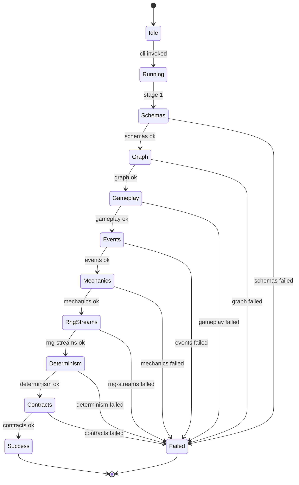
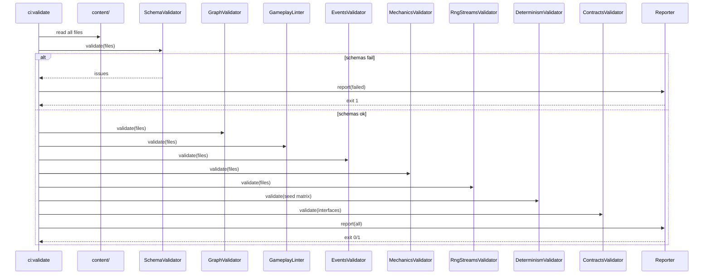

# DEV-SPEC-008 v1.0 — «CI Validation Pipeline»

**Тип документа:** Спецификация к разработке  
**Дата:** 2026-11-02  
**Статус:** draft  
**Волна:** Wave 0  
**Зависит от:** `DEV-SPEC-002`, `DEV-SPEC-003`, `DEV-SPEC-004`, `DEV-SPEC-005`  
**Блокирует:** все доменные `DEV-SPEC` (готовность к merge), `DEV-SPEC-039`  
**Основана на:** `GENERAL DESIGN v1.0` (GD-07, GD-08), разделы «Валидация и CI» всех `DESIGN v1.0`  
**Покрываемые DESIGN-блоки:** `GD-07`, `GD-08`, `SPEC-FLEET-080…083`, `SPEC-ECON-100…103`, `SPEC-CATA-080…083`, `SPEC-COMBAT-060…063`, `SPEC-PARTY-060…063`, `SPEC-COMP-060…063`, `SPEC-TRANS-060…063`, `SPEC-LORE-070…073`, `SPEC-EPI-060…063`, `SPEC-ART-070…073`  
**Связанные DESIGN-документы:** все `DESIGN v1.0`.

---

## 1. Назначение и границы

### 1.1. Что спецификация делает
Фиксирует единый CI-пайплайн валидации контента и кода: schema validation, graph integrity, gameplay lint, contract tests, детерминизм, проверки событий и механик. Определяет CLI-инструменты, порядок проверок, коды ошибок, отчёты и правило «PR не мержится, если CI красный».

### 1.2. Что спецификация НЕ делает
- Не описывает конкретные доменные gameplay lint-правила (они — в доменных `DEV-SPEC`, эта спека фиксирует механизм).
- Не описывает CI-провайдера (GitHub Actions, GitLab CI и т.п.) — только локально-исполнимые команды.
- Не описывает деплой, сборку артефактов, публикацию.
- Не описывает performance-бенчмарки (только бюджетные проверки, где это критично).

### 1.3. Связь с DESIGN

| DESIGN-блок | Реализация | Расхождения |
|---|---|---|
| `GD-07` | Content Registry + schema validation | нет |
| `GD-08` | Schema package + CI gate | нет |
| `SPEC-FLEET-080…083` | 3 уровня: schema + graph + gameplay lint | нет |
| `SPEC-ECON-100…103` | schema + graph (без gameplay lint) | gameplay lint добавлен по требованию `INT-07` |
| `SPEC-CATA-080…083` | schema + graph + gameplay lint | нет |
| `SPEC-COMBAT-060…063` | schema + graph + gameplay lint | нет |
| `SPEC-PARTY-060…063` | schema + graph + gameplay lint | нет |
| `SPEC-COMP-060…063` | schema + graph + gameplay lint | нет |
| `SPEC-TRANS-060…063` | schema + graph + gameplay lint | нет |
| `SPEC-LORE-070…073` | schema + graph + gameplay lint | нет |
| `SPEC-EPI-060…063` | schema + graph + gameplay lint | нет |
| `SPEC-ART-070…073` | schema + graph + gameplay lint | нет |

---

## 2. Зависимости

### 2.1. Обязательные
`DEV-SPEC-002` (`EventRegistry`), `DEV-SPEC-003` (`IContentRegistry`, schema package), `DEV-SPEC-004` (`IMechanicRegistry`), `DEV-SPEC-005` (каталог RNG-потоков).

### 2.2. Мягкие
Нет.

### 2.3. Внешние контракты
`ajv`, `ajv-formats`, `tsx` (для запуска TS-скриптов в CI), `node`.

---

## 3. Термины

| Термин | Определение |
|---|---|
| Schema validation | Проверка каждого JSON-файла по JSON Schema |
| Graph integrity | Проверка ссылок между сущностями (cross-reference) |
| Gameplay lint | Проверка игровых правил (запреты, обязательные связи) |
| Contract test | Проверка, что реализация соответствует интерфейсу |
| Determinism test | Проверка одинакового результата при одинаковом seed |
| CI Gate | Набор проверок, без прохождения которых merge запрещён |

---

## 4. Архитектурное размещение

### 4.1. Слои
`tools/ci/` — отдельно от `src/`, не входит в production bundle.

### 4.2. Файлы

```text
tools/
└── ci/
    ├── cli.ts
    ├── validate-schemas.ts
    ├── validate-graph.ts
    ├── validate-gameplay.ts
    ├── validate-events.ts
    ├── validate-mechanics.ts
    ├── validate-rng-streams.ts
    ├── validate-determinism.ts
    ├── validate-contracts.ts
    ├── reporters/
    │   ├── JsonReporter.ts
    │   └── ConsoleReporter.ts
    └── rules/
        ├── core/
        │   ├── unique-ids.ts
        │   ├── required-fields.ts
        │   ├── events-registered.ts
        │   ├── mechanics-have-role-tags.ts
        │   └── ...
        └── domain/
            ├── fleet.ts
            ├── economy.ts
            ├── cataclysm.ts
            ├── combat.ts
            ├── party.ts
            ├── companion.ts
            ├── transformation.ts
            ├── narrative.ts
            ├── epilogue.ts
            └── art.ts
```

### 4.3. DI
Не применимо. CLI-утилита.

---

## 5. Domain-модель

### 5.1. ValidationIssue

```ts
// tools/ci/types.ts
export type Severity = 'error' | 'warning' | 'info';

export interface ValidationIssue {
  readonly ruleId: string;
  readonly severity: Severity;
  readonly message: string;
  readonly file?: string;
  readonly path?: string;
  readonly meta?: Readonly<Record<string, unknown>>;
}
```

**Инварианты:**
- `INV-01`: Любая `severity: 'error'` блокирует merge.
- `INV-02`: `ruleId` уникален и совпадает с ID правила в `rules/`.
- `INV-03`: `file` и `path` указывают на конкретное место в контенте.

### 5.2. ValidationStage

```ts
// tools/ci/types.ts
export type ValidationStage =
  | 'schemas'
  | 'graph'
  | 'gameplay'
  | 'events'
  | 'mechanics'
  | 'rng-streams'
  | 'determinism'
  | 'contracts';

export interface StageResult {
  readonly stage: ValidationStage;
  readonly issues: readonly ValidationIssue[];
  readonly durationMs: number;
  readonly passed: boolean;
}
```

### 5.3. CLI

```ts
// tools/ci/cli.ts
// npm run ci:validate         — все стадии
// npm run ci:validate -- --stage=schemas
// npm run ci:validate -- --reporter=json > report.json
```

**Инварианты:**
- `INV-04`: CLI возвращает код `0` при отсутствии `error`-issue, иначе `1`.
- `INV-05`: `--stage` фильтрует стадии, но `--stage=gameplay` требует предварительного `--stage=schemas` (порядок).
- `INV-06`: `--reporter=json` пишет в stdout только JSON (никаких логов).

---

## 6. Data-контракты и схемы

### 6.1. Пакет JSON Schema
Спека добавляет в `content/schemas/`:

```json
{
  "$id": "https://game/schemas/validation-report.json",
  "type": "object",
  "required": ["stages", "passed"],
  "properties": {
    "stages": {
      "type": "array",
      "items": {
        "type": "object",
        "required": ["stage", "issues", "durationMs", "passed"],
        "properties": {
          "stage": { "enum": ["schemas","graph","gameplay","events","mechanics","rng-streams","determinism","contracts"] },
          "issues": { "type": "array" },
          "durationMs": { "type": "number" },
          "passed": { "type": "boolean" }
        }
      }
    },
    "passed": { "type": "boolean" }
  },
  "additionalProperties": false
}
```

### 6.2. TypeScript-типы
`ValidationIssue`, `StageResult` (§5).

### 6.3. Runtime-состояния
Не применимо.

### 6.4. Связь
CLI использует `IContentRegistry`, `EventRegistry`, `IMechanicRegistry` для проверок.

---

## 7. Рантайм-поведение

### 7.1. State machines



**Правило:** если какая-то стадия провалилась, следующая не запускается (кроме `--continue-on-error`).

### 7.2. Sequence



### 7.3. Tick-контракт
Не применимо.

### 7.4. Порядок стадий — фиксирован

1. `schemas` — валидация всех JSON по JSON Schema.
2. `graph` — cross-reference: каждая ссылка по ID существует.
3. `gameplay` — игровые правила по доменам.
4. `events` — все `consumes`/`emits` зарегистрированы; все `ownerSpec` корректны.
5. `mechanics` — `MechanicDefinition` валидны; resolver/tracker правила; `roleTags`.
6. `rng-streams` — все `rng.*` из DESIGN покрыты в `stream-names.ts`.
7. `determinism` — прогон с фиксированным seed даёт идентичный результат (snapshot comparison).
8. `contracts` — интерфейсы реализованы; все `IMementoProvider` есть; все `IEventBus`-подписки работают.

### 7.5. Детали стадий

#### 7.5.1. schemas
Для каждого файла в `content/`:
- Определить `ContentKind` по пути.
- Валидировать по соответствующей схеме.
- При ошибке — `ValidationIssue` с `ruleId: 'schema/<kind>'`.

#### 7.5.2. graph
Проверяются все ссылки из `SPEC-ECON-102`, `SPEC-CATA-082`, `SPEC-COMBAT-062`, `SPEC-PARTY-062`, `SPEC-COMP-062`, `SPEC-TRANS-062`, `SPEC-LORE-072`, `SPEC-EPI-062`, `SPEC-ART-072`, `SPEC-FLEET-082`.

Правило `graph/cross-ref`:
- Любое поле, заканчивающееся на `_id` или `_ids` (кроме `id` самого), обязано ссылаться на существующую сущность.
- `ruleId: 'graph/<kind>/<field>'`.

#### 7.5.3. gameplay
Правила из DESIGN, реализованные как плагины:
- `gameplay/fleet/faction-has-doctrine`
- `gameplay/fleet/branch-has-4-common-2-signature`
- `gameplay/fleet/primary-slot-covered-once`
- `gameplay/fleet/signature-amplifies-correct-facet`
- `gameplay/fleet/additional-facet-stage-2-or-3`
- `gameplay/fleet/contract-memory-last`
- `gameplay/economy/chain-acyclic`
- `gameplay/economy/chain-has-raw-input`
- `gameplay/economy/chain-has-final-output`
- `gameplay/economy/node-has-min-2-edges`
- `gameplay/cataclysm/has-min-2-stages`
- `gameplay/cataclysm/has-archetype-tag`
- `gameplay/cataclysm/has-resolution-policy`
- `gameplay/combat/faction-has-duel-doctrine`
- `gameplay/combat/duel-doctrine-has-unique-mechanic`
- `gameplay/party/companion-has-min-2-mechanics`
- `gameplay/party/companion-has-counterplay-tag`
- `gameplay/companion/has-synergy-or-conflict`
- `gameplay/companion/permadeath-has-valid-outcome`
- `gameplay/companion/double-agent-has-betrayal-condition`
- `gameplay/transformation/tree-has-final-state`
- `gameplay/transformation/trigger-has-source`
- `gameplay/narrative/beacon-has-completion`
- `gameplay/narrative/faction-arc-has-culmination`
- `gameplay/narrative/dialogue-has-outcome`
- `gameplay/epilogue/template-has-scenes`
- `gameplay/epilogue/template-has-final-choice`
- `gameplay/epilogue/template-has-meta-threat`
- `gameplay/art/faction-has-visual-doctrine`
- `gameplay/art/doctrine-has-unique-technique`
- `gameplay/art/doctrine-has-unique-vfx`
- `gameplay/art/transition-has-interpolated-param`
- `gameplay/art/cataclysm-has-visual-manifestation`

Каждое правило — отдельный файл в `rules/domain/<domain>.ts`.

#### 7.5.4. events
- Все `consumes`/`emits` из всех `MechanicDefinition` зарегистрированы в `EventRegistry`.
- Все `id` из `content/events/core.json` проходят `event-definition.json`.
- Нет дублей `id`.
- Все `ownerSpec` указывают на существующий `DEV-SPEC-{NNN}` (по манифесту).
- Все `faction_extension` события находятся в namespace фракции.
- Все события из списка DESIGN присутствуют (по чек-листу в `tools/ci/fixtures/design-events.json`).

#### 7.5.5. mechanics
- Все `MechanicDefinition` проходят `mechanic-definition.json`.
- `resolver` → `stateSchema === null`, `persisted === false`.
- `tracker` → `stateSchema !== null`.
- `roleTags` содержат хотя бы один доменный тег.
- `params` валиден по `paramsSchema`.
- `priority` — целое.
- `lifecycle.scope` — из enum.
- `id` уникален.
- Плагин зарегистрирован в `MechanicRegistry` (если `--deep`).

#### 7.5.6. rng-streams
- Все `rng.*` из `tools/ci/fixtures/design-rng-streams.json` присутствуют в `shared/rng/stream-names.ts`.
- Нет дублей.
- Нет вызовов `Math.random()` в `src/domain/` и `src/application/` (grep-rule).

#### 7.5.7. determinism
- Загрузка `content/` с фиксированным `contentHash`.
- `SeededRngService` с фиксированным seed.
- N тактов с заранее определёнными действиями (fixture).
- Снимок состояния сравнивается с эталоном `tools/ci/fixtures/determinism/<scenario>.snapshot.json`.
- Если расхождение → `ValidationIssue` с diff.

#### 7.5.8. contracts
- Все доменные `IMementoProvider` реализованы и зарегистрированы.
- Все интерфейсы из `DEV-SPEC-00X` имеют реализацию в `infrastructure/`.
- `IContentRegistry` проходит `loadAll()` без ошибок.
- `IEventBus` публикует все core-события.
- Все Use Cases возвращают `Result<T, E>`.

### 7.6. Идемпотентность и детерминизм
CI-проверки идемпотентны: повторный прогон с тем же `contentHash` и seed даёт идентичный отчёт.

---

## 8. Порты и адаптеры

### 8.1. Порты
Не применимо (CLI).

### 8.2. Адаптеры
- `JsonReporter` — машинно-читаемый отчёт.
- `ConsoleReporter` — человеко-читаемый.

### 8.3. Ошибки
`ValidationIssue` с `severity: 'error'` → exit code 1.

---

## 9. Интеграционные точки

### 9.1. Потребляемые события
Не применимо.

### 9.2. Эмитируемые события
Не применимо.

### 9.3. Порты других доменов
- `IContentRegistry` (из `DEV-SPEC-003`).
- `EventRegistry` (из `DEV-SPEC-002`).
- `IMechanicRegistry` (из `DEV-SPEC-004`).

### 9.4. Мосты
Не применимо.

---

## 10. Обработка ошибок

### 10.1. Result
`runValidation(): Promise<ValidationReport>`.

### 10.2. Таблица

| Код | Когда | Лог |
|---|---|---|
| `CI-001` | schema invalid | file + path + message |
| `CI-002` | cross-ref broken | file + field + missing id |
| `CI-003` | gameplay rule violated | ruleId + file |
| `CI-004` | event not registered | mechanicId + eventType |
| `CI-005` | mechanic invalid | mechanicId + invariant |
| `CI-006` | rng stream missing | stream name |
| `CI-007` | determinism mismatch | scenario + diff |
| `CI-008` | contract missing | interface + expected impl |

### 10.3. Восстановление
- Стадии независимы (при `--continue-on-error`).
- При `error`-issue — exit 1.
- При `warning` — exit 0 с выводом warnings.

---

## 11. Критерии приёмки

### `DEV-SPEC-008-R01` — Schema-стадия
**Given** `content/companions/invalid.json` с отсутствующим `id`  
**When** `npm run ci:validate -- --stage=schemas`  
**Then** exit code 1, отчёт содержит `CI-001`

**AC:**
- `DEV-SPEC-008-AC01`: валидный контент → exit 0.
- `DEV-SPEC-008-AC02`: невалидный → exit 1.
- `DEV-SPEC-008-AC03`: `--reporter=json` → только JSON в stdout.

### `DEV-SPEC-008-R02` — Graph-стадия
**Given** `material.shader_graph_id` ссылается на отсутствующий граф  
**When** `--stage=graph`  
**Then** `CI-002`

**AC:**
- `DEV-SPEC-008-AC04`: все cross-refs валидны → exit 0.
- `DEV-SPEC-008-AC05`: битый ref → `meta.field` содержит имя поля.

### `DEV-SPEC-008-R03` — Gameplay-стадия
**Given** доктрина без `unique_mechanic_ids`  
**When** `--stage=gameplay`  
**Then** `CI-003` с `ruleId: 'gameplay/fleet/signature-amplifies-correct-facet'` (или конкретное)

**AC:**
- `DEV-SPEC-008-AC06`: каждая rule имеет тест.
- `DEV-SPEC-008-AC07`: все правила из §7.5.3 реализованы.

### `DEV-SPEC-008-R04` — Events-стадия
**Given** механика `consumes: ['unknown.event']`  
**When** `--stage=events`  
**Then** `CI-004`

**AC:**
- `DEV-SPEC-008-AC08`: все core-события из `design-events.json` присутствуют.
- `DEV-SPEC-008-AC09`: `faction_extension` не вне namespace.

### `DEV-SPEC-008-R05` — Determinism-стадия
**Given** fixture с seed `"ci-test"`  
**When** `--stage=determinism`  
**Then** snapshot идентичен

**AC:**
- `DEV-SPEC-008-AC10`: изменение RNG-потока ломает snapshot.
- `DEV-SPEC-008-AC11`: изменение механики ломает snapshot.

### `DEV-SPEC-008-R06` — CI Gate
**Given** любой PR  
**When** `npm run ci:validate`  
**Then** без зелёного CI merge невозможен

**AC:**
- `DEV-SPEC-008-AC12`: `pre-push` hook вызывает `ci:validate`.
- `DEV-SPEC-008-AC13`: отчёт пишется в `ci-report.json`.

---

## 12. Тест-план

### 12.1. Unit
- Каждое `rule/*.ts` — валидный кейс + 2 невалидных.
- `SchemaValidator`: все 64 схемы.
- `GraphValidator`: 20 типов ссылок.
- `JsonReporter`/`ConsoleReporter`: формат.

### 12.2. Integration
- Полный `ci:validate` на фикстурах (валидных и по одной ошибке каждого типа).
- `--stage=X` фильтрация.
- `--continue-on-error`.

### 12.3. Contract
- CLI exit codes.
- JSON report schema.

### 12.4. Determinism
- 3 сценария × 2 seed × 2 прогона → идентичные снапшоты.

### 12.5. E2E
- `npm ci && npm run ci:validate` на чистом репо → зелёный.

### 12.6. CI
- Сам CI-пайплайн прогоняется в CI (meta-CI).
- `ci-report.json` — артефакт.

---

## 13. Производительность

### 13.1. Бюджет
- Полный прогон ≤ 60 с на десктопе.
- `--stage=schemas` ≤ 5 с.
- `--stage=determinism` ≤ 30 с.

### 13.2. LOD
Не применимо.

### 13.3. Профилирование
Каждая стадия логирует `durationMs`. Медленные стадии — `warning`.

---

## 14. Миграции
При добавлении новых правил — версионирование не требуется (правила аддитивны). При смене схем — миграция контента.

---

## 15. Открытые вопросы

| ID | Вопрос | Блокер? | Решение |
|---|---|---|---|
| `Q-01` | GitHub Actions vs локальный pre-push | нет | оба: CI в Actions + pre-push hook |
| `Q-02` | Хранить ли снапшоты детерминизма в репо | нет | да, `tools/ci/fixtures/determinism/` |
| `Q-03` | `--deep` (проверка плагинов) — обязательна? | нет | опционально, для nightly |

---

## 16. Что остаётся вне scope
- Доменные gameplay-правила (→ доменные `DEV-SPEC`).
- Performance-бенчмарки.
- Деплой.
- Публикация артефактов.

---

## 17. Трассировка на DESIGN

| DESIGN-блок | Требование | AC | Тест |
|---|---|---|---|
| `GD-07` | `DEV-SPEC-008-R01` | `DEV-SPEC-008-AC01` | `SchemaValidator.test.ts` |
| `GD-08` | `DEV-SPEC-008-R01` | `DEV-SPEC-008-AC02` | `SchemaValidator.test.ts` |
| `SPEC-FLEET-083` | `DEV-SPEC-008-R03` | `DEV-SPEC-008-AC06` | `FleetRules.test.ts` |
| `SPEC-ECON-103` | `DEV-SPEC-008-R03` | `DEV-SPEC-008-AC07` | `EconomyRules.test.ts` |
| `SPEC-EPI-063` | `DEV-SPEC-008-R03` | `DEV-SPEC-008-AC07` | `EpilogueRules.test.ts` |