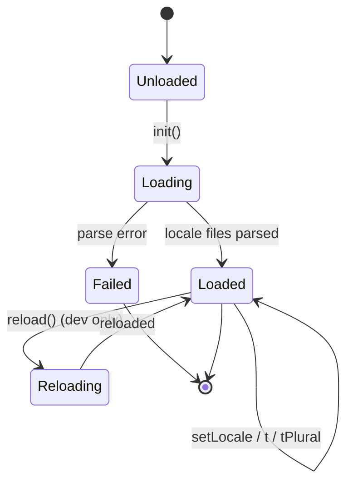
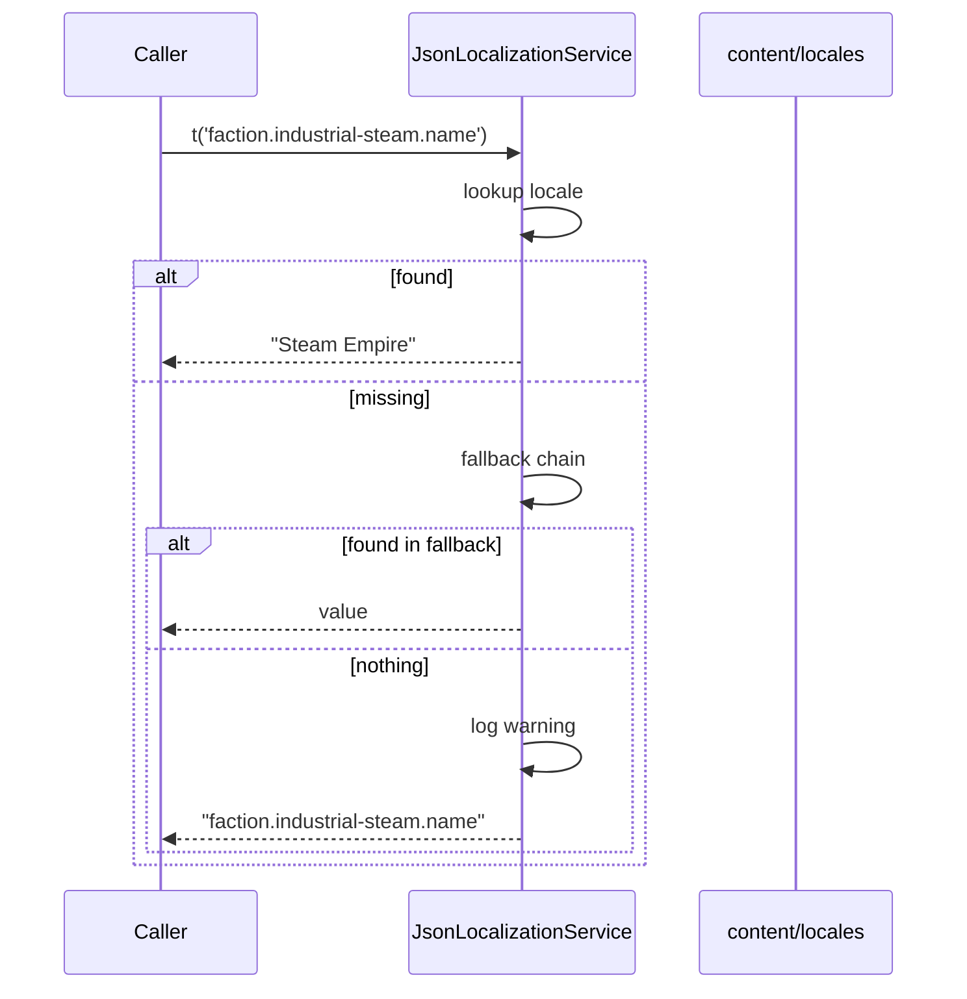

# DEV-SPEC-009 v1.0 — «Localization System»

**Тип документа:** Спецификация к разработке  
**Дата:** 2026-11-02  
**Статус:** ✅ реализовано в Wave 0  
**Реализация:** подтверждена 2026-11-14 — `bun run t:check` (117 тестов), `bun run ci:validate` (8/8 стадий)  
**Волна:** Wave 0  
**Зависит от:** `DEV-SPEC-001`, `DEV-SPEC-003`  
**Блокирует:** `DEV-SPEC-013` (UI), все доменные `DEV-SPEC` (у которых есть `display_name_key`), `DEV-SPEC-039`  
**Основана на:** все разделы `SPEC-*-020` в `DESIGN v1.0`, `GD-07`  
**Покрываемые DESIGN-блоки:** `SPEC-*-020` (все домены), `GD-07`  
**Связанные DESIGN-документы:** все `DESIGN v1.0`.

---

## 1. Назначение и границы

### 1.1. Что спецификация делает
Фиксирует механизм локализации всех `display_name_key` и текстовых ключей: загрузка locale-файлов, `t(key, params)`, плюрализация, интерполяция, fallback, hot reload (dev), валидация полноты ключей в CI.

### 1.2. Что спецификация НЕ делает
- Не описывает сами тексты (они — контент, не спека).
- Не описывает нарративные тексты (они — контент).
- Не описывает UI (→ `DEV-SPEC-013`).
- Не описывает форматирование чисел/дат (вне scope первой волны).

### 1.3. Связь с DESIGN

| DESIGN-блок | Реализация | Расхождения |
|---|---|---|
| Все `SPEC-*-020` | `LocalizationService.t(key)` | нет |
| `GD-07` | Locale-файлы как данные | нет |

---

## 2. Зависимости

### 2.1. Обязательные
`DEV-SPEC-001` (`Result`, `AppConfig`, `Logger`), `DEV-SPEC-003` (`IContentRegistry` для валидации).

### 2.2. Мягкие
Нет.

### 2.3. Внешние контракты
Нет.

---

## 3. Термины

| Термин | Определение |
|---|---|
| Locale | Язык + регион, например `en`, `ru` |
| Key | Строковый ID текста, `kebab-case` с точками |
| Fallback | Цепочка locale, из которой берётся перевод при отсутствии |
| Plural | Форма множественного числа |

---

## 4. Архитектурное размещение

### 4.1. Слои
`domain/localization/`, `infrastructure/localization/`.

### 4.2. Файлы

```text
src/
├── domain/
│   └── localization/
│       ├── ILocalizationService.ts
│       ├── LocalizationKey.ts
│       └── PluralForm.ts
├── infrastructure/
│   └── localization/
│       ├── JsonLocalizationService.ts
│       └── LocalizationValidator.ts
└── content/
    └── locales/
        ├── en.json
        └── ru.json
```

### 4.3. DI
- `ILocalizationService` → `JsonLocalizationService` (singleton).

---

## 5. Domain-модель

### 5.1. LocalizationKey

```ts
// domain/localization/LocalizationKey.ts
import type { Brand } from '../../shared/types/Brand';

export type LocalizationKey = string & Brand<string, 'LocalizationKey'>;

export function makeLocalizationKey(s: string): LocalizationKey {
  if (!/^[a-z][a-z0-9-]*(\.[a-z][a-z0-9-]*)+$/.test(s)) {
    throw new Error(`Invalid localization key: ${s}`);
  }
  return s as LocalizationKey;
}
```

### 5.2. PluralForm

```ts
// domain/localization/PluralForm.ts
export type PluralForm = 'zero' | 'one' | 'two' | 'few' | 'many' | 'other';
```

### 5.3. ILocalizationService

```ts
// domain/localization/ILocalizationService.ts
import type { LocalizationKey } from './LocalizationKey';
import type { Result } from '../../shared/types/Result';
import type { AppError } from '../../shared/errors/AppError';

export interface LocalizationParams {
  readonly [key: string]: string | number;
}

export interface ILocalizationService {
  readonly locale: string;
  readonly availableLocales: readonly string[];

  t(key: LocalizationKey, params?: LocalizationParams): string;

  tPlural(
    key: LocalizationKey,
    count: number,
    params?: LocalizationParams,
  ): string;

  has(key: LocalizationKey): boolean;

  setLocale(locale: string): Result<void, AppError>;

  reload(): Promise<Result<void, AppError>>;
}
```

**Инварианты:**
- `INV-01`: `t(key)` никогда не бросает; при отсутствии ключа возвращает `key` и логирует `warning`.
- `INV-02`: `t(key, params)` подставляет `{param}` из `params`.
- `INV-03`: Если `params` не содержит нужного ключа — оставляет `{param}` как есть, логирует `warning`.
- `INV-04`: `tPlural` выбирает форму по правилам locale (`en`: one/other; `ru`: one/few/many/other).
- `INV-05`: Fallback chain: `ru-RU → ru → en`. Если ни в одном нет ключа — возвращает `key`.
- `INV-06`: `setLocale` для неподдерживаемого locale → `Err`.
- `INV-07`: `reload` доступен только в `environment: 'dev'`.

### 5.4. Формат locale-файла

```json
{
  "$schema": "https://game/schemas/locale-file.json",
  "locale": "en",
  "entries": {
    "faction.industrial-steam.name": "Steam Empire",
    "companion.steam-engineer.name": "Steam Engineer",
    "party.morale.high": "High",
    "party.morale.low": "Low",
    "combat.duel-arena.name": "Duel Arena",
    "quest.delivery-coal-to-capital.description": "Deliver coal to the capital.",
    "plural.crew.count": {
      "one": "{count} crew member",
      "other": "{count} crew members"
    }
  }
}
```

Правила:
- Каждый ключ — `kebab-case` с точками.
- Значение — строка или объект `{ one, few, many, other }`.
- Интерполяция — `{paramName}`.
- Нет вложенных объектов, кроме plural.

---

## 6. Data-контракты и схемы

### 6.1. Пакет JSON Schema
Спека добавляет в `content/schemas/`:

```json
{
  "$id": "https://game/schemas/locale-file.json",
  "type": "object",
  "required": ["locale", "entries"],
  "properties": {
    "locale": { "type": "string", "pattern": "^[a-z]{2}(-[A-Z]{2})?$" },
    "entries": {
      "type": "object",
      "additionalProperties": {
        "oneOf": [
          { "type": "string", "minLength": 1 },
          {
            "type": "object",
            "additionalProperties": false,
            "properties": {
              "zero": { "type": "string" },
              "one": { "type": "string" },
              "two": { "type": "string" },
              "few": { "type": "string" },
              "many": { "type": "string" },
              "other": { "type": "string" }
            },
            "required": ["other"]
          }
        ]
      }
    }
  },
  "additionalProperties": false
}
```

### 6.2. TypeScript-типы
`LocalizationParams`, `PluralForm`.

### 6.3. Runtime-состояния
`locale` и `entries` в памяти; сериализуется в save.

### 6.4. Связь
Все `display_name_key` и `description_key` из DESIGN ссылаются на ключи в locale-файлах.

---

## 7. Рантайм-поведение

### 7.1. State machines



### 7.2. Sequence



### 7.3. Tick-контракт
Не применимо.

### 7.4. Порядок
- Загрузка при bootstrap: `ru.json`, `en.json` — оба, чтобы обеспечить fallback.
- `setLocale` меняет только указатель; entries остаются.

### 7.5. Идемпотентность и детерминизм
- `t` идемпотентен.
- `setLocale` идемпотентен.
- `reload` не детерминирован (dev only).

---

## 8. Порты и адаптеры

### 8.1. Порты
`ILocalizationService` (§5.3).

### 8.2. Адаптеры
- `JsonLocalizationService` — production.
- `InMemoryLocalizationService` — тесты.

### 8.3. Ошибки
- `INFRA_SCHEMA_INVALID` — невалидный locale-файл.
- `INFRA_CONTENT_NOT_FOUND` — `setLocale` для отсутствующего locale.

---

## 9. Интеграционные точки

### 9.1. Потребляемые события
Нет.

### 9.2. Эмитируемые события
- `locale.changed` (опционально, `core`) — для UI.

### 9.3. Порты других доменов
Используется всеми доменами через DI.

### 9.4. Мосты
Не применимо.

---

## 10. Обработка ошибок

### 10.1. Result
`setLocale` и `reload` → `Result<void, AppError>`.

### 10.2. Таблица

| Код | Когда | Лог |
|---|---|---|
| `INFRA_SCHEMA_INVALID` | locale-файл невалиден | file + path |
| `INFRA_CONTENT_NOT_FOUND` | `setLocale` для отсутствующего | locale |
| `warning` | `t` для отсутствующего ключа | key + locale |

### 10.3. Восстановление
- При невалидном locale-файле — не загружаем locale, остаётся fallback.
- При `t` для отсутствующего ключа — возвращаем `key`, логируем.

---

## 11. Критерии приёмки

### `DEV-SPEC-009-R01` — Базовый `t`
**Given** `en.json` с `faction.industrial-steam.name: "Steam Empire"`  
**When** `t('faction.industrial-steam.name')`  
**Then** `"Steam Empire"`

**AC:**
- `DEV-SPEC-009-AC01`: отсутствующий ключ → возвращает `key`.
- `DEV-SPEC-009-AC02`: `has(key)` корректно.

### `DEV-SPEC-009-R02` — Интерполяция
**Given** ключ `"crew.count": "{count} crew"`  
**When** `t('crew.count', { count: 5 })`  
**Then** `"5 crew"`

**AC:**
- `DEV-SPEC-009-AC03`: отсутствующий param оставляет `{count}`.
- `DEV-SPEC-009-AC04`: лишний param игнорируется.

### `DEV-SPEC-009-R03` — Плюрализация
**Given** `"plural.crew.count": { "one": "{count} member", "other": "{count} members" }`  
**When** `tPlural('plural.crew.count', 1)`  
**Then** `"1 member"`

**AC:**
- `DEV-SPEC-009-AC05`: `tPlural(key, 2)` → `"2 members"`.
- `DEV-SPEC-009-AC06`: для `ru` — 1 → `one`, 2 → `few`, 5 → `many`.

### `DEV-SPEC-009-R04` — Fallback
**Given** `ru` не имеет ключа, но `en` имеет  
**When** `setLocale('ru')` + `t(key)`  
**Then** возвращает `en`-значение

**AC:**
- `DEV-SPEC-009-AC07`: ни в одном нет → `key`.
- `DEV-SPEC-009-AC08`: `warning` залогирован.

### `DEV-SPEC-009-R05` — Валидация ключей
**Given** `content/` со ссылкой на `display_name_key: 'faction.unknown.name'`  
**When** `ci:validate --stage=gameplay`  
**Then** `CI-003` с правилом `gameplay/localization/key-exists`

**AC:**
- `DEV-SPEC-009-AC09`: все `display_name_key` из `content/` есть в `en.json`.
- `DEV-SPEC-009-AC10`: `ru.json` покрывает все ключи `en.json` (или warning).

---

## 12. Тест-план

### 12.1. Unit
- `makeLocalizationKey`: валидные/невалидные.
- `t`: базовый, интерполяция, отсутствующий ключ.
- `tPlural`: `en` и `ru`.
- `setLocale`: поддерживаемый/неподдерживаемый.
- Fallback chain.

### 12.2. Integration
- `JsonLocalizationService` + `content/locales/*.json`.
- Все `display_name_key` из `content/` валидны.

### 12.3. Contract
- `locale-file.json` валиден.
- `en.json` и `ru.json` проходят схему.

### 12.4. Determinism
- `t` идемпотентен.

### 12.5. E2E
- Смена locale в UI → все тексты обновились (после `DEV-SPEC-013`).

### 12.6. CI
- Правило `gameplay/localization/key-exists`.
- Правило `gameplay/localization/no-unused-keys` (warning).

---

## 13. Производительность

### 13.1. Бюджет
- `t` ≤ 1 мкс.
- Загрузка locale ≤ 50 мс.
- Память locale ≤ 500 КБ.

### 13.2. LOD
Не применимо.

### 13.3. Профилирование
Метрики: `t` count, missing keys count.

---

## 14. Миграции
При добавлении нового locale — аддитивно. При смене формата — новая версия схемы.

---

## 15. Открытые вопросы

| ID | Вопрос | Блокер? | Решение |
|---|---|---|---|
| `Q-01` | Хранить ли переводы в одном файле или по доменам? | нет | по одному файлу на locale |
| `Q-02` | Поддержка RTL | нет | отложено |
| `Q-03` | Форматирование чисел/дат | нет | отложено |

---

## 16. Что остаётся вне scope
- Нарративные тексты (это контент).
- Диалоги (это контент).
- UI-шрифты.
- RTL.

---

## 17. Трассировка на DESIGN

| DESIGN-блок | Требование | AC | Тест |
|---|---|---|---|
| Все `SPEC-*-020` | `DEV-SPEC-009-R01` | `DEV-SPEC-009-AC01` | `Localization.test.ts` |
| `GD-07` | `DEV-SPEC-009-R05` | `DEV-SPEC-009-AC09` | `LocalizationValidation.test.ts` |
| `SPEC-EPI-020` | `DEV-SPEC-009-R03` | `DEV-SPEC-009-AC05` | `Plural.test.ts` |