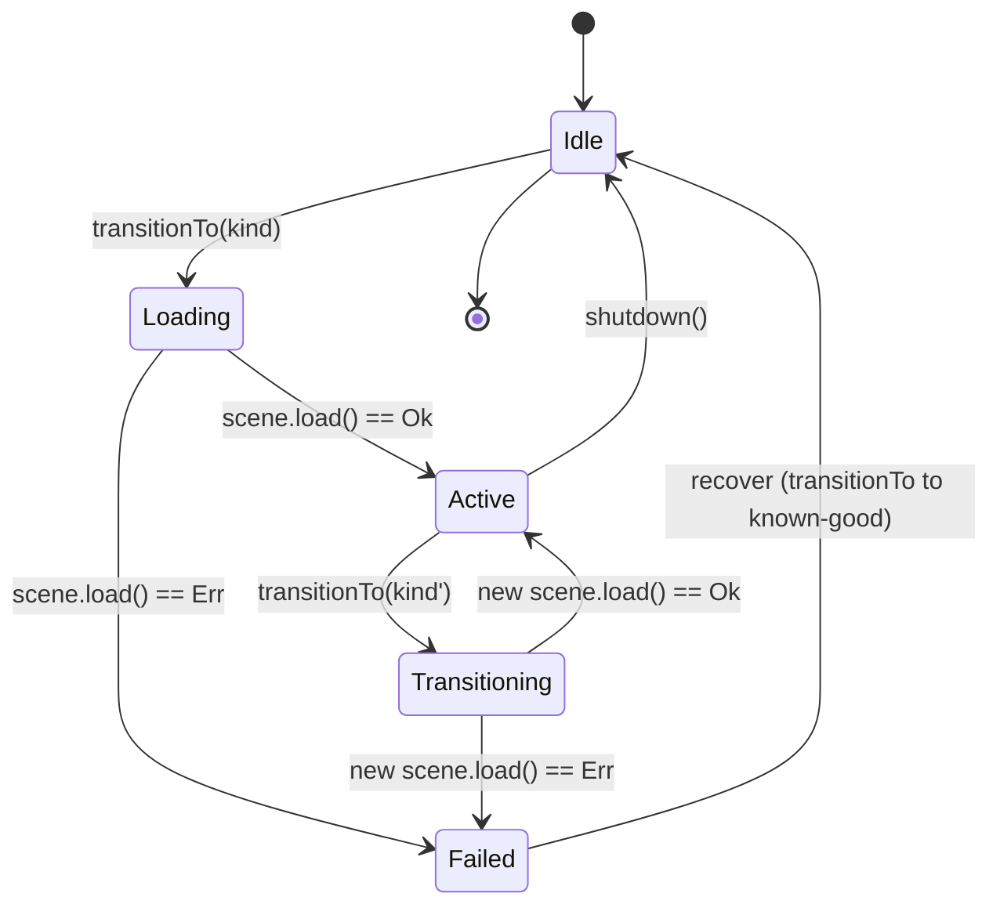
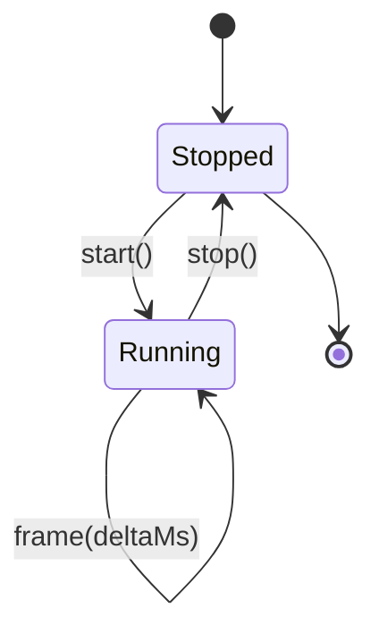
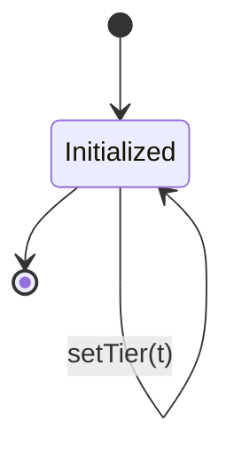
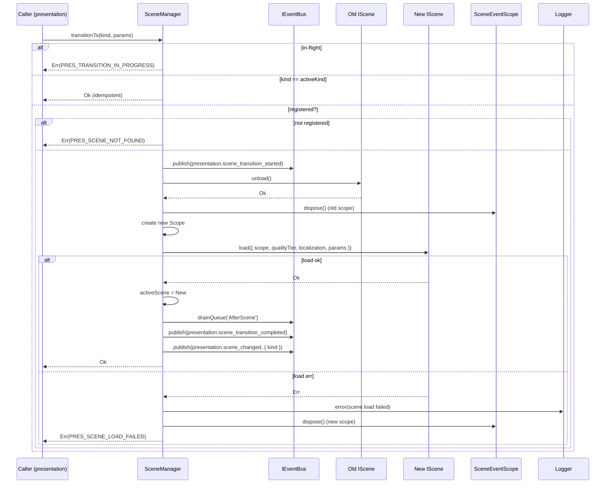

# DEV-SPEC-010 v1.0 — «Scene Manager & Render Pipeline»

**Тип документа:** Спецификация к разработке
**Дата:** 2026-11-02
**Статус:** draft
**Волна:** Wave 1
**Зависит от:** `DEV-SPEC-001`, `DEV-SPEC-002`, `DEV-SPEC-003`, `DEV-SPEC-007`, `DEV-SPEC-009`
**Блокирует:** `DEV-SPEC-011`, `DEV-SPEC-012`, `DEV-SPEC-013`, `DEV-SPEC-014`, `DEV-SPEC-015`, `DEV-SPEC-016`, `DEV-SPEC-039`
**Основана на:** `GENERAL DESIGN v1.0` (GD-01, GD-02, GD-11, GD-12, GD-13, GD-14), `DESIGN v1.0 — «Арт-дирекшн и шейдеры»` (SPEC-ART-002)
**Покрываемые DESIGN-блоки:** `GD-11`, `GD-12`, `GD-13`, `GD-14`, `SPEC-ART-002`
**Связанные DESIGN-документы:** `GENERAL DESIGN v1.0`, `DESIGN v1.0 — «Арт-дирекшн и шейдеры»`.

---

## 1. Назначение и границы

### 1.1. Что спецификация делает
Фиксирует управление сценами Babylon.js и render-пайплайн первого уровня:
- `SceneManager` — жизненный цикл сцен, переходы между режимами (world-map, combat, city, duel, epilogue), очистка подписок сцен на события;
- `RenderPipeline` — единый RAF-цикл, связывающий `IGameClock.advanceOneTick()` с покадровым рендером и интерполяцией (`InterpolationClock.alpha`);
- `BabylonEngineHost` — владелец `Engine` / `Scene` / `Camera` / `DeviceSourceManager`, единая точка создания Babylon-объектов;
- `QualityTierController` — единый владелец `qualityTier` (`low` / `medium` / `high`), реагирующий на `AppConfig` и эмитирующий `visual.quality_tier_changed`;
- `SceneEventScope` — scoped-подписка сцены на `IEventBus` с автоматическим `dispose()` при выгрузке сцены;
- триггер `eventBus.drainQueue('AfterScene')` при завершении перехода между сценами (согласно `DEV-SPEC-007` §7.3);
- контентные `SceneDefinition` (`content/scenes/*.json`).

### 1.2. Что спецификация НЕ делает
- Не описывает шейдеры и качественные проходы материалов (→ `DEV-SPEC-011`).
- Не описывает VFX-системы (→ `DEV-SPEC-012`).
- Не описывает UI (HTML/CSS + Babylon GUI) (→ `DEV-SPEC-013`).
- Не описывает ввод Desktop/Mobile (→ `DEV-SPEC-014`).
- Не описывает аудио (→ `DEV-SPEC-015`).
- Не описывает мобильную адаптацию и общий performance-бюджет (→ `DEV-SPEC-016`).
- Не описывает рендер конкретных игровых объектов (корабли, города, дуэлянты) — каждый домен даёт свой Babylon-адаптер в `DEV-SPEC-017…035`.
- Не описывает анимацию персонажей и VFX-анимации.

### 1.3. Связь с DESIGN

| DESIGN-блок | Реализация | Расхождения |
|---|---|---|
| `GD-11` | `SceneManager` с одной активной сценой на режим | нет |
| `GD-12` | Сцены подписываются на `IEventBus` через `SceneEventScope` | нет |
| `GD-13` | Сцены получают Use Cases через DI; прямые вызовы | нет |
| `GD-14` | `BabylonEngineHost` учитывает `AppConfig.mobile`; конкретные LOD — в `DEV-SPEC-016` | нет |
| `SPEC-ART-002` | `QualityTierController` владеет `qualityTier`; переключение — через событие | нет |

---

## 2. Зависимости

### 2.1. Обязательные
- `DEV-SPEC-001` — `Result`, `AppConfig`, `Logger`, `PresentationError`, `presentationError()`.
- `DEV-SPEC-002` — `IEventBus`, `drainQueue`, `DomainEvent`.
- `DEV-SPEC-003` — `IContentRegistry` (для валидации `SceneDefinition`).
- `DEV-SPEC-007` — `IGameClock` (включая `InterpolationClock.alpha`), `TickScheduler`.
- `DEV-SPEC-009` — `ILocalizationService` (для текстов загрузки сцен).

### 2.2. Мягкие
- `DEV-SPEC-004` — `IMechanicRuntime` (не используется напрямую, но сцены могут подписываться на события механик).

### 2.3. Внешние контракты
- `@babylonjs/core` (Engine, Scene, Camera, AbstractMesh, Light).
- `@babylonjs/gui` (не используется в этой спеке; → `DEV-SPEC-013`).
- `requestAnimationFrame`, `performance.now()`.
- `HTMLCanvasElement`.

---

## 3. Термины

| Термин | Определение |
|---|---|
| Scene | Игровой режим: `world-map`, `combat`, `city`, `duel`, `epilogue` |
| Active Scene | Единственная сцена, отрисовываемая в текущий момент |
| Transition | Переход из одной сцены в другую с промежуточной фазой загрузки |
| Render Frame | Один RAF-тик (~16.6 мс при 60 FPS), включающий tick-advance (если назрело) и `scene.render` |
| Interpolation Alpha | Фракция между предыдущим и следующим тактом (`[0, 1)`), из `InterpolationClock` |
| Quality Tier | `low` / `medium` / `high` — уровень детализации шейдеров (SPEC-ART-002) |
| Scene Event Scope | Подписка сцены на `IEventBus` с автоотпиской при выгрузке |

---

## 4. Архитектурное размещение

### 4.1. Слои
- `domain/rendering/` — порты (`IQualityTierController`, `QualityTier`).
- `presentation/scenes/` — `IScene`, `ISceneManager`, `IRenderPipeline`, `SceneManager`, `RenderPipeline`, `SceneEventScope`.
- `infrastructure/rendering/` — Babylon-адаптеры (`BabylonEngineHost`, `QualityTierController`, `Babylon*Scene`).

### 4.2. Файлы

```text
src/
├── domain/
│   └── rendering/
│       ├── QualityTier.ts
│       └── IQualityTierController.ts
├── presentation/
│   └── scenes/
│       ├── IScene.ts
│       ├── ISceneManager.ts
│       ├── IRenderPipeline.ts
│       ├── SceneEventScope.ts
│       ├── SceneManager.ts
│       ├── RenderPipeline.ts
│       └── SceneKinds.ts
├── infrastructure/
│   └── rendering/
│       ├── BabylonEngineHost.ts
│       ├── QualityTierController.ts
│       └── scenes/
│           ├── BabylonWorldMapScene.ts
│           ├── BabylonCombatScene.ts
│           ├── BabylonCityScene.ts
│           ├── BabylonDuelScene.ts
│           └── BabylonEpilogueScene.ts
└── content/
    └── scenes/
        ├── world-map.json
        ├── combat.json
        ├── city.json
        ├── duel.json
        └── epilogue.json
```

### 4.3. DI
- `IRenderPipeline` → `RenderPipeline` (singleton).
- `ISceneManager` → `SceneManager` (singleton).
- `IQualityTierController` → `QualityTierController` (singleton).
- `BabylonEngineHost` (singleton).
- `IScene` для каждого `kind` — singleton, регистрируются на bootstrap под уникальным токеном `SceneToken(kind)`.
- `SceneEventScope` — factory (transient, по экземпляру на активную сцену).

---

## 5. Domain-модель

### 5.1. SceneKind и SceneParams

```ts
// presentation/scenes/SceneKinds.ts
import type { Brand } from '../../shared/types/Brand';

export type SceneKind = string & Brand<string, 'SceneKind'>;

export const SCENE_KINDS = {
  WORLD_MAP: 'world-map' as SceneKind,
  COMBAT: 'combat' as SceneKind,
  CITY: 'city' as SceneKind,
  DUEL: 'duel' as SceneKind,
  EPILOGUE: 'epilogue' as SceneKind,
} as const;

export function makeSceneKind(s: string): SceneKind {
  if (!/^[a-z][a-z0-9-]*$/.test(s)) {
    throw new Error(`Invalid scene kind: ${s}`);
  }
  return s as SceneKind;
}

export type SceneParams = Readonly<Record<string, unknown>>;
```

### 5.2. QualityTier

```ts
// domain/rendering/QualityTier.ts
export type QualityTier = 'low' | 'medium' | 'high';

export const QUALITY_TIERS: readonly QualityTier[] = ['low', 'medium', 'high'];
```

### 5.3. IScene

```ts
// presentation/scenes/IScene.ts
import type { Result } from '../../shared/types/Result';
import type { AppError } from '../../shared/errors/AppError';
import type { SceneKind, SceneParams } from './SceneKinds';
import type { SceneEventScope } from './SceneEventScope';
import type { IQualityTierController } from '../../domain/rendering/IQualityTierController';
import type { ILocalizationService } from '../../domain/localization/ILocalizationService';

export interface SceneLoadContext {
  readonly sceneEventScope: SceneEventScope;
  readonly qualityTier: IQualityTierController;
  readonly localization: ILocalizationService;
  readonly params: SceneParams;
}

export interface IScene {
  readonly kind: SceneKind;

  load(ctx: SceneLoadContext): Promise<Result<void, AppError>>;

  unload(): Promise<Result<void, AppError>>;

  render(deltaMs: number, interpolationAlpha: number): void;

  handleResize(width: number, height: number): void;
}
```

**Инварианты:**
- `INV-01`: `load()` вызывается ровно один раз перед первым `render()`, и только когда `SceneManager` в состоянии `Loading`.
- `INV-02`: `render()` вызывается только после успешного `load()` и до `unload()`.
- `INV-03`: `unload()` идемпотентен: повторный вызов на выгруженной сцене возвращает `Ok`.
- `INV-04`: `SceneEventScope`, переданный в `load()`, автоматически `dispose()`-ится `SceneManager` после `unload()`.
- `INV-05`: `handleResize` вызывается только для активной сцены.

### 5.4. SceneEventScope

```ts
// presentation/scenes/SceneEventScope.ts
import type { IEventBus, EventHandler, SubscribeOptions } from '../../domain/events/IEventBus';
import type { DomainEvent } from '../../shared/events/DomainEvent';
import type { EventType } from '../../shared/events/EventType';

export interface SceneEventScope {
  subscribe<T extends DomainEvent>(
    type: EventType,
    handler: EventHandler<T>,
    options?: SubscribeOptions,
  ): void;

  isDisposed(): boolean;

  dispose(): void;
}
```

**Инварианты:**
- `INV-06`: после `dispose()` все внутренние подписки отписаны от `IEventBus`; повторный `subscribe` не бросает, но логирует `warn` и не подписывает.
- `INV-07`: `dispose()` идемпотентен.

### 5.5. ISceneManager

```ts
// presentation/scenes/ISceneManager.ts
import type { Result } from '../../shared/types/Result';
import type { AppError } from '../../shared/errors/AppError';
import type { IScene } from './IScene';
import type { SceneKind, SceneParams } from './SceneKinds';

export interface ISceneManager {
  readonly activeScene: IScene | null;
  readonly activeKind: SceneKind | null;

  register(scene: IScene): Result<void, AppError>;

  transitionTo(
    kind: SceneKind,
    params?: SceneParams,
  ): Promise<Result<void, AppError>>;

  handleResize(width: number, height: number): void;

  shutdown(): Promise<Result<void, AppError>>;
}
```

**Инварианты:**
- `INV-08`: `register()` вызывается на bootstrap, один раз на каждый `kind`; дублирующий `register` → `Err(PRES_SCENE_NOT_FOUND, meta.reason='duplicate-kind')`.
- `INV-09`: одновременно допустим только один in-flight `transitionTo`; параллельный вызов → `Err(PRES_TRANSITION_IN_PROGRESS)`.
- `INV-10`: `transitionTo` для незарегистрированного `kind` → `Err(PRES_SCENE_NOT_FOUND)`.
- `INV-11`: по завершении перехода `SceneManager` вызывает `eventBus.drainQueue('AfterScene')` (согласно `DEV-SPEC-007` §7.3).
- `INV-12`: `transitionTo(kind)` для того же `kind`, что и активный, возвращает `Ok` без перезагрузки (идемпотентно).
- `INV-13`: по завершении перехода `SceneManager` эмитит `presentation.scene_changed` через `IEventBus`.
- `INV-14`: `shutdown()` выгружает активную сцену, отписывает scope, останавливает RAF (через `RenderPipeline.stop()`) и возвращает `Ok`; повторный `shutdown` идемпотентен.

### 5.6. IRenderPipeline

```ts
// presentation/scenes/IRenderPipeline.ts
import type { Result } from '../../shared/types/Result';
import type { AppError } from '../../shared/errors/AppError';

export interface RenderPipelineMetrics {
  readonly frameCount: number;
  readonly lastFrameMs: number;
  readonly rollingFps: number;
  readonly tickCount: number;
}

export interface IRenderPipeline {
  readonly running: boolean;
  readonly metrics: RenderPipelineMetrics;

  start(): Result<void, AppError>;
  stop(): Result<void, AppError>;
}
```

**Инварианты:**
- `INV-15`: `start()` идемпотентен: повторный вызов возвращает `Ok` без второго RAF-цикла.
- `INV-16`: `stop()` идемпотентен; отменяет `requestAnimationFrame`.
- `INV-17`: на каждом кадре `RenderPipeline` вызывает `advanceOneTick()` столько раз, сколько «назрело» по `accumulatorMs` (см. §7.3).
- `INV-18`: на каждом кадре после возможных тиков `RenderPipeline` вызывает `activeScene.render(deltaMs, alpha)`.
- `INV-19`: если `IGameClock.state.paused === true`, `advanceOneTick()` не продвигает такт (согласно `DEV-SPEC-007` INV-11), но `render()` всё равно вызывается.
- `INV-20`: исключение в `activeScene.render()` логируется и не останавливает RAF-цикл.
- `INV-21`: `tickIntervalMs` берётся из `AppConfig.clock.tickIntervalMs`; `speedMultiplier` — из `IGameClock.state.speedMultiplier`.

### 5.7. IQualityTierController

```ts
// domain/rendering/IQualityTierController.ts
import type { Result } from '../../shared/types/Result';
import type { AppError } from '../../shared/errors/AppError';
import type { QualityTier } from './QualityTier';

export interface IQualityTierController {
  readonly current: QualityTier;

  setTier(tier: QualityTier): Result<void, AppError>;

  detectInitialTier(): QualityTier;
}
```

**Инварианты:**
- `INV-22`: `current` инициализируется из `AppConfig.qualityTier` при bootstrap.
- `INV-23`: `setTier` для невалидного значения (не из `QUALITY_TIERS`) → `Err(DOMAIN_INVARIANT_VIOLATION)`.
- `INV-24`: успешный `setTier` эмитит `visual.quality_tier_changed` через `IEventBus`.
- `INV-25`: `detectInitialTier()` возвращает `low` при отсутствии WebGL2 или неизвестных capabilities; иначе `medium` (эвристика, конкретика — в `DEV-SPEC-016`).

### 5.8. SceneDefinition (content)

```ts
// domain/rendering/SceneDefinition.ts — контент
export interface SceneDefinition {
  readonly id: string;
  readonly kind: string;
  readonly display_name_key: string;
  readonly transition_policy_id: string;
  readonly quality_overrides: Readonly<
    Partial<Record<QualityTier, Readonly<Record<string, unknown>>>>
  >;
  readonly camera_mode: string;
}
```

---

## 6. Data-контракты и схемы

### 6.1. Пакет JSON Schema
Спека добавляет в `content/schemas/`:

```json
{
  "$id": "https://game/schemas/scene-definition.json",
  "type": "object",
  "required": ["id", "kind", "display_name_key", "transition_policy_id", "camera_mode"],
  "properties": {
    "id": { "type": "string", "pattern": "^[a-z][a-z0-9-]*$" },
    "kind": { "type": "string", "pattern": "^[a-z][a-z0-9-]*$" },
    "display_name_key": { "type": "string" },
    "transition_policy_id": { "type": "string" },
    "quality_overrides": {
      "type": "object",
      "additionalProperties": {
        "type": "object"
      }
    },
    "camera_mode": { "type": "string" }
  },
  "additionalProperties": false
}
```

### 6.2. TypeScript-типы контента
`SceneDefinition` (§5.8).

### 6.3. Runtime-состояния
- `SceneManager` хранит `activeScene: IScene | null`, `activeKind: SceneKind | null`, `inFlightTransition: Promise<...> | null`.
- `RenderPipeline` хранит `running`, `rafHandle`, `accumulatorMs`, `lastFrameMs`, `frameCount`, `tickCount`.
- `QualityTierController` хранит `current`.
- Всё это **не** сериализуется в `SaveSnapshot`: `DEV-SPEC-006` не включает сцену/рендер. При загрузке сохранения `SceneManager` восстанавливается через `transitionTo(activeKind)` по событию `load.completed` (см. `DEV-SPEC-006` §9.2 — используется как триггер).

### 6.4. Связь definition ↔ instance
`SceneDefinition` (контент) читается через `IContentRegistry.get('scene', id)`. `IScene`-адаптеры (`Babylon*Scene`) — код, регистрируются на bootstrap. Соответствие `SceneDefinition.kind` ↔ `SceneKind` ↔ `Babylon*Scene` валидируется в CI.

---

## 7. Рантайм-поведение

### 7.1. State machines

**SceneManager:**



**RenderPipeline:**



**QualityTierController:**



### 7.2. Sequence — переход сцены



### 7.3. Render frame contract

`RenderPipeline` подписывается на `IGameClock.onFrame(callback)` — *extension, требующая амендмента к `DEV-SPEC-007` (см. Q-01)*. Получает `(deltaMs: number, alphaFromClock: number)`.

На каждом кадре:

1. `deltaMs = clamp(rawDeltaMs, 0, 100)` (защита от tab-sleep).
2. `accumulatorMs += deltaMs`.
3. `while (accumulatorMs >= tickIntervalMs)`:
   - `clock.advanceOneTick()` (может вернуть `Err` — лог, продолжить).
   - `accumulatorMs -= tickIntervalMs`.
   - `tickCount++`.
4. `alpha = accumulatorMs / tickIntervalMs` (или `alphaFromClock`, если доступно).
5. `activeScene.render(deltaMs, alpha)` в try/catch: исключение → `Logger.error`, кадр продолжается.
6. Обновить `metrics.rollingFps` (EMA по `1000 / deltaMs`).

**Инварианты:**
- `INV-26`: `advanceOneTick` вызывается только из `RenderPipeline` — это гарантирует единый источник такта. Доменные сервисы не должны звать `advanceOneTick` напрямую.
- `INV-27`: при `paused === true` `tickIntervalMs` всё ещё аккумулируется, но `advanceOneTick` no-op; `alpha` замораживается на `state.currentTickProgress` (`DEV-SPEC-007` §5.2).

### 7.4. Порядок
- При старте: `BabylonEngineHost.init()` → `QualityTierController.init()` → `RenderPipeline.start()` → `SceneManager.transitionTo('world-map')`.
- При завершении: `SceneManager.shutdown()` → `RenderPipeline.stop()` → `BabylonEngineHost.dispose()`.
- Переход: строго последовательный, без параллельных `transitionTo`.

### 7.5. Идемпотентность и детерминизм
- `SceneManager.transitionTo(kind)` при `kind === activeKind` — `Ok`, без эффектов.
- `QualityTierController.setTier(t)` при `t === current` — `Ok`, без эмита.
- Render frame не влияет на детерминизм домена: рендер читает только `InterpolationClock.alpha` и текущее состояние (read-only). Случайность в рендере — только через `SeededRngService` с потоком `rng.visual.*` (см. `DEV-SPEC-005` §5.4).
- `presentation.scene_changed` эмитится только при реальном изменении — детерминировано относительно `transitionTo`.

---

## 8. Порты и адаптеры

### 8.1. Порты
- `IScene` (§5.3)
- `ISceneManager` (§5.5)
- `IRenderPipeline` (§5.6)
- `IQualityTierController` (§5.7)
- `SceneEventScope` (§5.4)

### 8.2. Адаптеры
- `SceneManager` — production.
- `RenderPipeline` — production.
- `QualityTierController` — production.
- `BabylonEngineHost` — production.
- `BabylonWorldMapScene` / `BabylonCombatScene` / `BabylonCityScene` / `BabylonDuelScene` / `BabylonEpilogueScene` — production (реализуют `IScene`).
- `InMemorySceneManager` — тесты (реализует `ISceneManager` без Babylon).
- `ManualRenderPipeline` — тесты (реализует `IRenderPipeline` с ручным `tickFrame()`).
- `FixedQualityTierController` — тесты (всегда возвращает фиксированный `QualityTier`).

### 8.3. Контракт ошибок
Ошибки — `PresentationError` (или `InfrastructureError` для схемы `SceneDefinition`):

| Код | Слой | Когда |
|---|---|---|
| `PRES_SCENE_NOT_FOUND` | presentation | `transitionTo` для незарегистрированного kind; дубликат `register` |
| `PRES_SCENE_LOAD_FAILED` | presentation | `IScene.load()` вернул `Err` |
| `PRES_TRANSITION_IN_PROGRESS` | presentation | Параллельный `transitionTo` |
| `PRES_RENDER_FAILED` | presentation | Некритичный сбой рендера (лог, продолжение) |
| `INFRA_SCHEMA_INVALID` | infrastructure | `SceneDefinition` не прошёл схему |
| `DOMAIN_INVARIANT_VIOLATION` | domain | `setTier` с невалидным значением |

> ⚠️ **Требуется амендмент `DEV-SPEC-001` §5.3**: расширить `PresentationErrorCode` новыми значениями `PRES_SCENE_LOAD_FAILED`, `PRES_TRANSITION_IN_PROGRESS`. Зафиксировано в Q-02.

---

## 9. Интеграционные точки

### 9.1. Потребляемые события
- `load.completed` — для восстановления активной сцены после загрузки сохранения (из `DEV-SPEC-006`).
- `presentation.scene_changed` (собственное) — внутреннее.

### 9.2. Эмитируемые события
- `presentation.scene_changed` — **новое**, регистрируется в `content/events/core.json`. Payload: `{ kind: SceneKind, previousKind: SceneKind | null, tick: number }`. `default_delivery_policy: 'Immediate'`.
- `presentation.scene_transition_started` — **новое**, `Immediate`. Payload: `{ from: SceneKind | null, to: SceneKind }`.
- `presentation.scene_transition_completed` — **новое**, `Immediate`. Payload: `{ from: SceneKind | null, to: SceneKind, durationMs: number }`.
- `visual.quality_tier_changed` — существующее (в каталоге `DEV-SPEC-002`). Payload: `{ previous: QualityTier, next: QualityTier }`.

> ⚠️ **Требуется амендмент `DEV-SPEC-002` §9.4** — добавить три `presentation.*` события в каноническое ядро. Зафиксировано в Q-03.

### 9.3. Порты других доменов
- `IEventBus` (из `DEV-SPEC-002`) — для подписок сцен и эмита собственных событий.
- `IContentRegistry` (из `DEV-SPEC-003`) — загрузка `SceneDefinition`.
- `IGameClock` (из `DEV-SPEC-007`) — драйвер такта и интерполяции.
- `ILocalizationService` (из `DEV-SPEC-009`) — передаётся в `SceneLoadContext`.
- Use Cases (из `application/`) — сцены получают их через DI-контейнер.

### 9.4. Мосты
Не применимо (presentation — терминальный слой).

---

## 10. Обработка ошибок

### 10.1. Result
Все методы `ISceneManager`, `IScene`, `IRenderPipeline`, `IQualityTierController` возвращают `Result<T, AppError>`. Исключения во внутренних callback (`render`) ловятся и логируются.

### 10.2. Таблица

| Код | Когда | Лог | Восстановление |
|---|---|---|---|
| `PRES_SCENE_NOT_FOUND` | `transitionTo` на неизвестный kind | kind | `Err`, вызывающий решает |
| `PRES_SCENE_LOAD_FAILED` | `scene.load()` вернул `Err` | kind, cause | `Err`, восстановление — `transitionTo` на известную сцену |
| `PRES_TRANSITION_IN_PROGRESS` | Параллельный `transitionTo` | kind | `Err`, игнор |
| `PRES_RENDER_FAILED` | Исключение в `scene.render()` | kind, stack | лог, продолжение кадра |
| `DOMAIN_INVARIANT_VIOLATION` | `setTier` с невалидным значением | tier | `Err` |

### 10.3. Восстановление
- При `PRES_SCENE_LOAD_FAILED` — сцена не становится `active`; `SceneManager` переходит в `Failed`. Восстановление — `transitionTo(kind)` с корректной целью.
- При `PRES_RENDER_FAILED` — кадр продолжается; при частых ошибках (порог — 10 подряд) `RenderPipeline` логирует `error` (но не останавливается, чтобы не блокировать игру).

---

## 11. Критерии приёмки

### `DEV-SPEC-010-R01` — Базовый переход сцены
**Given** `SceneManager` с зарегистрированным `babylon-world-map` и `babylon-combat`, активная сцена — `world-map`
**When** `transitionTo(SCENE_KINDS.COMBAT)`
**Then** возвращает `Ok`; `activeKind === COMBAT`; события `presentation.scene_transition_started` / `_completed` / `_changed` эмитированы; `eventBus.drainQueue('AfterScene')` вызван ровно один раз.

**AC:**
- `DEV-SPEC-010-AC01`: `activeScene` до и после различаются.
- `DEV-SPEC-010-AC02`: старый scope `dispose`-нут; новый — активен.
- `DEV-SPEC-010-AC03`: `transitionTo(COMBAT)` при уже активном `COMBAT` возвращает `Ok` без событий.
- `DEV-SPEC-010-AC04`: `transitionTo` на незарегистрированный kind → `Err(PRES_SCENE_NOT_FOUND)`.

### `DEV-SPEC-010-R02` — AfterScene drain
**Given** `NextTick`-событие в очереди, готовое к `drainQueue('NextTick')`, и `AfterScene`-событие в очереди
**When** `transitionTo` завершается
**Then** `drainQueue('AfterScene')` вызван; `NextTick` **не** тронут (это делает `TickScheduler`).

**AC:**
- `DEV-SPEC-010-AC05`: `drainQueue('AfterScene')` вызван ровно один раз на переход.
- `DEV-SPEC-010-AC06`: `drainQueue('NextTick')` не вызывается из `SceneManager`.

### `DEV-SPEC-010-R03` — SceneEventScope
**Given** сцена подписалась на `event.x` через `SceneEventScope`
**When** `transitionTo` на другую сцену
**Then** старая подписка отписана; сцена больше не получает `event.x`.

**AC:**
- `DEV-SPEC-010-AC07`: `dispose` идемпотентен.
- `DEV-SPEC-010-AC08`: после `dispose` `subscribe` не подписывает, но логирует `warn`.
- `DEV-SPEC-010-AC09`: подписка внутри `load()` работает до `unload()`.

### `DEV-SPEC-010-R04` — RenderPipeline frame
**Given** `tickIntervalMs: 100`, `speedMultiplier: 1.0`
**When** 350 мс RAF-кадров вызваны с шагом 16 мс
**Then** `advanceOneTick` вызван 3 раза; на каждом кадре `activeScene.render(deltaMs, alpha)` вызван; `alpha ∈ [0, 1)`.

**AC:**
- `DEV-SPEC-010-AC10`: `stop()` отменяет RAF; после него `render` не вызывается.
- `DEV-SPEC-010-AC11`: `start()` идемпотентен — второй вызов не создаёт второй RAF.
- `DEV-SPEC-010-AC12`: при `paused === true` `advanceOneTick` no-op, но `render` продолжается.
- `DEV-SPEC-010-AC13`: исключение в `render` логируется, кадр продолжается.

### `DEV-SPEC-010-R05` — QualityTierController
**Given** `AppConfig.qualityTier: 'medium'`
**When** `QualityTierController` инициализируется
**Then** `current === 'medium'`; при `setTier('high')` — эмитится `visual.quality_tier_changed`, `current === 'high'`.

**AC:**
- `DEV-SPEC-010-AC14`: `setTier('invalid')` → `Err(DOMAIN_INVARIANT_VIOLATION)`.
- `DEV-SPEC-010-AC15`: `setTier('high')` при уже `high` — `Ok`, без эмита.
- `DEV-SPEC-010-AC16`: `detectInitialTier()` возвращает `low`, если WebGL2 недоступен (мок).

### `DEV-SPEC-010-R06` — DI-регистрация и bootstrap
**Given** `DependencyContainer.build(config)`
**When** резолвлю `ISceneManager`, `IRenderPipeline`, `IQualityTierController`
**Then** получаю singleton-экземпляры.

**AC:**
- `DEV-SPEC-010-AC17`: повторный resolve — тот же экземпляр.
- `DEV-SPEC-010-AC18`: `IScene` для каждого kind резолвится по `SceneToken(kind)`.
- `DEV-SPEC-010-AC19`: `SceneManager.register(scene)` для дубликата kind → `Err(PRES_SCENE_NOT_FOUND)`.

---

## 12. Тест-план

### 12.1. Unit
- `makeSceneKind`: валидные/невалидные (10 кейсов).
- `SceneManager.register` / `transitionTo` / `shutdown` (mock `IScene`).
- `SceneEventScope`: subscribe / dispose / idempotency.
- `RenderPipeline` (с `ManualGameClock` + `ManualRenderPipeline`): накопление, alpha, пауза.
- `QualityTierController.setTier` / `detectInitialTier` (mock WebGL).
- `makeSceneKind` brand-валидация.

### 12.2. Integration
- `SceneManager` + `InMemoryEventBus` + `drainQueue('AfterScene')`.
- `RenderPipeline` + `ManualGameClock` + `TickScheduler` (полный такт).
- `QualityTierController` + `IEventBus` → подписчик получает `visual.quality_tier_changed`.
- `SceneManager.transitionTo` → `presentation.scene_changed` доходит до подписчика.

### 12.3. Contract
- Все `content/scenes/*.json` проходят `scene-definition.json`.
- `SceneDefinition.kind` соответствует `SCENE_KINDS`.
- `presentation.scene_changed` / `_transition_started` / `_completed` зарегистрированы в `content/events/core.json` (после амендмента `DEV-SPEC-002`).

### 12.4. Determinism
- `RenderPipeline` дважды с одинаковыми `deltaMs` + `seed` даёт одинаковую последовательность `advanceOneTick`.
- `SceneManager.transitionTo` идемпотентен по `activeKind`.

### 12.5. E2E
- Запуск `RenderPipeline` + `SceneManager` (mock Babylon), 10 кадров, проверка `metrics.frameCount === 10`.
- `transitionTo('combat')` → рендер идёт, сцена `combat` активна.

### 12.6. CI
- `scene-definition.json` валиден.
- Все `Babylon*Scene` зарегистрированы на bootstrap.
- События `presentation.*` присутствуют в каталоге.
- `IRenderPipeline.advanceOneTick` — единственный вызов в `src/` (grep-rule).

---

## 13. Производительность

### 13.1. Бюджет
- Полный кадр `RenderPipeline` ≤ 16.6 мс на десктопе, ≤ 33.3 мс на мобильном (30 FPS floor).
- `SceneManager.transitionTo` (без `scene.load`) ≤ 5 мс.
- `IScene.load` асинхронный, ≤ 300 мс на десктопе, ≤ 1000 мс на мобильном.
- Память Babylon Engine — вне scope этой спеки (LOD и limits — в `DEV-SPEC-016`).

### 13.2. LOD
- `QualityTierController` управляет глобальным tier; конкретные LOD/шейдерные проходы — в `DEV-SPEC-011` и `DEV-SPEC-016`.
- `AppConfig.mobile === true` инициализирует `current` в `low`, если `detectInitialTier()` не определил иное.

### 13.3. Профилирование
- Метрики `RenderPipeline.metrics`: `frameCount`, `lastFrameMs`, `rollingFps`, `tickCount`. Логируются в `debug` раз в 5 секунд.

---

## 14. Миграции
Не применимо: сцена и рендер не сериализуются в `SaveSnapshot`. Версии `scene-definition.json` — через `id` контента, миграции — в рамках общего пайплайна миграций (вне scope).

---

## 15. Открытые вопросы

| ID | Вопрос | Блокер? | Решение |
|---|---|---|---|
| `Q-01` | Как `RenderPipeline` синхронизируется с RAF `IGameClock`? Сейчас `IGameClock` (DEV-SPEC-007) не отдаёт `onFrame`. | **да** | Предлагается амендмент `DEV-SPEC-007`: добавить `onFrame(cb: (deltaMs: number, alpha: number) => void): () => void`. Альтернатива — `RenderPipeline` использует `ManualGameClock` и владеет RAF. Требуется решение. |
| `Q-02` | `PresentationErrorCode` (DEV-SPEC-001) содержит только `PRES_SCENE_NOT_FOUND`, `PRES_INPUT_UNSUPPORTED`, `PRES_RENDER_FAILED`. Нужны `PRES_SCENE_LOAD_FAILED`, `PRES_TRANSITION_IN_PROGRESS`. | **да** | Амендмент `DEV-SPEC-001` §5.3: расширить union. |
| `Q-03` | Три `presentation.*` события отсутствуют в каталоге `DEV-SPEC-002` §9.4. | **да** | Амендмент `DEV-SPEC-002` §9.4: добавить `presentation.scene_changed`, `_transition_started`, `_completed` как `core`, `Immediate`. |
| `Q-04` | Что делать при `scene.load` ошибке — оставлять старую сцену активной (fail-safe) или переходить в `Failed` без рендера? | нет | Fail-safe: старая сцена остаётся активной; `activeKind` не меняется; логируется `error`. Согласуется с §7.1. |
| `Q-05` | Должен ли `SceneManager` сам подписываться на `load.completed` (DEV-SPEC-006) для восстановления сцены? | нет | Да — bootstrap подписывается на `load.completed` и вызывает `transitionTo(snapshot.activeKind ?? 'world-map')`. Логика — в `GameBootstrap`, не в `SceneManager`. |

---

## 16. Что остаётся вне scope
- Шейдеры и материалы (→ `DEV-SPEC-011`).
- VFX (→ `DEV-SPEC-012`).
- UI (→ `DEV-SPEC-013`).
- Ввод Desktop/Mobile (→ `DEV-SPEC-014`).
- Аудио (→ `DEV-SPEC-015`).
- Мобильная адаптация и общий performance budget (→ `DEV-SPEC-016`).
- Рендер игровых сущностей (корабли, города, персонажи) — каждая доменная спека.
- Анимации скелетов и морфинг.
- Сетевые/мультиплеерные сценарии.
- Восстановление сцены после загрузки save (кроме точки входа).

---

## 17. Трассировка на DESIGN

| DESIGN-блок | Требование | AC | Тест |
|---|---|---|---|
| `GD-11` | `DEV-SPEC-010-R01` | `DEV-SPEC-010-AC01` | `SceneManager.test.ts` |
| `GD-12` | `DEV-SPEC-010-R03` | `DEV-SPEC-010-AC07` | `SceneEventScope.test.ts` |
| `GD-13` | `DEV-SPEC-010-R06` | `DEV-SPEC-010-AC18` | `SceneManager.test.ts` |
| `GD-14` | `DEV-SPEC-010-R05` | `DEV-SPEC-010-AC14` | `QualityTierController.test.ts` |
| `SPEC-ART-002` | `DEV-SPEC-010-R05` | `DEV-SPEC-010-AC14` | `QualityTierController.test.ts` |
| `DEV-SPEC-007` §7.3 (`AfterScene`) | `DEV-SPEC-010-R02` | `DEV-SPEC-010-AC05` | `SceneManager.test.ts` |