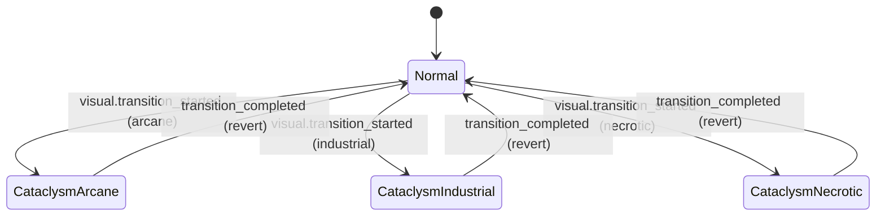
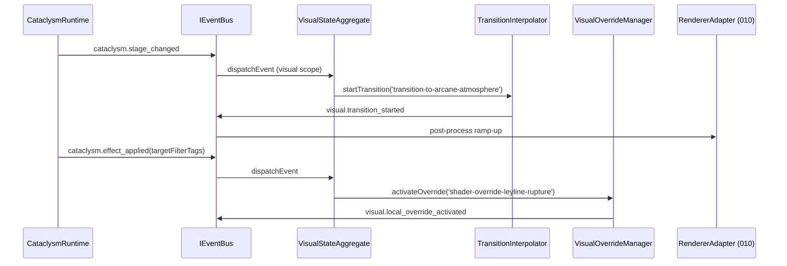

# DEV-SPEC-011 v1.0 — «Shader Pipeline & Quality Tiers»

**Тип документа:** Спецификация к разработке
**Дата:** 2026-11-03
**Статус:** draft
**Волна:** Wave 1
**Зависит от:** `DEV-SPEC-001…004`, `DEV-SPEC-007`, `DEV-SPEC-010`
**Блокирует:** `DEV-SPEC-012`, `DEV-SPEC-016`, `DEV-SPEC-039`
**Основана на:**
`DESIGN v1.0 — «Арт-дирекшн и шейдеры»` (SPEC-ART-001…005, 021…028, 050…051, 060…061, 070…073, 080…085)
`GENERAL DESIGN v1.0` (GD-07, GD-08, GD-09, GD-14)
**Покрываемые DESIGN-блоки:** `SPEC-ART-001…005`, `SPEC-ART-021…028`, `SPEC-ART-050…051`, `SPEC-ART-060…061`, `SPEC-ART-070…073`, `SPEC-ART-080…085`
**Связанные DESIGN-документы:** `DESIGN v1.0 — «Арт-дирекшн и шейдеры»`, `GENERAL DESIGN v1.0`

---

## 1. Назначение и границы

### 1.1. Что спецификация делает
Фиксирует data-driven шейдерный пайплайн визуальной подсистемы:
- content-сущности `StylizationProfileDefinition`, `ShaderQualityTierDefinition`, `FactionVisualDoctrineDefinition`, `MaterialDefinition`, `ShaderGraphDefinition`, `GlobalPostProcessProfileDefinition`, `LocalShaderOverrideDefinition`, `ShaderTransitionPolicyDefinition`;
- рантайм-контроллер качества (`ShaderQualityController`) — потребитель `visual.quality_tier_changed`;
- процедурное блендирование параметров шейдеров по `transition_policy_id` (`TransitionInterpolator`);
- активацию/деактивацию глобальных пост-процессинговых профилей и локализованных оверрайдов по событиям моста visual ↔ cataclysm/combat/world;
- `VisualResolver`/`VisualOverrideTracker`-механики в общем реестре `MechanicDefinition`;
- состав контента первой волны (4 доктрины, 8+ материалов, 6+ графов, 4+ пост-процесса, 4+ оверрайда, 4+ перехода).

### 1.2. Что спецификация НЕ делает
- Не описывает спавн/уничтожение VFX-систем (→ `DEV-SPEC-012`).
- Не описывает рендер со сцены и переходы сцен (→ `DEV-SPEC-010`).
- Не описывает мобильный бюджет производительности (→ `DEV-SPEC-016`).
- Не описывает UI/ввод/аудио (→ `DEV-SPEC-013/014/015`).
- Не фиксирует числовой баланс, uniform-значения и ассеты (контент — data).
- Не описывает сами GLSL-программы конкретных графов (код адаптеров — контент + плагины).

### 1.3. Связь с DESIGN

| DESIGN-блок | Как реализуется | Расхождения |
|---|---|---|
| `SPEC-ART-001` стилизация | `StylizationProfileDefinition` + базовый PBR-граф | нет |
| `SPEC-ART-002` качество | `ShaderQualityTierDefinition` × 3 тиров + `ShaderQualityController` | нет |
| `SPEC-ART-003` асимметрия | `FactionVisualDoctrineDefinition` × 4, уникальные графы и VFX-ссылки | нет |
| `SPEC-ART-004` катаклизмы | `GlobalPostProcessProfileDefinition` + `LocalShaderOverrideDefinition` | нет |
| `SPEC-ART-005` блендирование | `ShaderTransitionPolicyDefinition` + `TransitionInterpolator` | нет |

---

## 2. Зависимости

### 2.1. Обязательные
- `DEV-SPEC-001` — `Result`, `AppConfig`, `Logger`, brанийные ID (`InjectionKeys`).
- `DEV-SPEC-002` — `IEventBus`, `EventRegistry` (17 ядерных событий visual/shader, §4).
- `DEV-SPEC-003` — `IContentRegistry`, `AjvSchemaValidator`, схемы контента (8 новых, §6).
- `DEV-SPEC-004` — `MechanicRuntime`, `StateSchemaValidator` (`visual` scope механики).
- `DEV-SPEC-005` — `SeededRngService` (потоки `rng.visual.*`).
- `DEV-SPEC-006` — `VisualStateMementoProvider` (в виртуальном ранм отличе).
- `DEV-SPEC-007` — `TickScheduler` фазы `visual`.
- `DEV-SPEC-010` — `QualityTierController`, `BabylonEngineHost` (подключение к пайплайну).

### 2.2. Мягкие
Мосты с катаклизмами (`DEV-SPEC-025`), боем (`DEV-SPEC-029`), миром (`DEV-SPEC-023`) через события.

### 2.3. Внешние контракты
- `@babylonjs/core` (`Material`, `PostProcessRenderPipeline`, `EffectWrapper`, `ParticleSystem`).

---

## 3. Термины

| Термин | Определение |
|---|---|
| Quality Pass | Именованный проход шейдера (`base_color`, `reflections`, `volumetric_fog`, `complex_particles` и т.д.) |
| Quality Tier | `low` / `medium` / `high` — агрегированный уровень качества |
| Transition | Вектор интерполяции между визуальными состояниями (from/to параметры) |
| Override | Локализованных шейдерный оверрайд, применяемый к таргет-сущностям по фильтр-тегам |
| Dominance Index | Паре (`dominance_in_view`, `visual_influence`) — заметность фракции в текущем экране |

---

## 4. Событийная модель

### 4.1. Ядерные события (17 — потребитель/эмитер)
События из `SPEC-ART-040`: `visual.quality_tier_changed`, `visual.material_parameter_changed`, `visual.shader_uniform_updated`, `visual.post_process_profile_activated`, `visual.post_process_profile_deactivated`, `visual.local_override_activated`, `visual.local_override_deactivated`, `visual.override_intensity_changed`, `visual.transition_started`, `visual.transition_completed`, `visual.vfx_system_spawned`*(только контракт — спавн в 012)*, `visual.vfx_system_destroyed`*, `visual.faction_visual_dominance_changed`, `visual.cataclysm_visual_manifested`, `visual.narrative_visual_cue_triggered`, `shader.graph_switched`, `shader.technique_activated`.

### 4.2. Потребляемые мосты (SPEC-ART-042)
- cataclysm → visual: `cataclysm.triggered` → `visual.cataclysm_visual_manifested`; `cataclysm.stage_changed` → `visual.transition_started`; `cataclysm.effect_applied` → `visual.local_override_activated`; `cataclysm.ended` → `visual.post_process_profile_deactivated`.
- combat → visual: `combat.started` → боевой пост-процесс профиля; `combat.ended` → деактивация.
- world → visual: `world.time_of_day_changed`, `world.weather_changed` → активация пост-процесса.
- faction → visual: `faction.dominance_changed` → `visual.faction_visual_dominance_changed`.
- companion → visual: `companion.reaction_triggered_macro` → `visual.narrative_visual_cue_triggered`.
- narrative → visual: публикация фактов в `EpilogueFactPort` через `visual.fact_recorded` (`epilogue.visual.*`, 3 типа).

### 4.3. Инварианты событий
- `SA-01`: события визуальной модели выпускаются только через `EventRegistry` — буферный резолв при создании события.
- `SA-02`: механики содержат `role_tags` либо `visual`, либо `shader`.
- `SA-03`: namespace — `visual.*` и `shader.*`.

---

## 5. Domain-модель

### 5.1. Content-сущности (контракт TS — все readonly)

```ts
// src/domain/content/visual/StylizationProfileDefinition.ts
export interface StylizationProfileDefinition {
  readonly id: string;                       // EntityId
  readonly display_name_key: string;         // LocalizationKey
  readonly base_model: 'stylized_pbr' | 'toonshaded' | 'cel_shaded';
  readonly key_visual_markers: readonly VisualMarkerId[];  // ≥1
  readonly quality_policy_id: string;        // наша ShaderQualityPolicy полиси
  readonly default_material_policy_id: string;
}
```

```ts
// src/domain/content/visual/ShaderQualityTierDefinition.ts
export type ShaderQualityPass = 'base_color' | 'normal' | 'emission' | 'reflections' | 'volumetric_fog' | 'complex_particles';
export interface ShaderQualityTierDefinition {
  readonly id: string;
  readonly quality_tier: 'low' | 'medium' | 'high';
  readonly enabled_passes: readonly ShaderQualityPass[];
  readonly disabled_passes: readonly ShaderQualityPass[];
  readonly target_fps_policy_id: string;
}
```

```ts
// src/domain/content/visual/FactionVisualDoctrineDefinition.ts
export interface FactionVisualDoctrineDefinition {
  readonly id: string;
  readonly faction_id: string;
  readonly display_name_key: string;
  readonly description_key: string;
  readonly primary_palette_id: string;
  readonly secondary_palette_id: string;
  readonly emission_color_id: string;
  readonly unique_shader_technique_ids: readonly string[];  // ≥1
  readonly unique_vfx_system_ids: readonly string[];        // ≥1
  readonly material_policy_id: string;
  readonly visual_markers: readonly VisualMarkerId[];
}
```

```ts
// src/domain/content/visual/MaterialDefinition.ts
export interface MaterialDefinition {
  readonly id: string;
  readonly display_name_key: string;
  readonly shader_graph_id: string;
  readonly base_parameters: Readonly<Record<string, unknown>>;  // concrete uniform values (data)
  readonly quality_overrides?: Readonly<{
    low?: Readonly<Record<string, unknown>>;
    medium?: Readonly<Record<string, unknown>>;
    high?: Readonly<Record<string, unknown>>;
  }>;
}
```

```ts
// src/domain/content/visual/ShaderGraphDefinition.ts
export type ShaderGraphType = 'pbr_stylized' | 'fresnel_rim' | 'distortion_field' | 'refraction' | 'volumetric_fog' | 'dissolve_surface';
export interface ShaderGraphDefinition {
  readonly id: string;
  readonly display_name_key: string;
  readonly graph_type: ShaderGraphType;
  readonly input_parameters: readonly GraphParameterDeclaration[];  // ≥1
  readonly output_parameters: readonly string[];
  readonly quality_tier_ids: readonly string[];  // ≥1
  readonly mechanic_ids: readonly string[];      // visual scope механики
}
```

```ts
// src/domain/content/visual/GlobalPostProcessProfileDefinition.ts
export interface GlobalPostProcessProfileDefinition {
  readonly id: string;
  readonly display_name_key: string;
  readonly color_grading_policy_id?: string;
  readonly fog_policy_id?: string;
  readonly bloom_policy_id?: string;
  readonly distortion_policy_id?: string;
  readonly ambient_particles_policy_id?: string;
  readonly transition_policy_id?: string;
}  // минимум одна политика задана
```

```ts
// src/domain/content/visual/LocalShaderOverrideDefinition.ts
export type ShaderOverrideType = 'surface_distortion' | 'color_shift' | 'emission_pulse' | 'particle_overlay' | 'geometry_warp';
export interface LocalShaderOverrideDefinition {
  readonly id: string;
  readonly display_name_key: string;
  readonly override_type: ShaderOverrideType;
  readonly shader_graph_id: string;
  readonly target_filter_tags: readonly string[];    // ≥1
  readonly intensity_policy_id?: string;
  readonly transition_policy_id?: string;
  readonly mechanic_ids: readonly string[];
}
```

```ts
// src/domain/content/visual/ShaderTransitionPolicyDefinition.ts
export interface ShaderTransitionPolicyDefinition {
  readonly id: string;
  readonly display_name_key: string;
  readonly from_state_id: string;   // логический state id (data-driven graph state)
  readonly to_state_id: string;
  readonly duration_policy_id: string;
  readonly easing_policy_id: string;
  readonly interpolated_parameters: readonly InterpolatedParameter[];  // ≥1
}
export interface InterpolatedParameter {
  readonly parameter: string;
  readonly from_value: number;
  readonly to_value: number;
}
```

**Инварианты (§ из SPEC-ART-021…028):**
- `INV-011-01`: `enabled_passes` / `disabled_passes` не пересекаются.
- `INV-011-02`: `unique_shader_technique_ids.length >= 1` и `unique_vfx_system_ids.length >= 1`.
- `INV-011-03`: каждая ссылка `shader_graph_id`, `faction_id`, `material_*_id`, `transition_policy_id` существует в контент-реестре (graph integrity, §8).
- `INV-011-04`: `base_parameters` не содержит NaN/Infinity.
- `INV-011-05`: `from_state_id !== to_state_id`.

### 5.2. Runtime-компоненты

```ts
// src/infrastructure/visual/ShaderQualityController.ts
export interface ShaderQualityController {
  setTier(tier: 'low' | 'medium' | 'high'): Result<void, AppError>;
  tier(): 'low' | 'medium' | 'high';
  enabledPasses(): Result<readonly ShaderQualityPass[], AppError>;
}
```

```ts
// src/infrastructure/visual/TransitionInterpolator.ts
export interface TransitionInterpolator {
  /** Начать переход; событие visual.transition_started публикуется автоматически. */
  startTransition(transitionId: string): Result<void, AppError>;
  /** Гибкое обновление по каждому кадру / такту — интерполирует uniforms. */
  update(deltaTickProgress: number): void;
  activeTransitions(): readonly ActiveTransitionState[];
}
export interface ActiveTransitionState {
  readonly transition_id: string;
  readonly progress: number;
  readonly started_tick: number;
}
```

```ts
// src/infrastructure/visual/VisualOverrideManager.ts
export interface VisualOverrideManager {
  activateOverride(overrideId: string, initialIntensity?: number): Result<void, AppError>;
  deactivateOverride(overrideId: string): Result<void, AppError>;
  setIntensity(overrideId: string, intensity: number): Result<void, AppError>;
  activeOverrides(): readonly LocalOverrideRuntimeState[];
}
export interface LocalOverrideRuntimeState {
  readonly override_id: string;
  readonly intensity: number;
  readonly started_tick: number;
}
```

```ts
// src/infrastructure/visual/VisualStateAggregate.ts (Domain root для этих компонент + RNG + saves)
export interface VisualStateAggregate {
  getState(): VisualStateInstance;
  restoreState(state: VisualStateInstance): Result<void, AppError>;
  onWorldTick(evt: DomainEvent): Result<void, AppError>;   // step transitions / override intensity decay
}
```

**Инварианты runtime:**
- `INV-011-10`: `VisualStateAggreate` не хранит никаких ссылок на Babylon-объекты (порты Babylon → `INFRA` адаптеры в 010/012).
- `INV-011-11`: каждое изменение intensity публикует `visual.override_intensity_changed` (или сумма дельт за такт).
- `INV-011-12`: переход не может начаться, если другой transition на тот же `to_state_id` уже активен (замена с публикацией завершения предыдущего).

### 5.3. Механики visual scope (примеры контент-контракта)
Два канонических примера из SPEC-ART-030:
- `visual-pbr-resolver` (`kind: resolver`, `scope: visual`, `persisted: false`, consumes `visual.material_parameter_changed` + `world.tick_advanced`, emits `visual.shader_uniform_updated`).
- `visual-leyline-override-tracker` (`kind: tracker`, `scope: visual`, `persisted: true`, state: `current_intensity`, `affected_entity_ids`, `override_active`).

---

## 6. Data-контракты (JSON Schema — 8 схем)

Добавились файлы в `content/schemas/`:
- `stylization-profile.json`, `shader-quality-tier.json`, `faction-visual-doctrine.json`, `material.json`, `shader-graph.json`, `global-post-process-profile.json`, `local-shader-override.json`, `shader-transition-policy.json`.

Общие правила (из `SPEC-ART-020`): `snake_case` полей, `kebab-case` ID, displayName/описания — через локализационные ключи, `additionalProperties: false`.

Контент первой волны (SPEC-ART-080…085):
- `content/visual/doctrines.json` — 4 `FactionVisualDoctrineDefinition` (industrial-steam / ancient-arcane / necromantic-corpse / living-artifact);
- `content/visual/materials.json` — 8 материалов (по 2 на фракцию из SPEC-ART-081);
- `content/visual/shader-graphs.json` — 6 графов из SPEC-ART-082;
- `content/visual/post-process.json` — 4 профиля (normal, arcane, industrial-smog, necrotic-miasma);
- `content/visual/shader-overrides.json` — 4 оверрайда;
- `content/visual/transitions.json` — 4 перехода (`state-normal` ↔ катаклизмические состояния).

События visual/shader — 17 записей — в `content/events/core.json` поддерживаются через `provider 'core'`-декларацию (content pack).

---

## 7. Рантайм-поведение

### 7.1. State machine перехода VisualState



### 7.2. Sequence: реагирование на катаклизм



### 7.3. Tick-контракт
На такте `world.tick_advanced`:
- `VisualStateAggregate.onWorldTick`: обновляет `progress` активных переходов (`duration_policy_id` → тактов длительность);
- `TransitionInterpolator.update` публикует `visual.shader_uniform_updated` при дельте параметров ≥ epsilon;
- завершение переходов на фазе decay публикации `visual.transition_completed`;
- decay интенсивности активных оверрайдов.

### 7.4. Порядок обработки
Один `VisualResolver` с приоритетом 100 (SPEC-ART-030) — синхронно на фазках такта `visual` scope.

### 7.5. Идемпотентность
`setTier(t)` повторно с тем же `t` → Ok без новых событий.

---

## 8. Порты и адаптеры

### 8.1. Порты
```ts
export interface BabylonVisualPort {
  applyMaterialOverride(materialId: string, params: Readonly<Record<string, unknown>>): Result<void, AppError>;
  setPostProcessProfile(profileId: string | null, durationMs: number): Result<void, AppError>;
  setQualityPasses(enabled: readonly ShaderQualityPass[]): Result<void, AppError>;
}
```

### 8.2. Адаптеры
- `BabylonVisualAdapter` (realization, DEV-SPEC-010/011 граница — подключается на `BabylonEngineHost`).
- `InMemoryVisualPort` для тестов.

### 8.3. Ошибки

| Код | Когда |
|---|---|
| `VISUAL_PROFILE_NOT_FOUND` | переход/материал/профиль не найден в реестре |
| `VISUAL_TRANSITION_INCOMPATIBLE` | from/to состояния не связанны |
| `VISUAL_TIER_UNSUPPORTED` | запрошенный tier без определения в данных |
| `INFRA_SCHEMA_INVALID` | контент не валиден по схеме |

---

## 9. RNG

Потоки (SPEC-ART-051): `rng.visual.vfx_variation`, `rng.visual.transition_jitter`, `rng.visual.material_wear`, `rng.visual.faction_visual_mix`. Изолированы, каждый полученный через `SeededRngService.nextFloat`.

---

## 10. Сохранение (Memento)

`VisualStateInstance` — снимок из SPEC-ART-031: presentation profile, active quality tier, active post-process, local overrides (id + intensity + startedTick), активные transitions (id + progress + startedTick), tracker states, faction visual dominance map.

`VisualStateMementoProvider` (domainId `'visual'`) → регистрируется в `MementoRegistry` через `DEV-SPEC-006`.
Валидация при загрузке — по схеме `visual-state.json` (схема из SPEC-ART-011).

---

## 11. Валидация и CI

- Schema-валидация: 8 новых схем; requirements из INV-011-01…05.
- Graph integrity из `SPEC-ART-072` (каждая фракция имеет доктрину; каждый материал ссылается на граф; граф ≥ 1 уровень качества; у перехода есть duration_policy и easing_policy; все referenced mechanics/events/factions/materials/graфы существуют).
- Gameplay lint из `SPEC-ART-073` (доктрина ≥ 1 техника + ≥ 1 VFX-система; нет циклов переходов; role_tags visual/shader; каждый катаклизм ≥ 1 визуальное проявление — мост с 025).

Новые stage-правила под `validate-gameplay` (tools/ci/rules/domain/art.ts и визуально滥含ные):
- `gameplay/art/faction-has-visual-doctrine` (расширение: не только has, но и валидируем связи с материалами);
- `gameplay/art/no-cross-faction-techniques` (фракционные языки не пересекаются по базовым техникам);
- `gameplay/art/transition-cycle-free`.

---

## 12. Пакет и структура файлов

```text
src/
├── domain/content/visual/       # 8 defs + invariants
├── domain/events/visual/        # 17 core events payloads (TS types)
└── infrastructure/visual/
    ├── ShaderQualityController.ts
    ├── TransitionInterpolator.ts
    ├── VisualOverrideManager.ts
    ├── VisualStateAggregate.ts
    └── providers/VisualStateMementoProvider.ts
content/
├── visual/{doctrines,materials,shader-graphs,post-process,shader-overrides,transitions}.json
└── schemas/{8 новых схем}.json
test/contract/visual.contract.test.ts
test/unit/visual/*.test.ts
```

---

## 13. Критерии приёмки

- `DEV-SPEC-011-R01` — quality tier управляемо переключается. **AC:** AC01 tier=low → enabled_passes имеет ровно `base_color,normal,emission`; AC02 переключение два раза не даёт duplicate событий.
- `DEV-SPEC-011-R02` — переходы интерполируются по данным. **AC:** AC03 `startTransition` с 3 параметрами — после `update(progress=0.5)` значения_midpoint; AC04 `transition_completed` на достижимом progress=1.
- `DEV-SPEC-011-R03` — override активируется по мостам cataclysm. **AC:** AC05 `cataclysm.triggered` → `visual.cataclysm_visual_manifested`; AC06 `cataclysm.effect_applied` c targetFilterTags → `visual.local_override_activated`; AC07 `cataclysm.ended` → деактивация.
- `DEV-SPEC-011-R04` — домены правильно сериализуются. **AC:** AC08 roundtrip `serialize/restore` → `identical: JSON`;
- `DEV-SPEC-011-R05` — CI (graph/lint). **AC:** AC09 битая связь (`shader_graph_id` → missing) даёт graph issue; AC10 doctrine без unique technique — lint error.
- `DEV-SPEC-011-R06` — детерминизм. **AC:** AC11 100 тактов с fixed seed → два прогона дают идентичный `VisualStateInstance`.

---

## 14. Тест-план

- **Unit:** `ShaderQualityController` (переключения), `TransitionInterpolator` (прогрес, события), `VisualOverrideManager` (activate/intensity/deactivate), `VisualStateAggregаte.onWorldTick`.
- **Integration:** мост cataclysm → visual с 4 переходами; мост combat → боевой профиль.
- **Contract:** `visual.contract.test.ts` — детерминизм (seeded run), serialize/restore идентичность; schema-валидация контента первой волны;
- **E2E:** N/A (не-навигационный рендер; используем InMemoryVisualPort).
- **CI:** добавление 8 схем + 4 new lag нормы.

---

## 15. Производительность

- Переключение tier ≤ 5 ms (генерация人不 rebuild — только passes пересборка через порт).
- `update` на каждый tick: ≤ 1 ms при ≤ 8 активных transition и ≤ 16 overrides (бюджет уточняется в `DEV-SPEC-016`).

---

## 16. Открытые вопросы

| ID | Вопрос | Блокер? | Владелец | Решение |
|---|---|---|---|---|
| Q-011-01 | Где хранятся палитры/цвета (`palette-*`, `emission-*`) — отдельный kind? | нет | — | DEV-SPEC-011-R06: kind `palette` добаляется в одном хит-списке |
| Q-011-02 | Переходы, использующиеся из TWO state (from-To normal vs combat profile)? | нет | — | схема говорит `from_state_id` как произвольный string |

---

## 17. Что остаётся вне scope
- VFX-спавн и системы частиц (→ 012), Babylon-адаптеры (→ 010), Mobile budget (→ 016), UI/ввод/аудио (→ 013/014/015), ассеты/IMaterial uniform-значения.

---

## 18. Приложение. Трассировка

| DESIGN-блок | Требование | AC | Тест |
|---|---|---|---|
| SPEC-ART-002 | DEV-SPEC-011-R01 | AC01, AC02 | ShaderQualityController.test.ts |
| SPEC-ART-005 | DEV-SPEC-011-R02 | AC03, AC04 | TransitionInterpolator.test.ts |
| SPEC-ART-004 | DEV-SPEC-011-R03 | AC05…AC07 | visual contract test |
| SPEC-ART-060/061 | DEV-SPEC-011-R04 | AC08 | VisualStateMemento roundtrip |
| SPEC-ART-072/073 | DEV-SPEC-011-R05 | AC09, AC10 | validate-gameplay (rules/art) |
| SPEC-ART-050/051 | DEV-SPEC-011-R06 | AC11 | visual determinism contract |
