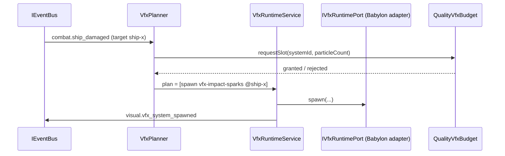

# DEV-SPEC-012 v1.0 — «VFX Runtime»

**Тип документа:** Спецификация к разработке
**Дата:** 2026-11-03
**Статус:** draft
**Волна:** Wave 1
**Зависит от:** `DEV-SPEC-001…005`, `DEV-SPEC-007`, `DEV-SPEC-010`, `DEV-SPEC-011`
**Блокирует:** `DEV-SPEC-016`, `DEV-SPEC-029`, `DEV-SPEC-039`
**Основана на:** `DESIGN v1.0 — «Арт-дирекшн и шейдеры»` (SPEC-ART-029, 031, 033, 036, 040…042, 051, 061, 071, 081…083), `GENERAL DESIGN v1.0` (GD-07…09, GD-14)

---

## 1. Назначение и границы

### 1.1. Что спецификация делает
- content-сущности `VfxSystemDefinition`, `VfxEmitterDefinition`, `VfxTriggerDefinition`, `VfxIntensityPolicyDefinition` и runtime-планер `VfxPlan`(stateless агрегатор);
- спавн/деактивация/пуll `VfxSystemRuntime` по событиям недвижимости (мости combat/cataclysm/companion/fleets) через `IVfxRuntimePort`;
- пул объектов particle system с лимитом из quality tier (`QualityVfxBudget`);
- пул particle system обходит Babylon ParticleSystem adaptation (цифры конкретных систем — контент);
- runtime tracker state (PERSISTED) — в `visual` scope (согласовано с 011);
- контент первой волны: 5+ VFX-систем, 8+ эмиттеров, 2+ интенсивностных политики.

### 1.2. Что спецификация НЕ делает
- Не описывает работу Babylon particle subsystem напрямую — только через адаптер.
- Не описывает шейдеры/материалы (→ 011) и рендер-пайплайн (→ 010).
- Не описывает UI/звук под VFX (→ 013/015).
- Не определяет конкретные численные значения эмиттеров.

## 2. Зависимости

Обязательные: `DEV-SPEC-001…005`, `DEV-SPEC-007`, `DEV-SPEC-010` (BabylonEngineHost), `DEV-SPEC-011` (Interpilation/Uniform port + visual events).
Мягкие: combat `combat.*`, cataclysm `cataclysm.*`, companion `companion.*` — мосты через `IEventBus`.

## 3. Термины

| Термин | Определение |
|---|---|
| VFX System | Декларативный набор emitter-ов + intensity полиси |
| Emitter | Конкретный particle-эмиттер (Babylon `ParticleSystem`-адаптация), параметры из data |
| Trigger | Правило начало/остановки/интесности VFX — по событиям + fiber-taгам |
| Budget | Максимум одновременно активных систем/частиц в tier |

## 4. Событийная модель

### 4.1. Публикуемые
`visual.vfx_system_spawned` (systemId, instanceId, reasonEvent), `visual.vfx_system_destroyed` (instanceId, reason), `visual.vfx_intensity_changed` (instanceId, intensity).

### 4.2. Потребляемые (SPEC-ART-042…043 расширения)
- `combat.ship_damaged` → spawn `vfx-impact-sparks` на ship-node; `combat_effect_*` → distinct системы.
- `cataclysm.stage_changed` → ambient/system full-volume VFX.
- `companion.reaction_triggered_macro` → companion-стен VFX.
- `faction.dominance_changed` → intensify/deintensify faction style VFX (и core/phase).

## 5. Domain-модель

```ts
// src/domain/content/visual/VfxSystemDefinition.ts
export interface VfxSystemDefinition {
  readonly id: string;
  readonly display_name_key: string;
  readonly lifetime_policy: 'until_destroyed' | 'fixed_duration' | 'bound_to_event';
  readonly bound_event_id?: string;
  readonly emitters: readonly VfxEmitterRef[];                  // ≥1
  readonly intensity_policy_id?: string;
  readonly quality_tier_ids: readonly string[];                 // ≥1
  readonly trigger_ids: readonly string[];
}
export interface VfxEmitterRef {
  readonly emitter_id: string;
  readonly count_policy_id?: string;
  readonly spread_policy_id?: string;
  readonly color_policy_id?: string;
  readonly duration_ms?: number;
}

export interface VfxTriggerDefinition {
  readonly id: string;
  readonly source_event_id: string;        // EventId
  readonly target_filter_tags?: readonly string[];
  readonly intensity_scale_policy_id?: string;
  readonly action: 'spawn' | 'destroy' | 'intensity';
}
```

Runtime (Memento-совместимый):

```ts
export interface VfxRuntimeStateInstance {
  readonly active_systems: ReadonlyArray<{
    readonly instance_id: string;         // UuidV4 (generated deterministically)
    readonly system_id: string;
    readonly linked_entity_ids: readonly string[];
    readonly intensity: number;           // 0…1
    readonly started_tick: number;
  }>;
}
```

Компоненты:
- `VfxPlanner` — решает по событию + budget → список spawn/destroy/intensity команд (stateless);
- `VfxRuntimePort` — интерфейс Babylon адаптера: `spawn(defId, opts)`, `destroy(instanceId)`, `setIntensity(instanceId, v)`;
- `VfxRuntimeService` — держит `VfxRuntimeStateInstance`, публикует события, обращается к порту;
-Tracker механика `visual-vfx-lifetime-tracker` (kind: tracker, scope visual, persisted true) — подсчитывает fixed_duration expiry по `world.tick_advanced`.

Инварианты:
- `INV-012-01`: минимум один emitter, минимум один trigger или bound_event.
- `INV-012-02`: суммарные частицы систем текущего tier ≤ budget (иначе — отбрасывание с `visual.vfx_budget_exceeded` warn-событием).
- `INV-012-03`: детерминированный генерация `instance_id` — counter + seed из `rng.visual.vfx_variation`.

## 6. Data-контракты

- `content/schemas/vfx-system.json`, `vfx-emitter.json`, `vfx-trigger.json`, `vfx-intensity-policy.json`, `vfx-runtime-state.json`.
- Контент: `content/visual/vfx/systems.json` (5 систем: impact-sparks, boiler-steam-burst, leyline-glow, plague-miasma-flow, artifact-shimmer), `content/visual/vfx/emitters.json` (8+), `content/visual/vfx/triggers.json` (12+ привязок по мостам).

## 7. Рантайм-поведение



- Бюджет: из `ShaderQualityTierDefinition` текущего tier + `max_active_systems`, `max_particles`.
- Спавн по fixed_duration активирует tracker; по tick expiring → destroy + событие.
- Идемпотентность: повторный `spawn` с той же (systemId, linkedEntityIds) в течение одного такта → одна сущность + одно событие.

## 8. Порты и адаптеры

- `IVfxRuntimePort` (см. выше), адаптеры: `BabylonVfxAdapter` (реализация поверх ParticleSystem/GPUParticleSystem по tier), `NullVfxAdapter` (headless/тесты).
- Ошибки: `VFX_SYSTEM_UNKNOWN`, `VFX_BUDGET_EXCEEDED` (soft, emit warn), `VFX_ADAPTER_UNAVAILABLE`.

## 9. RNG
`rng.visual.vfx_variation` — джиттер параметров (ложится на внутренние варьации системы).

## 10. Сохранение
`VfxRuntimeStateInstance` входит в `VisualStateInstance` (участок `vfx`); `VisualStateMementoProvider` сохраняет и восстанавливает (спавн re-issue по restore — через `VfxRuntimeService.restore()`).

## 11. Валидация и CI
Schema (5 схем) + graph integrity: ссылки vfx-system→emitters/triggers/tier ids существуют; trigger.source_event_id существует в EventRegistry; gameplay lint: каждая фракция ≥ 1 уникальной VFX-системой (из доктрины 011), у каждой fixed_duration системы есть duration.

## 12. Пакет и структура файлов

```text
src/
├── domain/content/visual/{VfxSystemDefinition,VfxTriggerDefinition}.ts
├── domain/events/visual/ (vfx payloads)
└── infrastructure/visual/
    ├── VfxPlanner.ts
    ├── VfxRuntimeService.ts
    └── adapters/{IVfxRuntimePort,BabylonVfxAdapter,NullVfxAdapter}.ts
content/visual/vfx/{systems,emitters,triggers}.json + content/schemas/vfx-*.json
test/unit/visual/vfx-*.test.ts, test/contract/visual-vfx.contract.test.ts
```

## 13. Критерии приёмки
- `DEV-SPEC-012-R01` — спавн по событию боя. **AC:** AC01 `combat.ship_damaged` → 1 spawned instance + событие; AC02 бюджет tier=low отсекает вторую систему и публикует warn.
- `DEV-SPEC-012-R02` — жизненный цикл. **AC:** AC03 fixed_duration система уничтожается на tick N и публикует destroyed; AC04 restore state → активные системы пересозданы детерминированно.
- `DEV-SPEC-012-R03` — триггеры по фильтр-тегам. **AC:** AC05 event c tags, не совпадающими с target_filter_tags → нет спавна.
- `DEV-SPEC-012-R04` — CI. **AC:** AC06 ссылка на несуществующий emitter — graph issue; AC07 триггер на неизвестное событие — lint error.

## 14. Тест-план
Unit: VfxPlanner, VfxRuntimeService (spawn/destroy/intensity/бюджет). Integration: мост combat/cataclysm → VFX; contract: детерминизм + restore; CI: расширенные правила validate-gameplay (правила vfx).

## 15. Производительность
≤ 2 ms на такт при 12 активных системах tier=high; spyOn particle pool не растёт без спорк (пул ограничен бюджетом).

## 16. Открытые вопросы
| ID | Вопрос | Блокер? |
|---|---|---|
| Q-012-01 | GPU vs CPU частицы по tier — фиксировано адаптером? | нет |

## 17. Вне scope
Балансовые числа эмиттеров, ассеты, UI-подтверждение спавна, звук VFX (→ 015).

## 18. Трассировка
| DESIGN | Требование | AC |
|---|---|---|
| SPEC-ART-029/033 | DEV-SPEC-012-R01 | AC01…02 |
| SPEC-ART-031/061 | DEV-SPEC-012-R02 | AC03…04 |
| SPEC-ART-042 | DEV-SPEC-012-R03 | AC05 |
| SPEC-ART-071 | DEV-SPEC-012-R04 | AC06…07 |
