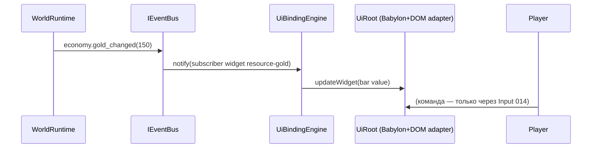

# DEV-SPEC-013 v1.0 — «UI Framework & HUD»

**Тип документа:** Спецификация к разработке
**Дата:** 2026-11-03
**Статус:** draft
**Волна:** Wave 1
**Зависит от:** `DEV-SPEC-001…003`, `DEV-SPEC-007`, `DEV-SPEC-010`, `DEV-SPEC-011`, `DEV-SPEC-012`
**Блокирует:** `DEV-SPEC-016`, `DEV-SPEC-039`
**Основана на:** `GENERAL DESIGN v1.0` (GD-14), `DESIGN v1.0 — «Арт-дирекшн и шейдеры»` (SPEC-ART-004, 046, 049, 062, 074, 087)

---

## 1. Назначение и границы

### 1.1. Что делает
- UI-фреймворк поверх Babylon (Full-Screen UI / DynamicTexture) + DOM-overlay для сложных контролов:
  - `IUiRoot`, `IUiPanel`, `IUiWidget` (компонентная модель, lifecycle);
  - HUD-скелет: карта мира, реестр корабля, реестр отряда, лог событий, панель ресурсов, диалоговое окно, меню паузы;
  - data-driven HUD-раскладка: `UiLayoutDefinition`, `UiPanelDefinition`, `UiWidgetDefinition`;
  - привязка виджетов к домену через event-подписки (односторонний поток: домен → UI; команды игрока — через `DEV-SPEC-014`);
  - тема (dark arcanepunk) через CSS-переменные / UI-палитры из `DEV-SPEC-011`;
  - контент первой волны: HUD-раскладка боевого/мирового экрана, 20+ виджетов, 3 панели найденных.

### 1.2. Что не делает
- Не обрабатывает ввод (→ 014); не рендерит 3D-мир (→ 010); не ведёт доменное состояние игры.
- Не описывает конкретные художественные ассеты иконок/шрифтов.

## 2. Зависимости
Обязательные: 001–003, 007, 010 (SceneManager + render), 011 (стили/palette), 012 (VFX-индикаторы HUD).
Мягкие: все домены Wave 2–6 подписками на события.

## 3. Термины
| Термин | Определение |
|---|---|
| HUD | Постоянный оверлей поверх сцены (ресурсы, миникарта, лог) |
| Panel | Прямоугольная зона UI с раскладкой виджетов |
| Widget | Атомарный контрол (label, bar, list, button-вывод, minimap) |
| Binding | Декларативная привязка widget ↔ event/порт данных |

## 4. Событийная модель
- UI только потребляет доменные события: `party.*`, `economy.*`, `ship.*`, `combat.*`, `cataclysm.*`, `narrative.*`, `world.*` и visual-события 011/012.
- Публикует прикладные UI-события: `ui.panel_opened`, `ui.panel_closed`, `ui.toast_shown`, `ui.hud_mode_changed` (global/map/combat/dialog) — namespace `ui.*`, регистрируются в `EventRegistry`.
- Инвариант: UI не мутирует домен напрямую; любые команды — через `IInputCommandBus` (014).

## 5. Domain-модель

```ts
// src/domain/content/ui/UiLayoutDefinition.ts
export interface UiLayoutDefinition {
  readonly id: string;
  readonly display_name_key: string;
  readonly screen_mode: 'world_map' | 'ship_view' | 'combat' | 'dialog' | 'epilogue';
  readonly panels: readonly UiPanelRef[];          // ≥1
}
export interface UiPanelRef { readonly panel_id: string; readonly anchor: 'top_left'|'top_right'|'bottom_left'|'bottom_right'|'center'; readonly size_policy_id: string; }

export interface UiPanelDefinition {
  readonly id: string;
  readonly display_name_key: string;
  readonly widgets: readonly UiWidgetRef[];        // ≥1
  readonly visibility_policy_id?: string;          // декларативное правило видимости
}
export interface UiWidgetRef { readonly widget_id: string; readonly binding_policy_id?: string; }

export interface UiWidgetDefinition {
  readonly id: string;
  readonly display_name_key: string;
  readonly widget_type: 'label'|'resource_bar'|'event_log'|'minimap'|'roster_list'|'quest_list'|'portrait'|'toast_area'|'button_row';
  readonly binding_context?: string;               // доменный context key (data-driven)
}
```

Runtime:
- `IUiRoot { mount(layoutId): Result<void>; setMode(mode): Result<void> }`;
- `UiStateMementoProvider` (domainId `'ui'`) — панель открытости, HUD-режим, toast-очередь (Memento по GD-09).

Инварианты: `INV-013-01` каждый layout ссылается только на существующие панели/виджеты; `INV-013-02` ровно один HUD-layout на screen_mode; `INV-013-03` UI-события не влияют на RNG.

## 6. Data-контракты
- Схемы: `ui-layout.json`, `ui-panel.json`, `ui-widget.json`, `binding-policy.json`, `ui-state.json`.
- Контент: `content/ui/layouts.json` (5 экранов), `content/ui/panels.json` (12 панелей), `content/ui/widgets.json` (20+ виджетов), `content/ui/bindings.json`.
- Локализация: `content/locales/ru/ui.json`, `en/ui.json`.

## 7. Рантайм-поведение



- Открытие/закрытие панели → `ui.panel_opened/closed`; смена режима HUDUsingEncoding → события 011 не задеваются.
- Toast-очередь: FIFO, максимум 3, автоскрытие по `duration_policy_id`.

## 8. Порты и адаптеры
- `IBabylonUiPort` (Full Screen UI primitives), `IDomOverlayPort` (текст/html-контент), тестовые `NullUiPort`.
- Ошибки: `UI_LAYOUT_UNKNOWN`, `UI_WIDGET_UNKNOWN`, `UI_BINDING_INVALID`.

## 9. RNG
UI не потребляет игровые потоки; brawl-джиттер не используется (INV-013-03).

## 10. Сохранение
`UiStateInstance { hud_mode, open_panel_ids, toast_queue }` — в общем снимке презентации (папка `presentation` root-агрегата из 010) — отдельный `UiStateMementoProvider`.

## 11. Валидация и CI
Schema + graph integrity (linkage layout→panel→widget), lint: у каждой панели ≥1 виджет, у каждого экрана ≥1 панель, нет дублей widget_id внутри панели.

## 12. Структура файлов

```text
src/presentation/ui/{UiRoot,UiBindingEngine,adapters/*}.ts
src/domain/content/ui/{UiLayoutDefinition,UiPanelDefinition,UiWidgetDefinition}.ts
content/ui/*.json, content/locales/{ru,en}/ui.json
test/unit/ui/*.test.ts, test/contract/ui.contract.test.ts
```

## 13. Критерии приёмки
- `DEV-SPEC-013-R01` — HUD отображает ресурсы. **AC:** AC01 `economy.gold_changed` обновляет bar ≤ 1 такт; AC02 неизвестный binding — warn + fallback пустого значения.
- `DEV-SPEC-013-R02` — режимы HUD. **AC:** AC03 смена screen_mode → `ui.hud_mode_changed` +panel visibility по layout; AC04 открытие панели дубликатом — идемпотентно.
- `DEV-SPEC-013-R03` — save/load. **AC:** AC05 open panels и hud_mode восстановлены идентично.
- `DEV-SPEC-013-R04` — CI. **AC:** AC06 layout со ссылкой на missing panel — graph issue.

## 14. Тест-план
Unit: UiRoot, UiBindingEngine; integration: загрузка layouts первой волны + mock события; contract: schema валидность, восстановление.

## 15. Производительность
Обновление HUD ≤ 2 ms/такт; не более 30 DOM-обновлений/сек на widget (throttle policy).

## 16. Открытые вопросы
| ID | Вопрос | Блокер? |
|---|---|---|
| Q-013-01 | DOM-overlay vs полный Babylon UI для списков | нет — решить при имплементации mix-подход |

## 17. Вне scope
Иконки/шрифты/ассеты, ввод (014), мобильная разметка (016), эпилог-рендер текста (→ 037 использует UiRoot, но специфика там).

## 18. Трассировка
| DESIGN | Требование | AC |
|---|---|---|
| GD-14 | DEV-SPEC-013-R01…R02 | AC01…04 |
| GD-09 / SPEC-ART-062 | DEV-SPEC-013-R03 | AC05 |
| SPEC-ART-074 | DEV-SPEC-013-R04 | AC06 |
