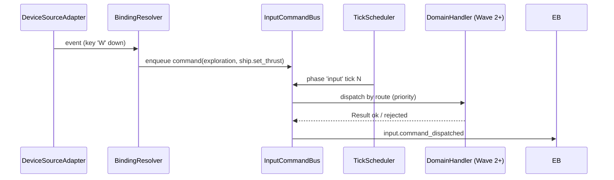

# DEV-SPEC-014 v1.0 — «Input System & Player Commands»

**Тип документа:** Спецификация к разработке
**Дата:** 2026-11-03
**Статус:** draft
**Волна:** Wave 1
**Зависит от:** `DEV-SPEC-001…003`, `DEV-SPEC-007`, `DEV-SPEC-010`, `DEV-SPEC-013`
**Блокирует:** `DEV-SPEC-016`, `DEV-SPEC-018`, `DEV-SPEC-029`, `DEV-SPEC-039`
**Основана на:** `GENERAL DESIGN v1.0` (GD-14), `INTENT v1.0` (INT-04), `DESIGN v1.0 — «Механики корабельных веток фракций»` (команды корабля)

---

## 1. Назначение и границы

### 1.1. Что делает
- Единый `IInputCommandBus`: буферизация команд игрока и доставка доменам по фазам такта (`TickScheduler.phases`, фаза `input` — до `simulation`);
- data-driven привязки: `InputActionDefinition` (действие), `InputBindingDefinition` (клавиша/кнопка/тач → действие), `InputCommandRouteDefinition` (действие → доменный обработчик);
- адаптеры ввода: клавиатура/мышь (desktop), touch (мобильный, уточнение в 016), gamepad-хуки;
- режимы ввода `exploration | combat | dialog | menu` с приоритетом поглощения;
- очередь команд с лимитом и слиянием (идемпотентные повторные клики);
- контент первой волны: 25+ действий (движение корабля, камера, выбор цели, пауза, меню, диалоговые выборы, боечные команды-заглушки).

### 1.2. Что НЕ делает
- Не решает, как домены интерпретируют команды (домены Wave 2+);
- не описывает UI-визуал (→ 013), не меняет доменное состояние сам.

## 2. Зависимости
Обязательные: 001–003, 007 (фазы такта), 010 (pointer raycast от сцены), 013 (фокус/пanel сворачивание).
Мягкие: 018/029/034 — потребители команд.

## 3. Термины
| Термин | Определение |
|---|---|
| Action | Нормализованное игровое действие (`ship.set_thrust`, `camera.pan`, `combat.target_select`) |
| Binding | Физический источник (key/mouse/touch/gamepad) → action |
| Route | Action → обработчик домена (Phase, priority) |
| Input Mode | Режим контекста, определяющий активный subset binding-ов |

## 4. Событийная модель
- Публикует: `input.mode_changed`, `input.command_dispatched` ( debugging/трассировка), `input.command_rejected` (unknown action / фаза недоступна).
- Не потребляет доменные события (кроме UI-событий 013 для смены режима).
- Инварианты: `INV-014-01` unknown action — rejected + лог; `INV-014-02` команды такта N не мутируют домен до фазы `input` такта N; `INV-014-03` никакая команда не создаёт RNG-потребление.

## 5. Domain-модель

```ts
// src/domain/content/input/InputActionDefinition.ts
export interface InputActionDefinition {
  readonly id: string;
  readonly display_name_key: string;
  readonly allowed_modes: readonly InputMode[];   // ≥1
  readonly route_id: string;
}
export type InputMode = 'exploration' | 'combat' | 'dialog' | 'menu';

export interface InputBindingDefinition {
  readonly id: string;
  readonly action_id: string;
  readonly source: { kind: 'key'|'mouse'|'touch'|'gamepad'; code: string; modifiers?: readonly string[] };
}

export interface InputCommandRouteDefinition {
  readonly id: string;
  readonly target_domain: 'ship' | 'fleet' | 'party' | 'combat' | 'economy' | 'narrative' | 'ui';
  readonly handler_policy_id: string;            // декларативный обработчик (Wave 2+ контент)
  readonly phase: 'input' | 'pre_simulation' | 'post_simulation';
  readonly priority: number;
  readonly repeat_policy?: 'single' | 'continuous' | 'repeat_on_hold';
}
```

Runtime:
- `InputCommandBus` — очередь `PlayerCommand { command_id, action_id, payload, tick_issued }`, лимит 64 за такт, overflow → reject.
- `InputModeController` — активный режим + стек (dialog > combat > exploration > menu).
- `InputStateMementoProvider` (domainId `'input'`): активные held-actions (для repeat_on_hold), режим, счётчик команд.

## 6. Data-контракты
- Схемы: `input-action.json`, `input-binding.json`, `input-route.json`, `input-state.json`.
- Контент: `content/input/actions.json` (25+), `content/input/bindings-desktop.json`, `content/input/bindings-touch.json` (заготовка под 016), `content/input/routes.json`.

## 7. Рантайм-поведение



- Held-клавиша с `repeat_on_hold` → повторная постановка команды каждый такт.
- Блокировка: открытая модальная панель (013) → режим `menu` поглощает все команды.

## 8. Порты и адаптеры
- `IDeviceSourcePort { subscribe(handler) }`; адаптеры: `KeyboardMouseSource`, `TouchSource`, `GamepadSource`, `ScriptedSource` (тесты/демо — переиспользование demo-driver подхода Wave 0).
- Ошибки: `INPUT_ACTION_UNKNOWN`, `INPUT_MODE_LOCKED`, `INPUT_QUEUE_OVERFLOW`.

## 9. RNG
Не потребляет потоки (INV-014-03).

## 10. Сохранение
`InputStateInstance` — стек режимов, счётчик команд, held-состояние. В общий snapshot `presentation`.

## 11. Валидация и CI
Schema + graph integrity (action→route, binding→action), lint: каждый route указывает существующий домен, нет двух binding-ов одного source на одно действие в одном режиме (конфликт — warning), HUD-команды не маршрутизируются в домены.

## 12. Структура файлов

```text
src/presentation/input/{InputCommandBus,InputModeController,adapters/*}.ts
src/domain/content/input/*.ts
content/input/*.json + content/schemas/input-*.json
test/unit/input/*.test.ts, test/contract/input.contract.test.ts
```

## 13. Критерии приёмки
- `DEV-SPEC-014-R01` — маршрутизация. **AC:** AC01 команда доставляется в фазе `input` до `simulation` того же такта; AC02 unknown action → `input.command_rejected`.
- `DEV-SPEC-014-R02` — режимы. **AC:** AC03 в mode=dialog команды exploration отсекаются; AC04 повторная команда holding-клавиши → N команд за N тактов.
- `DEV-SPEC-014-R03` — очередь. **AC:** AC05 65-я команда за такт → reject + событие.
- `DEV-SPEC-014-R04` — save/load. **AC:** AC06 стек режимов восстановлен.
- `DEV-SPEC-014-R05` — CI. **AC:** AC07 пропуск route на несуществующий домен — lint error.

## 14. Тест-план
Unit: CommandBus (enqueue/dispatch/reject/overflow), ModeController; integration: ScriptedSource полный проход 100 тактов с требованиями Wave 0 demos; contract: schema/determinism (клавиши не влияют на RNG), restore.

## 15. Производительность
Доставка ≤ 1 ms на 32 команды; polling binding-разрешение кэшируется по режиму.

## 16. Открытые вопросы
| ID | Вопрос | Блокер? |
|---|---|---|
| Q-014-01 | Gamepad-профили — после Wave 1? | нет |

## 17. Вне scope
Touch-гесты детально и mobile-раскладка (→ 016), обработчики доменов (Wave 2+), replay-плеер (Wave 0 интерфейс уже есть).

## 18. Трассировка
| DESIGN | Требование | AC |
|---|---|---|
| GD-14 / INT-04 | DEV-SPEC-014-R01…R02 | AC01…04 |
| GD-14 | DEV-SPEC-014-R03 | AC05 |
| GD-09 | DEV-SPEC-014-R04 | AC06 |
| — CI | DEV-SPEC-014-R05 | AC07 |
