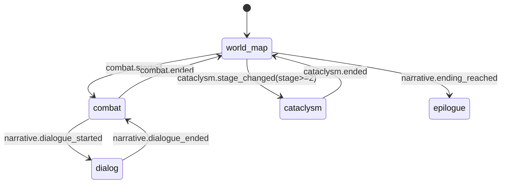

# DEV-SPEC-015 v1.0 — «Audio System»

**Тип документа:** Спецификация к разработке
**Дата:** 2026-11-03
**Статус:** draft
**Волна:** Wave 1
**Зависит от:** `DEV-SPEC-001…003`, `DEV-SPEC-007`, `DEV-SPEC-010`, `DEV-SPEC-011` (визуальные сцены/переходы), `DEV-SPEC-012` (VFX-триггеры)
**Блокирует:** `DEV-SPEC-016`, `DEV-SPEC-039`
**Основана на:** `GENERAL DESIGN v1.0` (GD-15), `DESIGN v1.0 — «Арт-дирекшн и шейдеры»` (SPEC-ART-041, 043, 063, 075, 088)

---

## 1. Назначение и границы

### 1.1. Что делает
- Аудиодвижок поверх Babylon AudioEngine / WebAudio:
  - `AudioMixer` с каноническими шинами: `music`, `sfx`, `ambient`, `ui`, `dialog`;
  - data-driven аудио-контент: `AudioTrackDefinition`, `AudioSfxDefinition`, `AmbientLoopDefinition`, `AudioTriggerDefinition`, `AudioMixPolicyDefinition`;
  - триггеры аудио по доменным событиям (двунаправленно с VFX 012: у VFX-систем опциональный `audio_sfx_id`);
  - динамическая музыка по состоянию экрана/боя/катаклизма (`music_state` state machine);
  - управление громкостью/мьют через user-preferences (UI 013);
  - контент первой волны: 6+ треков, 12+ sfx, 4+ ambient-лупа, 15+ триггеров.

### 1.2. Что НЕ делает
- Не генерирует ассеты и музыку; не решает игровой логики; не делает VFX-спавн.

## 2. Зависимости
Обязательные: 001–003, 007, 010 (SceneManager/экраны), 011 (переходы → кроссфейды), 012 (триггеры VFX-событий).
Мягкие: combat/economy/cataclysm/companion события Wave 2+.

## 3. Термины
| Термин | Определение |
|---|---|
| Bus | Канал микшера со своей громкостью |
| Music State | Состояние music-плейлиста (world/explore, combat, cataclysm, epilogue) |
| Duck | Автоприглушение одного bus при активности другого (dialog > music) |

## 4. Событийная модель
- Публикует: `audio.mix_changed`, `audio.music_state_changed`, `audio.sfx_played`.
- Потребляет: `visual.transition_started/completed` (музыка/ambient кроссфейд), `combat.started/ended`, `cataclysm.stage_changed`, `narrative.dialogue_started/ended`, `ui.panel_opened/closed` (UI-звуки), VFX-события 012 (синхронные звуки).
- Инварианты: `INV-015-01` аудио не влияет на доменные состояния и RNG; `INV-015-02` все триггеры зарегистрированы в EventRegistry.

## 5. Domain-модель

```ts
// src/domain/content/audio/AudioTrackDefinition.ts
export interface AudioTrackDefinition {
  readonly id: string;
  readonly display_name_key: string;
  readonly bus: 'music' | 'sfx' | 'ambient' | 'ui' | 'dialog';
  readonly asset_ref: string;                 // путь (данные)
  readonly loop: boolean;
  readonly fade_in_policy_id?: string;
  readonly fade_out_policy_id?: string;
}
export type MusicStateName = 'world_map' | 'combat' | 'cataclysm' | 'dialog' | 'epilogue';

export interface AudioMixPolicyDefinition {
  readonly id: string;
  readonly music_state: MusicStateName;
  readonly track_ids: readonly string[];          // ≥1, играются рандомно/безповторно
  readonly duck_rules: readonly DuckRule[];       // опционально
}
export interface DuckRule { readonly bus: BusName; readonly target_volume: number; }

export interface AudioTriggerDefinition {
  readonly id: string;
  readonly source_event_id: string;
  readonly sfx_id: string;
  readonly target_filter_tags?: readonly string[];
  readonly cooldown_policy_id?: string;
}
```

Runtime:
- `AudioMixerService` — шины, громкости, mute, duck;
- `MusicStateController` — state machine MusicState, очередь треков, кроссфейд по duration_policy;
- `AudioSfxService` — one-shot sfx со лимитом одновременных (budget;
- `AudioStateMementoProvider` (domainId `'audio'`): громкости, mute, текущий music_state (трек не сериализуем — рестарт по restore).

## 6. Data-контракты
- Схемы: `audio-track.json`, `audio-sfx.json`, `ambient-loop.json`, `audio-trigger.json`, `audio-mix-policy.json`, `audio-state.json`.
- Контент: `content/audio/{tracks,sfx,ambient,mix-policies,triggers}.json`.

## 7. Рантайм-поведение



- Кроссфейд треков по `visual.transition_completed` согласован с 011.
- SFX-trigger c cooldown не воспроизводится чаще cooldown.
- Ограничение: не более 8 одновременных sfx.

## 8. Порты и адаптеры
- `IAudioEnginePort { play(trackId, opts): Result<void>; stop(id); setBusVolume(bus, v): Result<void>; }`.
- Адаптеры: `BabylonAudioAdapter`, `NullAudioAdapter` (headless/CI).
- Ошибки: `AUDIO_ASSET_UNKNOWN`, `AUDIO_BUS_UNKNOWN`, `AUDIO_EXHAUSTED` (soft-limit).

## 9. RNG
`rng.audio.playlist_next` (новый поток: выбрать следующий трек без повтора) — изолированный поток в `stream-names`.

## 10. Сохранение
`AudioStateInstance` (громкости/mute/music_state) — в снимок презентации.

## 11. Валидация и CI
Schema + graph integrity (track/sfx ссылки, trigger.source_event_id существует), lint: каждый music_state ≥1 трек; все audio_sfx_id VFX-систем (012) существуют; duck target_volume в [0,1].
Headless-режим CI использует NullAudioAdapter — аудио-контент валидируется, но не воспроизводится.

## 12. Структура файлов

```text
src/presentation/audio/{AudioMixerService,MusicStateController,AudioSfxService,adapters/*}.ts
src/domain/content/audio/*.ts
content/audio/*.json + content/schemas/audio-*.json
test/unit/audio/*.test.ts, test/contract/audio.contract.test.ts
```

## 13. Критерии приёмки
- `DEV-SPEC-015-R01` — музыка по состоянию. **AC:** AC01 `combat.started` → `audio.music_state_changed(combat)`; AC02 end → обратно world_map.
- `DEV-SPEC-015-R02` — триггеры sfx. **AC:** AC03 VFX-спавн с audio_sfx_id → sfx_played; AC04 cooldown-blocked повторный триггер — без воспроизведения.
- `DEV-SPEC-015-R03` — микшер. **AC:** AC05 setBusVolume сохраняется и восстанавливается; AC06 duck при dialog_active.
- `DEV-SPEC-015-R04` — CI. **AC:** AC07 mix-policy без треков — lint error; AC08 trigger на unknown event — graph issue.

## 14. Тест-план
Unit: AudioMixerService, MusicStateController (state transitions), SfxService (cooldown/budget); integration с NullAudioAdapter: полный проход событий Wave 0 demos; contract: schema, restore громкостей.

## 15. Производительность
≤ 1 ms/такт на agress-обработку; кроссфейд — вне игрового такта (requestAnimationFrame/port).

## 16. Открытые вопросы
| ID | Вопрос | Блокер? |
|---|---|---|
| Q-015-01 | Сжатые ассеты и ленивые загрузки — Wave 1 stub или позже? | нет (asset_ref ост_null) |

## 17. Вне scope
Композиция музыки/запись sfx, голос, мобильные аудио-квоты (→ 016).

## 18. Трассировка
| DESIGN | Требование | AC |
|---|---|---|
| GD-15 | DEV-SPEC-015-R01…R02 | AC01…04 |
| GD-15 / SPEC-ART-063 | DEV-SPEC-015-R03 | AC05…06 |
| SPEC-ART-075 | DEV-SPEC-015-R04 | AC07…08 |
