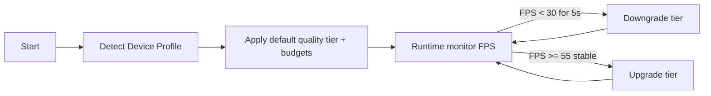

# DEV-SPEC-016 v1.0 — «Mobile Adaptation & Performance Budget»

**Тип документа:** Спецификация к разработке
**Дата:** 2026-11-03
**Статус:** draft
**Волна:** Wave 1
**Зависит от:** `DEV-SPEC-010`, `DEV-SPEC-011`, `DEV-SPEC-012`, `DEV-SPEC-013`, `DEV-SPEC-014`, `DEV-SPEC-015`
**Блокирует:** `DEV-SPEC-039`
**Основана на:** `GENERAL DESIGN v1.0` (GD-14), `INTENT v1.0` (INT-04), `DESIGN v1.0 — «Арт-дирекшн и шейдеры»` (SPEC-ART-002, 085), `INTENT`-след transforms из SPEC-ART-002

---

## 1. Назначение и границы

### 1.1. Что делает
- Политика качества на мобильных (aspect ratio / портрет-ландшафт / мобильный DPI) через системные настройки;
- усиленные (`mobile`) tier-настройки из 011: lowercase default tier, лимиты активных систем VFX/постпроцессов;
- полная замена input-политики 014 на touch-binding-и из 014 (заготовленных данных) + крупные тач-таргеты (не UI-разметка — runtime-увеличение>();
- адаптивная загрузка < той же сцены : деградация ALLOWED (重要讲话: 011 LODог введена для данных в тире low;
-деление на mobile-screen бюджет: HUD-упрощение (меньше виджетов с 013 - data-driven displacement в layout, minimal HUD;
- аудио-спецмобильные квоты (015): лимит одновременных sfx, ограничение DN амбиентов;
- полная связка со MachicDef from DEV-SPEC-004 - через `"mobile": bool` вариант в `params`. Отдельного набора механик НЕ создаётся — используемytyто же контент механик (проверка в int-tests).

### 1.2. Что НЕ делает
- Не создаёт отдельную версию игры/сборку; не меняет домен; не определяет функциональный состав (полная игра — 039).

## 2. Зависимости
Обязательные: 010–015.
Мягкие: 025/029/037 (специальные сцены - на интеграцию).

## 3. Термины
| Термин | Определение |
|---|---|
| Device Profile | Классификация устройства (desktop/mobile-low/mobile-high) по UA/DPR/памяти |
| Adaptive Budget | Рантайм-лимиты из Device Profile (VFX count, particles, post-processes, активные треки) |
| Resolution Scale | Масштабирование render target на мобильном |

## 4. Событийная модель
- Публикует: `visual.device_profile_changed`, `visual.resolution_scale_changed`.
- Потребляет: те же, что и остальные presentation-спеки (никаких новых доменных зависимостей).
- Инвариант: `INV-016-01` mobile-режим не меняет результаты deterministic-симуляции (портитет — визуальный только).

## 5. Domain-модель

```ts
// src/domain/content/presentation/DeviceProfileDefinition.ts
export interface DeviceProfileDefinition {
  readonly id: string;
  readonly match_policy_id: string;          // декларативное правило (UA, DPR, RAM)
  readonly quality_tier_default: 'low' | 'medium' | 'high';
  readonly vfx_budget_override?: { max_active_systems: number; max_particles: number; };
  readonly audio_budget_override?: { max_sfx_simultaneous: number };
  readonly resolution_scale: number;          // 0.5…1.0
  readonly hud_layout_override_id?: string;   // alt layout из 013
}
```

Runtime:
- `DeviceProfileDetector` — определяет профиль один раз при старте (+ listeners orientation/DPR);
- `MobilePerformanceGovernor` — runtime-опекусят: измеряет FPS (rolling), при < 30 понижает tier на одну ступень (только визуально, события 011), при стабильных 55+ поднимает, cooldown 5 сек, максимум 1 auto-step.
- `MobileStateMementoProvider` (domainId `'presentation_mobile'`): выбранный tier override, resolution_scale.

## 6. Data-контракты
- Схемы: `device-profile.json`, `mobile-governor-policy.json`, `mobile-state.json`.
- Контент: `content/presentation/device-profiles.json` (3 профиля: desktop, mobile-low, mobile-high), `content/input/bindings-touch.json` — уже из 014.

## 7. Рантайм-поведение



- ResolutionScale применяется к Babylon Engine adaptively (адаптер 010).
- VFX/audio-бюджеты передаются в QualityVfxBudget (012) и AudioSfxService (015).

## 8. Порты и адаптеры
- `IDeviceInfoPort { profile(): Readonly<DeviceInfo>; onOrientationChange(cb) }`, тестовые `FakeDevicePort`.
- Ошибки: `DEVICE_INFO_UNKNOWN` (fallback desktop).

## 9. RNG
Van новый (device не влияет на симуляцию. INV-016-01.

## 10. Сохранение
`MobileStateInstance` (overrides, resolution_scale) — общий presentation snapshot.

## 11. Валидация и CI
Schema + lint: каждый device_profile ссылается на существующий HUD-layout (если указан override); governor thresholds внутри [0, 120]; у mobile-low дефолт tier = low (из DESIGN first-step-of-ART-002).

## 12. Структура файлов

```text
src/presentation/mobile/{DeviceProfileDetector,MobilePerformanceGovernor,adapters/*}.ts
src/domain/content/presentation/DeviceProfileDefinition.ts
content/presentation/device-profiles.json + schemas
test/unit/mobile/*.test.ts, test/contract/mobile.contract.test.ts
```

## 13. Критерии приёмки
- `DEV-SPEC-016-R01` — определение профиля. **AC:** AC01 mobile-high UA → mobile-high профиль; AC02 unknown UA → desktop fallback.
- `DEV-SPEC-016-R02` — governor. **AC:** AC03 rolling FPS < 30 → tier вниз на 1; AC04 cooldown предотвращает частые переключения; AC05 tier не опускается ниже low.
- `DEV-SPEC-016-R03` — бюджеты. **AC:** AC06 vfx budget from override передан в VfxPlanner (012); AC07 resolution scale применен (check adapter calls).
- `DEV-SPEC-016-R04` — CI. **AC:** AC08 мобильный профиль с несуществующим layout — lint error.
- `DEV-SPEC-016-R05` — инвариант симуляции. **AC:** AC09 fixed-seed walk: desktop vs mobile → identical `VisualStateInstance` (кроме presentation параметры?).

## 14. Тест-план
Unit: DeviceProfileDetector, MobilePerformanceGovernor (fake fps stream); integration: 012/013/015 бюджет missage; contract: schema, AC09.

## 15. Производительность
Цели для mobile-high: 30 FPS сцена world_map с ≤ 400 particles; mobile-low: 30 FPS с tier=low (см. 015 budget).

## 16. Открытые вопросы
| ID | Вопрос | Блокер? |
|---|---|---|
| Q-016-01 | Точные пороговые значения FPS/duration — выставляются после benchmarks | нет |

## 17. Вне scope
Мобильный маркет/сторы, PWA/установка, отдельная UI-стилистика.

## 18. Трассировка
| DESIGN | Требование | AC |
|---|---|---|
| GD-14 / INT-04 | DEV-SPEC-016-R01…R02 | AC01…05 |
| SPEC-ART-002 (tier low) | DEV-SPEC-016-R03 | AC06…07 |
| SPEC-ART-085 | DEV-SPEC-016-R04…R05 | AC08…09 |
