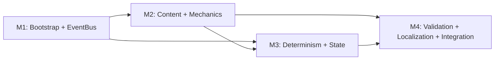

# TICKETS-OVERVIEW v1.0 — «Каталог тикетов Wave 0 (walking skeleton)»

**Тип документа:** Каталог тикетов  
**Дата:** 2026-11-02  
**Статус:** draft  
**Основан на:**  
`DEV-SPEC-001…009`  
`DEV-SPEC-OVERVIEW v1.0`  
`DEV-SPEC-TEMPLATE v1.0`  
**Назначение:** полный список тикетов для построения walking skeleton проекта «Наука против Магии» на основе `DEV-SPEC-001…009` в режиме **«механизмы + минимальный контент»**.

---

## 1. Область

### 1.1. Что строим
- рабочий TS-проект с DI, bootstrap, конфигом, логгером;
- работающий `EventBus` с `DeliveryPolicy`;
- `ContentRegistry` с 7–10 схемами и ~30 core-событиями;
- `MechanicRuntime` с resolver/tracker и 2–3 stub-плагинами;
- детерминированный `SeededRngService` со всеми потоками;
- Save/Load с 1–2 memento-провайдерами;
- `GameClock` с фиксированным порядком фаз и пустыми scope;
- работающий `ci:validate`;
- работающий `LocalizationService`.

### 1.2. Что НЕ строим
- игру, домены, сцены, UI;
- полный каталог 150 событий и 64 схем;
- реальные геймплейные механики;
- баланс и контент.

### 1.3. Критерий «skeleton готов»
Приложение стартует, грузит контент, публикует события, механики реагируют, RNG детерминирован, save/load roundtrip идентичен, `ci:validate` зелёный на скелете. Играть нельзя — проверять контракты можно.

---

## 2. Формат тикета

Каждый тикет — блок в `TICKETS-M{N}.md`:

```
### TKT-{M}-{NN} — {Название}

**DEV-SPEC:** DEV-SPEC-{NNN}  
**Требования:** R01, R02  
**AC:** AC01, AC02  
**Размер:** XS / S / M  
**Зависит от:** TKT-…  
**Блокирует:** TKT-…

**Что сделать:**
- список изменений

**Definition of Done:**
- [ ] все AC покрыты тестами
- [ ] CI зелёный
- [ ] PR смержен
```

---

## 3. Легенда размеров

| Размер | Оценка | Описание |
|---|---|---|
| `XS` | <2 ч | типы, маленькие хелперы |
| `S` | 0.5–1 день | реализация с тестами |
| `M` | 1–2 дня | Use Case, CI-стадия, state validator |
| `L` | >2 дней | **избегать**, делить на части |

---

## 4. Вехи

| Веха | DEV-SPEC | Тикетов | Демо |
|---|---|---:|---|
| **M1** — Bootstrap + EventBus | 001, 002 | 18 | старт → publish → handler |
| **M2** — Content + Mechanics | 003, 004 | 18 | контент загружен → механика реагирует |
| **M3** — Determinism + State | 005, 006, 007 | 26 | N тиков → save → load → ident |
| **M4** — Validation + Localization + Integration | 008, 009, integration | 20 | `ci:validate` зелёный, E2E |
| **Итого** | | **82** | |

---

## 5. Каталог тикетов

### M1 — Bootstrap + EventBus (18)

| ID | Название | DEV-SPEC | Размер |
|---|---|---|---|
| `TKT-M1-001` | Brand & EntityId types | 001 | XS |
| `TKT-M1-002` | Result type + helpers | 001 | S |
| `TKT-M1-003` | AppError hierarchy | 001 | S |
| `TKT-M1-004` | Logger + PinoLogger + NoopLogger | 001 | S |
| `TKT-M1-005` | AppConfig + zod schema + app-config.json | 001 | S |
| `TKT-M1-006` | DependencyContainer + GameBootstrap + main.ts | 001 | M |
| `TKT-M1-007` | EventType + DomainEvent + DeliveryPolicy types | 002 | XS |
| `TKT-M1-008` | EventDefinition type + JSON Schema | 002 | S |
| `TKT-M1-009` | EventRegistry interface + impl | 002 | S |
| `TKT-M1-010` | IEventBus + InMemoryEventBus (publish/subscribe) | 002 | M |
| `TKT-M1-011` | EventPayloadValidator + интеграция с publish | 002 | S |
| `TKT-M1-012` | DeliveryPolicy queues + drainQueue | 002 | M |
| `TKT-M1-013` | Handler priority + isolation | 002 | S |
| `TKT-M1-014` | RecordingEventBus (тест-адаптер) | 002 | XS |
| `TKT-M1-015` | content/events/core.json — ~30 core-событий | 002 | M |
| `TKT-M1-016` | CI: events stage | 002 | S |
| `TKT-M1-017` | Contract-тесты: все core-события валидны | 002 | S |
| `TKT-M1-018` | M1 демо: bootstrap + publish + handler | 001,002 | S |

### M2 — Content + Mechanics (18)

| ID | Название | DEV-SPEC | Размер |
|---|---|---|---|
| `TKT-M2-001` | ContentKind type + все 64 значения | 003 | XS |
| `TKT-M2-002` | ContentPack type + loader (topo sort) | 003 | S |
| `TKT-M2-003` | AjvSchemaValidator | 003 | S |
| `TKT-M2-004` | 7–10 базовых JSON Schema | 003 | M |
| `TKT-M2-005` | JsonContentRegistry.loadAll | 003 | M |
| `TKT-M2-006` | CrossReferenceValidator | 003 | M |
| `TKT-M2-007` | ContentHasher (SHA-256) | 003 | S |
| `TKT-M2-008` | Hot reload (dev only) | 003 | S |
| `TKT-M2-009` | InMemoryContentRegistry (тест) | 003 | S |
| `TKT-M2-010` | MechanicDefinition type + JSON Schema | 004 | S |
| `TKT-M2-011` | MechanicContext type | 004 | XS |
| `TKT-M2-012` | IMechanicPlugin + базовый класс | 004 | S |
| `TKT-M2-013` | MechanicRegistry interface + impl | 004 | S |
| `TKT-M2-014` | StateSchemaValidator | 004 | S |
| `TKT-M2-015` | MechanicRuntime.dispatchEvent | 004 | M |
| `TKT-M2-016` | MechanicRuntime.tickScope + activate/deactivate | 004 | M |
| `TKT-M2-017` | 2–3 stub-плагина (resolver + tracker) | 004 | S |
| `TKT-M2-018` | M2 демо: контент → механика реагирует | 003,004 | S |

### M3 — Determinism + State (26)

| ID | Название | DEV-SPEC | Размер |
|---|---|---|---|
| `TKT-M3-001` | RngStreamName type + все имена | 005 | S |
| `TKT-M3-002` | RngStreamState type + JSON Schema | 005 | XS |
| `TKT-M3-003` | XorShift128Plus core | 005 | S |
| `TKT-M3-004` | StreamDerivation (из masterSeed) | 005 | S |
| `TKT-M3-005` | SeededRngService: nextFloat/nextInt/pickOne/shuffle/chance | 005 | M |
| `TKT-M3-006` | getState/restoreState/serializeAll | 005 | S |
| `TKT-M3-007` | FixedRngService (тест) | 005 | XS |
| `TKT-M3-008` | Contract-тесты: детерминизм, изоляция | 005 | S |
| `TKT-M3-009` | SaveSnapshot type + JSON Schema | 006 | S |
| `TKT-M3-010` | IMementoProvider interface | 006 | XS |
| `TKT-M3-011` | MementoRegistry | 006 | S |
| `TKT-M3-012` | ISaveRepository + LocalStorageSaveRepository | 006 | M |
| `TKT-M3-013` | InMemorySaveRepository (тест) | 006 | XS |
| `TKT-M3-014` | SaveGameUseCase | 006 | M |
| `TKT-M3-015` | LoadGameUseCase | 006 | M |
| `TKT-M3-016` | SaveSnapshotValidator | 006 | S |
| `TKT-M3-017` | ContentHash check при load | 006 | S |
| `TKT-M3-018` | List/Delete use cases | 006 | S |
| `TKT-M3-019` | 1–2 stub-провайдера (RNG + stub) | 006 | S |
| `TKT-M3-020` | Determinism-тест roundtrip | 006 | S |
| `TKT-M3-021` | TickPhase + IGameClock interface | 007 | S |
| `TKT-M3-022` | ClockState + InterpolationClock | 007 | S |
| `TKT-M3-023` | TickScheduler — фикс. порядок фаз | 007 | M |
| `TKT-M3-024` | RafGameClock — RAF loop, pause/speed | 007 | M |
| `TKT-M3-025` | ManualGameClock (тест) | 007 | XS |
| `TKT-M3-026` | M3 демо: N тиков → save → load → ident | 005,006,007 | M |

### M4 — Validation + Localization + Integration (20)

| ID | Название | DEV-SPEC | Размер |
|---|---|---|---|
| `TKT-M4-001` | CLI skeleton: `ci:validate` | 008 | S |
| `TKT-M4-002` | ValidationIssue + StageResult types | 008 | XS |
| `TKT-M4-003` | JsonReporter + ConsoleReporter | 008 | S |
| `TKT-M4-004` | CI stage: schemas | 008 | M |
| `TKT-M4-005` | CI stage: graph | 008 | M |
| `TKT-M4-006` | CI stage: gameplay (5–10 базовых правил) | 008 | M |
| `TKT-M4-007` | CI stage: events | 008 | S |
| `TKT-M4-008` | CI stage: mechanics | 008 | S |
| `TKT-M4-009` | CI stage: rng-streams | 008 | S |
| `TKT-M4-010` | CI stage: determinism | 008 | M |
| `TKT-M4-011` | CI stage: contracts | 008 | M |
| `TKT-M4-012` | pre-push hook | 008 | XS |
| `TKT-M4-013` | LocalizationKey + ILocalizationService | 009 | S |
| `TKT-M4-014` | JsonLocalizationService: t, setLocale, fallback | 009 | M |
| `TKT-M4-015` | tPlural для en/ru | 009 | S |
| `TKT-M4-016` | locale-file.json schema + минимальные en/ru | 009 | S |
| `TKT-M4-017` | InMemoryLocalizationService (тест) | 009 | XS |
| `TKT-M4-018` | gameplay rule: localization/key-exists | 009,008 | S |
| `TKT-M4-019` | Bootstrap всех foundation-сервисов | 001–009 | M |
| `TKT-M4-020` | M4 демо: полный E2E skeleton | все | M |

---

## 6. Карта зависимостей вех



Внутри каждой вехи порядок — по возрастанию номера тикета. Межвеховые зависимости — по полю `Зависит от`.

---

## 7. Mapping DEV-SPEC → Milestone → тикеты

| DEV-SPEC | Milestone | Тикеты |
|---|---|---|
| 001 | M1 | TKT-M1-001…006 |
| 002 | M1 | TKT-M1-007…018 |
| 003 | M2 | TKT-M2-001…009 |
| 004 | M2 | TKT-M2-010…018 |
| 005 | M3 | TKT-M3-001…008 |
| 006 | M3 | TKT-M3-009…020 |
| 007 | M3 | TKT-M3-021…026 |
| 008 | M4 | TKT-M4-001…012 |
| 009 | M4 | TKT-M4-013…018 |
| integration | M4 | TKT-M4-019…020 |

---

## 8. Definition of Done для вехи

Веха считается завершённой, если:

- ✅ все тикеты вехи смержены в `main`;
- ✅ CI зелёный на `main`;
- ✅ демо вехи воспроизводится по шагам из соответствующего `TICKETS-M{N}.md`;
- ✅ все AC из связанных `DEV-SPEC` покрыты тестами;
- ✅ `contentHash` стабилен (если контент был добавлен);
- ✅ открытые вопросы `Q-NN` из `DEV-SPEC` либо закрыты, либо явно отложены с указанием, какой тикет их разблокирует;
- ✅ нет `TODO` и `FIXME` в смерженном коде без ссылки на тикет.

---

## 9. Правила работы с тикетами

1. **Один PR — один тикет.** Исключение: XS-тикеты можно группировать по 2–3, если они логически связаны.
2. **В PR — ссылка на тикет.** Формат: `Implements TKT-M{N}-{NN} (DEV-SPEC-{NNN}-R{NN})`.
3. **Каждый PR проходит `ci:validate`.** После M4 — обязательно; до M4 — по возможности (CI-стадии появляются инкрементально).
4. **Открытые вопросы из DEV-SPEC не разрешаются молча.** Если тикет требует решения из `Q-NN`, оно должно быть либо закрыто в тикете, либо явно отложено.
5. **Контракты из `DEV-SPEC-001…009` не переопределяются.** Если тикет требует изменения контракта — сначала PR в `DEV-SPEC`, потом PR в код.
6. **Тикеты не «расширяются» в PR.** Если реализация требует больше работы, чем заявлено в тикете, — тикет дробится, а не расширяется.

---

## 10. Что остаётся вне scope этого каталога

- Тикеты для Wave 1–8 (`DEV-SPEC-010…039`) — будут нарезаны отдельно.
- Миграции сохранений.
- Арт, аудио, VFX-ассеты.
- Баланс и геймплей.
- Production deployment.
- Полные каталоги событий (150) и схем (64) — заполняются по мере готовности доменных DEV-SPEC.

---

## 11. Приложение. Сводная статистика

| Показатель | Значение |
|---|---:|
| Всего тикетов | **82** |
| XS | 11 |
| S | 44 |
| M | 27 |
| L | 0 |
| Специй покрыто | 9 |
| Вех | 4 |
| Оценка для 1 разработчика | 12–16 недель |
| Оценка для 2 разработчиков | 7–10 недель |
| Оценка для тонкого скелета (50–60 тикетов) | 4–6 недель |