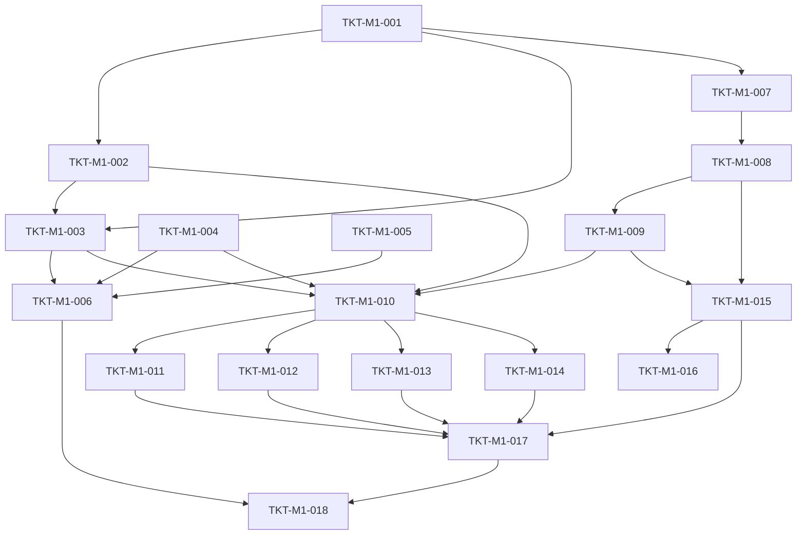

# TICKETS-M1 v1.0 — «Bootstrap + EventBus»

**Тип документа:** Детализация тикетов вехи M1  
**Дата:** 2026-11-02  
**Статус:** ✅ реализовано (Wave 0, 2026-11-14)  
**Реализация:** все тикеты вехи выполнены и подтверждены проверками (`bun run t:check` — 117 тестов, `bun run ci:validate` — 8/8 стадий). Фактические пути файлов могут отличаться от текста тикетов — см. `TICKETS-OVERVIEW`, раздел «Фактическая реализация Wave 0». DoD-чекбоксы остаются авторским шаблоном, статус ведётся в поле «Статус» каждого тикета.  
**Веха:** M1  
**Покрывает:** `DEV-SPEC-001`, `DEV-SPEC-002`  
**Тикетов:** 18  
**Демо вехи:** приложение стартует, публикует событие, хендлер вызывается; минимальный validator для `core.json` зелёный.

---

## 1. Состав вехи

| ID | Название | DEV-SPEC | Размер |
|---|---|---|---|
| `TKT-M1-001` | Brand & EntityId types | 001 | XS |
| `TKT-M1-002` | Result type + helpers | 001 | S |
| `TKT-M1-003` | AppError hierarchy | 001 | S |
| `TKT-M1-004` | Logger + PinoLogger + NoopLogger | 001 | S |
| `TKT-M1-005` | AppConfig + zod schema + app-config.json | 001 | S |
| `TKT-M1-006` | DependencyContainer + GameBootstrap + main.ts | 001 | M |
| `TKT-M1-007` | EventType + DomainEvent + DeliveryPolicy types | 002 | XS |
| `TKT-M1-008` | EventDefinition type + JSON Schema | 002 | S |
| `TKT-M1-009` | EventRegistry interface + impl | 002 | S |
| `TKT-M1-010` | IEventBus + InMemoryEventBus (publish/subscribe) | 002 | M |
| `TKT-M1-011` | EventPayloadValidator + интеграция с publish | 002 | S |
| `TKT-M1-012` | DeliveryPolicy queues + drainQueue | 002 | M |
| `TKT-M1-013` | Handler priority + isolation | 002 | S |
| `TKT-M1-014` | RecordingEventBus (тест-адаптер) | 002 | XS |
| `TKT-M1-015` | content/events/core.json — 30 core-событий | 002 | M |
| `TKT-M1-016` | Минимальный events validator (script) | 002 | S |
| `TKT-M1-017` | Contract-тесты: все core-события валидны | 002 | S |
| `TKT-M1-018` | M1 демо: bootstrap + publish + handler | 001,002 | S |

---

## 2. Порядок выполнения



**Параллелизация:** после `TKT-M1-001` можно параллельно вести ветки 002→003 и 007→008→009. После `TKT-M1-010` — три параллельных подветки (011, 012, 013/014).

---

## 3. Тикеты

### TKT-M1-001 — Brand & EntityId types

**DEV-SPEC:** DEV-SPEC-001  
**Требования:** R01  
**AC:** AC01, AC02, AC03  
**Размер:** XS  
**Статус:** ✅ выполнено  
**Зависит от:** —  
**Блокирует:** TKT-M1-002, 003, 006, 007, 009, 010

**Что сделать:**
- Файл `src/shared/types/Brand.ts` с типом `Brand<T, B>`.
- Файл `src/shared/types/EntityId.ts` со всеми branded типами из §5.1 DEV-SPEC-001 (`EntityId`, `CaptainId`, `ShipId`, `CompanionId`, `TradeNodeId`, `FactionId`, `CataclysmId`, `MechanicId`, `EventType` и т.п.).
- Функция `makeEntityId<T>(raw: string): T` с regex-валидацией `kebab-case`.
- Функция `asEntityId(s: string): EntityId` — только для десериализации.

**Acceptance Criteria:**
- `DEV-SPEC-001-AC01`: `"Industrial-Steam"` бросает ошибку.
- `DEV-SPEC-001-AC02`: `"a1-b2"` проходит.
- `DEV-SPEC-001-AC03`: `""` бросает ошибку.

**Definition of Done:**
- [ ] типы экспортируются из `src/shared/types/index.ts`;
- [ ] unit-тесты для 10 валидных/невалидных кейсов;
- [ ] все AC покрыты тестами;
- [ ] CI зелёный;
- [ ] PR смержен.

---

### TKT-M1-002 — Result type + helpers

**DEV-SPEC:** DEV-SPEC-001  
**Требования:** R02  
**AC:** AC04, AC05  
**Размер:** S  
**Статус:** ✅ выполнено  
**Зависит от:** TKT-M1-001  
**Блокирует:** TKT-M1-003, 006, 009, 010, 011, 012, 013

**Что сделать:**
- Файл `src/shared/types/Result.ts` с `Result<T, E>`, `Ok<T>`, `Err<E>`.
- Хелперы: `ok`, `err`, `isOk`, `isErr`, `unwrap`, `mapResult`, `flatMapResult`, `combineResults`.
- Никаких исключений из этих функций (кроме `unwrap` на `Err`).

**Acceptance Criteria:**
- `DEV-SPEC-001-AC04`: `mapResult(err(e), f)` возвращает `err(e)`, `f` не вызывается.
- `DEV-SPEC-001-AC05`: `flatMapResult` аналогично.

**Definition of Done:**
- [ ] unit-тесты ≥15 кейсов (ok/err/map/flatMap/combine);
- [ ] `unwrap` на `Err` бросает, на `Ok` — возвращает;
- [ ] все AC покрыты тестами;
- [ ] CI зелёный;
- [ ] PR смержен.

---

### TKT-M1-003 — AppError hierarchy

**DEV-SPEC:** DEV-SPEC-001  
**Требования:** supports R02 (контракт ошибок)  
**AC:** —  
**Размер:** S  
**Статус:** ✅ выполнено  
**Зависит от:** TKT-M1-001, 002  
**Блокирует:** TKT-M1-006, 010, 011, 012

**Что сделать:**
- Файл `src/shared/errors/AppError.ts` с `AppErrorBase`, `AppError`, `makeError`.
- Файл `DomainError.ts` с `DomainErrorCode` и фабрикой.
- Файл `InfrastructureError.ts` с `InfrastructureErrorCode` и фабрикой.
- Файл `PresentationError.ts` с `PresentationErrorCode` и фабрикой.
- Все коды из §5.3 DEV-SPEC-001.

**Acceptance Criteria:**
- `makeError` возвращает frozen-объект.
- Все коды из спецификации присутствуют как union-типы.
- `DomainError`, `InfrastructureError`, `PresentationError` дискриминируются по `layer`.

**Definition of Done:**
- [ ] unit-тесты на freeze и на discriminated union;
- [ ] все три фабрики экспортируются;
- [ ] CI зелёный;
- [ ] PR смержен.

---

### TKT-M1-004 — Logger + PinoLogger + NoopLogger

**DEV-SPEC:** DEV-SPEC-001  
**Требования:** supports R03  
**AC:** —  
**Размер:** S  
**Статус:** ✅ выполнено  
**Зависит от:** —  
**Блокирует:** TKT-M1-006, 010, 013

**Что сделать:**
- Файл `src/shared/logging/Logger.ts` с интерфейсом из §5.4 DEV-SPEC-001.
- `PinoLogger.ts` — адаптер над `pino`; в `dev` — `pino-pretty`, в `production` — JSON.
- `NoopLogger.ts` — для unit-тестов.
- Метод `child(bindings)` возвращает новый `Logger` с привязанными полями.

**Acceptance Criteria:**
- `Logger` — интерфейс, реализации взаимозаменяемы.
- `NoopLogger` не пишет ничего.
- `PinoLogger` пишет JSON в production.

**Definition of Done:**
- [ ] unit-тесты: `child` сохраняет родительские bindings;
- [ ] `NoopLogger` проходит smoke-тест;
- [ ] lint-правило запрещает прямой `console.*` вне `shared/logging/`;
- [ ] CI зелёный;
- [ ] PR смержен.

---

### TKT-M1-005 — AppConfig + zod schema + app-config.json

**DEV-SPEC:** DEV-SPEC-001  
**Требования:** supports R03  
**AC:** —  
**Размер:** S  
**Статус:** ✅ выполнено  
**Зависит от:** —  
**Блокирует:** TKT-M1-006

**Что сделать:**
- Файл `src/shared/config/AppConfig.ts` с интерфейсом из §5.5 DEV-SPEC-001.
- Файл `AppConfigSchema.ts` — zod-схема с полями `version`, `environment`, `seed`, `qualityTier`, `language`, `mobile`, `debug`.
- Файл `content/config/app-config.json` — валидный пример.
- Функция `loadAppConfig(): Result<AppConfig, InfrastructureError>`.

**Acceptance Criteria:**
- Валидный `app-config.json` → `Ok`.
- Невалидный → `Err(INFRA_SCHEMA_INVALID)` с `meta.issues` из zod.
- Zod-schema имеет `.default(...)` для необязательных полей (например, `debug`).

**Definition of Done:**
- [ ] unit-тесты: валидный, невалидный, defaults;
- [ ] `app-config.json` в репо валиден;
- [ ] CI зелёный;
- [ ] PR смержен.

---

### TKT-M1-006 — DependencyContainer + GameBootstrap + main.ts

**DEV-SPEC:** DEV-SPEC-001  
**Требования:** R03, R04  
**AC:** AC06, AC07, AC08, AC09  
**Размер:** M  
**Статус:** ✅ выполнено  
**Зависит от:** TKT-M1-001…005  
**Блокирует:** TKT-M1-018

**Что сделать:**
- Файл `src/bootstrap/DependencyContainer.ts` — регистрация `Logger`, `AppConfig`; placeholder-регистрации для будущих сервисов (Bus, RNG, ContentRegistry).
- Файл `src/bootstrap/GameBootstrap.ts` — последовательность из §7.4 DEV-SPEC-001: `loadAppConfig → DependencyContainer.build → initFoundation → initDomains → initPresentation`.
- Файл `src/bootstrap/main.ts` — вызов `bootstrap()` и обработка `Result`.
- `bootstrap(): Promise<Result<AppHandle, AppError>>`.

**Acceptance Criteria:**
- `DEV-SPEC-001-AC06`: mock-модули логируют порядок вызовов, порядок совпадает.
- `DEV-SPEC-001-AC07`: при ошибке на шаге N шаги > N не вызываются.
- `DEV-SPEC-001-AC08`: повторный resolve даёт тот же singleton.
- `DEV-SPEC-001-AC09`: resolve незарегистрированного типа бросает tsyringe error.

**Definition of Done:**
- [ ] `bootstrap` возвращает `Ok(AppHandle)` на валидном конфиге;
- [ ] `bootstrap` возвращает `Err` на невалидном конфиге;
- [ ] `main.ts` логирует ошибку и корректно завершает процесс;
- [ ] все AC покрыты тестами;
- [ ] CI зелёный;
- [ ] PR смержен.

---

### TKT-M1-007 — EventType + DomainEvent + DeliveryPolicy types

**DEV-SPEC:** DEV-SPEC-002  
**Требования:** supports R05  
**AC:** —  
**Размер:** XS  
**Статус:** ✅ выполнено  
**Зависит от:** TKT-M1-001  
**Блокирует:** TKT-M1-008, 009, 010

**Что сделать:**
- Файл `src/shared/events/EventType.ts` с `EventType` и `makeEventType` (regex `^[a-z][a-z0-9-]*(\.[a-z0-9-]+)+$`).
- Файл `src/shared/events/DeliveryPolicy.ts` с типом `DeliveryPolicy = 'Immediate' | 'NextTick' | 'AfterScene' | 'WarningThenImpact'`.
- Файл `src/shared/events/DomainEvent.ts` с `DomainEvent<TType, TPayload>` из §5.2 DEV-SPEC-002.

**Acceptance Criteria:**
- `makeEventType('world.tick_advanced')` → валидный.
- `makeEventType('World')` → ошибка.
- `makeEventType('world')` (без точки) → ошибка.

**Definition of Done:**
- [ ] unit-тесты на 10 валидных/невалидных кейсов;
- [ ] типы экспортируются из `src/shared/events/index.ts`;
- [ ] CI зелёный;
- [ ] PR смержен.

---

### TKT-M1-008 — EventDefinition type + JSON Schema

**DEV-SPEC:** DEV-SPEC-002  
**Требования:** supports R05  
**AC:** —  
**Размер:** S  
**Статус:** ✅ выполнено  
**Зависит от:** TKT-M1-007  
**Блокирует:** TKT-M1-009, 015

**Что сделать:**
- Файл `src/domain/events/EventDefinition.ts` с интерфейсом из §5.3 DEV-SPEC-002.
- Файл `content/schemas/event-definition.json` — JSON Schema из §6.1 DEV-SPEC-002.

**Acceptance Criteria:**
- `EventDefinition` покрывает все поля из спецификации.
- Схема валидна как JSON Schema (проверка в unit-тесте через ajv).
- `additionalProperties: false` в схеме.

**Definition of Done:**
- [ ] unit-тест: минимальный валидный `EventDefinition` проходит схему;
- [ ] unit-тест: отсутствие обязательного поля ломает схему;
- [ ] CI зелёный;
- [ ] PR смержен.

---

### TKT-M1-009 — EventRegistry interface + impl

**DEV-SPEC:** DEV-SPEC-002  
**Требования:** R01  
**AC:** AC01, AC02  
**Размер:** S  
**Статус:** ✅ выполнено  
**Зависит от:** TKT-M1-002, 007, 008  
**Блокирует:** TKT-M1-010, 015

**Что сделать:**
- Файл `src/domain/events/EventRegistry.ts` с интерфейсом из §5.4 DEV-SPEC-002.
- Файл `src/infrastructure/events/InMemoryEventRegistry.ts` — реализация.
- `register(def)` — при дубле `id` бросает или возвращает `Err`? Решение: возвращает `Result<void, AppError>` с `INFRA_SCHEMA_INVALID` (не бросает).

**Acceptance Criteria:**
- `DEV-SPEC-002-AC01`: зарегистрированное событие → `has()` = `true`.
- `DEV-SPEC-002-AC02`: незарегистрированное → `has()` = `false`, `get()` возвращает `Err`.

**Definition of Done:**
- [ ] unit-тесты: register, duplicate, get, has, list, listByOwner;
- [ ] все AC покрыты тестами;
- [ ] CI зелёный;
- [ ] PR смержен.

---

### TKT-M1-010 — IEventBus + InMemoryEventBus (publish/subscribe)

**DEV-SPEC:** DEV-SPEC-002  
**Требования:** R01, R04  
**AC:** AC01, AC02, AC08, AC09  
**Размер:** M  
**Статус:** ✅ выполнено  
**Зависит от:** TKT-M1-002, 003, 004, 007, 009  
**Блокирует:** TKT-M1-011, 012, 013, 014

**Что сделать:**
- Файл `src/domain/events/IEventBus.ts` с интерфейсом из §5.5 DEV-SPEC-002.
- Файл `src/infrastructure/events/InMemoryEventBus.ts` — базовая реализация `publish` (без payload-валидации — она в TKT-M1-011) и `subscribe`.
- На этом тикете — только `Immediate` доставка (без очередей — они в TKT-M1-012).

**Acceptance Criteria:**
- `DEV-SPEC-002-AC01`: `publish` для зарегистрированного события → `Ok`.
- `DEV-SPEC-002-AC02`: `publish` для незарегистрированного → `Err(INFRA_EVENT_UNKNOWN)`.
- `DEV-SPEC-002-AC08`: при равных `priority` — порядок подписки.
- `DEV-SPEC-002-AC09`: исключение в первом хендлере не мешает второму.

**Definition of Done:**
- [ ] unit-тесты: publish/subscribe/unsubscribe, unknown event;
- [ ] все AC покрыты тестами;
- [ ] CI зелёный;
- [ ] PR смержен.

---

### TKT-M1-011 — EventPayloadValidator + интеграция с publish

**DEV-SPEC:** DEV-SPEC-002  
**Требования:** R02  
**AC:** AC03, AC04  
**Размер:** S  
**Статус:** ✅ выполнено  
**Зависит от:** TKT-M1-010  
**Блокирует:** TKT-M1-017

**Что сделать:**
- Файл `src/infrastructure/events/EventPayloadValidator.ts` — валидация payload по `payloadSchema` из `EventDefinition` через ajv.
- Интеграция в `InMemoryEventBus.publish`: перед вызовом хендлеров — валидация; при ошибке — `Err(INFRA_SCHEMA_INVALID)` с `meta.issues`.

**Acceptance Criteria:**
- `DEV-SPEC-002-AC03`: валидный payload → `Ok`, хендлеры вызваны.
- `DEV-SPEC-002-AC04`: невалидный payload → `Err(INFRA_SCHEMA_INVALID)`, хендлеры не вызваны.

**Definition of Done:**
- [ ] unit-тесты на 5 событий с разными схемами;
- [ ] ajv-компиляция схем кэшируется;
- [ ] все AC покрыты тестами;
- [ ] CI зелёный;
- [ ] PR смержен.

---

### TKT-M1-012 — DeliveryPolicy queues + drainQueue

**DEV-SPEC:** DEV-SPEC-002  
**Требования:** R03  
**AC:** AC05, AC06, AC07  
**Размер:** M  
**Статус:** ✅ выполнено  
**Зависит от:** TKT-M1-010  
**Блокирует:** TKT-M1-017

**Что сделать:**
- Очереди для `NextTick`, `AfterScene`, `WarningThenImpact` в `InMemoryEventBus`.
- Метод `drainQueue(policy): readonly DomainEvent[]` — возвращает события в порядке `emittedAtMs`, очищает очередь.
- `peekQueue()` — без очистки.
- `Immediate` — синхронно, не в очереди.

**Acceptance Criteria:**
- `DEV-SPEC-002-AC05`: `Immediate` — хендлеры вызваны синхронно.
- `DEV-SPEC-002-AC06`: `NextTick` — только после `drainQueue('NextTick')`.
- `DEV-SPEC-002-AC07`: `drainQueue` возвращает события и очищает очередь.

**Definition of Done:**
- [ ] unit-тесты на все 4 политики;
- [ ] порядок событий в очереди стабилен;
- [ ] все AC покрыты тестами;
- [ ] CI зелёный;
- [ ] PR смержен.

---

### TKT-M1-013 — Handler priority + isolation

**DEV-SPEC:** DEV-SPEC-002  
**Требования:** R04  
**AC:** AC08, AC09  
**Размер:** S  
**Статус:** ✅ выполнено  
**Зависит от:** TKT-M1-010  
**Блокирует:** TKT-M1-017

**Что сделать:**
- Сортировка хендлеров по `priority` (убывание), tie-breaker — порядок подписки.
- Изоляция: исключение в одном хендлере ловится, логируется через `Logger.error` с `eventType`, `handlerIndex`; остальные продолжают.
- Флаг `once: true` — хендлер вызывается один раз, затем отписывается.

**Acceptance Criteria:**
- `DEV-SPEC-002-AC08`: при равных `priority` — порядок подписки.
- `DEV-SPEC-002-AC09`: исключение в первом хендлере не мешает второму.

**Definition of Done:**
- [ ] unit-тесты: priority, once, isolation;
- [ ] все AC покрыты тестами;
- [ ] CI зелёный;
- [ ] PR смержен.

---

### TKT-M1-014 — RecordingEventBus (тест-адаптер)

**DEV-SPEC:** DEV-SPEC-002  
**Требования:** supports R04  
**AC:** —  
**Размер:** XS  
**Статус:** ✅ выполнено  
**Зависит от:** TKT-M1-010  
**Блокирует:** TKT-M1-017

**Что сделать:**
- Файл `src/infrastructure/events/RecordingEventBus.ts` — декоратор над `InMemoryEventBus`, сохраняет все `publish` и `drainQueue` в массив.
- Методы: `getRecorded(): readonly DomainEvent[]`, `clear()`.

**Acceptance Criteria:**
- Записывает все события в порядке публикации.
- `clear()` очищает журнал.

**Definition of Done:**
- [ ] unit-тесты: запись и очистка;
- [ ] используется в тестах TKT-M1-017 и TKT-M1-018;
- [ ] CI зелёный;
- [ ] PR смержен.

---

### TKT-M1-015 — content/events/core.json — 30 core-событий

**DEV-SPEC:** DEV-SPEC-002  
**Требования:** R05  
**AC:** AC10, AC11  
**Размер:** M  
**Статус:** ✅ выполнено  
**Зависит от:** TKT-M1-008, 009  
**Блокирует:** TKT-M1-016, 017, 018

**Что сделать:**
- Файл `content/events/core.json` — массив `EventDefinition` для 30 событий.
- У каждого — `payloadSchema` с реальными полями (не `{ type: 'object' }`).
- Все `source: 'core'`, `ownerSpec` соответствует DESIGN.

**Список 30 событий:**

| ID | Payload (обязательные поля) |
|---|---|
| `world.tick_advanced` | `tick: number` |
| `combat.started` | `combatId: string`, `partyIds: string[]` |
| `combat.ended` | `combatId: string`, `resolution: string` |
| `combat.tick_advanced` | `combatId: string`, `tick: number` |
| `combat.duel_action_executed` | `combatId: string`, `actorId: string`, `actionType: string` |
| `combat.duel_damage_dealt` | `combatId: string`, `targetId: string`, `amount: number` |
| `combat.duel_captain_wounded` | `combatId: string`, `captainId: string`, `severity: string` |
| `combat.duel_captain_defeated` | `combatId: string`, `captainId: string` |
| `combat.party_morale_changed` | `combatId: string`, `partyId: string`, `oldValue: number`, `newValue: number` |
| `combat.crew_casualty_occurred` | `combatId: string`, `crewId: string` |
| `combat.resolution_triggered` | `combatId: string`, `resolutionType: string` |
| `ship.damaged` | `shipId: string`, `amount: number`, `source: string` |
| `ship.destroyed` | `shipId: string` |
| `ship.repaired` | `shipId: string`, `amount: number` |
| `ship.maneuver_executed` | `shipId: string`, `maneuverType: string` |
| `ship.acquired` | `shipId: string`, `definitionId: string` |
| `ship.lost` | `shipId: string` |
| `economy.trade_executed` | `nodeId: string`, `goodId: string`, `quantity: number`, `price: number` |
| `economy.price_changed` | `nodeId: string`, `goodId: string`, `oldPrice: number`, `newPrice: number` |
| `economy.quest_generated` | `questId: string`, `templateId: string` |
| `economy.quest_completed` | `questId: string` |
| `cataclysm.triggered` | `cataclysmId: string`, `definitionId: string` |
| `cataclysm.stage_changed` | `cataclysmId: string`, `fromStage: string`, `toStage: string` |
| `cataclysm.effect_applied` | `cataclysmId: string`, `targetId: string`, `effectTag: string` |
| `cataclysm.ended` | `cataclysmId: string`, `resolution: string` |
| `party.companion_recruited` | `companionId: string`, `definitionId: string` |
| `party.companion_died` | `companionId: string` |
| `party.companion_relationship_changed` | `companionId: string`, `oldValue: number`, `newValue: number` |
| `visual.transition_started` | `transitionId: string` |
| `visual.transition_completed` | `transitionId: string` |

**Пример одной записи (для эталона):**

```json
{
  "id": "world.tick_advanced",
  "namespace": "world",
  "source": "core",
  "descriptionKey": "event.world.tick_advanced.description",
  "payloadSchema": {
    "type": "object",
    "required": ["tick"],
    "properties": { "tick": { "type": "integer", "minimum": 0 } },
    "additionalProperties": false
  },
  "tags": ["core", "world", "tick"],
  "defaultDeliveryPolicy": "Immediate",
  "ownerSpec": "DEV-SPEC-007"
}
```

**Acceptance Criteria:**
- `DEV-SPEC-002-AC10`: дубль `id` в `core.json` → `Err` при загрузке в `EventRegistry`.
- `DEV-SPEC-002-AC11`: `industrial-steam.*` не может быть `core` (проверяется в TKT-M1-016).

**Definition of Done:**
- [ ] все 30 событий присутствуют;
- [ ] каждое имеет непустой `payloadSchema` с `required`;
- [ ] все `ownerSpec` корректны;
- [ ] `core.json` валиден по `event-definition.json`;
- [ ] все AC покрыты тестами;
- [ ] CI зелёный;
- [ ] PR смержен.

---

### TKT-M1-016 — Минимальный events validator (script)

**DEV-SPEC:** DEV-SPEC-002  
**Требования:** supports R05  
**AC:** AC10, AC11  
**Размер:** S  
**Статус:** ✅ выполнено  
**Зависит от:** TKT-M1-009, 015  
**Блокирует:** TKT-M1-018

**Что сделать:**
- Файл `tools/ci/validate-events.ts` — минимальный скрипт (полная CI-обвязка будет в TKT-M4-007).
- Проверки:
  1. `core.json` валиден по `event-definition.json`.
  2. Нет дублей `id`.
  3. Все `source: 'core'` — `id` не начинается с префикса фракции (`industrial-steam.`, `ancient-arcane.`, `necromantic-corpse.`, `living-artifact.`).
  4. Все `ownerSpec` соответствуют шаблону `DEV-SPEC-NNN`.
- Скрипт запускается через `npm run validate:events`.
- Exit code 0/1.

**Acceptance Criteria:**
- `DEV-SPEC-002-AC10`: добавление дубля в `core.json` → скрипт падает с exit 1.
- `DEV-SPEC-002-AC11`: `id: 'industrial-steam.foo'` с `source: 'core'` → падает.

**Definition of Done:**
- [ ] скрипт работает локально;
- [ ] добавлен в `package.json` как `validate:events`;
- [ ] скрипт вызывается в PR-чеке (или в pre-push hook);
- [ ] все AC покрыты тестами;
- [ ] CI зелёный;
- [ ] PR смержен.

---

### TKT-M1-017 — Contract-тесты: все core-события валидны

**DEV-SPEC:** DEV-SPEC-002  
**Требования:** R01, R02, R03, R04, R05  
**AC:** AC01…AC11 (все)  
**Размер:** S  
**Статус:** ✅ выполнено  
**Зависит от:** TKT-M1-011, 012, 013, 014, 015  
**Блокирует:** TKT-M1-018

**Что сделать:**
- Файл `tests/contract/events.contract.test.ts`.
- Тест 1: загрузить `core.json` → `EventRegistry` → все 30 событий зарегистрированы.
- Тест 2: для каждого события — `publish` с минимальным валидным payload → `Ok`; с невалидным → `Err`.
- Тест 3: `RecordingEventBus` фиксирует все 30 событий при публикации.
- Тест 4: `drainQueue` для каждой `DeliveryPolicy` корректно возвращает события.
- Тест 5: priority ordering.

**Acceptance Criteria:**
- Все AC из DEV-SPEC-002 покрыты хотя бы одним тестом.

**Definition of Done:**
- [ ] все 5 тестов проходят;
- [ ] покрытие `InMemoryEventBus` ≥80%;
- [ ] все AC покрыты тестами;
- [ ] CI зелёный;
- [ ] PR смержен.

---

### TKT-M1-018 — M1 демо: bootstrap + publish + handler

**DEV-SPEC:** DEV-SPEC-001, DEV-SPEC-002  
**Требования:** 001-R03, 002-R01, 002-R03, 002-R04  
**AC:** 001-AC06, 001-AC07, 002-AC01, 002-AC05, 002-AC08  
**Размер:** S  
**Статус:** ✅ выполнено  
**Зависит от:** TKT-M1-006, 017  
**Блокирует:** TKT-M2-001

**Что сделать:**
- Файл `src/bootstrap/M1Demo.ts` (или `scripts/m1-demo.ts`) — минимальный сценарий:
  1. `bootstrap()` → `Ok`.
  2. Резолв `IEventBus` из DI.
  3. Загрузка `core.json` в `EventRegistry`.
  4. Подписка на `world.tick_advanced` с `priority: 100`.
  5. `publish({ type: 'world.tick_advanced', payload: { tick: 0 } })`.
  6. Хендлер логирует «tick received».
  7. `RecordingEventBus` подтверждает одно событие.
- README-секция «Как проверить M1» с шагами.

**Acceptance Criteria:**
- `DEV-SPEC-001-AC06`: bootstrap логирует порядок шагов.
- `DEV-SPEC-001-AC07`: при падении `initFoundation` демо возвращает `Err`.
- `DEV-SPEC-002-AC01`: `publish` для `world.tick_advanced` → `Ok`.
- `DEV-SPEC-002-AC05`: `Immediate` — хендлер вызван синхронно.
- `DEV-SPEC-002-AC08`: при двух хендлерах с разными `priority` — порядок корректен.

**Definition of Done:**
- [ ] `npm run demo:m1` отрабатывает без ошибок;
- [ ] в логе видно: bootstrap → publish → handler;
- [ ] все AC покрыты тестами;
- [ ] CI зелёный;
- [ ] PR смержен.

---

## 4. Definition of Done для вехи M1

- [ ] все 18 тикетов смержены в `main`;
- [ ] `npm run validate:events` зелёный;
- [ ] `npm run demo:m1` воспроизводится;
- [ ] все AC из `DEV-SPEC-001` (AC01…AC09) и `DEV-SPEC-002` (AC01…AC11) покрыты тестами;
- [ ] `content/events/core.json` содержит 30 событий, каждое с непустой схемой;
- [ ] в коде нет `TODO`/`FIXME` без ссылки на тикет;
- [ ] открытые вопросы `Q-01`, `Q-02` из DEV-SPEC-002 — закрыты или явно отложены.

---

## 5. Что разблокирует M1

Завершение M1 разблокирует:
- **M2**: `TKT-M2-001` (ContentKind), `TKT-M2-009` (InMemoryContentRegistry), `TKT-M2-010` (MechanicDefinition) — все зависят от готового EventBus.
- **M3**: `TKT-M3-001` (RngStreamName) — не зависит от M1 напрямую, но M3-demo (`TKT-M3-026`) требует M1.
- **M4**: `TKT-M4-007` (CI events stage) — расширяет минимальный validator из TKT-M1-016.

---

## 6. Риски и заметки

| Риск | Митигация |
|---|---|
| `ajv`-компиляция схем может быть медленной | кэшировать скомпилированные валидаторы по `$id` схемы |
| `core.json` со временем будет расширяться | структура массива, новые события аддитивны, ID не меняются |
| tsyringe-декораторы требуют `reflect-metadata` | подключить `reflect-metadata` в `main.ts` до первого импорта DI-модулей |
| `pino` в браузере требует bundler-плагина | использовать `pino/browser`, ограничить формат |