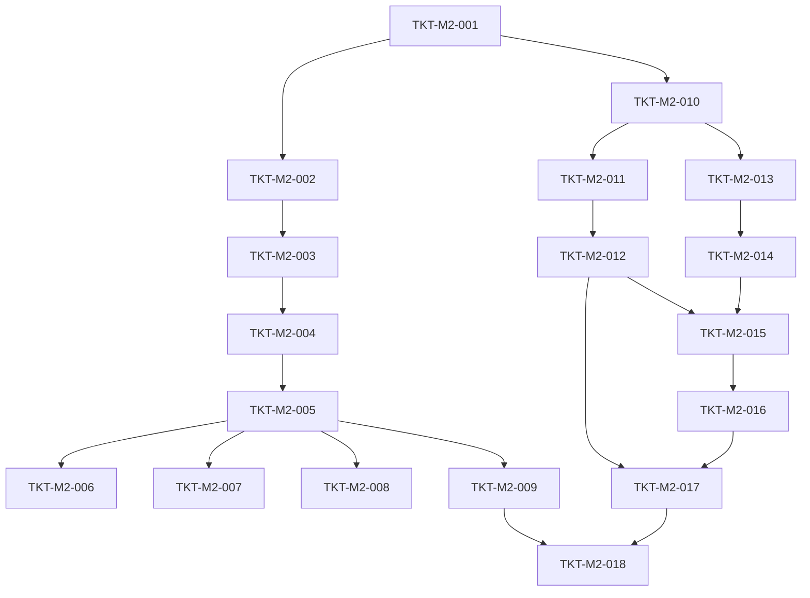

# TICKETS-M2 v1.0 — «Content + Mechanics»

**Тип документа:** Детализация тикетов вехи M2  
**Дата:** 2026-11-02  
**Статус:** draft  
**Веха:** M2  
**Покрывает:** `DEV-SPEC-003`, `DEV-SPEC-004`  
**Тикетов:** 18  
**Демо вехи:** контент загружается, 2–3 stub-механики зарегистрированы, resolver реагирует на событие, tracker тикает и валидирует state.

---

## 1. Состав вехи

| ID | Название | DEV-SPEC | Размер |
|---|---|---|---|
| `TKT-M2-001` | ContentKind type + все 64 значения | 003 | XS |
| `TKT-M2-002` | ContentPack type + loader (topo sort) | 003 | S |
| `TKT-M2-003` | AjvSchemaValidator | 003 | S |
| `TKT-M2-004` | 7–10 базовых JSON Schema | 003 | M |
| `TKT-M2-005` | JsonContentRegistry.loadAll | 003 | M |
| `TKT-M2-006` | CrossReferenceValidator | 003 | M |
| `TKT-M2-007` | ContentHasher (SHA-256) | 003 | S |
| `TKT-M2-008` | Hot reload (dev only) | 003 | S |
| `TKT-M2-009` | InMemoryContentRegistry (тест) | 003 | S |
| `TKT-M2-010` | MechanicDefinition type + JSON Schema | 004 | S |
| `TKT-M2-011` | MechanicContext type | 004 | XS |
| `TKT-M2-012` | IMechanicPlugin + базовый класс | 004 | S |
| `TKT-M2-013` | MechanicRegistry interface + impl | 004 | S |
| `TKT-M2-014` | StateSchemaValidator | 004 | S |
| `TKT-M2-015` | MechanicRuntime.dispatchEvent | 004 | M |
| `TKT-M2-016` | MechanicRuntime.tickScope + activate/deactivate | 004 | M |
| `TKT-M2-017` | 2–3 stub-плагина (resolver + tracker) | 004 | S |
| `TKT-M2-018` | M2 демо: контент → механика реагирует | 003,004 | S |

---

## 2. Порядок выполнения

**Параллелизация:** после `TKT-M2-001` две независимые ветки — Content (002→005) и Mechanics (010→013). Сходятся на `TKT-M2-017` и `TKT-M2-018`.

---

## 3. Тикеты

### TKT-M2-001 — ContentKind type + все 64 значения

**DEV-SPEC:** DEV-SPEC-003  
**Требования:** supports R01, R02, R03  
**AC:** —  
**Размер:** XS  
**Зависит от:** TKT-M1-001  
**Блокирует:** TKT-M2-002, 010

**Что сделать:**
- Файл `src/domain/content/ContentKind.ts` с union-типом из §5.1 DEV-SPEC-003.
- Все 64 значения (перечислить полностью, как в спеке).
- Константа `ALL_CONTENT_KINDS: readonly ContentKind[]` для итерации.

**Acceptance Criteria:**
- Все значения из §5.1 присутствуют.
- `ALL_CONTENT_KINDS.length === 64`.

**Definition of Done:**
- [ ] unit-тест: `ALL_CONTENT_KINDS` содержит все значения;
- [ ] type-check проходит;
- [ ] CI зелёный;
- [ ] PR смержен.

---

### TKT-M2-002 — ContentPack type + loader (topo sort)

**DEV-SPEC:** DEV-SPEC-003  
**Требования:** supports R01  
**AC:** —  
**Размер:** S  
**Зависит от:** TKT-M2-001, TKT-M1-002  
**Блокирует:** TKT-M2-003, 005

**Что сделать:**
- Файл `src/domain/content/ContentPack.ts` с интерфейсом из §5.2 DEV-SPEC-003.
- Функция `loadPacks(manifest): Result<ContentPack[], InfrastructureError>` — читает манифест packs и возвращает топологически отсортированный список.
- Детект циклов в `dependencies` → `Err(INFRA_SCHEMA_INVALID)`.
- `content/packs.json` — манифест для скелета (3–4 packs: `events`, `mechanics`, `schemas`, `config`).

**Acceptance Criteria:**
- Пакеты с зависимостями сортируются в правильном порядке.
- Цикл зависимостей → `Err`.
- Отсутствующий pack → `Err`.

**Definition of Done:**
- [ ] unit-тесты: линейная цепочка, diamond, цикл;
- [ ] `content/packs.json` валиден;
- [ ] CI зелёный;
- [ ] PR смержен.

---

### TKT-M2-003 — AjvSchemaValidator

**DEV-SPEC:** DEV-SPEC-003  
**Требования:** supports R01  
**AC:** —  
**Размер:** S  
**Зависит от:** TKT-M2-002, TKT-M1-003  
**Блокирует:** TKT-M2-004, 005

**Что сделать:**
- Файл `src/infrastructure/content/AjvSchemaValidator.ts`.
- Обёртка над `ajv` с `allErrors: true`, `strict: false`, `ajv-formats`.
- Кэш скомпилированных валидаторов по `$id`.
- Метод `validate(kind, value): Result<void, InfrastructureError>` — резолвит схему по `kind`, валидирует, возвращает `meta.issues`.

**Acceptance Criteria:**
- Валидный объект → `Ok`.
- Невалидный → `Err` с `issues: string[]` и `path`.
- Кэш не создаёт дубликаты компиляции.

**Definition of Done:**
- [ ] unit-тесты: валидный, невалидный, кэш;
- [ ] `ajv` и `ajv-formats` в `package.json`;
- [ ] CI зелёный;
- [ ] PR смержен.

---

### TKT-M2-004 — 7–10 базовых JSON Schema

**DEV-SPEC:** DEV-SPEC-003  
**Требования:** supports R03  
**AC:** —  
**Размер:** M  
**Зависит от:** TKT-M2-003  
**Блокирует:** TKT-M2-005, 010

**Что сделать:**
- В `content/schemas/` добавить **7–10 схем** (не 64) — только те, что нужны скелету сейчас:
  1. `event-definition.json` — уже есть из TKT-M1-008.
  2. `mechanic-definition.json` — из DEV-SPEC-004 §6.1.
  3. `save-snapshot.json` — из DEV-SPEC-006 §6.1 (понадобится в M3, но схема стабильна).
  4. `rng-stream-state.json` — из DEV-SPEC-005 §6.1.
  5. `clock-config.json` — из DEV-SPEC-007 §6.1.
  6. `locale-file.json` — из DEV-SPEC-009 §6.1.
  7. `content-pack.json` — новый, простой (id, version, kinds, files, dependencies).
  8. `app-config.json` — из DEV-SPEC-001 §5.5 (можно добавить, если решено валидировать конфиг тем же путём; иначе — только zod).
- Файл `content/schemas/index.ts` — экспорт `Record<string, object>`.

**Правило:** `additionalProperties: true` на первой волне. Ужесточение — отдельным тикетом, когда домены будут готовы.

**Acceptance Criteria:**
- Все 7–10 схем валидны как JSON Schema (проверка через `ajv.validateSchema`).
- `index.ts` экспортирует все.
- Каждая схема минимально покрывает пример из соответствующего DEV-SPEC.

**Definition of Done:**
- [ ] unit-тест: каждая схема валидна как JSON Schema;
- [ ] unit-тест: минимальный валидный пример проходит;
- [ ] CI зелёный;
- [ ] PR смержен.

---

### TKT-M2-005 — JsonContentRegistry.loadAll

**DEV-SPEC:** DEV-SPEC-003  
**Требования:** R01, R02  
**AC:** AC01, AC02, AC03, AC04, AC05  
**Размер:** M  
**Зависит от:** TKT-M2-002, 003, 004, TKT-M1-002  
**Блокирует:** TKT-M2-006, 007, 008, 009, 018

**Что сделать:**
- Файл `src/infrastructure/content/JsonContentRegistry.ts`.
- Метод `loadAll()`:
  1. Загрузить packs в порядке из `loadPacks`.
  2. Для каждого файла — определить `kind` по пути.
  3. Валидировать через `AjvSchemaValidator`.
  4. Проверить дубли `id` в пределах `kind`.
  5. Сохранить в `Map<ContentKind, Map<string, ContentEntry>>`.
- Методы `get`, `list`, `has` — как в §5.3.
- `get` возвращает `Err(INFRA_CONTENT_NOT_FOUND)` при отсутствии.
- `contentHash()` возвращает заглушку `'stub'` (реальный hash — в TKT-M2-007).

**Acceptance Criteria:**
- `DEV-SPEC-003-AC01`: валидный pack → `Ok`.
- `DEV-SPEC-003-AC02`: отсутствует обязательное поле → `Err`.
- `DEV-SPEC-003-AC03`: неверный enum → `Err`.
- `DEV-SPEC-003-AC04`: дубликат `id` → `Err` с `meta.issues`.
- `DEV-SPEC-003-AC05`: дубликат между packs → `Err`.

**Definition of Done:**
- [ ] unit-тесты: валидный, невалидный, дубликаты;
- [ ] `loadAll` не падает на пустых packs;
- [ ] все AC покрыты тестами;
- [ ] CI зелёный;
- [ ] PR смержен.

---

### TKT-M2-006 — CrossReferenceValidator

**DEV-SPEC:** DEV-SPEC-003  
**Требования:** R03  
**AC:** AC06, AC07, AC08  
**Размер:** M  
**Зависит от:** TKT-M2-005  
**Блокирует:** TKT-M2-018

**Что сделать:**
- Файл `src/infrastructure/content/CrossReferenceValidator.ts`.
- Правило: любое поле, заканчивающееся на `_id` или `_ids`, кроме `id` самого объекта, — ссылка. Если значение непустое и не найдено в соответствующем `kind` — ошибка.
- Маппинг поле → `kind` — через конфиг `content/cross-refs.json` (какое поле ссылается на какой `kind`).
- Для скелета — минимальный набор: `shader_graph_id → shaderGraph`, `mechanic_ids → mechanic`, `scar_ids → nodeScar`, `event_id → event` и т.п.
- Метод `validate(registry): Result<void, InfrastructureError>`.

**Acceptance Criteria:**
- `DEV-SPEC-003-AC06`: `material → shaderGraph` broken ref → `Err`.
- `DEV-SPEC-003-AC07`: `cataclysm → nodeScar` broken ref → `Err`.
- `DEV-SPEC-003-AC08`: все refs валидны → `Ok`.

**Definition of Done:**
- [ ] unit-тесты: 10 типов ссылок, broken + valid;
- [ ] `cross-refs.json` в репо;
- [ ] все AC покрыты тестами;
- [ ] CI зелёный;
- [ ] PR смержен.

---

### TKT-M2-007 — ContentHasher (SHA-256)

**DEV-SPEC:** DEV-SPEC-003  
**Требования:** R04  
**AC:** AC09, AC10  
**Размер:** S  
**Зависит от:** TKT-M2-005  
**Блокирует:** TKT-M2-018, TKT-M3-017

**Что сделать:**
- Файл `src/infrastructure/content/ContentHasher.ts`.
- Канонизация: все entries сортируются по `(kind, id)`; JSON — детерминированный (сортировка ключей рекурсивно); SHA-256 через `crypto.subtle`.
- Метод `hash(entries): Promise<string>`.
- Интеграция в `JsonContentRegistry.contentHash()` — после `loadAll`.

**Acceptance Criteria:**
- `DEV-SPEC-003-AC09`: изменение любого поля меняет хеш.
- `DEV-SPEC-003-AC10`: порядок файлов в ФС не влияет на хеш.

**Definition of Done:**
- [ ] unit-тесты: детерминизм, изменение поля, порядок;
- [ ] хеш — 64 hex-символа;
- [ ] все AC покрыты тестами;
- [ ] CI зелёный;
- [ ] PR смержен.

---

### TKT-M2-008 — Hot reload (dev only)

**DEV-SPEC:** DEV-SPEC-003  
**Требования:** R05  
**AC:** AC11  
**Размер:** S  
**Зависит от:** TKT-M2-005  
**Блокирует:** TKT-M2-018

**Что сделать:**
- Метод `JsonContentRegistry.reload()`.
- В `production` — `Err(INFRA_NETWORK_NOT_ALLOWED)` или аналогичный (не в scope) — проще: `Err(DOMAIN_INVARIANT_VIOLATION)` с `meta.reason: 'dev_only'`.
- В `dev` — повторный `loadAll` + пересчёт hash.
- Vite HMR hook: при изменении файла в `content/` — вызвать `reload()`.

**Acceptance Criteria:**
- `DEV-SPEC-003-AC11`: `dev` → `Ok`, контент обновлён.

**Definition of Done:**
- [ ] unit-тест: dev → `Ok`; production → `Err`;
- [ ] HMR работает в `npm run dev`;
- [ ] все AC покрыты тестами;
- [ ] CI зелёный;
- [ ] PR смержен.

---

### TKT-M2-009 — InMemoryContentRegistry (тест)

**DEV-SPEC:** DEV-SPEC-003  
**Требования:** supports R01  
**AC:** —  
**Размер:** S  
**Зависит от:** TKT-M2-005  
**Блокирует:** TKT-M2-018

**Что сделать:**
- Файл `src/infrastructure/content/InMemoryContentRegistry.ts`.
- Конструктор принимает `Record<ContentKind, Record<string, unknown>>`.
- Валидация через `AjvSchemaValidator` (тот же контракт).
- `contentHash()` — фиксированный `'in-memory-stub'`.
- `reload()` — `Ok` без изменений.

**Acceptance Criteria:**
- Все методы `IContentRegistry` реализованы.
- Используется в unit-тестах M2/M3.

**Definition of Done:**
- [ ] unit-тесты: get/list/has на подготовленных данных;
- [ ] CI зелёный;
- [ ] PR смержен.

---

### TKT-M2-010 — MechanicDefinition type + JSON Schema

**DEV-SPEC:** DEV-SPEC-004  
**Требования:** R01  
**AC:** AC01, AC02, AC03  
**Размер:** S  
**Зависит от:** TKT-M2-001, TKT-M2-004, TKT-M1-007  
**Блокирует:** TKT-M2-011, 013

**Что сделать:**
- Файл `src/domain/mechanics/MechanicDefinition.ts` с интерфейсом из §5.1 DEV-SPEC-004.
- Файл `content/schemas/mechanic-definition.json` — из §6.1 DEV-SPEC-004.
- Валидатор инвариантов `INV-01`…`INV-05` — отдельная функция `validateMechanicDefinition(def): Result<void, AppError>` (используется в TKT-M2-013).

**Acceptance Criteria:**
- `DEV-SPEC-004-AC01`: `resolver` + `stateSchema !== null` → `Err`.
- `DEV-SPEC-004-AC02`: `resolver` + `persisted: true` → `Err`.
- `DEV-SPEC-004-AC03`: `tracker` + `stateSchema === null` → `Err`.

**Definition of Done:**
- [ ] unit-тесты на все INV;
- [ ] JSON Schema валидна;
- [ ] все AC покрыты тестами;
- [ ] CI зелёный;
- [ ] PR смержен.

---

### TKT-M2-011 — MechanicContext type

**DEV-SPEC:** DEV-SPEC-004  
**Требования:** supports R02, R03, R04  
**AC:** —  
**Размер:** XS  
**Зависит от:** TKT-M2-010, TKT-M1-004  
**Блокирует:** TKT-M2-012

**Что сделать:**
- Файл `src/domain/mechanics/MechanicContext.ts` с интерфейсом из §5.2 DEV-SPEC-004.
- `emit` и `setState` — обёртки над `IEventBus` и runtime state.
- `SeededRngService` — импорт типа из DEV-SPEC-005 (интерфейс уже зафиксирован, реализация — в M3; на M2 — заглушка).

**Acceptance Criteria:**
- Все поля из §5.2 присутствуют.
- `emit` возвращает `Result`.

**Definition of Done:**
- [ ] type-check проходит;
- [ ] CI зелёный;
- [ ] PR смержен.

---

### TKT-M2-012 — IMechanicPlugin + базовый класс

**DEV-SPEC:** DEV-SPEC-004  
**Требования:** supports R05, R04  
**AC:** AC10, AC11  
**Размер:** S  
**Зависит от:** TKT-M2-011, TKT-M1-002  
**Блокирует:** TKT-M2-015, 017

**Что сделать:**
- Файл `src/domain/mechanics/IMechanicPlugin.ts` с интерфейсом из §5.3 DEV-SPEC-004.
- Файл `src/domain/mechanics/AbstractMechanicPlugin.ts` — базовый класс с пустыми реализациями `onTick`, `onActivate`, `onDeactivate` (no-op `Ok`), обязательный `onEvent`.
- Изоляция исключений — в runtime (TKT-M2-015), не в плагине.

**Acceptance Criteria:**
- `definitionId` обязателен.
- Базовый класс реализует `onTick`/`onActivate`/`onDeactivate` как no-op.

**Definition of Done:**
- [ ] unit-тест: наследник компилируется и вызывает `onEvent`;
- [ ] CI зелёный;
- [ ] PR смержен.

---

### TKT-M2-013 — MechanicRegistry interface + impl

**DEV-SPEC:** DEV-SPEC-004  
**Требования:** R01  
**AC:** AC01, AC02, AC03  
**Размер:** S  
**Зависит от:** TKT-M2-010, TKT-M1-002  
**Блокирует:** TKT-M2-014, 015

**Что сделать:**
- Файл `src/domain/mechanics/IMechanicRegistry.ts` с интерфейсом из §5.4 DEV-SPEC-004.
- Файл `src/infrastructure/mechanics/MechanicRegistry.ts` — реализация.
- При `register` — валидация `validateMechanicDefinition` (из TKT-M2-010); ошибка → `Err`.
- Проверка: `plugin.definitionId === definition.id`; иначе `Err(DOMAIN_INVARIANT_VIOLATION)`.
- `listByScope(scope)` — фильтрация по `lifecycle.scope`.

**Acceptance Criteria:**
- `DEV-SPEC-004-AC01`: невалидная `MechanicDefinition` → `Err`.
- `DEV-SPEC-004-AC02`: `plugin.definitionId` не совпадает → `Err`.
- `DEV-SPEC-004-AC03`: валидная — `Ok`, попадает в `list()`.

**Definition of Done:**
- [ ] unit-тесты: register, duplicate id, get, list, listByScope;
- [ ] все AC покрыты тестами;
- [ ] CI зелёный;
- [ ] PR смержен.

---

### TKT-M2-014 — StateSchemaValidator

**DEV-SPEC:** DEV-SPEC-004  
**Требования:** R04  
**AC:** AC08, AC09  
**Размер:** S  
**Зависит от:** TKT-M2-013  
**Блокирует:** TKT-M2-015

**Что сделать:**
- Файл `src/infrastructure/mechanics/StateSchemaValidator.ts`.
- Компиляция `stateSchema` через ajv (кэш по `mechanicId`).
- `validate(mechanicId, state): Result<void, AppError>`.
- Возврат `Err(INFRA_SCHEMA_INVALID)` с `meta.issues` при нарушении.

**Acceptance Criteria:**
- `DEV-SPEC-004-AC08`: валидный state → `Ok`.
- `DEV-SPEC-004-AC09`: невалидный → `Err`, state не изменён.

**Definition of Done:**
- [ ] unit-тесты: валидный, невалидный, кэш;
- [ ] все AC покрыты тестами;
- [ ] CI зелёный;
- [ ] PR смержен.

---

### TKT-M2-015 — MechanicRuntime.dispatchEvent

**DEV-SPEC:** DEV-SPEC-004  
**Требования:** R02, R03, R05  
**AC:** AC04, AC05, AC06, AC07, AC10, AC11  
**Размер:** M  
**Зависит от:** TKT-M2-012, 013, 014, TKT-M1-010  
**Блокирует:** TKT-M2-016, 017, 018

**Что сделать:**
- Файл `src/infrastructure/mechanics/MechanicRuntime.ts` — пока только `dispatchEvent`.
- `dispatchEvent(event)`:
  1. Найти все механики, у которых `consumes` содержит `event.type`.
  2. Отсортировать по `priority` убывание, tie-breaker — `id` лексикографически.
  3. Для каждой вызвать `plugin.onEvent(event, ctx)`.
  4. Исключение в плагине — ловится, логируется, continue.
- `ctx` создаётся через фабрику `createContext(mechanic)`.

**Acceptance Criteria:**
- `DEV-SPEC-004-AC04`: `priority: 100` вызвана первой.
- `DEV-SPEC-004-AC05`: при равных `priority` — порядок по `id`.
- `DEV-SPEC-004-AC06`: `onEvent` вызван для consumed event.
- `DEV-SPEC-004-AC07`: `onEvent` не вызван для non-consumed.
- `DEV-SPEC-004-AC10`: падение плагина A не мешает плагину B.
- `DEV-SPEC-004-AC11`: ошибка залогирована с `mechanicId`.

**Definition of Done:**
- [ ] unit-тесты: порядок, consumed, isolation, лог;
- [ ] все AC покрыты тестами;
- [ ] CI зелёный;
- [ ] PR смержен.

---

### TKT-M2-016 — MechanicRuntime.tickScope + activate/deactivate

**DEV-SPEC:** DEV-SPEC-004  
**Требования:** R02, R04  
**AC:** AC05, AC08, AC09  
**Размер:** M  
**Зависит от:** TKT-M2-015  
**Блокирует:** TKT-M2-017, 018

**Что сделать:**
- Дополнить `MechanicRuntime`:
  - `tickScope(scope)` — все активные tracker'ы scope, порядок по `priority` убывание, tie-breaker `id`.
  - `activate(mechanicId, initialState?)` — валидация `initialState` через `StateSchemaValidator`; сохранить в `Map<mechanicId, state>`.
  - `deactivate(mechanicId)` — удалить из active set (state остаётся в `Map` до явной очистки).
  - `getState(mechanicId)` — вернуть state или `Err`.

**Acceptance Criteria:**
- `DEV-SPEC-004-AC05`: `tickScope` — порядок по `priority`, tie-breaker `id`.
- `DEV-SPEC-004-AC08`: валидный `initialState` → `Ok`.
- `DEV-SPEC-004-AC09`: невалидный → `Err`, state не изменён.

**Definition of Done:**
- [ ] unit-тесты: tickScope, activate, deactivate, getState;
- [ ] state сохраняется между tick'ами;
- [ ] все AC покрыты тестами;
- [ ] CI зелёный;
- [ ] PR смержен.

---

### TKT-M2-017 — 2–3 stub-плагина (resolver + tracker)

**DEV-SPEC:** DEV-SPEC-004  
**Требования:** supports R02, R03, R04  
**AC:** —  
**Размер:** S  
**Зависит от:** TKT-M2-012, 016  
**Блокирует:** TKT-M2-018

**Что сделать:**
- Плагин `StubTickLoggerResolver`:
  - `kind: 'resolver'`, `consumes: ['world.tick_advanced']`.
  - `onEvent`: логирует `tick`.
  - `roleTags: ['epilogue']` (любой доменный тег для прохождения проверки).
- Плагин `StubCounterTracker`:
  - `kind: 'tracker'`, `consumes: ['world.tick_advanced']`.
  - `stateSchema: { type: 'object', required: ['count'], properties: { count: { type: 'integer' } } }`.
  - `onEvent`: инкрементирует `count`.
  - `onTick`: no-op (или логирует `count` при каждом тике).
- Плагин `StubEventCounterResolver`:
  - `kind: 'resolver'`, `consumes: ['combat.started']`.
  - `onEvent`: инкрементирует in-memory счётчик (для демо).
- Все три — в `src/infrastructure/mechanics/plugins/stub/`.
- Их `MechanicDefinition` — в `content/mechanics/stubs.json`.

**Acceptance Criteria:**
- Все три проходят `mechanic-definition.json`.
- Регистрируются без ошибок в `MechanicRegistry`.
- `StubCounterTracker` корректно сохраняет state.

**Definition of Done:**
- [ ] stub-плагины компилируются;
- [ ] `stubs.json` валиден;
- [ ] unit-тесты на каждый плагин;
- [ ] CI зелёный;
- [ ] PR смержен.

---

### TKT-M2-018 — M2 демо: контент → механика реагирует

**DEV-SPEC:** DEV-SPEC-003, DEV-SPEC-004  
**Требования:** все R из 003, 004  
**AC:** все AC из 003, 004  
**Размер:** S  
**Зависит от:** TKT-M2-009, 017  
**Блокирует:** TKT-M3-001

**Что сделать:**
- Файл `src/bootstrap/M2Demo.ts` (или `scripts/m2-demo.ts`):
  1. `bootstrap()` → `Ok`.
  2. Загрузить `JsonContentRegistry` → `Ok`.
  3. Зарегистрировать stub-плагины в `MechanicRegistry`.
  4. `activate('stub-counter-tracker')`.
  5. `publish({ type: 'world.tick_advanced', payload: { tick: 0 } })`.
  6. `dispatchEvent` → `StubTickLoggerResolver` и `StubCounterTracker` реагируют.
  7. `tickScope('epilogue')` (или любой scope) → `StubCounterTracker.onTick` вызван.
  8. Проверить `runtime.getState('stub-counter-tracker')` → `count === 1`.
- README-секция «Как проверить M2».

**Acceptance Criteria:**
- `DEV-SPEC-003-AC08`: cross-refs валидны → `Ok`.
- `DEV-SPEC-004-AC04`: resolver вызван.
- `DEV-SPEC-004-AC05`: tracker state увеличился.
- `DEV-SPEC-004-AC08`: state валиден.
- `DEV-SPEC-004-AC10`: если один плагин бросает — остальные работают.

**Definition of Done:**
- [ ] `npm run demo:m2` отрабатывает без ошибок;
- [ ] в логе видно: content loaded → mechanics registered → event dispatched → state updated;
- [ ] `contentHash` посчитан;
- [ ] все AC покрыты тестами;
- [ ] CI зелёный;
- [ ] PR смержен.

---

## 4. Definition of Done для вехи M2

- [ ] все 18 тикетов смержены в `main`;
- [ ] `npm run demo:m2` воспроизводится;
- [ ] `contentHash` стабилен и логируется;
- [ ] все AC из `DEV-SPEC-003` (AC01…AC11) и `DEV-SPEC-004` (AC01…AC11) покрыты тестами;
- [ ] 7–10 схем в `content/schemas/`;
- [ ] 2–3 stub-плагина зарегистрированы и работают;
- [ ] нет `TODO`/`FIXME` без ссылки на тикет;
- [ ] открытые вопросы `DEV-SPEC-004-Q01` (где хранится state) — **закрыт** решением: runtime хранит state, сериализуется в `SaveSnapshot.mechanicRuntimeState` (см. TKT-M3-009).

---

## 5. Что разблокирует M2

Завершение M2 разблокирует:
- **M3**: `TKT-M3-009` (SaveSnapshot) требует `ContentHash` из `TKT-M2-007`; `TKT-M3-019` (stub-провайдеры) требует `IMementoProvider`, который может использовать stub-механики.
- **M4**: `TKT-M4-004` (CI schemas stage) требует полного набора схем из `TKT-M2-004`; `TKT-M4-008` (CI mechanics stage) требует `MechanicRegistry` из M2.

---

## 6. Риски и заметки

| Риск | Митигация |
|---|---|
| `ajv`-компиляция `mechanic-definition.json` может быть сложной из-за вложенных `paramsSchema`/`stateSchema` | не валидировать их как часть `mechanic-definition.json`; валидировать отдельно при регистрации механики |
| `contentHash` через `crypto.subtle` может быть медленным на больших packs | для скелета контента мало; если станет проблемой — кэш по содержимому файла |
| Cross-refs на M2 могут ломаться при добавлении доменных сущностей | правило `additionalProperties: true` и `cross-refs.json` как конфиг — расширяется без изменения кода |
| Stub-плагины могут «утечь» в production | пометить их `roleTags: ['stub']`, CI-правило в M4 отсеет их из production-конфигурации |
| Hot reload может конфликтовать с Vite HMR | использовать `import.meta.hot` API, не глобальный watcher |