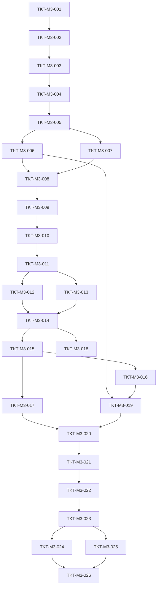

# TICKETS-M3 v1.0 — «Determinism + State»

**Тип документа:** Детализация тикетов вехи M3  
**Дата:** 2026-11-02  
**Статус:** draft  
**Веха:** M3  
**Покрывает:** `DEV-SPEC-005`, `DEV-SPEC-006`, `DEV-SPEC-007`  
**Тикетов:** 26  
**Демо вехи:** N тиков → save → load → продолжение идентично исходному; RNG-потоки изолированы; clock тикает с фиксированным порядком фаз.

---

## 1. Состав вехи

| ID | Название | DEV-SPEC | Размер |
|---|---|---|---|
| `TKT-M3-001` | RngStreamName type + каталог имён | 005 | S |
| `TKT-M3-002` | RngStreamState type + JSON Schema | 005 | XS |
| `TKT-M3-003` | XorShift128Plus core | 005 | S |
| `TKT-M3-004` | StreamDerivation (из masterSeed) | 005 | S |
| `TKT-M3-005` | SeededRngService: nextFloat/nextInt/pickOne/shuffle/chance | 005 | M |
| `TKT-M3-006` | getState/restoreState/serializeAll | 005 | S |
| `TKT-M3-007` | FixedRngService (тест-адаптер) | 005 | XS |
| `TKT-M3-008` | Contract-тесты: детерминизм, изоляция | 005 | S |
| `TKT-M3-009` | SaveSnapshot type + JSON Schema | 006 | S |
| `TKT-M3-010` | IMementoProvider interface | 006 | XS |
| `TKT-M3-011` | MementoRegistry | 006 | S |
| `TKT-M3-012` | ISaveRepository + LocalStorageSaveRepository | 006 | M |
| `TKT-M3-013` | InMemorySaveRepository (тест) | 006 | XS |
| `TKT-M3-014` | SaveGameUseCase | 006 | M |
| `TKT-M3-015` | LoadGameUseCase | 006 | M |
| `TKT-M3-016` | SaveSnapshotValidator | 006 | S |
| `TKT-M3-017` | ContentHash check при load | 006 | S |
| `TKT-M3-018` | List/Delete use cases | 006 | S |
| `TKT-M3-019` | Stub-провайдеры (RNG + mechanic runtime) | 006 | S |
| `TKT-M3-020` | Determinism-тест roundtrip | 006 | S |
| `TKT-M3-021` | TickPhase + IGameClock interface | 007 | S |
| `TKT-M3-022` | ClockState + InterpolationClock | 007 | S |
| `TKT-M3-023` | TickScheduler — фикс. порядок фаз | 007 | M |
| `TKT-M3-024` | RafGameClock — RAF loop, pause/speed | 007 | M |
| `TKT-M3-025` | ManualGameClock (тест) | 007 | XS |
| `TKT-M3-026` | M3 демо: N тиков → save → load → ident | 005,006,007 | M |

---

## 2. Порядок выполнения

**Параллелизация:**
- Ветка RNG (001→008) — независима от Save/Load и Clock.
- Ветка Save/Load (009→020) зависит от RNG (006) для сериализации.
- Ветка Clock (021→025) зависит от Save/Load только для демо (026).
- После `TKT-M3-008` можно параллельно вести Save/Load и Clock (021→025).

---

## 3. Тикеты

### TKT-M3-001 — RngStreamName type + каталог имён

**DEV-SPEC:** DEV-SPEC-005  
**Требования:** supports R01, R02  
**AC:** —  
**Размер:** S  
**Зависит от:** TKT-M1-001  
**Блокирует:** TKT-M3-002

**Что сделать:**
- Файл `src/domain/rng/RngStreamName.ts` с branded типом и `makeStreamName` (regex `^rng\.[a-z][a-z0-9_]*(\.[a-z][a-z0-9_]*)+$`).
- Файл `src/shared/rng/stream-names.ts` — `Record<string, RngStreamName>` со всеми ~40 именами из §5.4 DEV-SPEC-005 (fleet, combat, economy, cataclysm, party, companion, hidden_branch, narrative, epilogue, visual).
- Экспорт `ALL_STREAM_NAMES: readonly RngStreamName[]`.

**Acceptance Criteria:**
- `makeStreamName('rng.combat.damage')` → валидный.
- `makeStreamName('combat.damage')` → ошибка (нет `rng.`).
- `makeStreamName('rng.Combat.Damage')` → ошибка (не lowercase).
- `ALL_STREAM_NAMES.length >= 40`.

**Definition of Done:**
- [ ] все имена из DEV-SPEC-005 §5.4 присутствуют;
- [ ] unit-тесты на валидацию;
- [ ] CI зелёный;
- [ ] PR смержен.

---

### TKT-M3-002 — RngStreamState type + JSON Schema

**DEV-SPEC:** DEV-SPEC-005  
**Требования:** supports R01, R04  
**AC:** —  
**Размер:** XS  
**Зависит от:** TKT-M3-001  
**Блокирует:** TKT-M3-003, TKT-M3-006

**Что сделать:**
- Файл `src/domain/rng/RngStreamState.ts` с интерфейсом из §5.3 DEV-SPEC-005 (`algorithm`, `s0`…`s3`, `callCount`).
- Схема `content/schemas/rng-stream-state.json` из §6.1 DEV-SPEC-005 (уже добавлена в TKT-M2-004 — здесь только типы).

**Acceptance Criteria:**
- Тип соответствует схеме.
- `algorithm` — литерал `'xor-shift-128-plus'`.

**Definition of Done:**
- [ ] type-check проходит;
- [ ] CI зелёный;
- [ ] PR смержен.

---

### TKT-M3-003 — XorShift128Plus core

**DEV-SPEC:** DEV-SPEC-005  
**Требования:** R01, R04  
**AC:** AC01, AC06, AC07  
**Размер:** S  
**Зависит от:** TKT-M3-002  
**Блокирует:** TKT-M3-004, TKT-M3-005

**Что сделать:**
- Файл `src/infrastructure/rng/XorShift128Plus.ts`.
- Чистая функция `xorShift128Plus(state: RngStreamState): { value: number; next: RngStreamState }`:
  - `value` — 32-битное целое.
  - `next` — следующее состояние.
- Функция `fromSeeds(s0: bigint, s1: bigint, s2: bigint, s3: bigint): RngStreamState`.
- Функция `serialize(state): RngStreamState` — сериализация `bigint → string`.
- Функция `deserialize(state): RngStreamState` — `string → bigint`.
- Никакого `Math.random`. Только целочисленная арифметика.

**Acceptance Criteria:**
- `DEV-SPEC-005-AC01`: два прогона с одинаковым initial state дают идентичную последовательность.
- `DEV-SPEC-005-AC06`: `serialize` → `deserialize` даёт исходное состояние.
- `DEV-SPEC-005-AC07`: `callCount` инкрементируется на каждый шаг.

**Definition of Done:**
- [ ] unit-тесты: детерминизм, сериализация, `callCount`;
- [ ] 1000 итераций без деградации;
- [ ] все AC покрыты тестами;
- [ ] CI зелёный;
- [ ] PR смержен.

---

### TKT-M3-004 — StreamDerivation (из masterSeed)

**DEV-SPEC:** DEV-SPEC-005  
**Требования:** R01, R02  
**AC:** AC01, AC02  
**Размер:** S  
**Зависит от:** TKT-M3-003  
**Блокирует:** TKT-M3-005

**Что сделать:**
- Файл `src/infrastructure/rng/StreamDerivation.ts`.
- Функция `deriveStream(masterSeed: string, streamName: RngStreamName): RngStreamState`:
  - Хешировать `masterSeed + ':' + streamName` через SHA-256.
  - Взять 16 байт → 4 × 32-bit → начальный state.
  - `callCount: 0`.
- Гарантия: разные `streamName` при одном `masterSeed` дают разные стартовые состояния с вероятностью ~1.

**Acceptance Criteria:**
- `DEV-SPEC-005-AC01`: `masterSeed: "abc"` + `rng.combat.damage` → стабильный state.
- `DEV-SPEC-005-AC02`: `masterSeed: "abc"` + `rng.combat.duel` → state ≠ state из `rng.combat.damage`.

**Definition of Done:**
- [ ] unit-тесты: детерминизм derivation, независимость потоков;
- [ ] все AC покрыты тестами;
- [ ] CI зелёный;
- [ ] PR смержен.

---

### TKT-M3-005 — SeededRngService: nextFloat/nextInt/pickOne/shuffle/chance

**DEV-SPEC:** DEV-SPEC-005  
**Требования:** R01, R02, R03, R05  
**AC:** AC01, AC02, AC03, AC04, AC05, AC08  
**Размер:** M  
**Зависит от:** TKT-M3-004, TKT-M1-002, TKT-M1-003  
**Блокирует:** TKT-M3-006, TKT-M3-007, TKT-M3-008

**Что сделать:**
- Файл `src/infrastructure/rng/SeededRngService.ts` — реализация интерфейса из §5.2 DEV-SPEC-005.
- Методы:
  - `nextFloat(stream)` — `[0, 1)`.
  - `nextInt(stream, min, max)` — целое `[min, max]` включительно.
  - `pickOne(stream, items)` — пустой массив → `Err`.
  - `shuffle(stream, items)` — Fisher-Yates, не мутирует.
  - `chance(stream, p)` — валидация `p ∈ [0, 1]`, `p=0` → `false`, `p=1` → `true`.
- Ленивая инициализация потока при первом обращении через `StreamDerivation`.
- Хранит `Map<RngStreamName, RngStreamState>`.
- Все методы возвращают `Result<T, AppError>`.

**Acceptance Criteria:**
- `DEV-SPEC-005-AC01`: детерминизм при одинаковом seed + одинаковой последовательности.
- `DEV-SPEC-005-AC02`: изоляция потоков.
- `DEV-SPEC-005-AC03`: `nextInt(stream, 10, 5)` → `Err`.
- `DEV-SPEC-005-AC04`: `chance(stream, -0.1)` → `Err`.
- `DEV-SPEC-005-AC05`: `pickOne(stream, [])` → `Err`.
- `DEV-SPEC-005-AC08`: `chance(stream, 1)` — всегда `true`.

**Definition of Done:**
- [ ] unit-тесты на все методы;
- [ ] `nextInt(min, max)` — границы включительно;
- [ ] `shuffle` — permutation of input;
- [ ] все AC покрыты тестами;
- [ ] CI зелёный;
- [ ] PR смержен.

---

### TKT-M3-006 — getState/restoreState/serializeAll

**DEV-SPEC:** DEV-SPEC-005  
**Требования:** R04  
**AC:** AC06, AC07  
**Размер:** S  
**Зависит от:** TKT-M3-005  
**Блокирует:** TKT-M3-008, TKT-M3-019

**Что сделать:**
- Дополнить `SeededRngService`:
  - `getState(stream)` — вернуть `RngStreamState` или `Err` (если поток не инициализирован).
  - `restoreState(stream, state)` — восстановить поток.
  - `listStreams()` — все инициализированные потоки.
  - `serializeAll()` — `Record<streamName, RngStreamState>`.
- `restoreState` не продвигает поток.

**Acceptance Criteria:**
- `DEV-SPEC-005-AC06`: `serializeAll` возвращает все использованные streams.
- `DEV-SPEC-005-AC07`: после `restoreState` `getState` совпадает.

**Definition of Done:**
- [ ] unit-тесты: serialize → restore → continue идентично;
- [ ] `serializeAll` сортирован по имени потока (детерминизм);
- [ ] все AC покрыты тестами;
- [ ] CI зелёный;
- [ ] PR смержен.

---

### TKT-M3-007 — FixedRngService (тест-адаптер)

**DEV-SPEC:** DEV-SPEC-005  
**Требования:** supports R04  
**AC:** —  
**Размер:** XS  
**Зависит от:** TKT-M3-005  
**Блокирует:** TKT-M3-008

**Что сделать:**
- Файл `src/infrastructure/rng/FixedRngService.ts`.
- Конструктор принимает `Record<streamName, number[]>` — заранее заданные значения.
- `nextFloat(stream)` — возвращает следующее значение из массива; при исчерпании — `Err`.
- Остальные методы — на основе `nextFloat`.
- Используется в тестах, где нужен точный контроль.

**Acceptance Criteria:**
- Все методы интерфейса реализованы.
- При исчерпании массива — `Err(DOMAIN_INVARIANT_VIOLATION)`.

**Definition of Done:**
- [ ] unit-тесты на все методы;
- [ ] используется в тестах TKT-M3-008;
- [ ] CI зелёный;
- [ ] PR смержен.

---

### TKT-M3-008 — Contract-тесты: детерминизм, изоляция

**DEV-SPEC:** DEV-SPEC-005  
**Требования:** R01, R02, R03, R04, R05  
**AC:** AC01…AC08  
**Размер:** S  
**Зависит от:** TKT-M3-005, TKT-M3-006, TKT-M3-007  
**Блокирует:** TKT-M3-009

**Что сделать:**
- Файл `tests/contract/rng.contract.test.ts`.
- Тест 1: детерминизм — 2 сервиса с одинаковым seed + одинаковой последовательностью → идентичные результаты.
- Тест 2: изоляция — 100 вызовов в одном потоке, затем 1 во втором → результат второго совпадает с «чистым» сервисом.
- Тест 3: save/restore — serialize → restore → 101-й вызов идентичен.
- Тест 4: `chance` — границы 0 и 1.
- Тест 5: все имена из `ALL_STREAM_NAMES` работают.

**Acceptance Criteria:**
- Все AC из DEV-SPEC-005 покрыты хотя бы одним тестом.

**Definition of Done:**
- [ ] все 5 тестов проходят;
- [ ] покрытие `SeededRngService` ≥85%;
- [ ] все AC покрыты тестами;
- [ ] CI зелёный;
- [ ] PR смержен.

---

### TKT-M3-009 — SaveSnapshot type + JSON Schema

**DEV-SPEC:** DEV-SPEC-006  
**Требования:** supports R01, R03  
**AC:** —  
**Размер:** S  
**Зависит от:** TKT-M3-008, TKT-M2-007  
**Блокирует:** TKT-M3-010, TKT-M3-014

**Что сделать:**
- Файл `src/domain/save/SaveSnapshot.ts` с интерфейсом из §5.2 DEV-SPEC-006.
- Схема `content/schemas/save-snapshot.json` из §6.1 (уже добавлена в TKT-M2-004 — здесь только типы).
- `formatVersion: 1` как литерал.

**Acceptance Criteria:**
- Все поля из §5.2 присутствуют.
- `formatVersion` — литерал `1`.

**Definition of Done:**
- [ ] type-check проходит;
- [ ] CI зелёный;
- [ ] PR смержен.

---

### TKT-M3-010 — IMementoProvider interface

**DEV-SPEC:** DEV-SPEC-006  
**Требования:** supports R04  
**AC:** —  
**Размер:** XS  
**Зависит от:** TKT-M3-009  
**Блокирует:** TKT-M3-011

**Что сделать:**
- Файл `src/domain/save/IMementoProvider.ts` с интерфейсом из §5.1 DEV-SPEC-006 (`domainId`, `captureState`, `restoreState`).

**Acceptance Criteria:**
- Все три метода объявлены.
- `captureState` возвращает `Result<TState, AppError>`.

**Definition of Done:**
- [ ] type-check проходит;
- [ ] CI зелёный;
- [ ] PR смержен.

---

### TKT-M3-011 — MementoRegistry

**DEV-SPEC:** DEV-SPEC-006  
**Требования:** R04  
**AC:** AC07  
**Размер:** S  
**Зависит от:** TKT-M3-010  
**Блокирует:** TKT-M3-012, TKT-M3-013

**Что сделать:**
- Файл `src/infrastructure/save/MementoRegistry.ts`.
- `register(provider)` — при дубле `domainId` → `Err` или исключение на bootstrap (решение: `Err` в runtime, лог + exit на bootstrap).
- `list()` — детерминированный порядок по `domainId`.
- `get(domainId)`.

**Acceptance Criteria:**
- `DEV-SPEC-006-AC07`: все зарегистрированные провайдеры вызываются при save.
- `DEV-SPEC-006-AC08`: при ошибке одного провайдера save падает с ошибкой.

**Definition of Done:**
- [ ] unit-тесты: register, duplicate, list, get;
- [ ] все AC покрыты тестами;
- [ ] CI зелёный;
- [ ] PR смержен.

---

### TKT-M3-012 — ISaveRepository + LocalStorageSaveRepository

**DEV-SPEC:** DEV-SPEC-006  
**Требования:** R01, R03  
**AC:** —  
**Размер:** M  
**Зависит от:** TKT-M3-011, TKT-M1-002  
**Блокирует:** TKT-M3-014

**Что сделать:**
- Файл `src/domain/save/ISaveRepository.ts` с интерфейсом из §5.3.
- Файл `src/infrastructure/save/LocalStorageSaveRepository.ts`:
  - Ключ: `nvm:save:{slotId}`.
  - `list()` — все ключи с префиксом → `SaveSlotMeta[]`.
  - `save(slotId, snapshot)` — сериализация JSON, `localStorage.setItem`.
  - `load(slotId)` — `getItem` + JSON.parse; отсутствие → `Err(INFRA_CONTENT_NOT_FOUND)`.
  - `delete(slotId)`.
  - `exists(slotId)`.
- Все ошибки `localStorage` → `Err(INFRA_STORAGE_FAILED)` с `meta.reason`.

**Acceptance Criteria:**
- Save → Load roundtrip идентичен.
- `load` для отсутствующего слота → `Err`.
- `list` возвращает все сохранённые слоты.
- Quota exceeded → `Err(INFRA_STORAGE_FAILED)` с `meta.reason: 'quota_exceeded'`.

**Definition of Done:**
- [ ] unit-тесты: save/load/delete/list/exists;
- [ ] `localStorage` мокируется в тестах;
- [ ] CI зелёный;
- [ ] PR смержен.

---

### TKT-M3-013 — InMemorySaveRepository (тест)

**DEV-SPEC:** DEV-SPEC-006  
**Требования:** supports R01  
**AC:** —  
**Размер:** XS  
**Зависит от:** TKT-M3-011  
**Блокирует:** TKT-M3-014

**Что сделать:**
- Файл `src/infrastructure/save/InMemorySaveRepository.ts`.
- Реализация `ISaveRepository` через `Map<string, SaveSnapshot>`.
- Используется в unit-тестах без браузера.

**Acceptance Criteria:**
- Все методы реализованы.
- Тесты работают без `localStorage`.

**Definition of Done:**
- [ ] unit-тесты: save/load/delete/list;
- [ ] CI зелёный;
- [ ] PR смержен.

---

### TKT-M3-014 — SaveGameUseCase

**DEV-SPEC:** DEV-SPEC-006  
**Требования:** R01, R04  
**AC:** AC01, AC02, AC03, AC07  
**Размер:** M  
**Зависит от:** TKT-M3-012, TKT-M3-013, TKT-M3-011  
**Блокирует:** TKT-M3-015, TKT-M3-018

**Что сделать:**
- Файл `src/application/save/SaveGameUseCase.ts`.
- Шаги:
  1. `mementoRegistry.list()` — все providers.
  2. Для каждого — `captureState()`; при `Err` → общий `Err`.
  3. `rng.serializeAll()` → `rngState`.
  4. `mechanicRuntime.captureRuntimeState()` → `mechanicRuntimeState` (метод добавляется в TKT-M3-019).
  5. `eventBus.peekQueue()` для `NextTick`, `AfterScene`, `WarningThenImpact`.
  6. Собрать `SaveSnapshot` с `contentHash` из `ContentRegistry`.
  7. `SaveSnapshotValidator.validate(snapshot)`.
  8. `saveRepository.save(slotId, snapshot)`.
- Возвращает `Result<void, AppError>`.

**Acceptance Criteria:**
- `DEV-SPEC-006-AC01`: `RngState` идентичен после roundtrip.
- `DEV-SPEC-006-AC02`: `domainStates` идентичны по содержимому.
- `DEV-SPEC-006-AC03`: журналы идентичны.
- `DEV-SPEC-006-AC07`: все providers вызваны.

**Definition of Done:**
- [ ] unit-тесты: сохранение со всеми providers;
- [ ] ошибка одного provider → общий `Err`;
- [ ] все AC покрыты тестами;
- [ ] CI зелёный;
- [ ] PR смержен.

---

### TKT-M3-015 — LoadGameUseCase

**DEV-SPEC:** DEV-SPEC-006  
**Требования:** R01, R02, R03  
**AC:** AC01, AC02, AC03, AC04, AC05, AC06  
**Размер:** M  
**Зависит от:** TKT-M3-014, TKT-M3-016, TKT-M3-017  
**Блокирует:** TKT-M3-019, TKT-M3-020

**Что сделать:**
- Файл `src/application/save/LoadGameUseCase.ts`.
- Шаги:
  1. `saveRepository.load(slotId)`.
  2. `SaveSnapshotValidator.validate(snapshot)`.
  3. `ContentHash check` (TKT-M3-017).
  4. `rng.restoreState` для каждого stream.
  5. `mechanicRuntime.restoreRuntimeState` (метод из TKT-M3-019).
  6. Для каждого provider — `restoreState(snapshot.domainStates[domainId])`.
  7. Восстановить event queues (опционально на первой волне — пустые).
- Порядок восстановления — обратный порядку захвата (реверс `list()`).

**Acceptance Criteria:**
- `DEV-SPEC-006-AC01`: `RngState` восстановлен точно.
- `DEV-SPEC-006-AC02`: домены восстановлены.
- `DEV-SPEC-006-AC04`: `contentHash` mismatch → `Err`.
- `DEV-SPEC-006-AC05`: невалидный snapshot → `Err`.
- `DEV-SPEC-006-AC06`: `formatVersion: 2` → `Err`.

**Definition of Done:**
- [ ] unit-тесты: успешная загрузка, все ошибки;
- [ ] все AC покрыты тестами;
- [ ] CI зелёный;
- [ ] PR смержен.

---

### TKT-M3-016 — SaveSnapshotValidator

**DEV-SPEC:** DEV-SPEC-006  
**Требования:** R03  
**AC:** AC05, AC06  
**Размер:** S  
**Зависит от:** TKT-M3-015  
**Блокирует:** TKT-M3-019

**Что сделать:**
- Файл `src/infrastructure/save/SaveSnapshotValidator.ts`.
- Валидация `SaveSnapshot` через ajv + `save-snapshot.json`.
- `formatVersion` проверяется как литерал `1`.
- `meta.issues` — пути к нарушениям.

**Acceptance Criteria:**
- `DEV-SPEC-006-AC05`: отсутствует обязательное поле → `Err`.
- `DEV-SPEC-006-AC06`: `formatVersion: 2` → `Err`.

**Definition of Done:**
- [ ] unit-тесты: валидный, невалидный, formatVersion;
- [ ] все AC покрыты тестами;
- [ ] CI зелёный;
- [ ] PR смержен.

---

### TKT-M3-017 — ContentHash check при load

**DEV-SPEC:** DEV-SPEC-006  
**Требования:** R02  
**AC:** AC04  
**Размер:** S  
**Зависит от:** TKT-M3-015, TKT-M2-007  
**Блокирует:** TKT-M3-019

**Что сделать:**
- Функция `checkContentHash(snapshot, registry): Result<void, AppError>`.
- Сравнение `snapshot.contentHash` с `registry.contentHash()`.
- Mismatch → `Err(INFRA_CONTENT_NOT_FOUND)` с `meta: { snapshotHash, registryHash }`.
- В `dev` — лог `warning`, но `Ok` (для отладки). В `production` — `Err`.

**Acceptance Criteria:**
- `DEV-SPEC-006-AC04`: `contentHash` совпадает → `Ok`.
- Mismatch в production → `Err`.

**Definition of Done:**
- [ ] unit-тесты: совпадение, mismatch, dev/prod;
- [ ] все AC покрыты тестами;
- [ ] CI зелёный;
- [ ] PR смержен.

---

### TKT-M3-018 — List/Delete use cases

**DEV-SPEC:** DEV-SPEC-006  
**Требования:** supports R01  
**AC:** —  
**Размер:** S  
**Зависит от:** TKT-M3-014  
**Блокирует:** TKT-M3-020

**Что сделать:**
- Файл `src/application/save/ListSavesUseCase.ts` — `Result<SaveSlotMeta[], AppError>`.
- Файл `src/application/save/DeleteSaveUseCase.ts` — `Result<void, AppError>`.

**Acceptance Criteria:**
- `list` возвращает все слоты (включая `autosave`, если он есть).
- `delete` для отсутствующего слота → `Ok` (идемпотентно).

**Definition of Done:**
- [ ] unit-тесты: list, delete, delete missing;
- [ ] CI зелёный;
- [ ] PR смержен.

---

### TKT-M3-019 — Stub-провайдеры (RNG + mechanic runtime)

**DEV-SPEC:** DEV-SPEC-006  
**Требования:** supports R01  
**AC:** —  
**Размер:** S  
**Зависит от:** TKT-M3-006, TKT-M3-016  
**Блокирует:** TKT-M3-020

**Что сделать:**
- Файл `src/infrastructure/save/providers/RngMementoProvider.ts`:
  - `domainId: 'rng'`.
  - `captureState()` → `rng.serializeAll()`.
  - `restoreState(state)` → `rng.restoreState` для каждого stream.
- Файл `src/infrastructure/save/providers/MechanicRuntimeMementoProvider.ts`:
  - `domainId: 'mechanicRuntime'`.
  - `captureState()` → `runtime.captureRuntimeState()`.
  - `restoreState(state)` → `runtime.restoreRuntimeState(state)`.
- Метод `captureRuntimeState()` / `restoreRuntimeState(state)` в `IMechanicRuntime` (добавить в интерфейс, реализовать в `MechanicRuntime`).
- Регистрация в `MementoRegistry` на bootstrap.

**Acceptance Criteria:**
- RNG state сохраняется и восстанавливается.
- Mechanic runtime state сохраняется и восстанавливается.
- Оба provider регистрируются в registry.

**Definition of Done:**
- [ ] unit-тесты: capture → restore → identical;
- [ ] `IMechanicRuntime` расширен;
- [ ] CI зелёный;
- [ ] PR смержен.

---

### TKT-M3-020 — Determinism-тест roundtrip

**DEV-SPEC:** DEV-SPEC-006  
**Требования:** R01, R02  
**AC:** AC01, AC02, AC03  
**Размер:** S  
**Зависит от:** TKT-M3-017, TKT-M3-018, TKT-M3-019  
**Блокирует:** TKT-M3-026

**Что сделать:**
- Файл `tests/contract/save-load.determinism.test.ts`.
- Сценарий:
  1. Инициализировать RNG + runtime + stub-механики.
  2. Сделать N вызовов RNG и M `dispatchEvent`.
  3. `SaveGameUseCase`.
  4. `LoadGameUseCase`.
  5. Сделать ещё K вызовов RNG и M `dispatchEvent`.
  6. Сравнить итоговые state с исходным прогоном (без save/load).

**Acceptance Criteria:**
- `DEV-SPEC-006-AC01`: RNG state идентичен.
- `DEV-SPEC-006-AC02`: domain states идентичны.
- `DEV-SPEC-006-AC03`: журналы идентичны.

**Definition of Done:**
- [ ] тест проходит с N=M=K=100;
- [ ] тест падает при изменении seed;
- [ ] все AC покрыты тестами;
- [ ] CI зелёный;
- [ ] PR смержен.

---

### TKT-M3-021 — TickPhase + IGameClock interface

**DEV-SPEC:** DEV-SPEC-007  
**Требования:** supports R01  
**AC:** —  
**Размер:** S  
**Зависит от:** TKT-M3-020  
**Блокирует:** TKT-M3-022

**Что сделать:**
- Файл `src/domain/clock/TickPhase.ts` с union-типом из §5.1 DEV-SPEC-007 (14 значений).
- Файл `src/domain/clock/IGameClock.ts` с `ClockState` и `IGameClock` из §5.2.

**Acceptance Criteria:**
- Все 14 фаз присутствуют.
- `IGameClock` содержит все методы.

**Definition of Done:**
- [ ] type-check проходит;
- [ ] CI зелёный;
- [ ] PR смержен.

---

### TKT-M3-022 — ClockState + InterpolationClock

**DEV-SPEC:** DEV-SPEC-007  
**Требования:** supports R03, R05  
**AC:** AC08, AC09  
**Размер:** S  
**Зависит от:** TKT-M3-021  
**Блокирует:** TKT-M3-023

**Что сделать:**
- Файл `src/infrastructure/clock/InterpolationClock.ts`:
  - `alpha: number` ∈ `[0, 1)`.
  - `deltaMs: number` — время с последнего тика.
- Класс обновляется по `performance.now()`, вычисляет `alpha` и `deltaMs`.
- Используется рендером (в `DEV-SPEC-010`, не здесь).

**Acceptance Criteria:**
- `DEV-SPEC-007-AC08`: `alpha` ∈ `[0, 1)`.
- `DEV-SPEC-007-AC09`: `deltaMs` растёт монотонно между тиками.

**Definition of Done:**
- [ ] unit-тесты: alpha при elapsed 0/500/1000 мс;
- [ ] все AC покрыты тестами;
- [ ] CI зелёный;
- [ ] PR смержен.

---

### TKT-M3-023 — TickScheduler — фикс. порядок фаз

**DEV-SPEC:** DEV-SPEC-007  
**Требования:** R01, R02  
**AC:** AC01, AC02, AC03, AC06  
**Размер:** M  
**Зависит от:** TKT-M3-022, TKT-M1-010, TKT-M2-015  
**Блокирует:** TKT-M3-024, TKT-M3-025

**Что сделать:**
- Файл `src/infrastructure/clock/TickScheduler.ts`.
- Метод `runOneTick()`:
  1. `eventBus.drainQueue('WarningThenImpact')`.
  2. `eventBus.drainQueue('NextTick')`.
  3. `eventBus.publish({ type: 'world.tick_advanced', payload: { tick } }, { deliveryPolicy: 'Immediate' })`.
  4. `runtime.tickScope('world')`.
  5. `runtime.tickScope('economy')`.
  6. `runtime.tickScope('cataclysm')`.
  7. `runtime.tickScope('party')`.
  8. `runtime.tickScope('combat')`.
  9. `runtime.tickScope('captain')`.
  10. `runtime.tickScope('narrative')`.
  11. `runtime.tickScope('visual')`.
  12. `runtime.tickScope('epilogue')`.
- Порядок строго фиксирован.
- Исключения в `tickScope` / `drainQueue` — ловятся, логируются, continue.

**Acceptance Criteria:**
- `DEV-SPEC-007-AC01`: `WarningThenImpact` перед `NextTick`.
- `DEV-SPEC-007-AC02`: `world.tick_advanced` между `NextTick` и `tickScope('world')`.
- `DEV-SPEC-007-AC03`: все `tickScope` в порядке.
- `DEV-SPEC-007-AC06`: следующий callback вызван при падении предыдущего.

**Definition of Done:**
- [ ] unit-тесты: порядок фаз, изоляция;
- [ ] `tickScope` для пустых scope — no-op без ошибок;
- [ ] все AC покрыты тестами;
- [ ] CI зелёный;
- [ ] PR смержен.

---

### TKT-M3-024 — RafGameClock — RAF loop, pause/speed

**DEV-SPEC:** DEV-SPEC-007  
**Требования:** R01, R02, R03, R04  
**AC:** AC04, AC05, AC06, AC07  
**Размер:** M  
**Зависит от:** TKT-M3-023  
**Блокирует:** TKT-M3-026

**Что сделать:**
- Файл `src/infrastructure/clock/RafGameClock.ts`.
- Реализация `IGameClock`:
  - `start()` — запускает `requestAnimationFrame` loop.
  - `stop()` — отменяет RAF.
  - `pause()` / `resume()` — переключатель.
  - `setSpeedMultiplier(m)` — валидация `m > 0`.
  - `advanceOneTick()` — прямой вызов `TickScheduler.runOneTick()`, инкремент `currentTick`.
  - `onTick(cb)` / `onTickPhase(cb)` — подписки с отпиской.
- Loop: накапливает `elapsedMs`; когда `elapsedMs * speedMultiplier >= tickIntervalMs` — `advanceOneTick()`.
- Callbacks вызываются в try/catch, лог при ошибке.

**Acceptance Criteria:**
- `DEV-SPEC-007-AC04`: `paused` → `advanceOneTick` не продвигает tick.
- `DEV-SPEC-007-AC05`: `speedMultiplier: 2` → такт при elapsed 600 мс вместо 1000.
- `DEV-SPEC-007-AC06`: callback бросает → `Logger.error`, continue.
- `DEV-SPEC-007-AC07`: `currentTick` продвинулся.

**Definition of Done:**
- [ ] unit-тесты: pause/resume, speed, callback isolation;
- [ ] RAF мокируется в тестах;
- [ ] все AC покрыты тестами;
- [ ] CI зелёный;
- [ ] PR смержен.

---

### TKT-M3-025 — ManualGameClock (тест)

**DEV-SPEC:** DEV-SPEC-007  
**Требования:** supports R01  
**AC:** —  
**Размер:** XS  
**Зависит от:** TKT-M3-023  
**Блокирует:** TKT-M3-026

**Что сделать:**
- Файл `src/infrastructure/clock/ManualGameClock.ts`.
- Никакого RAF. Только `advanceOneTick()`.
- `onTick` / `onTickPhase` вызываются синхронно.
- Используется в тестах без браузера.

**Acceptance Criteria:**
- Все методы `IGameClock` реализованы.
- `advanceOneTick` работает синхронно.

**Definition of Done:**
- [ ] unit-тесты: N тиков → `currentTick === N`;
- [ ] CI зелёный;
- [ ] PR смержен.

---

### TKT-M3-026 — M3 демо: N тиков → save → load → ident

**DEV-SPEC:** DEV-SPEC-005, 006, 007  
**Требования:** все R из 005, 006, 007  
**AC:** все AC из 005, 006, 007  
**Размер:** M  
**Зависит от:** TKT-M3-020, TKT-M3-024, TKT-M3-025  
**Блокирует:** TKT-M4-001

**Что сделать:**
- Файл `src/bootstrap/M3Demo.ts` (или `scripts/m3-demo.ts`):
  1. `bootstrap()` → `Ok`.
  2. Загрузить `ContentRegistry`.
  3. Зарегистрировать stub-плагины (из M2).
  4. `ManualGameClock`, 50 тиков.
  5. На каждом тике — `rng.nextFloat('rng.combat.damage')`, `dispatchEvent` для `world.tick_advanced`.
  6. `SaveGameUseCase` → slot `demo`.
  7. Запомнить state (RNG values, tracker count).
  8. Сбросить вcё (новая сессия симуляции).
  9. `LoadGameUseCase` → slot `demo`.
  10. Ещё 50 тиков + те же RNG-вызовы.
  11. Сравнить с эталоном (прогон без save/load).
- README-секция «Как проверить M3».

**Acceptance Criteria:**
- `DEV-SPEC-005-AC01`: RNG-последовательности идентичны.
- `DEV-SPEC-006-AC01`: `RngState` идентичен.
- `DEV-SPEC-006-AC02`: domain states идентичны.
- `DEV-SPEC-007-AC03`: порядок фаз сохранён.
- `DEV-SPEC-007-AC07`: `currentTick === 100`.

**Definition of Done:**
- [ ] `npm run demo:m3` отрабатывает без ошибок;
- [ ] вывод содержит сравнение «before/after» — identical;
- [ ] все AC покрыты тестами;
- [ ] CI зелёный;
- [ ] PR смержен.

---

## 4. Definition of Done для вехи M3

- [ ] все 26 тикетов смержены в `main`;
- [ ] `npm run demo:m3` воспроизводится;
- [ ] все AC из `DEV-SPEC-005` (AC01…AC08), `DEV-SPEC-006` (AC01…AC11), `DEV-SPEC-007` (AC01…AC09) покрыты тестами;
- [ ] `SaveSnapshot` содержит `rngState`, `mechanicRuntimeState`, `domainStates`, `eventQueueState`;
- [ ] RNG изолирован по потокам и восстанавливается точно;
- [ ] `TickScheduler` выполняет фазы строго в фиксированном порядке;
- [ ] нет `TODO`/`FIXME` без ссылки на тикет;
- [ ] `DEV-SPEC-004-Q01` (где хранится state) — **закрыт**: state хранится в `MechanicRuntime`, сериализуется через `MechanicRuntimeMementoProvider` (TKT-M3-019).

---

## 5. Что разблокирует M3

Завершение M3 разблокирует:
- **M4**: `TKT-M4-010` (CI determinism stage) требует детерминированного прогона из M3; `TKT-M4-019` (полный bootstrap) требует все foundation-сервисы.
- **Wave 1**: `DEV-SPEC-010` (Scene Manager) требует `IGameClock` и `InterpolationClock`.
- **Wave 2+**: все доменные спеки требуют RNG, Save/Load и Clock.

---

## 6. Риски и заметки

| Риск | Митигация |
|---|---|
| `crypto.subtle` в браузере асинхронный; `deriveStream` синхронный — конфликт | на M3 использовать синхронный SHA-256 fallback (`js-sha256`) или precompute в `loadAll` |
| `bigint` в `RngStreamState` плохо сериализуется в JSON | сериализация в hex-строки через `toString(16)`, десериализация через `BigInt('0x' + s)` |
| `RafGameClock` в headless-тестах не имеет `requestAnimationFrame` | использовать `ManualGameClock` в тестах; `RafGameClock` тестируется с mock RAF |
| `eventQueueState` в `SaveSnapshot` может расти неограниченно | ограничить размер очередей (см. `DEV-SPEC-002 Q-02`), при превышении — drop с логом |
| Восстановление порядка providers может быть недетерминированным | `MementoRegistry.list()` сортирует по `domainId`; `LoadGameUseCase` использует реверс этого порядка |
| `LocalStorage` quota exceeded на больших save | `SaveSnapshot` ≤ 5 МБ; при превышении — `Err` с понятным сообщением |