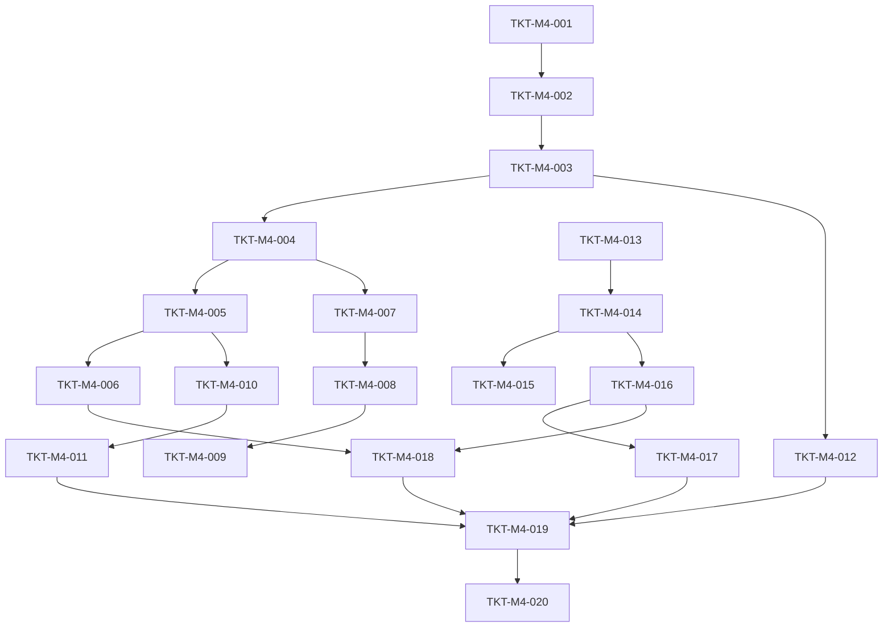

# TICKETS-M4 v1.0 — «Validation + Localization + Integration»

**Тип документа:** Детализация тикетов вехи M4  
**Дата:** 2026-11-02  
**Статус:** draft  
**Веха:** M4  
**Покрывает:** `DEV-SPEC-008`, `DEV-SPEC-009`, интеграцию `DEV-SPEC-001…009`  
**Тикетов:** 20  
**Демо вехи:** полный walking skeleton — `npm run demo:full` проходит; `npm run ci:validate` зелёный; локализация работает; save/load roundtrip идентичен.

---

## 1. Состав вехи

| ID | Название | DEV-SPEC | Размер |
|---|---|---|---|
| `TKT-M4-001` | CLI skeleton: `ci:validate` | 008 | S |
| `TKT-M4-002` | ValidationIssue + StageResult types | 008 | XS |
| `TKT-M4-003` | JsonReporter + ConsoleReporter | 008 | S |
| `TKT-M4-004` | CI stage: schemas | 008 | M |
| `TKT-M4-005` | CI stage: graph | 008 | M |
| `TKT-M4-006` | CI stage: gameplay (5–10 базовых правил) | 008 | M |
| `TKT-M4-007` | CI stage: events | 008 | S |
| `TKT-M4-008` | CI stage: mechanics | 008 | S |
| `TKT-M4-009` | CI stage: rng-streams | 008 | S |
| `TKT-M4-010` | CI stage: determinism | 008 | M |
| `TKT-M4-011` | CI stage: contracts | 008 | M |
| `TKT-M4-012` | pre-push hook | 008 | XS |
| `TKT-M4-013` | LocalizationKey + ILocalizationService | 009 | S |
| `TKT-M4-014` | JsonLocalizationService: t, setLocale, fallback | 009 | M |
| `TKT-M4-015` | tPlural для en/ru | 009 | S |
| `TKT-M4-016` | locale-file.json schema + минимальные en/ru | 009 | S |
| `TKT-M4-017` | InMemoryLocalizationService (тест) | 009 | XS |
| `TKT-M4-018` | gameplay rule: localization/key-exists | 009,008 | S |
| `TKT-M4-019` | Bootstrap всех foundation-сервисов | 001–009 | M |
| `TKT-M4-020` | M4 демо: полный E2E skeleton | все | M |

---

## 2. Порядок выполнения



**Параллелизация:**
- Ветка CI (001→012) и ветка Localization (013→017) независимы до `TKT-M4-018`.
- `TKT-M4-019` — точка схода, требует завершения обеих ветвей и `TKT-M4-011`.
- `TKT-M4-020` — финал.

---

## 3. Тикеты

### TKT-M4-001 — CLI skeleton: `ci:validate`

**DEV-SPEC:** DEV-SPEC-008  
**Требования:** supports R01…R06  
**AC:** —  
**Размер:** S  
**Зависит от:** TKT-M3-026  
**Блокирует:** TKT-M4-002, 003

**Что сделать:**
- Файл `tools/ci/cli.ts`.
- Парсинг аргументов: `--stage`, `--reporter`, `--continue-on-error`.
- Заглушки всех 8 стадий (просто `passed: true`).
- Exit code 0/1 по флагу `passed`.
- `package.json` → `"ci:validate": "tsx tools/ci/cli.ts"`.

**Acceptance Criteria:**
- `npm run ci:validate` → exit 0 на пустом проекте.
- `npm run ci:validate -- --stage=schemas` запускает только одну стадию.
- `--reporter=json` — только JSON в stdout.

**Definition of Done:**
- [ ] CLI работает;
- [ ] `--stage` фильтрует;
- [ ] CI зелёный;
- [ ] PR смержен.

---

### TKT-M4-002 — ValidationIssue + StageResult types

**DEV-SPEC:** DEV-SPEC-008  
**Требования:** supports R01…R06  
**AC:** —  
**Размер:** XS  
**Зависит от:** TKT-M4-001  
**Блокирует:** TKT-M4-003

**Что сделать:**
- Файл `tools/ci/types.ts` с `Severity`, `ValidationIssue`, `ValidationStage`, `StageResult` из §5.
- Схема `validation-report.json` (уже в `content/schemas/` из `TKT-M2-004`).

**Acceptance Criteria:**
- Все типы из §5 присутствуют.
- `ruleId` — string.

**Definition of Done:**
- [ ] type-check проходит;
- [ ] CI зелёный;
- [ ] PR смержен.

---

### TKT-M4-003 — JsonReporter + ConsoleReporter

**DEV-SPEC:** DEV-SPEC-008  
**Требования:** supports R01  
**AC:** AC03 (из `DEV-SPEC-008-R01`)  
**Размер:** S  
**Зависит от:** TKT-M4-002  
**Блокирует:** TKT-M4-004, 012

**Что сделать:**
- Файл `tools/ci/reporters/JsonReporter.ts` — сериализация `StageResult[]` → JSON по схеме.
- Файл `tools/ci/reporters/ConsoleReporter.ts` — человеко-читаемый вывод: `✅ stage` / `❌ stage` + issues с путями.
- Файл `tools/ci/reporters/index.ts` — фабрика по `--reporter`.

**Acceptance Criteria:**
- `--reporter=json` — валидный JSON по `validation-report.json`.
- `--reporter=console` — читаемый вывод.
- Exit code 1 при наличии `error`-issue.

**Definition of Done:**
- [ ] unit-тесты на оба репортера;
- [ ] JSON валиден;
- [ ] все AC покрыты тестами;
- [ ] CI зелёный;
- [ ] PR смержен.

---

### TKT-M4-004 — CI stage: schemas

**DEV-SPEC:** DEV-SPEC-008  
**Требования:** R01  
**AC:** AC01, AC02, AC03  
**Размер:** M  
**Зависит от:** TKT-M4-003, TKT-M2-005  
**Блокирует:** TKT-M4-005, 007

**Что сделать:**
- Файл `tools/ci/validate-schemas.ts`.
- Читает все файлы в `content/` (кроме `schemas/` и `locales/`).
- Определяет `kind` по пути (`content/<kind-dir>/<file>.json`).
- Валидирует через `AjvSchemaValidator`.
- Возвращает `StageResult` с `ValidationIssue[]`.
- `ruleId: 'schema/<kind>'`.

**Acceptance Criteria:**
- `DEV-SPEC-008-AC01`: валидный контент → exit 0.
- `DEV-SPEC-008-AC02`: невалидный → exit 1.
- `DEV-SPEC-008-AC03`: `--reporter=json` — только JSON.

**Definition of Done:**
- [ ] стадия работает на текущем `content/`;
- [ ] unit-тесты: валидный, невалидный по одному полю;
- [ ] все AC покрыты тестами;
- [ ] CI зелёный;
- [ ] PR смержен.

---

### TKT-M4-005 — CI stage: graph

**DEV-SPEC:** DEV-SPEC-008  
**Требования:** R02  
**AC:** AC04, AC05  
**Размер:** M  
**Зависит от:** TKT-M4-004, TKT-M2-006  
**Блокирует:** TKT-M4-006, 010

**Что сделать:**
- Файл `tools/ci/validate-graph.ts`.
- Использует `CrossReferenceValidator`.
- Читает `content/cross-refs.json`.
- Возвращает `StageResult`.
- `ruleId: 'graph/<kind>/<field>'`.

**Acceptance Criteria:**
- `DEV-SPEC-008-AC04`: все cross-refs валидны → exit 0.
- `DEV-SPEC-008-AC05`: битый ref → `meta.field` содержит имя поля.

**Definition of Done:**
- [ ] стадия работает;
- [ ] unit-тесты: валидный + 3 типа битых refs;
- [ ] все AC покрыты тестами;
- [ ] CI зелёный;
- [ ] PR смержен.

---

### TKT-M4-006 — CI stage: gameplay (5–10 базовых правил)

**DEV-SPEC:** DEV-SPEC-008  
**Требования:** R03  
**AC:** AC06, AC07  
**Размер:** M  
**Зависит от:** TKT-M4-005  
**Блокирует:** TKT-M4-018

**Что сделать:**
- Файл `tools/ci/validate-gameplay.ts`.
- Реализовать **5–10 правил** (не все 35 из спеки):
  1. `gameplay/fleet/faction-has-doctrine`
  2. `gameplay/economy/chain-acyclic`
  3. `gameplay/cataclysm/has-min-2-stages`
  4. `gameplay/combat/faction-has-duel-doctrine`
  5. `gameplay/party/companion-has-min-2-mechanics`
  6. `gameplay/companion/has-synergy-or-conflict`
  7. `gameplay/transformation/tree-has-final-state`
  8. `gameplay/narrative/beacon-has-completion`
  9. `gameplay/epilogue/template-has-scenes`
  10. `gameplay/art/faction-has-visual-doctrine`
- Каждое правило — отдельный файл в `tools/ci/rules/domain/`.
- Регистрация в `validate-gameplay.ts` через массив правил.

**Правило:** остальные 25 правил — в Wave 1+ по мере готовности доменных `DEV-SPEC`.

**Acceptance Criteria:**
- `DEV-SPEC-008-AC06`: каждое правило имеет тест.
- `DEV-SPEC-008-AC07`: все 10 правил реализованы.

**Definition of Done:**
- [ ] 10 правил реализованы;
- [ ] unit-тесты: валидный + невалидный кейс для каждого;
- [ ] все AC покрыты тестами;
- [ ] CI зелёный;
- [ ] PR смержен.

---

### TKT-M4-007 — CI stage: events

**DEV-SPEC:** DEV-SPEC-008  
**Требования:** R04  
**AC:** AC08, AC09  
**Размер:** S  
**Зависит от:** TKT-M4-004, TKT-M1-016  
**Блокирует:** TKT-M4-008

**Что сделать:**
- Файл `tools/ci/validate-events.ts` — расширение `validate-events.ts` из `TKT-M1-016`.
- Добавить проверки:
  1. Все `consumes`/`emits` из `content/mechanics/*.json` зарегистрированы в `core.json`.
  2. Все `faction_extension` — в правильном namespace.
  3. `design-events.json` (fixture) — все события из DESIGN присутствуют.
- `ruleId: 'events/<check>'`.

**Acceptance Criteria:**
- `DEV-SPEC-008-AC08`: все core-события из fixture присутствуют.
- `DEV-SPEC-008-AC09`: `faction_extension` не вне namespace.

**Definition of Done:**
- [ ] стадия работает на текущем `content/`;
- [ ] fixture `design-events.json` создан;
- [ ] все AC покрыты тестами;
- [ ] CI зелёный;
- [ ] PR смержен.

---

### TKT-M4-008 — CI stage: mechanics

**DEV-SPEC:** DEV-SPEC-008  
**Требования:** R05  
**AC:** —  
**Размер:** S  
**Зависит от:** TKT-M4-007, TKT-M2-013  
**Блокирует:** TKT-M4-009

**Что сделать:**
- Файл `tools/ci/validate-mechanics.ts`.
- Проверки:
  1. Все `MechanicDefinition` проходят `mechanic-definition.json`.
  2. `resolver` → `stateSchema === null`, `persisted === false`.
  3. `tracker` → `stateSchema !== null`.
  4. `roleTags` содержат хотя бы один доменный тег.
  5. `priority` — целое.
  6. `id` уникален.
  7. `params` валиден по `paramsSchema`.

**Acceptance Criteria:**
- Все проверки из §7.5.5 `DEV-SPEC-008` работают.

**Definition of Done:**
- [ ] стадия работает на текущем `content/mechanics/`;
- [ ] unit-тесты на каждую проверку;
- [ ] CI зелёный;
- [ ] PR смержен.

---

### TKT-M4-009 — CI stage: rng-streams

**DEV-SPEC:** DEV-SPEC-008  
**Требования:** R06  
**AC:** —  
**Размер:** S  
**Зависит от:** TKT-M4-008, TKT-M3-001  
**Блокирует:** TKT-M4-010

**Что сделать:**
- Файл `tools/ci/validate-rng-streams.ts`.
- Проверки:
  1. Все `rng.*` из fixture `design-rng-streams.json` присутствуют в `shared/rng/stream-names.ts`.
  2. Нет дублей.
  3. Grep-правило: нет `Math.random()` в `src/domain/` и `src/application/`.

**Acceptance Criteria:**
- Fixture покрывает все ~40 потоков из `DEV-SPEC-005`.
- `Math.random` в домене → CI падает.

**Definition of Done:**
- [ ] стадия работает;
- [ ] fixture создан;
- [ ] CI зелёный;
- [ ] PR смержен.

---

### TKT-M4-010 — CI stage: determinism

**DEV-SPEC:** DEV-SPEC-008  
**Требования:** R07  
**AC:** AC10, AC11  
**Размер:** M  
**Зависит от:** TKT-M4-005, TKT-M3-020  
**Блокирует:** TKT-M4-011

**Что сделать:**
- Файл `tools/ci/validate-determinism.ts`.
- Загружает `content/` с фиксированным `contentHash`.
- `SeededRngService` с seed `"ci-test"`.
- Прогон 100 тиков по fixture-сценарию (`tools/ci/fixtures/determinism/scenario.json`).
- Снимок состояния → сравнение с `tools/ci/fixtures/determinism/expected.snapshot.json`.
- Diff → `ValidationIssue` с путями.
- Создать `expected.snapshot.json` при первом запуске (`--update`).

**Acceptance Criteria:**
- `DEV-SPEC-008-AC10`: изменение RNG-потока ломает snapshot.
- `DEV-SPEC-008-AC11`: изменение механики ломает snapshot.

**Definition of Done:**
- [ ] стадия работает;
- [ ] fixture создан;
- [ ] `--update` генерирует snapshot;
- [ ] все AC покрыты тестами;
- [ ] CI зелёный;
- [ ] PR смержен.

---

### TKT-M4-011 — CI stage: contracts

**DEV-SPEC:** DEV-SPEC-008  
**Требования:** R08  
**AC:** AC12, AC13  
**Размер:** M  
**Зависит от:** TKT-M4-010, TKT-M3-019  
**Блокирует:** TKT-M4-019

**Что сделать:**
- Файл `tools/ci/validate-contracts.ts`.
- Проверки:
  1. Все доменные `IMementoProvider` зарегистрированы.
  2. Все интерфейсы из `DEV-SPEC-001…009` имеют реализацию в `infrastructure/`.
  3. `IContentRegistry.loadAll()` без ошибок.
  4. `IEventBus` публикует все core-события.
  5. Все Use Cases возвращают `Result<T, E>` (AST-проверка).

**Acceptance Criteria:**
- `DEV-SPEC-008-AC12`: `pre-push` hook вызывает `ci:validate`.
- `DEV-SPEC-008-AC13`: отчёт пишется в `ci-report.json`.

**Definition of Done:**
- [ ] стадия работает;
- [ ] все AC покрыты тестами;
- [ ] CI зелёный;
- [ ] PR смержен.

---

### TKT-M4-012 — pre-push hook

**DEV-SPEC:** DEV-SPEC-008  
**Требования:** R06  
**AC:** AC12  
**Размер:** XS  
**Зависит от:** TKT-M4-003  
**Блокирует:** TKT-M4-019

**Что сделать:**
- Файл `.husky/pre-push`:
  ```bash
  #!/bin/sh
  npm run ci:validate || exit 1
  ```
- `package.json` → `"prepare": "husky install"`.
- Документация в README.

**Acceptance Criteria:**
- `DEV-SPEC-008-AC12`: `git push` с красным CI → push блокируется.

**Definition of Done:**
- [ ] hook работает;
- [ ] README обновлён;
- [ ] все AC покрыты тестами;
- [ ] CI зелёный;
- [ ] PR смержен.

---

### TKT-M4-013 — LocalizationKey + ILocalizationService

**DEV-SPEC:** DEV-SPEC-009  
**Требования:** supports R01…R05  
**AC:** —  
**Размер:** S  
**Зависит от:** TKT-M1-001  
**Блокирует:** TKT-M4-014

**Что сделать:**
- Файл `src/domain/localization/LocalizationKey.ts` с branded типом и `makeLocalizationKey` (regex `^[a-z][a-z0-9-]*(\.[a-z][a-z0-9-]*)+$`).
- Файл `src/domain/localization/PluralForm.ts`.
- Файл `src/domain/localization/ILocalizationService.ts` с интерфейсом из §5.3.

**Acceptance Criteria:**
- Все типы из §5 присутствуют.
- `makeLocalizationKey` валидирует формат.

**Definition of Done:**
- [ ] unit-тесты на валидацию ключа;
- [ ] type-check проходит;
- [ ] CI зелёный;
- [ ] PR смержен.

---

### TKT-M4-014 — JsonLocalizationService: t, setLocale, fallback

**DEV-SPEC:** DEV-SPEC-009  
**Требования:** R01, R02, R04  
**AC:** AC01, AC02, AC03, AC04, AC07, AC08  
**Размер:** M  
**Зависит от:** TKT-M4-013, TKT-M1-002, TKT-M1-003  
**Блокирует:** TKT-M4-015, TKT-M4-016

**Что сделать:**
- Файл `src/infrastructure/localization/JsonLocalizationService.ts`:
  - Загрузка `en.json` и `ru.json` при инициализации.
  - `t(key, params?)` — поиск по fallback chain `ru-RU → ru → en`, интерполяция `{param}`, при отсутствии — вернуть `key` + `warning`.
  - `setLocale(locale)` — `Err(INFRA_CONTENT_NOT_FOUND)` для неподдерживаемого.
  - `has(key)` — проверка по fallback chain.
  - `reload()` — только dev.
- `locale` берётся из `AppConfig.language`.

**Acceptance Criteria:**
- `DEV-SPEC-009-AC01`: отсутствующий ключ → возвращает `key`.
- `DEV-SPEC-009-AC02`: `has(key)` корректно.
- `DEV-SPEC-009-AC03`: отсутствующий param оставляет `{count}`.
- `DEV-SPEC-009-AC04`: лишний param игнорируется.
- `DEV-SPEC-009-AC07`: ни в одном locale нет → `key`.
- `DEV-SPEC-009-AC08`: `warning` залогирован.

**Definition of Done:**
- [ ] unit-тесты на все методы;
- [ ] fallback chain работает;
- [ ] все AC покрыты тестами;
- [ ] CI зелёный;
- [ ] PR смержен.

---

### TKT-M4-015 — tPlural для en/ru

**DEV-SPEC:** DEV-SPEC-009  
**Требования:** R03  
**AC:** AC05, AC06  
**Размер:** S  
**Зависит от:** TKT-M4-014  
**Блокирует:** —

**Что сделать:**
- Метод `tPlural(key, count, params?)`.
- Для `en`: `one` (count === 1), `other`.
- Для `ru`: `one` (count % 10 === 1 && count % 100 !== 11), `few` (count % 10 ∈ [2,4] && count % 100 ∉ [12,14]), `many` (остальное), `other` (дробные).
- Fallback — как в `t`.

**Acceptance Criteria:**
- `DEV-SPEC-009-AC05`: `tPlural(key, 2)` для en → `other`.
- `DEV-SPEC-009-AC06`: для ru — 1 → `one`, 2 → `few`, 5 → `many`.

**Definition of Done:**
- [ ] unit-тесты на все формы;
- [ ] граничные случаи: 0, 1, 2, 5, 11, 21, 22;
- [ ] все AC покрыты тестами;
- [ ] CI зелёный;
- [ ] PR смержен.

---

### TKT-M4-016 — locale-file.json schema + минимальные en/ru

**DEV-SPEC:** DEV-SPEC-009  
**Требования:** supports R05  
**AC:** AC09, AC10  
**Размер:** S  
**Зависит от:** TKT-M4-014  
**Блокирует:** TKT-M4-017, TKT-M4-018

**Что сделать:**
- Схема `content/schemas/locale-file.json` (уже в `TKT-M2-004`).
- Файл `content/locales/en.json` — минимальный (~30 ключей):
  - все `display_name_key` из `content/` (companion, faction, material, mechanic, etc.);
  - все `description_key`;
  - `event.*.description` для 30 core-событий.
- Файл `content/locales/ru.json` — тот же набор ключей на русском.

**Правило:** на первой волне — только ключи, которые реально используются в `content/`.

**Acceptance Criteria:**
- `DEV-SPEC-009-AC09`: все `display_name_key` из `content/` есть в `en.json`.
- `DEV-SPEC-009-AC10`: `ru.json` покрывает все ключи `en.json` (или `warning`).

**Definition of Done:**
- [ ] оба файла валидны по схеме;
- [ ] ключи покрывают `content/`;
- [ ] все AC покрыты тестами;
- [ ] CI зелёный;
- [ ] PR смержен.

---

### TKT-M4-017 — InMemoryLocalizationService (тест)

**DEV-SPEC:** DEV-SPEC-009  
**Требования:** supports R01  
**AC:** —  
**Размер:** XS  
**Зависит от:** TKT-M4-016  
**Блокирует:** TKT-M4-019

**Что сделать:**
- Файл `src/infrastructure/localization/InMemoryLocalizationService.ts`.
- Конструктор принимает `Record<locale, entries>`.
- Все методы `ILocalizationService` работают в памяти.
- Используется в тестах.

**Acceptance Criteria:**
- Все методы реализованы.
- Тесты работают без файлов.

**Definition of Done:**
- [ ] unit-тесты: t, tPlural, fallback;
- [ ] CI зелёный;
- [ ] PR смержен.

---

### TKT-M4-018 — gameplay rule: localization/key-exists

**DEV-SPEC:** DEV-SPEC-009, DEV-SPEC-008  
**Требования:** R05  
**AC:** AC09  
**Размер:** S  
**Зависит от:** TKT-M4-006, TKT-M4-016  
**Блокирует:** TKT-M4-019

**Что сделать:**
- Файл `tools/ci/rules/domain/localization.ts`.
- Правило `gameplay/localization/key-exists`:
  - Для каждой сущности в `content/` — если есть `display_name_key` / `description_key`, проверить наличие в `en.json`.
  - Отсутствие → `ValidationIssue` с `severity: 'error'`.
- Правило `gameplay/localization/no-unused-keys` — `severity: 'warning'` (не блокирует).
- Регистрация в `validate-gameplay.ts`.

**Acceptance Criteria:**
- `DEV-SPEC-009-AC09`: все `display_name_key` из `content/` есть в `en.json`.
- `DEV-SPEC-009-AC10`: `ru.json` покрывает все ключи `en.json`.

**Definition of Done:**
- [ ] правило работает на текущем `content/`;
- [ ] unit-тесты: валидный + отсутствующий ключ;
- [ ] все AC покрыты тестами;
- [ ] CI зелёный;
- [ ] PR смержен.

---

### TKT-M4-019 — Bootstrap всех foundation-сервисов

**DEV-SPEC:** DEV-SPEC-001…009  
**Требования:** 001-R03  
**AC:** 001-AC06, 001-AC07  
**Размер:** M  
**Зависит от:** TKT-M4-011, TKT-M4-012, TKT-M4-017, TKT-M4-018  
**Блокирует:** TKT-M4-020

**Что сделать:**
- Расширить `GameBootstrap.ts`:
  - `initFoundation()`:
    1. `Logger` (из 001).
    2. `AppConfig` (из 001).
    3. `IEventBus` → `InMemoryEventBus` (из 002).
    4. `IContentRegistry` → `JsonContentRegistry` (из 003).
    5. `SeededRngService` (из 005).
    6. `IMechanicRegistry` + `IMechanicRuntime` (из 004).
    7. `MementoRegistry` (из 006).
    8. `ISaveRepository` → `LocalStorageSaveRepository` (из 006).
    9. `IGameClock` → `RafGameClock` (из 007).
    10. `ILocalizationService` → `JsonLocalizationService` (из 009).
  - `initDomains()` — регистрация stub-плагинов.
  - `initPresentation()` — заглушка (сцены — в `DEV-SPEC-010`).
- Регистрация memento-провайдеров (`RngMementoProvider`, `MechanicRuntimeMementoProvider`).
- Загрузка `content/` → `EventRegistry` + `ContentRegistry.loadAll()`.

**Acceptance Criteria:**
- `DEV-SPEC-001-AC06`: порядок вызовов соответствует §7.4.
- `DEV-SPEC-001-AC07`: при ошибке на шаге N шаги > N не вызываются.

**Definition of Done:**
- [ ] `bootstrap()` возвращает `Ok(AppHandle)` со всеми сервисами;
- [ ] все сервисы резолвятся из DI;
- [ ] все AC покрыты тестами;
- [ ] CI зелёный;
- [ ] PR смержен.

---

### TKT-M4-020 — M4 демо: полный E2E skeleton

**DEV-SPEC:** все `DEV-SPEC-001…009`  
**Требования:** все R из 001…009  
**AC:** все AC из 001…009  
**Размер:** M  
**Зависит от:** TKT-M4-019  
**Блокирует:** Wave 1

**Что сделать:**
- Файл `scripts/demo-full.ts`.
- Сценарий:
  1. `bootstrap()` → `Ok`.
  2. `ContentRegistry.loadAll()` → `Ok`.
  3. `LocalizationService.t('faction.industrial-steam.name')` → `"Steam Empire"`.
  4. `RafGameClock.start()`.
  5. 20 тиков: RNG-вызовы, `dispatchEvent` на `world.tick_advanced`, stub-механики реагируют.
  6. `SaveGameUseCase` → slot `full-demo`.
  7. Сброс симуляции.
  8. `LoadGameUseCase` → slot `full-demo`.
  9. Ещё 20 тиков.
  10. Сравнение с эталонным прогоном (без save/load) — identical.
  11. `ci:validate` — зелёный.
- README-секция «Как проверить M4» с шагами.
- `npm run demo:full`.

**Acceptance Criteria:**
- Все AC из `DEV-SPEC-001…009` покрыты хотя бы одним тестом.
- `npm run demo:full` воспроизводится.
- `npm run ci:validate` зелёный после демо.

**Definition of Done:**
- [ ] демо отрабатывает без ошибок;
- [ ] вывод содержит: bootstrap → content loaded → 20 ticks → save → load → 20 ticks → identical;
- [ ] `ci:validate` зелёный;
- [ ] все AC покрыты тестами;
- [ ] CI зелёный;
- [ ] PR смержен.

---

## 4. Definition of Done для вехи M4

- [ ] все 20 тикетов смержены в `main`;
- [ ] `npm run demo:full` воспроизводится;
- [ ] `npm run ci:validate` зелёный;
- [ ] все AC из `DEV-SPEC-001…009` покрыты тестами;
- [ ] `ci:validate` покрывает 8 стадий: schemas, graph, gameplay, events, mechanics, rng-streams, determinism, contracts;
- [ ] 5–10 gameplay-правил реализованы;
- [ ] локализация работает с fallback и плюрализацией;
- [ ] pre-push hook активен;
- [ ] нет `TODO`/`FIXME` без ссылки на тикет;
- [ ] все открытые вопросы `Q-NN` из `DEV-SPEC-001…009` — закрыты или явно отложены с указанием тикета-разблокировщика.

---

## 5. Что разблокирует M4

Завершение M4 = **walking skeleton готов**. Разблокирует:
- **Wave 1** (`DEV-SPEC-010…016`): Scene Manager, Shaders, VFX, UI, Input, Audio, Mobile — всё готово к интеграции.
- **Wave 2** (`DEV-SPEC-017…019`): Fleet — может использовать `IGameClock`, `IMechanicRuntime`, `IEventBus`, `SeededRngService`.
- **Wave 3–8**: все доменные спеки готовы к написанию.
- **Нарезание тикетов для Wave 1+** — по тому же принципу «механизмы + минимальный контент».

---

## 6. Риски и заметки

| Риск | Митигация |
|---|---|
| `ci:validate` на M4 может быть медленным (>60 с) | разбить на `--stage` и запускать только релевантные в PR |
| `LocalStorage` в headless-тестах недоступен | `InMemorySaveRepository` для тестов, `LocalStorageSaveRepository` — только для demo |
| `crypto.subtle` требует secure context | в `demo:full` использовать `InMemory` варианты, где возможно |
| `RafGameClock` в Node-скрипте | `ManualGameClock` в `demo:full`; `RafGameClock` — только в браузерном демо |
| `content/locales/*.json` могут отставать от `content/` | правило `localization/key-exists` блокирует merge |
| `ci-report.json` — артефакт, не коммитится | `.gitignore` + CI artifact upload |
| 8 CI-стадий могут дублировать работу друг друга | кэширование `AjvSchemaValidator` и `ContentRegistry` между стадиями в одном процессе |

---

## 7. Итог по всем вехам

| Веха | Тикетов | Что даёт |
|---|---:|---|
| **M1** | 18 | Bootstrap + EventBus |
| **M2** | 18 | Content + Mechanics |
| **M3** | 26 | Determinism + State |
| **M4** | 20 | Validation + Localization + Integration |
| **Итого** | **82** | **Walking skeleton** |

Walking skeleton готов, если:
- ✅ приложение стартует;
- ✅ контент загружается и валидируется;
- ✅ механики регистрируются и реагируют на события;
- ✅ RNG детерминирован и изолирован;
- ✅ save/load roundtrip идентичен;
- ✅ clock тикает с фиксированным порядком фаз;
- ✅ `ci:validate` зелёный;
- ✅ локализация работает.

Это точка входа в **Wave 1** (`DEV-SPEC-010 — Scene Manager & Render Pipeline`).