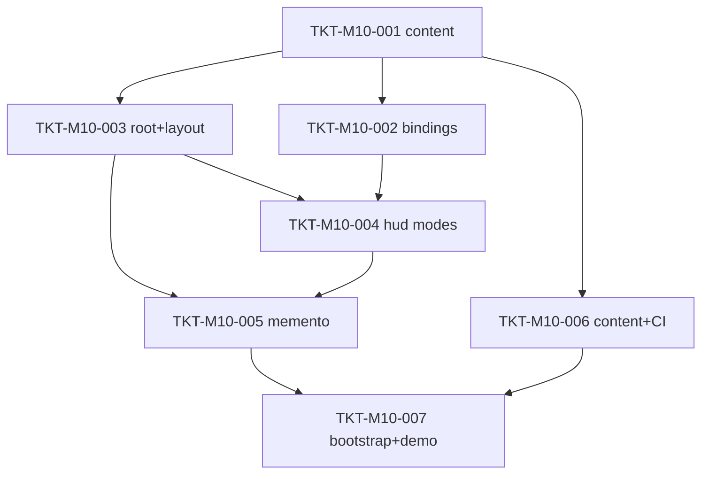

# TICKETS-M10 v1.0 — «UI Framework & HUD»

**Тип документа:** Детализация тикетов вехи M10  
**Дата:** 2026-11-14  
**Статус:** ✅ реализовано (2026-11-16) — UI Framework & HUD  
**Веха:** M10 (Wave 1 — Presentation skeleton)  
**Покрывает:** `DEV-SPEC-013`  
**Тикетов:** 7  
**Демо вехи:** `bun run demo:m10` — загрузка layout `world_map` → HUD показывает золото/ресурсы → `economy.gold_changed` обновляет bar → переключение screen_mode `combat` → панели по layout → save/load открытых панелей → идентичное восстановление.

---

## 1. Состав вехи

| ID | Название | DEV-SPEC-013 | Размер |
|---|---|---|---|
| `TKT-M10-001` | UI content-типы, схемы и пакеты | §5, §6 | M |
| `TKT-M10-002` | UiBindingEngine и binding-политики | §5, §7 | M |
| `TKT-M10-003` | UiRoot, layout и монтирование панелей | §7 | M |
| `TKT-M10-004` | Режимы HUD и `ui.hud_mode_changed` | §4, §7 | S |
| `TKT-M10-005` | UI memento и восстановление панелей | §10 | S |
| `TKT-M10-006` | Контент UI, локализация и graph-CI | §6, §11 | M |
| `TKT-M10-007` | DI, bootstrap и demo:m10 | §12, §18 | M |

---

## 2. Порядок выполнения

**Параллелизация:** T001 — корень; T002/T003/T006 — параллельно; T004 после T002+T003; T007 — сход.

---

## 3. Тикеты

### TKT-M10-001 — UI content-типы, схемы и пакеты

**DEV-SPEC:** DEV-SPEC-013 §5, §6  
**Требования:** R01, R02  
**AC:** AC01, AC03, AC06  
**Размер:** M  
**Статус:** ✅ выполнено  
**Зависит от:** TKT-M8-001  
**Блокирует:** TKT-M10-002, TKT-M10-003, TKT-M10-006

**Что сделать:**
- Описать `UiLayoutDefinition`, `UiPanelDefinition`, `UiWidgetDefinition`, `UiPanelRef`, `UiWidgetRef` (§5) с `readonly`-полями.
- Добавить JSON-схемы `ui-layout`, `ui-panel`, `ui-widget` (`additionalProperties: false`, minItems ≥ 1).
- Зарегистрировать kinds `uiLayout`/`uiPanel`/`uiWidget` в `schemaNameForKind` и пакет `ui-core` в `packs.json`.

**Acceptance Criteria:**
- `DEV-SPEC-013-AC06`: layout со ссылкой на отсутствующую панель → graph issue.
- `DEV-SPEC-013-AC03`: `screen_mode` из enum восстанавливается в HUD.

**Definition of Done:**
- [ ] типы/схемы добавлены; [ ] schema-тесты; [ ] `t:type`/`t:test` зелёные; [ ] PR смержен.

---

### TKT-M10-002 — UiBindingEngine и binding-политики

**DEV-SPEC:** DEV-SPEC-013 §5, §7  
**Требования:** R01  
**AC:** AC01, AC02  
**Размер:** M  
**Статус:** ✅ выполнено  
**Зависит от:** TKT-M10-001  
**Блокирует:** TKT-M10-004, TKT-M10-007

**Что сделать:**
- Реализовать `UiBindingEngine`: привязка widget → `binding_context` (ресурсы, золото, отряд), обновление по событиям (`economy.gold_changed` и др.).
- Поддержать декларативные binding-политики; неизвестный binding → warn + пустое значение, без падения UI.
- Обновление не чаще одного раза за такт (коалесинг).

**Acceptance Criteria:**
- `DEV-SPEC-013-AC01`: `economy.gold_changed` обновляет bar в пределах 1 такта.
- `DEV-SPEC-013-AC02`: неизвестный binding → warn + fallback.

**Definition of Done:**
- [ ] движок привязок реализован; [ ] unit-тесты на recording bus; [ ] `t:test` зелёный; [ ] PR смержен.

---

### TKT-M10-003 — UiRoot, layout и монтирование панелей

**DEV-SPEC:** DEV-SPEC-013 §7  
**Требования:** R01, R02  
**AC:** AC03, AC04  
**Размер:** M  
**Статус:** ✅ выполнено  
**Зависит от:** TKT-M10-001  
**Блокирует:** TKT-M10-004, TKT-M10-005

**Что сделать:**
- Реализовать `UiRoot`: монтирование layout, панелей по `anchor`/`size_policy_id`, слой HUD поверх canvas.
- Адаптеры DOM/Babylon GUI (минимум один рабочий + Null для тестов).
- Открытие/закрытие панели идемпотентно; повторный open не создаёт дубликат.

**Acceptance Criteria:**
- `DEV-SPEC-013-AC03`: смена screen_mode применяет панели layout.
- `DEV-SPEC-013-AC04`: повторное открытие панели идемпотентно.

**Definition of Done:**
- [ ] root/layout реализованы; [ ] unit-тесты монтирования; [ ] `t:test` зелёный; [ ] PR смержен.

---

### TKT-M10-004 — Режимы HUD и `ui.hud_mode_changed`

**DEV-SPEC:** DEV-SPEC-013 §4, §7  
**Требования:** R02  
**AC:** AC03, AC04  
**Размер:** S  
**Статус:** ✅ выполнено  
**Зависит от:** TKT-M10-002, TKT-M10-003  
**Блокирует:** TKT-M10-005, TKT-M10-007

**Что сделать:**
- Добавить события `ui.hud_mode_changed`, `ui.panel_opened`, `ui.panel_closed` в реестр.
- Связать `screen_mode` сцен (010) с видимостью панелей и режимом HUD.
- Применять `visibility_policy_id` панелей без прямых мутаций DOM из домена.

**Acceptance Criteria:**
- `DEV-SPEC-013-AC03`: смена режима эмитит событие и меняет видимость панелей.
- `DEV-SPEC-013-AC04`: дубликат open не эмитит повторное событие.

**Definition of Done:**
- [ ] события и связка со сценами добавлены; [ ] integration-тест; [ ] `ci:validate --stage=events` зелёный; [ ] PR смержен.

---

### TKT-M10-005 — UI memento и восстановление панелей

**DEV-SPEC:** DEV-SPEC-013 §10  
**Требования:** R03  
**AC:** AC05  
**Размер:** S  
**Статус:** ✅ выполнено  
**Зависит от:** TKT-M10-003, TKT-M10-004  
**Блокирует:** TKT-M10-007

**Что сделать:**
- Добавить `UiStateMementoProvider` (`domainId: 'ui'`): открытые панели, `hud_mode`, свёрнутые секции.
- Сериализация только UI-состояния, без доменных данных; валидация схемой при restore.
- Contract-тест: save/load → identical.

**Acceptance Criteria:**
- `DEV-SPEC-013-AC05`: open panels и `hud_mode` восстанавливаются идентично.

**Definition of Done:**
- [ ] memento зарегистрирован; [ ] roundtrip-тест; [ ] `t:test` зелёный; [ ] PR смержен.

---

### TKT-M10-006 — Контент UI, локализация и graph-CI

**DEV-SPEC:** DEV-SPEC-013 §6, §11  
**Требования:** R04  
**AC:** AC06  
**Размер:** M  
**Статус:** ✅ выполнено  
**Зависит от:** TKT-M10-001  
**Блокирует:** TKT-M10-007

**Что сделать:**
- Добавить `content/ui/*.json`: layout-ы world_map/combat/city/dialog/epilogue, 8–10 панелей, виджеты HUD.
- Локализация `content/locales/{ru,en}/ui.json` для всех `display_name_key`.
- Graph-правило CI: каждая `panel_id`/`widget_id` существует; каждый `binding_context` зарегистрирован.

**Acceptance Criteria:**
- `DEV-SPEC-013-AC06`: layout с missing panel → graph issue.

**Definition of Done:**
- [ ] контент и правило CI добавлены; [ ] `ci:validate --stage=graph` зелёный; [ ] PR смержен.

---

### TKT-M10-007 — DI, bootstrap и demo:m10

**DEV-SPEC:** DEV-SPEC-013 §12, §18  
**Требования:** R01–R04  
**AC:** AC01–AC06  
**Размер:** M  
**Статус:** ✅ выполнено  
**Зависит от:** TKT-M10-005, TKT-M10-006  
**Блокирует:** DEV-SPEC-016

**Что сделать:**
- Зарегистрировать `UiBindingEngine`, `UiRoot`, `UiStateMementoProvider` в `GameContainer`.
- Подключить UI к SceneManager (010): каждая сцена получает свой layout.
- Добавить `scripts/demo-m10.ts` и `demo:m10` в `package.json`.

**Acceptance Criteria:**
- `DEV-SPEC-013-AC01`–`AC06`: демо проходит, save/load UI идентичен.

**Definition of Done:**
- [ ] DI/демо работают; [ ] `bun run demo:m10` зелёный; [ ] `t:check` зелёный; [ ] PR смержен.

---

## 4. Definition of Done для вехи

- [ ] все 7 тикетов смержены; [ ] `t:check`/`ci:validate` зелёные; [ ] `bun run demo:m10` воспроизводится; [ ] все AC 013 покрыты.

## 5. Что разблокирует M10

`DEV-SPEC-016` (mobile/HUD layout), `DEV-SPEC-039` (vertical slice).

## 6. Риски и заметки

- UI-состояние не должно попадать в доменные снимки, кроме собственного memento-домена.
- Babylon GUI и DOM HUD нельзя смешивать в одном слое без адаптера.
