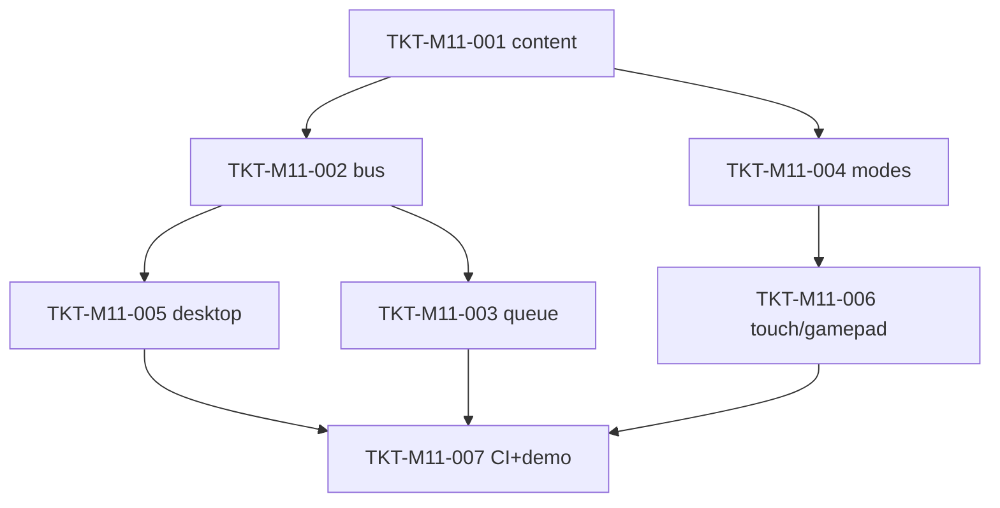

# TICKETS-M11 v1.0 — «Input System & Player Commands»

**Тип документа:** Детализация тикетов вехи M11  
**Дата:** 2026-11-14  
**Статус:** ✅ реализовано (2026-11-16) — Input System & Player Commands  
**Веха:** M11 (Wave 1 — Presentation skeleton)  
**Покрывает:** `DEV-SPEC-014`  
**Тикетов:** 7  
**Демо вехи:** `bun run demo:m11` — загрузка input-пакета → desktop-команда «открыть порт» проходит в фазе `input` → mode=dialog отсекает exploration-команду → 65-я команда за такт отклоняется → save/load стека режимов → идентичное восстановление.

---

## 1. Состав вехи

| ID | Название | DEV-SPEC-014 | Размер |
|---|---|---|---|
| `TKT-M11-001` | Input content-типы, схемы и пакеты | §5, §6 | M |
| `TKT-M11-002` | InputCommandBus: маршрутизация и фазы | §5, §7.1 | M |
| `TKT-M11-003` | Очередь команд и `input.command_rejected` | §7.2, §7.3 | S |
| `TKT-M11-004` | InputModeController и стек режимов | §5, §7.2 | M |
| `TKT-M11-005` | Desktop-адаптер (keyboard/mouse) | §8.2 | S |
| `TKT-M11-006` | Touch/gamepad-адаптер | §8.2 | M |
| `TKT-M11-007` | CI, memento, bootstrap и demo:m11 | §10, §11, §18 | M |

---

## 2. Порядок выполнения

**Параллелизация:** T001 — корень; после T002 можно параллельно вести очередь и desktop; режимы (T004) — отдельная ветка; T007 — сход.

---

## 3. Тикеты

### TKT-M11-001 — Input content-типы, схемы и пакеты

**DEV-SPEC:** DEV-SPEC-014 §5, §6  
**Требования:** R01, R02  
**AC:** AC01, AC07  
**Размер:** M  
**Статус:** ✅ выполнено  
**Зависит от:** TKT-M8-001  
**Блокирует:** TKT-M11-002, TKT-M11-004

**Что сделать:**
- Описать `InputActionDefinition`, `InputBindingDefinition`, `InputCommandRouteDefinition`, `InputMode`, `InputSource` (§5).
- Добавить схемы `input-action`, `input-binding`, `input-route`; `target_domain` — enum из §5.
- Зарегистрировать kinds и пакет `input-core`; локализационные ключи действий.

**Acceptance Criteria:**
- `DEV-SPEC-014-AC01`: команда доставляется в фазе `input` до `simulation` того же такта.
- `DEV-SPEC-014-AC07`: route на несуществующий домен → lint error.

**Definition of Done:**
- [ ] типы/схемы добавлены; [ ] schema-тесты; [ ] `t:type`/`t:test` зелёные; [ ] PR смержен.

---

### TKT-M11-002 — InputCommandBus: маршрутизация и фазы

**DEV-SPEC:** DEV-SPEC-014 §5, §7.1  
**Требования:** R01  
**AC:** AC01, AC02  
**Размер:** M  
**Статус:** ✅ выполнено  
**Зависит от:** TKT-M11-001  
**Блокирует:** TKT-M11-003, TKT-M11-005, TKT-M11-007

**Что сделать:**
- Реализовать `InputCommandBus`: приём action → resolve route → доставка в домен в фазе `input`.
- Учитывать `priority` и `phase`; команда не должна попадать в `simulation` раньше `input`.
- Неизвестный action → `input.command_rejected` с причиной, не исключение.

**Acceptance Criteria:**
- `DEV-SPEC-014-AC01`: порядок фаз соблюдён (тест на `ManualGameClock`).
- `DEV-SPEC-014-AC02`: unknown action → `input.command_rejected`.

**Definition of Done:**
- [ ] bus реализован; [ ] unit-тесты маршрутизации; [ ] `t:test` зелёный; [ ] PR смержен.

---

### TKT-M11-003 — Очередь команд и `input.command_rejected`

**DEV-SPEC:** DEV-SPEC-014 §7.2, §7.3  
**Требования:** R03  
**AC:** AC05  
**Размер:** S  
**Статус:** ✅ выполнено  
**Зависит от:** TKT-M11-002  
**Блокирует:** TKT-M11-007

**Что сделать:**
- Ограничить очередь 64 командами на такт; 65-я отклоняется с событием.
- Дренаж очереди в начале фазы `input`; детерминированный порядок (priority, seq).
- Не терять команды при паузе: очередь замирает, не очищается.

**Acceptance Criteria:**
- `DEV-SPEC-014-AC05`: 65-я команда → reject + событие.

**Definition of Done:**
- [ ] лимит и drain реализованы; [ ] unit-тест переполнения; [ ] `t:test` зелёный; [ ] PR смержен.

---

### TKT-M11-004 — InputModeController и стек режимов

**DEV-SPEC:** DEV-SPEC-014 §5, §7.2  
**Требования:** R02, R04  
**AC:** AC03, AC04, AC06  
**Размер:** M  
**Статус:** ✅ выполнено  
**Зависит от:** TKT-M11-001  
**Блокирует:** TKT-M11-006, TKT-M11-007

**Что сделать:**
- Реализовать `InputModeController`: `exploration|combat|dialog|menu`, стек режимов, `pushMode`/`popMode`.
- Фильтрация действий по `allowed_modes`; в `dialog` exploration-команды отсекаются.
- Memento стека режимов (`domainId: 'input'`) с восстановлением при load.

**Acceptance Criteria:**
- `DEV-SPEC-014-AC03`: в `dialog` exploration-команды отсекаются.
- `DEV-SPEC-014-AC04`: holding-команда даёт N команд за N тактов.
- `DEV-SPEC-014-AC06`: стек режимов восстанавливается.

**Definition of Done:**
- [ ] режимы и memento реализованы; [ ] unit-тесты; [ ] `t:test` зелёный; [ ] PR смержен.

---

### TKT-M11-005 — Desktop-адаптер (keyboard/mouse)

**DEV-SPEC:** DEV-SPEC-014 §8.2  
**Требования:** R01, R02  
**AC:** AC01, AC04  
**Размер:** S  
**Статус:** ✅ выполнено  
**Зависит от:** TKT-M11-002  
**Блокирует:** TKT-M11-007

**Что сделать:**
- Добавить DOM-адаптер: keyboard/mouse events → `InputActionDefinition` по binding-политике.
- Поддержать модификаторы и repeat-policy (`single|continuous|repeat_on_hold`).
- Null-адаптер для тестов; отписка от listeners при dispose.

**Acceptance Criteria:**
- `DEV-SPEC-014-AC01`: desktop-команда проходит в фазе `input`.
- `DEV-SPEC-014-AC04`: continuous-политика даёт N команд за N тактов.

**Definition of Done:**
- [ ] адаптер добавлен; [ ] smoke-тест маппинга; [ ] `t:type` зелёный; [ ] PR смержен.

---

### TKT-M11-006 — Touch/gamepad-адаптер

**DEV-SPEC:** DEV-SPEC-014 §8.2  
**Требования:** R02  
**AC:** AC03, AC04  
**Размер:** M  
**Статус:** ✅ выполнено  
**Зависит от:** TKT-M11-004  
**Блокирует:** TKT-M11-007, DEV-SPEC-016

**Что сделать:**
- Добавить touch-адаптер: виртуальный стик/кнопки, свайпы → действия; учитывать safe-area.
- Gamepad-адаптер через Gamepad API (desktop), маппинг осей/кнопок.
- Переключение источников без дублирования команд при смене устройства.

**Acceptance Criteria:**
- `DEV-SPEC-014-AC03`: touch-команды соблюдают режимы.
- `DEV-SPEC-014-AC04`: repeat_on_hold работает для touch.

**Definition of Done:**
- [ ] touch/gamepad добавлены; [ ] тесты маппинга; [ ] `t:type` зелёный; [ ] PR смержен.

---

### TKT-M11-007 — CI, memento, bootstrap и demo:m11

**DEV-SPEC:** DEV-SPEC-014 §10, §11, §18  
**Требования:** R01–R05  
**AC:** AC01–AC07  
**Размер:** M  
**Статус:** ✅ выполнено  
**Зависит от:** TKT-M11-003, TKT-M11-005, TKT-M11-006  
**Блокирует:** DEV-SPEC-018

**Что сделать:**
- Зарегистрировать bus/режимы/адаптеры в `GameContainer`; подключить к bootstrap после UI (013).
- Добавить graph-правило: `route_id`/`action_id`/`binding_id` должны существовать; запрет неизвестного `target_domain`.
- Добавить `scripts/demo-m11.ts` и `demo:m11`.

**Acceptance Criteria:**
- `DEV-SPEC-014-AC07`: битый route ловится CI.
- `DEV-SPEC-014-AC06`: memento-стек режимов проходит roundtrip.

**Definition of Done:**
- [ ] DI/CI/демо добавлены; [ ] `bun run demo:m11` зелёный; [ ] `ci:validate` зелёный; [ ] PR смержен.

---

## 4. Definition of Done для вехи

- [ ] все 7 тикетов смержены; [ ] `t:check`/`ci:validate` зелёные; [ ] `demo:m11` воспроизводится; [ ] все AC 014 покрыты.

## 5. Что разблокирует M11

`DEV-SPEC-016` (mobile UX), `DEV-SPEC-018` (команды боя), `DEV-SPEC-029` (бой отряда).

## 6. Риски и заметки

- Ввод — единственный источник недетерминизма на границе; все команды обязаны попадать в очередь такта.
- Touch и desktop не должны одновременно эмитить одну команду.
