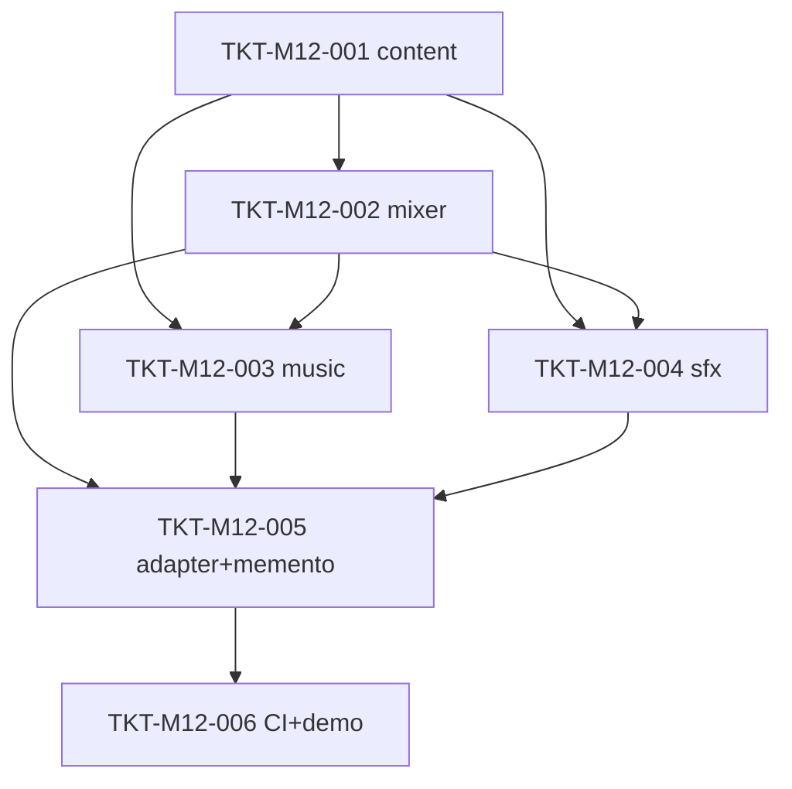

# TICKETS-M12 v1.0 — «Audio System»

**Тип документа:** Детализация тикетов вехи M12  
**Дата:** 2026-11-14  
**Статус:** ✅ реализовано (2026-11-16) — Audio System  
**Веха:** M12 (Wave 1 — Presentation skeleton)  
**Покрывает:** `DEV-SPEC-015`  
**Тикетов:** 6  
**Демо вехи:** `bun run demo:m12` — загрузка audio-пакета → world_map трек → `combat.started` переключает music_state → VFX-спавн с `audio_sfx_id` играет sfx → duck при dialog → save/load громкостей → идентичное восстановление.

---

## 1. Состав вехи

| ID | Название | DEV-SPEC-015 | Размер |
|---|---|---|---|
| `TKT-M12-001` | Audio content-типы, схемы и пакеты | §5, §6 | M |
| `TKT-M12-002` | AudioMixerService: шины и duck | §5, §7 | M |
| `TKT-M12-003` | MusicStateController | §4, §7 | M |
| `TKT-M12-004` | AudioSfxService: триггеры и cooldown | §4, §7 | S |
| `TKT-M12-005` | WebAudio-адаптер, загрузка ассетов и memento | §8, §10 | M |
| `TKT-M12-006` | CI, bootstrap и demo:m12 | §11, §18 | M |

---

## 2. Порядок выполнения

**Параллелизация:** T001 — корень; T002/T003/T004 после типов, но music/sfx зависят от шин; T005 — сход; T006 — финал.

---

## 3. Тикеты

### TKT-M12-001 — Audio content-типы, схемы и пакеты

**DEV-SPEC:** DEV-SPEC-015 §5, §6  
**Требования:** R01, R02, R03  
**AC:** AC01, AC03, AC07  
**Размер:** M  
**Статус:** ✅ выполнено  
**Зависит от:** TKT-M9-001  
**Блокирует:** TKT-M12-002, TKT-M12-003, TKT-M12-004

**Что сделать:**
- Описать `AudioTrackDefinition`, `AudioMixPolicyDefinition`, `AudioTriggerDefinition`, `DuckRule`, `MusicStateName` (§5).
- Добавить схемы `audio-track`, `audio-mix-policy`, `audio-trigger`; проверить `asset_ref`, bus enum, `track_ids` ≥ 1.
- Зарегистрировать kinds и пакет `audio-core`; локализационные ключи.

**Acceptance Criteria:**
- `DEV-SPEC-015-AC07`: mix-policy без треков → lint error.
- `DEV-SPEC-015-AC08`: trigger на unknown event → graph issue.

**Definition of Done:**
- [ ] типы/схемы добавлены; [ ] schema-тесты; [ ] `t:type`/`t:test` зелёные; [ ] PR смержен.

---

### TKT-M12-002 — AudioMixerService: шины и duck

**DEV-SPEC:** DEV-SPEC-015 §5, §7  
**Требования:** R03  
**AC:** AC05, AC06  
**Размер:** M  
**Статус:** ✅ выполнено  
**Зависит от:** TKT-M12-001  
**Блокирует:** TKT-M12-003, TKT-M12-004, TKT-M12-005

**Что сделать:**
- Реализовать шины `music|sfx|ambient|ui|dialog`, `setBusVolume`, `getBusVolume`.
- Duck-правила: при `dialog_active` применять `target_volume` к указанным шинам и восстанавливать после.
- Хранить громкости в memento (`domainId: 'audio'`), не в DOM.

**Acceptance Criteria:**
- `DEV-SPEC-015-AC05`: `setBusVolume` сохраняется и восстанавливается.
- `DEV-SPEC-015-AC06`: duck при `dialog_active` срабатывает и снимается.

**Definition of Done:**
- [ ] микшер реализован; [ ] unit-тесты шин/duck; [ ] `t:test` зелёный; [ ] PR смержен.

---

### TKT-M12-003 — MusicStateController

**DEV-SPEC:** DEV-SPEC-015 §4, §7  
**Требования:** R01  
**AC:** AC01, AC02  
**Размер:** M  
**Статус:** ✅ выполнено  
**Зависит от:** TKT-M12-002  
**Блокирует:** TKT-M12-005

**Что сделать:**
- Реализовать `MusicStateController`: `world_map|combat|cataclysm|dialog|epilogue`.
- Подписки: `combat.started` → `combat`; `combat.ended` → `world_map`; `cataclysm.triggered` → `cataclysm`.
- Кроссфейд по fade-политике, без повторного запуска того же трека; событие `audio.music_state_changed`.

**Acceptance Criteria:**
- `DEV-SPEC-015-AC01`: `combat.started` → `audio.music_state_changed(combat)`.
- `DEV-SPEC-015-AC02`: конец боя → обратно `world_map`.

**Definition of Done:**
- [ ] контроллер реализован; [ ] integration-тест на recording bus; [ ] `t:test` зелёный; [ ] PR смержен.

---

### TKT-M12-004 — AudioSfxService: триггеры и cooldown

**DEV-SPEC:** DEV-SPEC-015 §4, §7  
**Требования:** R02  
**AC:** AC03, AC04  
**Размер:** S  
**Статус:** ✅ выполнено  
**Зависит от:** TKT-M12-002  
**Блокирует:** TKT-M12-005

**Что сделать:**
- Реализовать `AudioSfxService`: реакция на `AudioTriggerDefinition` (`source_event_id`, `target_filter_tags`, `cooldown_policy_id`).
- Спавн VFX с `audio_sfx_id` → проигрывание sfx; cooldown блокирует повторный триггер.
- Событие `audio.sfx_played` для тестов и наблюдаемости.

**Acceptance Criteria:**
- `DEV-SPEC-015-AC03`: VFX-спавн с `audio_sfx_id` → `sfx_played`.
- `DEV-SPEC-015-AC04`: cooldown-blocked повторный триггер не играет.

**Definition of Done:**
- [ ] сервис реализован; [ ] unit-тесты cooldown; [ ] `t:test` зелёный; [ ] PR смержен.

---

### TKT-M12-005 — WebAudio-адаптер, загрузка ассетов и memento

**DEV-SPEC:** DEV-SPEC-015 §8, §10  
**Требования:** R01, R03, R04  
**AC:** AC05, AC06  
**Размер:** M  
**Статус:** ✅ выполнено  
**Зависит от:** TKT-M12-002, TKT-M12-003, TKT-M12-004  
**Блокирует:** TKT-M12-006

**Что сделать:**
- Адаптер `WebAudioAdapter`: декодирование/проигрывание по `asset_ref`, управление gain по шинам, dispose.
- `NullAudioAdapter` для CI; ленивая загрузка и кэш буферов.
- `AudioStateMementoProvider`: громкости шин, music_state, позиции кроссфейда.

**Acceptance Criteria:**
- `DEV-SPEC-015-AC05`: memento roundtrip громкостей.
- `DEV-SPEC-015-AC06`: duck восстанавливается после load.

**Definition of Done:**
- [ ] адаптер и memento добавлены; [ ] тесты с Null-адаптером; [ ] `t:test` зелёный; [ ] PR смержен.

---

### TKT-M12-006 — CI, bootstrap и demo:m12

**DEV-SPEC:** DEV-SPEC-015 §11, §18  
**Требования:** R01–R04  
**AC:** AC01–AC08  
**Размер:** M  
**Статус:** ✅ выполнено  
**Зависит от:** TKT-M12-005  
**Блокирует:** DEV-SPEC-016

**Что сделать:**
- Зарегистрировать audio-сервисы в `GameContainer`, подключить к bootstrap после VFX/сцен.
- Добавить graph/lint-правила: `source_event_id`, `sfx_id`, `track_ids`, `cooldown_policy_id` резолвятся.
- Добавить `scripts/demo-m12.ts` и `demo:m12` по сценарию шапки.

**Acceptance Criteria:**
- `DEV-SPEC-015-AC07`, `AC08`: CI ловит пустую policy и unknown event.
- `DEV-SPEC-015-AC01`–`AC06`: демо проходит.

**Definition of Done:**
- [ ] DI/CI/демо добавлены; [ ] `demo:m12` и `ci:validate` зелёные; [ ] PR смержен.

---

## 4. Definition of Done для вехи

- [ ] все 6 тикетов смержены; [ ] `t:check`/`ci:validate` зелёные; [ ] `demo:m12` воспроизводится; [ ] все AC 015 покрыты.

## 5. Что разблокирует M12

`DEV-SPEC-016` (mobile audio budget), нарративная аудио-доставка Wave 6.

## 6. Риски и заметки

- Автовоспроизведение в браузере требует user gesture; демо и тесты — только через Null-адаптер.
- Аудио не должно влиять на детерминизм домена; состояние — только presentation.
