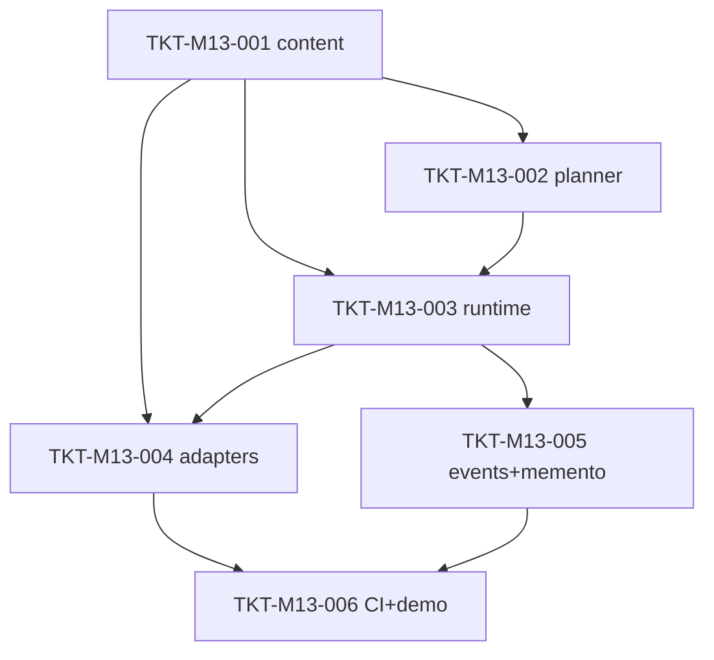

# TICKETS-M13 v1.0 — «VFX Runtime»

**Тип документа:** Детализация тикетов вехи M13  
**Дата:** 2026-11-14  
**Статус:** ⏳ запланировано — реализация не начата  
**Веха:** M13 (Wave 1 — Presentation skeleton)  
**Покрывает:** `DEV-SPEC-012`  
**Тикетов:** 6  
**Демо вехи:** `bun run demo:m13` — загрузка VFX-пакета → `combat.ship_damaged` спавнит систему → budget tier=low отсекает вторую → fixed_duration уничтожается на такте N → save/load пересоздаёт активные системы детерминированно.

---

## 1. Состав вехи

| ID | Название | DEV-SPEC-012 | Размер |
|---|---|---|---|
| `TKT-M13-001` | VFX content-типы, схемы и пакеты | §5, §6 | M |
| `TKT-M13-002` | VfxPlanner: триггеры, фильтры и бюджет | §5, §7 | M |
| `TKT-M13-003` | VfxRuntimeService и жизненный цикл | §5, §7 | M |
| `TKT-M13-004` | IVfxRuntimePort, Null- и Babylon-адаптеры | §8 | S |
| `TKT-M13-005` | События, memento и restore активных систем | §4, §10 | S |
| `TKT-M13-006` | CI, bootstrap и demo:m13 | §11, §18 | M |

---

## 2. Порядок выполнения

---

## 3. Тикеты

### TKT-M13-001 — VFX content-типы, схемы и пакеты

**DEV-SPEC:** DEV-SPEC-012 §5, §6  
**Требования:** R01, R03  
**AC:** AC01, AC05  
**Размер:** M  
**Статус:** ⏳ не начато  
**Зависит от:** TKT-M9-001  
**Блокирует:** TKT-M13-002, TKT-M13-003

**Что сделать:**
- Описать `VfxSystemDefinition`, `VfxEmitterRef`, `VfxTriggerDefinition`, `VfxRuntimeStateInstance` (§5).
- Добавить схемы `vfx-system`, `vfx-trigger`; `quality_tier_ids`/`trigger_ids` непустые.
- Зарегистрировать kinds и пакет `vfx-core`; контент `content/visual/vfx/{systems,emitters,triggers}.json`.

**Acceptance Criteria:**
- `DEV-SPEC-012-AC01`: `combat.ship_damaged` спавнит ровно один instance.
- `DEV-SPEC-012-AC05`: несовпадение `target_filter_tags` → нет спавна.

**Definition of Done:**
- [ ] типы/схемы/контент добавлены; [ ] schema-тесты; [ ] `t:test` зелёный; [ ] PR смержен.

---

### TKT-M13-002 — VfxPlanner: триггеры, фильтры и бюджет

**DEV-SPEC:** DEV-SPEC-012 §5, §7  
**Требования:** R01, R03  
**AC:** AC01, AC02, AC05  
**Размер:** M  
**Статус:** ⏳ не начато  
**Зависит от:** TKT-M13-001  
**Блокирует:** TKT-M13-003

**Что сделать:**
- Реализовать `VfxPlanner`: матчинг события по `target_filter_tags`, выбор систем по quality tier, проверка бюджета (`max_active_systems`, `max_particles`).
- При превышении бюджета — отказ + warn-событие, без исключения.
- Принимать budget override из mobile-профиля (016) через порт конфигурации.

**Acceptance Criteria:**
- `DEV-SPEC-012-AC02`: tier=low отсекает вторую систему и публикует warn.
- `DEV-SPEC-012-AC05`: фильтр-теги блокируют спавн.

**Definition of Done:**
- [ ] планировщик реализован; [ ] unit-тесты бюджета/фильтров; [ ] `t:test` зелёный; [ ] PR смержен.

---

### TKT-M13-003 — VfxRuntimeService и жизненный цикл

**DEV-SPEC:** DEV-SPEC-012 §5, §7  
**Требования:** R01, R02  
**AC:** AC03, AC04  
**Размер:** M  
**Статус:** ⏳ не начато  
**Зависит от:** TKT-M13-002  
**Блокирует:** TKT-M13-004, TKT-M13-005

**Что сделать:**
- Реализовать `VfxRuntimeService`: `spawn`, `destroy`, `setIntensity`, tick-обновление активных систем.
- Поддержать `lifetime_policy` (`until_destroyed`, `fixed_duration`, `bound_to_event`).
- Детерминированные `instance_id` (без UUID v4 random): счётчик + seed.

**Acceptance Criteria:**
- `DEV-SPEC-012-AC03`: fixed_duration уничтожается на такте N + `destroyed` событие.
- `DEV-SPEC-012-AC04`: restore пересоздаёт активные системы детерминированно.

**Definition of Done:**
- [ ] сервис реализован; [ ] unit-тесты lifecycle; [ ] `t:test` зелёный; [ ] PR смержен.

---

### TKT-M13-004 — IVfxRuntimePort, Null- и Babylon-адаптеры

**DEV-SPEC:** DEV-SPEC-012 §8  
**Требования:** R01, R02  
**AC:** AC01, AC03  
**Размер:** S  
**Статус:** ⏳ не начато  
**Зависит от:** TKT-M13-003  
**Блокирует:** TKT-M13-006

**Что сделать:**
- Описать `IVfxRuntimePort` (`play`, `stop`, `setIntensity`, `dispose`).
- `NullVfxAdapter` (CI) и `BabylonVfxAdapter` (ParticleSystem) с маппингом `emitter_id` → ассет.
- Не допускать утечек: dispose активных систем при выгрузке сцены.

**Acceptance Criteria:**
- `DEV-SPEC-012-AC01`: адаптер получает ровно один spawn.
- `DEV-SPEC-012-AC03`: stop/dispose прекращает систему.

**Definition of Done:**
- [ ] порт и адаптеры добавлены; [ ] smoke-тесты; [ ] `t:type` зелёный; [ ] PR смержен.

---

### TKT-M13-005 — События, memento и restore активных систем

**DEV-SPEC:** DEV-SPEC-012 §4, §10  
**Требования:** R02, R04  
**AC:** AC03, AC04  
**Размер:** S  
**Статус:** ⏳ не начато  
**Зависит от:** TKT-M13-003  
**Блокирует:** TKT-M13-006

**Что сделать:**
- Зарегистрировать события `visual.vfx_spawned`, `visual.vfx_destroyed`, `visual.vfx_budget_exceeded`.
- Добавить `VfxStateMementoProvider` (`domainId: 'presentation_vfx'`): активные системы, intensity, started_tick.
- Валидировать состояние схемой; на restore не перезапускать прошедшие такты.

**Acceptance Criteria:**
- `DEV-SPEC-012-AC04`: save/load → активные системы восстановлены идентично.

**Definition of Done:**
- [ ] события и memento добавлены; [ ] roundtrip-тест; [ ] `t:test` зелёный; [ ] PR смержен.

---

### TKT-M13-006 — CI, bootstrap и demo:m13

**DEV-SPEC:** DEV-SPEC-012 §11, §18  
**Требования:** R01–R04  
**AC:** AC01–AC07  
**Размер:** M  
**Статус:** ⏳ не начато  
**Зависит от:** TKT-M13-004, TKT-M13-005  
**Блокирует:** DEV-SPEC-016, DEV-SPEC-029

**Что сделать:**
- Зарегистрировать VFX-сервисы в `GameContainer`; подключить после сцен/visual.
- Добавить graph/lint: `emitter_id`, `trigger_ids`, `bound_event_id` резолвятся; неизвестное событие — ошибка.
- Добавить `scripts/demo-m13.ts` и `demo:m13`.

**Acceptance Criteria:**
- `DEV-SPEC-012-AC06`, `AC07`: CI ловит неизвестный emitter/trigger.
- `DEV-SPEC-012-AC01`–`AC05`: демо проходит.

**Definition of Done:**
- [ ] DI/CI/демо добавлены; [ ] `demo:m13` и `ci:validate` зелёные; [ ] PR смержен.

---

## 4. Definition of Done для вехи

- [ ] все 6 тикетов смержены; [ ] `t:check`/`ci:validate` зелёные; [ ] `demo:m13` воспроизводится; [ ] все AC 012 покрыты.

## 5. Что разблокирует M13

`DEV-SPEC-016` (бюджеты), `DEV-SPEC-029` (боевые эффекты), vertical slice.

## 6. Риски и заметки

- VFX не должен становиться источником доменных событий — только presentation.
- Частицы в тестах — только через Null-адаптер.
