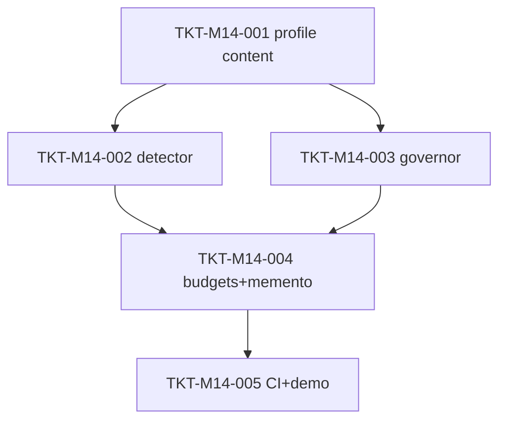

# TICKETS-M14 v1.0 — «Mobile Adaptation & Performance Budget»

**Тип документа:** Детализация тикетов вехи M14  
**Дата:** 2026-11-14  
**Статус:** ✅ реализовано (2026-11-16) — Mobile Adaptation & Performance Budget  
**Веха:** M14 (Wave 1 — Presentation skeleton)  
**Покрывает:** `DEV-SPEC-016`  
**Тикетов:** 5  
**Демо вехи:** `bun run demo:m14` — UA mobile-high → профиль mobile-high → governor понижает tier при FPS < 30 → budget override уходит в VfxPlanner → resolution scale применён → save/load профиля и tier → fixed-seed прогон desktop/mobile даёт одинаковый `VisualStateInstance`.

---

## 1. Состав вехи

| ID | Название | DEV-SPEC-016 | Размер |
|---|---|---|---|
| `TKT-M14-001` | DeviceProfileDefinition, схема и контент | §5, §6 | S |
| `TKT-M14-002` | DeviceProfileDetector | §5 | S |
| `TKT-M14-003` | MobilePerformanceGovernor | §5, §7 | M |
| `TKT-M14-004` | Бюджеты presentation и memento | §5, §7 | M |
| `TKT-M14-005` | CI, bootstrap и demo:m14 | §11, §18 | M |

---

## 2. Порядок выполнения

---

## 3. Тикеты

### TKT-M14-001 — DeviceProfileDefinition, схема и контент

**DEV-SPEC:** DEV-SPEC-016 §5, §6  
**Требования:** R01  
**AC:** AC01, AC02  
**Размер:** S  
**Статус:** ✅ выполнено  
**Зависит от:** TKT-M8-005  
**Блокирует:** TKT-M14-002, TKT-M14-003

**Что сделать:**
- Описать `DeviceProfileDefinition` (§5): `match_policy_id`, `quality_tier_default`, `vfx_budget_override`, `audio_budget_override`, `resolution_scale`, `hud_layout_override_id`.
- Добавить схему `device-profile.json` (`resolution_scale` 0.5…1.0) и `content/presentation/device-profiles.json`.
- Профили минимум: `mobile-high`, `mobile-low`, `desktop`; локализационные ключи не требуются.

**Acceptance Criteria:**
- `DEV-SPEC-016-AC01`: mobile-high UA → mobile-high профиль (проверка в T002).
- `DEV-SPEC-016-AC02`: unknown UA → desktop fallback.

**Definition of Done:**
- [ ] тип/схема/контент добавлены; [ ] schema-тесты; [ ] PR смержен.

---

### TKT-M14-002 — DeviceProfileDetector

**DEV-SPEC:** DEV-SPEC-016 §5  
**Требования:** R01  
**AC:** AC01, AC02  
**Размер:** S  
**Статус:** ✅ выполнено  
**Зависит от:** TKT-M14-001  
**Блокирует:** TKT-M14-004

**Что сделать:**
- Реализовать `DeviceProfileDetector`: определение по UA/DPR/RAM/screen, один раз при старте.
- Подписки на orientation/DPR изменения без повторного выбора профиля.
- Null-детектор для CI (фиксированный desktop).

**Acceptance Criteria:**
- `DEV-SPEC-016-AC01`: mobile-high UA → `mobile-high`.
- `DEV-SPEC-016-AC02`: неизвестный UA → `desktop`.

**Definition of Done:**
- [ ] детектор реализован; [ ] unit-тесты UA-кейсов; [ ] `t:test` зелёный; [ ] PR смержен.

---

### TKT-M14-003 — MobilePerformanceGovernor

**DEV-SPEC:** DEV-SPEC-016 §5, §7  
**Требования:** R02  
**AC:** AC03, AC04, AC05  
**Размер:** M  
**Статус:** ✅ выполнено  
**Зависит от:** TKT-M14-001  
**Блокирует:** TKT-M14-004

**Что сделать:**
- Реализовать `MobilePerformanceGovernor`: rolling FPS из `RenderPipeline.metrics`, понижение tier на 1 при FPS < 30.
- Cooldown 5 сек, максимум один auto-step; подъём tier при устойчивых 55+; не ниже `low`.
- Управлять tier только через `IQualityTierController` (010), не напрямую.

**Acceptance Criteria:**
- `DEV-SPEC-016-AC03`: FPS < 30 → tier вниз на 1.
- `DEV-SPEC-016-AC04`: cooldown предотвращает частые переключения.
- `DEV-SPEC-016-AC05`: tier не опускается ниже `low`.

**Definition of Done:**
- [ ] governor реализован; [ ] unit-тесты на fake clock; [ ] `t:test` зелёный; [ ] PR смержен.

---

### TKT-M14-004 — Бюджеты presentation и memento

**DEV-SPEC:** DEV-SPEC-016 §5, §7  
**Требования:** R03, R05  
**AC:** AC06, AC07, AC09  
**Размер:** M  
**Статус:** ✅ выполнено  
**Зависит от:** TKT-M14-002, TKT-M14-003  
**Блокирует:** TKT-M14-005

**Что сделать:**
- Прокинуть `vfx_budget_override` в `VfxPlanner` (012), `audio_budget_override` в AudioMixer (015), `resolution_scale` в адаптер рендера.
- `MobileStateMementoProvider` (`domainId: 'presentation_mobile'`): tier override, профиль, resolution_scale.
- Гарантировать: mobile-профиль не меняет доменное состояние (только presentation).

**Acceptance Criteria:**
- `DEV-SPEC-016-AC06`: бюджет из override передан в VfxPlanner.
- `DEV-SPEC-016-AC07`: resolution scale применён (проверка вызовов адаптера).
- `DEV-SPEC-016-AC09`: fixed-seed walk desktop/mobile → идентичный `VisualStateInstance`.

**Definition of Done:**
- [ ] бюджеты связаны; [ ] memento roundtrip; [ ] `t:test` зелёный; [ ] PR смержен.

---

### TKT-M14-005 — CI, bootstrap и demo:m14

**DEV-SPEC:** DEV-SPEC-016 §11, §18  
**Требования:** R01–R05  
**AC:** AC01–AC09  
**Размер:** M  
**Статус:** ✅ выполнено  
**Зависит от:** TKT-M14-004  
**Блокирует:** DEV-SPEC-039

**Что сделать:**
- Зарегистрировать detector/governor/memento в `GameContainer`; подключить к bootstrap после visual/VFX/audio.
- Добавить lint: профиль со ссылкой на несуществующий `hud_layout_override_id` → ошибка.
- Добавить `scripts/demo-m14.ts` и `demo:m14`.

**Acceptance Criteria:**
- `DEV-SPEC-016-AC08`: битый mobile-профиль ловится CI.
- `DEV-SPEC-016-AC01`–`AC09`: демо проходит.

**Definition of Done:**
- [ ] DI/CI/демо добавлены; [ ] `demo:m14` и `ci:validate` зелёные; [ ] PR смержен.

---

## 4. Definition of Done для вехи

- [ ] все 5 тикетов смержены; [ ] `t:check`/`ci:validate` зелёные; [ ] `demo:m14` воспроизводится; [ ] все AC 016 покрыты.

## 5. Что разблокирует M14

`DEV-SPEC-039` (vertical slice), мобильный UX для Wave 5.

## 6. Риски и заметки

- Governor обязан быть детерминированным в тестах: FPS подаётся через mock clock, не через реальное время.
- Автопонижение tier не должно менять доменные события.
