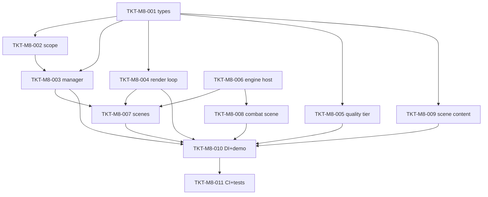

# TICKETS-M8 v1.0 — «Scene Manager & Render Pipeline»

**Тип документа:** Детализация тикетов вехи M8  
**Дата:** 2026-11-14  
**Статус:** ✅ реализовано (2026-11-16) — Scene Manager & Render Pipeline  
**Веха:** M8 (Wave 1 — Presentation skeleton)  
**Покрывает:** `DEV-SPEC-010`  
**Тикетов:** 11  
**Демо вехи:** `bun run demo:m8` — bootstrap с BabylonEngineHost → регистрация 5 сцен → переход world-map → combat → drain `AfterScene` → 20 RAF-кадров с фиксированным clock (alpha ∈ [0,1)) → setTier('low') → save/load позиции сцены.

---

## 1. Состав вехи

| ID | Название | DEV-SPEC-010 | Размер |
|---|---|---|---|
| `TKT-M8-001` | SceneKind, QualityTier и SceneDefinition | §5.1, §5.2, §5.8 | S |
| `TKT-M8-002` | IScene и SceneEventScope | §5.3, §5.4 | S |
| `TKT-M8-003` | SceneManager: переходы и AfterScene drain | §5.5, §7.2 | M |
| `TKT-M8-004` | RenderPipeline: RAF, alpha, пауза | §5.6, §7.3 | M |
| `TKT-M8-005` | QualityTierController и detectInitialTier | §5.7, §7.5 | S |
| `TKT-M8-006` | BabylonEngineHost и жизненный цикл движка | §8.2 | S |
| `TKT-M8-007` | Babylon-сцены world-map/city/duel/epilogue | §8.2 | M |
| `TKT-M8-008` | Babylon-сцена боя и мост SceneParams | §5.1, §8.2 | S |
| `TKT-M8-009` | Контент сцен и registry mapping | §6.1, §6.2 | S |
| `TKT-M8-010` | DI, bootstrap и demo:m8 | §4.3, §7.4 | M |
| `TKT-M8-011` | CI, contract- и determinism-тесты сцен | §12.4, §12.6 | M |

---

## 2. Порядок выполнения

**Параллелизация:** типы (T001) — корень; после него независимо идут scope/manager (T002→T003), render loop (T004), quality tier (T005). Babylon-адаптеры (T006→T007/T008) можно вести параллельно с доменом. Точка схода — T010.

---

## 3. Тикеты

### TKT-M8-001 — SceneKind, SceneParams, QualityTier и SceneDefinition

**DEV-SPEC:** DEV-SPEC-010 §5.1, §5.2, §5.8, §6.1  
**Требования:** R01, R05  
**AC:** AC01, AC14  
**Размер:** S  
**Статус:** ✅ выполнено  
**Зависит от:** —  
**Блокирует:** TKT-M8-002, TKT-M8-003, TKT-M8-004, TKT-M8-005, TKT-M8-009

**Что сделать:**
- Добавить `src/presentation/scenes/SceneKinds.ts`: `SceneKind` (branded), `SCENE_KINDS` (`world-map`, `combat`, `city`, `duel`, `epilogue`), `makeSceneKind` с kebab-case валидацией.
- Добавить `src/domain/rendering/QualityTier.ts`: `QualityTier`, `QUALITY_TIERS`, guard `isQualityTier`.
- Описать `SceneParams` и `SceneDefinition` (content-контракт §5.8), JSON-схему `content/schemas/scene-definition.json` (`additionalProperties: false`).
- Зарегистрировать `scene` в `schemaNameForKind` (`JsonContentRegistry`).

**Acceptance Criteria:**
- `DEV-SPEC-010-AC01`: активная сцена до/после перехода различаются (проверяется в T003).
- `DEV-SPEC-010-AC14`: `setTier('invalid')` → `Err(DOMAIN_INVARIANT_VIOLATION)`; `makeSceneKind('Bad Kind')` бросает.

**Definition of Done:**
- [ ] типы и схема добавлены; [ ] unit-тесты валид/невалид; [ ] `t:type`/`t:test` зелёные; [ ] PR смержен.

---

### TKT-M8-002 — IScene и SceneEventScope

**DEV-SPEC:** DEV-SPEC-010 §5.3, §5.4, §7.1  
**Требования:** R03  
**AC:** AC07, AC08, AC09  
**Размер:** S  
**Статус:** ✅ выполнено  
**Зависит от:** TKT-M8-001  
**Блокирует:** TKT-M8-003, TKT-M8-007

**Что сделать:**
- Описать `IScene` (`kind`, `load`, `unload`, `render`, `onActivate`, `onDeactivate`) и `SceneLoadContext` (`sceneEventScope`, `qualityTier`, `localization`, `params`).
- Реализовать `SceneEventScope`: `subscribe`, `dispose`, идемпотентность, warn при подписке после dispose.
- Привязать scope к `IEventBus` без утечек подписок; запрет `subscribe` после `dispose`.

**Acceptance Criteria:**
- `DEV-SPEC-010-AC07`: повторный `dispose` не бросает и не меняет состояние.
- `DEV-SPEC-010-AC08`: `subscribe` после `dispose` не подписывает и логирует `warn`.
- `DEV-SPEC-010-AC09`: подписка внутри `load()` активна до `unload()`.

**Definition of Done:**
- [ ] scope реализован; [ ] unit-тесты subscribe/dispose/idempotency; [ ] `t:type`/`t:test` зелёные; [ ] PR смержен.

---

### TKT-M8-003 — SceneManager: переходы и AfterScene drain

**DEV-SPEC:** DEV-SPEC-010 §5.5, §7.2, §9.2  
**Требования:** R01, R02  
**AC:** AC01, AC02, AC03, AC04, AC05, AC06, AC19  
**Размер:** M  
**Статус:** ✅ выполнено  
**Зависит от:** TKT-M8-001, TKT-M8-002  
**Блокирует:** TKT-M8-007, TKT-M8-010

**Что сделать:**
- Реализовать `SceneManager`: `register`/`unregister`, `transitionTo`, `shutdown`, `activeScene`, `activeKind`.
- Переход: `unload` старой сцены → dispose scope → `drainQueue('AfterScene')` ровно один раз → `load` новой → активация.
- Эмитить `presentation.scene_transition_started` / `_completed` / `_changed`; повторный переход в тот же kind — `Ok` без событий.
- Ошибки: незарегистрированный kind и дубликат регистрации → `Err(PRES_SCENE_NOT_FOUND)`.

**Acceptance Criteria:**
- `DEV-SPEC-010-AC01`, `AC02`: сцена и scope заменяются, старый scope уничтожен.
- `DEV-SPEC-010-AC03`, `AC04`, `AC19`: no-op переход, ошибка неизвестного kind, дубликат регистрации.
- `DEV-SPEC-010-AC05`, `AC06`: `AfterScene` drain вызван один раз, `NextTick` не трогается.

**Definition of Done:**
- [ ] manager реализован; [ ] unit-тесты переходов; [ ] `t:type`/`t:test` зелёные; [ ] PR смержен.

---

### TKT-M8-004 — RenderPipeline: RAF, alpha, пауза

**DEV-SPEC:** DEV-SPEC-010 §5.6, §7.3, §7.4  
**Требования:** R04  
**AC:** AC10, AC11, AC12, AC13  
**Размер:** M  
**Статус:** ✅ выполнено  
**Зависит от:** TKT-M8-001  
**Блокирует:** TKT-M8-010, TKT-M8-011

**Что сделать:**
- Реализовать `RenderPipeline`: `start`/`stop`/`pause`/`resume`, RAF-цикл, `advanceOneTick` по `tickIntervalMs × speedMultiplier`, вызов `activeScene.render(deltaMs, alpha)`.
- alpha = остаток до следующего такта; метрики `frameCount`, `lastFrameMs`, `rollingFps`, `tickCount`.
- Изоляция исключений рендера: логировать и продолжать кадр; `start` идемпотентен.
- `ManualRenderPipeline` для детерминированных тестов.

**Acceptance Criteria:**
- `DEV-SPEC-010-AC10`: `stop()` отменяет RAF, `render` больше не вызывается.
- `DEV-SPEC-010-AC11`: второй `start()` не создаёт второй RAF.
- `DEV-SPEC-010-AC12`, `AC13`: пауза не останавливает render; исключение не убивает кадр.

**Definition of Done:**
- [ ] loop реализован; [ ] unit-тесты на fake timers; [ ] `t:type`/`t:test` зелёные; [ ] PR смержен.

---

### TKT-M8-005 — QualityTierController и detectInitialTier

**DEV-SPEC:** DEV-SPEC-010 §5.7, §7.5  
**Требования:** R05  
**AC:** AC14, AC15, AC16  
**Размер:** S  
**Статус:** ✅ выполнено  
**Зависит от:** TKT-M8-001  
**Блокирует:** TKT-M8-010, TKT-M8-011

**Что сделать:**
- Реализовать `QualityTierController`: `current`, `setTier`, `detectInitialTier`.
- Инициализация из `AppConfig.qualityTier`; `setTier` эмитит `visual.quality_tier_changed` только при реальной смене.
- `detectInitialTier`: WebGL2 недоступен → `low`; иначе — конфиг/эвристика.

**Acceptance Criteria:**
- `DEV-SPEC-010-AC14`: невалидный tier → `Err(DOMAIN_INVARIANT_VIOLATION)`.
- `DEV-SPEC-010-AC15`: повторный `setTier('high')` → `Ok` без события.
- `DEV-SPEC-010-AC16`: мок без WebGL2 → `low`.

**Definition of Done:**
- [ ] контроллер реализован; [ ] unit-тесты с моком WebGL; [ ] `t:type`/`t:test` зелёные; [ ] PR смержен.

---

### TKT-M8-006 — BabylonEngineHost и жизненный цикл движка

**DEV-SPEC:** DEV-SPEC-010 §8.2  
**Требования:** R04  
**AC:** AC10  
**Размер:** S  
**Статус:** ✅ выполнено  
**Зависит от:** —  
**Блокирует:** TKT-M8-007, TKT-M8-008

**Что сделать:**
- Добавить `src/infrastructure/rendering/BabylonEngineHost.ts`: создание `Engine`, canvas, resize, `runRenderLoop`, `dispose`.
- Адаптер `IRenderPipeline` → Babylon: кадр вызывает `scene.render()`, `engine.resize()` при изменении размера.
- Null-реализация для Node/CI (`NullEngineHost`) без WebGL.

**Acceptance Criteria:**
- `DEV-SPEC-010-AC10`: `stop()`/`dispose()` прекращает цикл рендера (в тесте на NullEngineHost).

**Definition of Done:**
- [ ] хост и null-адаптер добавлены; [ ] smoke-тест жизненного цикла; [ ] `t:type` зелёный; [ ] PR смержен.

---

### TKT-M8-007 — Babylon-сцены world-map/city/duel/epilogue

**DEV-SPEC:** DEV-SPEC-010 §8.2, §5.3  
**Требования:** R01  
**AC:** AC01, AC02  
**Размер:** M  
**Статус:** ✅ выполнено  
**Зависит от:** TKT-M8-002, TKT-M8-003, TKT-M8-006  
**Блокирует:** TKT-M8-010

**Что сделать:**
- Добавить `BabylonWorldMapScene`, `BabylonCityScene`, `BabylonDuelScene`, `BabylonEpilogueScene` с единым контрактом `IScene`.
- Каждая сцена: `load` (камера/свет/скайбокс из `SceneDefinition`), `render`, `unload` (dispose ресурсов), подписки через `SceneEventScope`.
- Параметры сцены (`SceneParams`) читать из content-пакета, не хардкодить.

**Acceptance Criteria:**
- `DEV-SPEC-010-AC01`: `activeScene` меняется при переходе между этими сценами.
- `DEV-SPEC-010-AC02`: ресурсы старой сцены уничтожаются.

**Definition of Done:**
- [ ] 4 сцены добавлены; [ ] smoke-тесты load/unload; [ ] `t:type` зелёный; [ ] PR смержен.

---

### TKT-M8-008 — Babylon-сцена боя и мост SceneParams

**DEV-SPEC:** DEV-SPEC-010 §5.1, §8.2  
**Требования:** R01  
**AC:** AC01, AC02  
**Размер:** S  
**Статус:** ✅ выполнено  
**Зависит от:** TKT-M8-006, TKT-M8-007  
**Блокирует:** TKT-M8-010

**Что сделать:**
- Добавить `BabylonCombatScene`: камера/арена, приём `SceneParams` (`encounter_id`, `weather_tag`) из контента.
- Подготовить точки подключения боевых механик Wave 2 (`combat.*` события) без реализации боя.
- Dispose всех мешей/материалов при `unload`.

**Acceptance Criteria:**
- `DEV-SPEC-010-AC01`: переход world-map → combat создаёт и активирует боевую сцену.
- `DEV-SPEC-010-AC02`: после перехода обратно ресурсы боевой сцены уничтожены.

**Definition of Done:**
- [ ] сцена добавлена; [ ] smoke-тест перехода; [ ] `t:type` зелёный; [ ] PR смержен.

---

### TKT-M8-009 — Контент сцен и registry mapping

**DEV-SPEC:** DEV-SPEC-010 §6.1, §6.2, §6.3  
**Требования:** R01  
**AC:** AC19  
**Размер:** S  
**Статус:** ✅ выполнено  
**Зависит от:** TKT-M8-001  
**Блокирует:** TKT-M8-010

**Что сделать:**
- Добавить `content/scenes/{world-map,combat,city,duel,epilogue}.json` по `SceneDefinition`.
- Зарегистрировать пакет `scenes` в `content/packs.json` и mapping kind → schema.
- Проверить локализационные ключи `display_name_key` (en/ru) для пяти сцен.

**Acceptance Criteria:**
- `DEV-SPEC-010-AC19`: загрузка всех сцен через `ContentRegistry` не даёт ошибок; неизвестный `kind` отклоняется схемой.

**Definition of Done:**
- [ ] 5 пакетов добавлены; [ ] schema-тест зелёный; [ ] PR смержен.

---

### TKT-M8-010 — DI, bootstrap и demo:m8

**DEV-SPEC:** DEV-SPEC-010 §4.3, §7.4  
**Требования:** R06  
**AC:** AC17, AC18, AC19  
**Размер:** M  
**Статус:** ✅ выполнено  
**Зависит от:** TKT-M8-003, TKT-M8-004, TKT-M8-005, TKT-M8-007, TKT-M8-008, TKT-M8-009  
**Блокирует:** TKT-M8-011

**Что сделать:**
- Зарегистрировать в `GameContainer`: `ISceneManager`, `IRenderPipeline`, `IQualityTierController` как singleton, `SceneToken(kind)` для каждой сцены.
- Подключить `SceneManager` к `GameBootstrap` после EventBus/ContentRegistry/Clock.
- Добавить `scripts/demo-m8.ts` и `demo:m8` в `package.json`: сценарии из шапки вехи.

**Acceptance Criteria:**
- `DEV-SPEC-010-AC17`: повторный resolve — тот же экземпляр.
- `DEV-SPEC-010-AC18`: каждая сцена резолвится по `SceneToken(kind)`.
- `DEV-SPEC-010-AC19`: дубликат регистрации kind → `Err(PRES_SCENE_NOT_FOUND)`.

**Definition of Done:**
- [ ] DI и демо работают; [ ] `bun run demo:m8` зелёный; [ ] `t:type`/`t:test` зелёные; [ ] PR смержен.

---

### TKT-M8-011 — CI, contract- и determinism-тесты сцен

**DEV-SPEC:** DEV-SPEC-010 §12.3, §12.4, §12.6  
**Требования:** R02, R04  
**AC:** AC05, AC06, AC12  
**Размер:** M  
**Статус:** ✅ выполнено  
**Зависит от:** TKT-M8-010  
**Блокирует:** DEV-SPEC-011, DEV-SPEC-013

**Что сделать:**
- Добавить contract-тест: `SceneManager` + `RecordingEventBus` + `ManualGameClock`, проверка порядка transition-событий и drain.
- Добавить determinism-сценарий: 20 RAF-кадров с фиксированным clock → `alpha`/`tickCount` совпадают между прогонами.
- Расширить `ci:validate`: graph-правило «`SceneDefinition.kind` существует в `SCENE_KINDS`».

**Acceptance Criteria:**
- `DEV-SPEC-010-AC05`, `AC06`: drain-контракт проверяется тестом.
- `DEV-SPEC-010-AC12`: пауза воспроизводима в determinism-сценарии.

**Definition of Done:**
- [ ] тесты и правило CI добавлены; [ ] `t:test` и `ci:validate` зелёные; [ ] PR смержен.

---

## 4. Definition of Done для вехи

- [ ] все 11 тикетов смержены в `main`;
- [ ] `bun run t:check` и `bun run ci:validate` зелёные;
- [ ] `bun run demo:m8` воспроизводится по шагам из шапки;
- [ ] все AC `DEV-SPEC-010` покрыты тестами;
- [ ] в `src/` нет `TODO`/`FIXME` без ссылки на тикет.

## 5. Что разблокирует M8

`DEV-SPEC-011` (shader pipeline), `DEV-SPEC-013` (UI/HUD), `DEV-SPEC-014` (input), `DEV-SPEC-015` (audio), `DEV-SPEC-012` (VFX), `DEV-SPEC-016` (mobile).

## 6. Риски и заметки

- Babylon в Node-тестах: обязателен `NullEngine`-путь, иначе CI повиснет на WebGL.
- `AfterScene` drain — единственная точка синхронизации переходов; не вызывать `drainQueue` из сцен.
