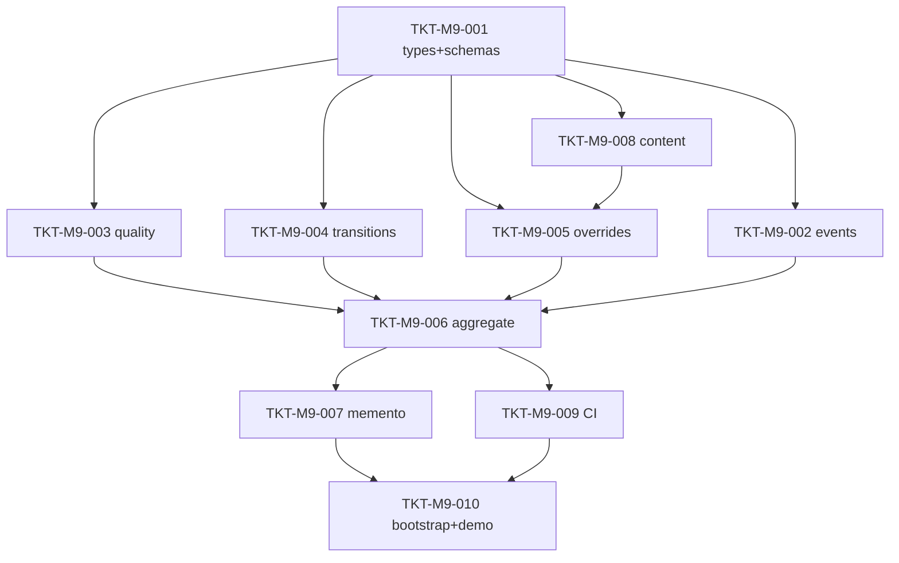

# TICKETS-M9 v1.0 — «Shader Pipeline & Quality Tiers»

**Тип документа:** Детализация тикетов вехи M9  
**Дата:** 2026-11-14  
**Статус:** ⏳ запланировано — реализация не начата  
**Веха:** M9 (Wave 1 — Presentation skeleton)  
**Покрывает:** `DEV-SPEC-011`  
**Тикетов:** 10  
**Демо вехи:** `bun run demo:m9` — загрузка visual-пакета → `setTier('low')` → 20 тактов без переходов → `cataclysm.triggered` → интерполяция перехода → save/load → повторный прогон даёт идентичный `VisualStateInstance`.

---

## 1. Состав вехи

| ID | Название | DEV-SPEC-011 | Размер |
|---|---|---|---|
| `TKT-M9-001` | Visual content-типы, 8 схем и registry mapping | §5.1, §6, §12 | M |
| `TKT-M9-002` | Событийное ядро visual.* (17 событий) | §4, §6.3 | S |
| `TKT-M9-003` | ShaderQualityController | §5.2, §7.1 | M |
| `TKT-M9-004` | TransitionInterpolator | §5.2, §7.2 | M |
| `TKT-M9-005` | VisualOverrideManager и мосты cataclysm | §5.2, §7.2 | M |
| `TKT-M9-006` | VisualStateAggregate и такт visual-scope | §5.2, §7.3–7.5 | M |
| `TKT-M9-007` | VisualStateMementoProvider | §7.5, §10 | S |
| `TKT-M9-008` | Контент visual-среза и доктрины фракций | §5.1, §5.3 | M |
| `TKT-M9-009` | CI: graph/lint/determinism visual | §11, §14 | M |
| `TKT-M9-010` | DI, bootstrap и demo:m9 | §8, §18 | M |

---

## 2. Порядок выполнения

**Параллелизация:** T001 — корень; T003/T004/T005/T008 независимы после типов; T006 — точка схода; T010 требует T006–T009.

---

## 3. Тикеты

### TKT-M9-001 — Visual content-типы, 8 схем и registry mapping

**DEV-SPEC:** DEV-SPEC-011 §5.1, §6, §12  
**Требования:** R01, R05  
**AC:** AC01, AC09  
**Размер:** M  
**Статус:** ⏳ не начато  
**Зависит от:** Wave 1 M8 (SceneManager)  
**Блокирует:** TKT-M9-002, TKT-M9-003, TKT-M9-004, TKT-M9-005, TKT-M9-008

**Что сделать:**
- Описать TS-контракты §5.1: `StylizationProfileDefinition`, `ShaderQualityTierDefinition`, `FactionVisualDoctrineDefinition`, `MaterialDefinition`, `ShaderGraphDefinition`, `GlobalPostProcessProfileDefinition`, `LocalShaderOverrideDefinition`, `ShaderTransitionPolicyDefinition`.
- Добавить 8 JSON-схем в `content/schemas/` (`additionalProperties: false`, enum-ы, kebab-case ID).
- Расширить `schemaNameForKind` и зарегистрировать пакет `visual-core` в `content/packs.json`.

**Acceptance Criteria:**
- `DEV-SPEC-011-AC01`: `tier=low` даёт ровно `base_color,normal,emission` в `enabled_passes`.
- `DEV-SPEC-011-AC09`: `shader_graph_id` на отсутствующий граф даёт graph issue.

**Definition of Done:**
- [ ] типы, схемы и mapping добавлены; [ ] schema-тесты валид/невалид; [ ] `t:type`/`t:test` зелёные; [ ] PR смержен.

---

### TKT-M9-002 — Событийное ядро visual.* (17 событий)

**DEV-SPEC:** DEV-SPEC-011 §4, §6.3  
**Требования:** R01, R06  
**AC:** AC02, AC11  
**Размер:** S  
**Статус:** ⏳ не начато  
**Зависит от:** TKT-M9-001  
**Блокирует:** TKT-M9-003, TKT-M9-005, TKT-M9-006

**Что сделать:**
- Зарегистрировать 17 core-событий visual-scope: `visual.quality_tier_changed`, `visual.transition_started`, `visual.transition_completed`, `visual.cataclysm_visual_manifested`, `visual.local_override_activated`/`_deactivated`, `visual.post_process_changed` и остальные по §4.1.
- Добавить payload-типы и JSON-схемы событий; связать с `IEventRegistry`.
- Проверить delivery policy для каждого события (Immediate/NextTick/AfterScene).

**Acceptance Criteria:**
- `DEV-SPEC-011-AC02`: двойное переключение tier не даёт duplicate-событий.
- `DEV-SPEC-011-AC11`: события не ломают детерминизм 100 тактов.

**Definition of Done:**
- [ ] события и схемы зарегистрированы; [ ] contract-тест payload-ов; [ ] `ci:validate --stage=events` зелёный; [ ] PR смержен.

---

### TKT-M9-003 — ShaderQualityController

**DEV-SPEC:** DEV-SPEC-011 §5.2, §7.1  
**Требования:** R01  
**AC:** AC01, AC02  
**Размер:** M  
**Статус:** ⏳ не начато  
**Зависит от:** TKT-M9-001, TKT-M9-002  
**Блокирует:** TKT-M9-006

**Что сделать:**
- Реализовать `ShaderQualityController`: применение `ShaderQualityTierDefinition` к material/shader pass-ам, `setTier`, `enabledPasses`.
- Подписка на `visual.quality_tier_changed`; идемпотентность при повторной установке того же tier.
- Адаптер применения passes к Babylon (материалы/пост-процесс) с Null-адаптером для тестов.

**Acceptance Criteria:**
- `DEV-SPEC-011-AC01`: `tier=low` включает ровно `base_color,normal,emission`.
- `DEV-SPEC-011-AC02`: повторное переключение не эмитит дубликат.

**Definition of Done:**
- [ ] контроллер и адаптер добавлены; [ ] unit-тесты переключений; [ ] `t:test` зелёный; [ ] PR смержен.

---

### TKT-M9-004 — TransitionInterpolator

**DEV-SPEC:** DEV-SPEC-011 §5.2, §7.2  
**Требования:** R02  
**AC:** AC03, AC04  
**Размер:** M  
**Статус:** ⏳ не начато  
**Зависит от:** TKT-M9-001, TKT-M9-002  
**Блокирует:** TKT-M9-006

**Что сделать:**
- Реализовать `TransitionInterpolator`: `startTransition(policy, from, to)`, `update(progress)`, `complete`.
- Интерполяция параметров по данным `ShaderTransitionPolicyDefinition` (цвет, туман, искажение), progress ∈ [0,1].
- Эмитить `visual.transition_started` / `visual.transition_completed` ровно один раз.

**Acceptance Criteria:**
- `DEV-SPEC-011-AC03`: `update(0.5)` даёт midpoint между значениями.
- `DEV-SPEC-011-AC04`: `transition_completed` эмитится на progress=1.

**Definition of Done:**
- [ ] интерполятор реализован; [ ] unit-тесты midpoint/completion; [ ] `t:test` зелёный; [ ] PR смержен.

---

### TKT-M9-005 — VisualOverrideManager и мосты cataclysm

**DEV-SPEC:** DEV-SPEC-011 §5.2, §7.2  
**Требования:** R03  
**AC:** AC05, AC06, AC07  
**Размер:** M  
**Статус:** ⏳ не начато  
**Зависит от:** TKT-M9-001, TKT-M9-002, TKT-M9-008  
**Блокирует:** TKT-M9-006

**Что сделать:**
- Реализовать `VisualOverrideManager`: `activate(overrideId, intensity)`, `deactivate`, `activeOverrides`.
- Подписки: `cataclysm.triggered` → `visual.cataclysm_visual_manifested`; `cataclysm.effect_applied` с `target_filter_tags` → `visual.local_override_activated`; `cataclysm.ended` → деактивация.
- Ограничить количество активных override по quality tier (binding из 016).

**Acceptance Criteria:**
- `DEV-SPEC-011-AC05`: cataclysm.triggered порождает manifested-событие.
- `DEV-SPEC-011-AC06`: фильтр-теги управляют активацией.
- `DEV-SPEC-011-AC07`: cataclysm.ended деактивирует override.

**Definition of Done:**
- [ ] менеджер и мосты добавлены; [ ] integration-тест с recording bus; [ ] `t:test` зелёный; [ ] PR смержен.

---

### TKT-M9-006 — VisualStateAggregate и такт visual-scope

**DEV-SPEC:** DEV-SPEC-011 §5.2, §7.3–7.5  
**Требования:** R06  
**AC:** AC11  
**Размер:** M  
**Статус:** ⏳ не начато  
**Зависит от:** TKT-M9-003, TKT-M9-004, TKT-M9-005  
**Блокирует:** TKT-M9-007, TKT-M9-009

**Что сделать:**
- Реализовать `VisualStateAggregate`: активные переходы/override, `onWorldTick` (порядок фаз §7.4), `snapshot()`.
- Обеспечить детерминизм: без `Date.now`/`Math.random`, порядок обработки стабилен.
- Валидировать состояние по `VisualStateInstance`-схеме перед сохранением.

**Acceptance Criteria:**
- `DEV-SPEC-011-AC11`: 100 тактов с fixed seed → два прогона дают идентичный `VisualStateInstance`.

**Definition of Done:**
- [ ] агрегат и tick-контракт реализованы; [ ] determinism-тест; [ ] `t:test` зелёный; [ ] PR смержен.

---

### TKT-M9-007 — VisualStateMementoProvider

**DEV-SPEC:** DEV-SPEC-011 §7.5, §10  
**Требования:** R04  
**AC:** AC08  
**Размер:** S  
**Статус:** ⏳ не начато  
**Зависит от:** TKT-M9-006  
**Блокирует:** TKT-M9-010

**Что сделать:**
- Добавить `VisualStateMementoProvider` (`domainId: 'visual'`): `serialize`/`restore`, регистрация в `SaveLoad`.
- Валидировать снимок схемой; восстанавливать активные переходы/override.
- Тест roundtrip: `serialize → restore → serialize` идентичен.

**Acceptance Criteria:**
- `DEV-SPEC-011-AC08`: roundtrip даёт `identical: JSON`.

**Definition of Done:**
- [ ] провайдер зарегистрирован; [ ] contract-тест roundtrip; [ ] `t:test` зелёный; [ ] PR смержен.

---

### TKT-M9-008 — Контент visual-среза и доктрины фракций

**DEV-SPEC:** DEV-SPEC-011 §5.1, §5.3  
**Требования:** R01, R05  
**AC:** AC01, AC10  
**Размер:** M  
**Статус:** ⏳ не начато  
**Зависит от:** TKT-M9-001  
**Блокирует:** TKT-M9-005, TKT-M9-010

**Что сделать:**
- Добавить `content/visual/{doctrines,materials,shader-graphs,post-process,shader-overrides,transitions}.json`.
- Минимум: 3 quality tier, 4 фракционные доктрины (по одной на фракцию), 6 материалов/графов, 4 перехода.
- Локализационные ключи en/ru для `display_name_key`.

**Acceptance Criteria:**
- `DEV-SPEC-011-AC01`: tier `low` покрывает пассы из схемы.
- `DEV-SPEC-011-AC10`: доктрина без unique technique → lint error (проверяется в T009).

**Definition of Done:**
- [ ] контент-пакеты добавлены; [ ] schema-валидация зелёная; [ ] PR смержен.

---

### TKT-M9-009 — CI: graph/lint/determinism visual

**DEV-SPEC:** DEV-SPEC-011 §11, §14  
**Требования:** R05, R06  
**AC:** AC09, AC10, AC11  
**Размер:** M  
**Статус:** ⏳ не начато  
**Зависит от:** TKT-M9-008  
**Блокирует:** TKT-M9-010

**Что сделать:**
- Добавить graph-правила: `shader_graph_id`, `material_policy_id`, `unique_shader_technique_ids`, `unique_vfx_system_ids` должны резолвиться.
- Добавить gameplay-lint: доктрина обязана иметь ≥1 unique technique и ≥1 unique VFX.
- Добавить determinism-сценарий visual (100 тактов, fixed seed) и fixture RNG-потоков visual.

**Acceptance Criteria:**
- `DEV-SPEC-011-AC09`: битая ссылка на граф → graph issue.
- `DEV-SPEC-011-AC10`: доктрина без unique technique → lint error.
- `DEV-SPEC-011-AC11`: два прогона идентичны.

**Definition of Done:**
- [ ] правила и fixture добавлены; [ ] `ci:validate` зелёный; [ ] PR смержен.

---

### TKT-M9-010 — DI, bootstrap и demo:m9

**DEV-SPEC:** DEV-SPEC-011 §8, §18  
**Требования:** R01–R06  
**AC:** AC01–AC11  
**Размер:** M  
**Статус:** ⏳ не начато  
**Зависит от:** TKT-M9-006, TKT-M9-007, TKT-M9-009  
**Блокирует:** DEV-SPEC-012, DEV-SPEC-016

**Что сделать:**
- Зарегистрировать сервисы visual-scope в `GameContainer` и подключить к `GameBootstrap` после сцен/контента.
- Добавить `scripts/demo-m9.ts` и `demo:m9` в `package.json` по сценарию шапки.
- Проверить, что visual-код не импортирует Babylon напрямую из domain-слоя.

**Acceptance Criteria:**
- `DEV-SPEC-011-AC01`–`AC11`: демо проходит, состояние визуала сохраняется/восстанавливается.

**Definition of Done:**
- [ ] DI/демо работают; [ ] `bun run demo:m9` зелёный; [ ] `t:check` и `ci:validate` зелёные; [ ] PR смержен.

---

## 4. Definition of Done для вехи

- [ ] все 10 тикетов смержены в `main`;
- [ ] `t:check` и `ci:validate` зелёные;
- [ ] `bun run demo:m9` воспроизводится;
- [ ] все AC `DEV-SPEC-011` покрыты тестами.

## 5. Что разблокирует M9

`DEV-SPEC-012` (VFX), `DEV-SPEC-016` (mobile budget), `DEV-SPEC-039` (vertical slice).

## 6. Риски и заметки

- Babylon-материалы нельзя тестировать в CI без Null-адаптера — держать применениe passes за портом.
- События visual не должны влиять на доменное состояние: только presentation-слой.
