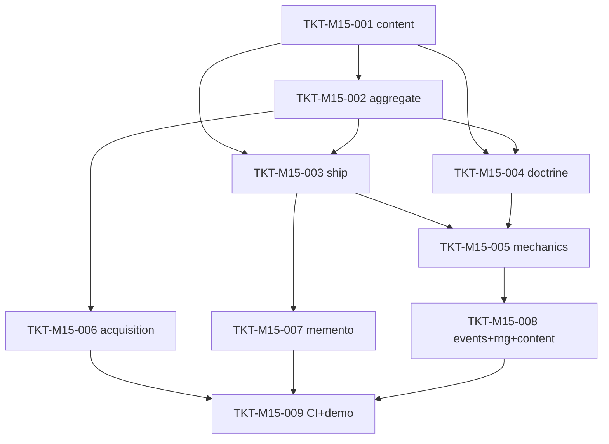

# TICKETS-M15 v1.0 — «Ship & Fleet Domain»

**Тип документа:** Детализация тикетов вехи M15  
**Дата:** 2026-11-14  
**Статус:** ✅ реализовано (2026-11-16) — Ship & Fleet Domain  
**Веха:** M15 (Wave 2 — First domain: Fleet)  
**Покрывает:** `DEV-SPEC-017`  
**Тикетов:** 9  
**Демо вехи:** `bun run demo:m15` — 4 фракции и 32 корабля из контента → смена класса корабля → status applied/removed → фаза доктрины >1 → acquisition signature-корабля → save/load → идентичное продолжение 100 тактов.

---

## 1. Состав вехи

| ID | Название | DEV-SPEC-017 | Размер |
|---|---|---|---|
| `TKT-M15-001` | Fleet content-типы, 7 схем и пакеты | §5.1, §6 | M |
| `TKT-M15-002` | FleetStateAggregate | §5.2 | M |
| `TKT-M15-003` | ShipRuntime: hp, слоты, статусы | §5.2, §7 | M |
| `TKT-M15-004` | DoctrineRuntime: фазы и binding | §5.2, §7.3 | M |
| `TKT-M15-005` | Механики fleet-scope (tick/status/doctrine) | §4, §7.1 | M |
| `TKT-M15-006` | AcquisitionResolver и signature-корабли | §5.2, §7.2 | M |
| `TKT-M15-007` | FleetStateMementoProvider | §10 | S |
| `TKT-M15-008` | События, RNG-потоки и контент-срез | §4, §9, §11 | M |
| `TKT-M15-009` | CI, интеграция и demo:m15 | §11, §12 | M |

---

## 2. Порядок выполнения

---

## 3. Тикеты

### TKT-M15-001 — Fleet content-типы, 7 схем и пакеты

**DEV-SPEC:** DEV-SPEC-017 §5.1, §6  
**Требования:** R01  
**AC:** AC01, AC02  
**Размер:** M  
**Статус:** ✅ выполнено  
**Зависит от:** Wave 0 (M1–M4)  
**Блокирует:** TKT-M15-002, TKT-M15-003, TKT-M15-004, TKT-M15-006

**Что сделать:**
- Описать TS-контракты §5.1: `FactionDefinition`, `DoctrineDefinition`, `ShipClassDefinition`, `FactionShipBranchDefinition`, `ShipInstance`, `StatusDefinition`, `AcquisitionRef`.
- Добавить 7 JSON-схем в `content/schemas/fleet/`: `faction`, `doctrine`, `ship-class`, `faction-ship-branch`, `ship-instance`, `status`, `acquisition-ref`.
- Зарегистрировать kinds и пакет `fleet-core`; проверить уникальность `mechanic_id`, `slot_layout`, `branch`-ссылок.

**Acceptance Criteria:**
- `DEV-SPEC-017-AC01`: загрузка даёт 4 фракции, 4 doctrine, 32 корабля (24 common + 8 signature).
- `DEV-SPEC-017-AC02`: у каждого signature-корабля ≥1 `facet_binding`.

**Definition of Done:**
- [ ] типы/схемы/пакет добавлены; [ ] schema-тесты; [ ] `t:test` зелёный; [ ] PR смержен.

---

### TKT-M15-002 — FleetStateAggregate

**DEV-SPEC:** DEV-SPEC-017 §5.2  
**Требования:** R03  
**AC:** AC05, AC06  
**Размер:** M  
**Статус:** ✅ выполнено  
**Зависит от:** TKT-M15-001  
**Блокирует:** TKT-M15-003, TKT-M15-004, TKT-M15-006

**Что сделать:**
- Реализовать `FleetStateAggregate`: текущий корабль, док, ресурсы, статусы, активные tracker states.
- Инварианты: hp ∈ [0, max], destroyed-корабль не принимает урон, tracker state ↔ `mechanic_ids`.
- Публиковать `ship.*` только через команды агрегата, без прямых мутаций извне.

**Acceptance Criteria:**
- `DEV-SPEC-017-AC05`: 100 тактов seeded RNG → детерминированный snapshot.
- `DEV-SPEC-017-AC06`: `ship_damaged` уменьшает hp и эмитит событие ровно один раз.

**Definition of Done:**
- [ ] агрегат реализован; [ ] unit-тесты инвариантов; [ ] `t:test` зелёный; [ ] PR смержен.

---

### TKT-M15-003 — ShipRuntime: hp, слоты, статусы

**DEV-SPEC:** DEV-SPEC-017 §5.2, §7  
**Требования:** R03  
**AC:** AC05, AC06  
**Размер:** M  
**Статус:** ✅ выполнено  
**Зависит от:** TKT-M15-002  
**Блокирует:** TKT-M15-005, TKT-M15-007

**Что сделать:**
- Реализовать `ShipRuntime`: `equipSlot`, `applyStatus`, `removeStatus`, `changeClass`, `dock`.
- Расчёт effective stats из класса + экипировки + статусов; события `ship.slot_equipped`, `ship.status_applied/removed`, `ship.class_changed`.
- Запретить экипировку в занятый/несовместимый слот без явной замены.

**Acceptance Criteria:**
- `DEV-SPEC-017-AC06`: урон и статусы не нарушают инварианты.
- `DEV-SPEC-017-AC05`: воспроизводимость операций в seeded-прогоне.

**Definition of Done:**
- [ ] runtime реализован; [ ] unit-тесты слотов/статусов; [ ] `t:test` зелёный; [ ] PR смержен.

---

### TKT-M15-004 — DoctrineRuntime: фазы и binding

**DEV-SPEC:** DEV-SPEC-017 §5.2, §7.3  
**Требования:** R04  
**AC:** AC07  
**Размер:** M  
**Статус:** ✅ выполнено  
**Зависит от:** TKT-M15-002  
**Блокирует:** TKT-M15-005, TKT-M15-008

**Что сделать:**
- Реализовать `DoctrineRuntime`: текущая фаза, threshold-переходы, `on_enter`-эффекты.
- Эмитить `doctrine.phase_changed` при входе в фазу >1; binding doctrine ↔ корабль/фракция.
- RNG-поток `rng.fleet.doctrine_phase` только для chance-based переходов.

**Acceptance Criteria:**
- `DEV-SPEC-017-AC07`: вход в фазу >1 по threshold → `doctrine.phase_changed` + on_enter события.

**Definition of Done:**
- [ ] runtime реализован; [ ] unit-тесты фаз; [ ] `t:test` зелёный; [ ] PR смержен.

---

### TKT-M15-005 — Механики fleet-scope (tick/status/doctrine)

**DEV-SPEC:** DEV-SPEC-017 §4, §7.1  
**Требования:** R02, R03  
**AC:** AC03, AC04, AC05  
**Размер:** M  
**Статус:** ✅ выполнено  
**Зависит от:** TKT-M15-003, TKT-M15-004  
**Блокирует:** TKT-M15-008

**Что сделать:**
- Добавить `MechanicDefinition` fleet-scope: `fleet-ship-status-tick`, `fleet-doctrine-phase`, `fleet-resource-regeneration`.
- Проверить границу resolver/tracker: resolver без `state_schema`, tracker с `state_schema` и `persisted: true`.
- Зарегистрировать механики в `content/mechanics/fleet.json` и общем `MechanicRegistry`.

**Acceptance Criteria:**
- `DEV-SPEC-017-AC03`: resolver без state_schema проходит.
- `DEV-SPEC-017-AC04`: tracker со state_schema и persisted работает.
- `DEV-SPEC-017-AC05`: тик детерминирован.

**Definition of Done:**
- [ ] механики добавлены; [ ] invariant-тесты 004; [ ] `ci:validate --stage=mechanics` зелёный; [ ] PR смержен.

---

### TKT-M15-006 — AcquisitionResolver и signature-корабли

**DEV-SPEC:** DEV-SPEC-017 §5.2, §7.2  
**Требования:** R05  
**AC:** AC08  
**Размер:** M  
**Статус:** ✅ выполнено  
**Зависит от:** TKT-M15-002  
**Блокирует:** TKT-M15-009, DEV-SPEC-019

**Что сделать:**
- Реализовать `AcquisitionResolver`: `world_event`, `quest_reward`, `port_service`, `faction_reputation` → unlock узла ветки.
- Эмитить `ship.branch_node_unlocked` / `ship.branch_ship_acquired`; не выдавать signature без выполнения условия.
- RNG-поток `rng.fleet.signature_ship_spawn` только для chance-based acquisition.

**Acceptance Criteria:**
- `DEV-SPEC-017-AC08`: world_event acquisition ref разблокирует signature-корабль в ветке.

**Definition of Done:**
- [ ] resolver реализован; [ ] integration-тест acquisition; [ ] `t:test` зелёный; [ ] PR смержен.

---

### TKT-M15-007 — FleetStateMementoProvider

**DEV-SPEC:** DEV-SPEC-017 §10  
**Требования:** R06  
**AC:** AC09  
**Размер:** S  
**Статус:** ✅ выполнено  
**Зависит от:** TKT-M15-003  
**Блокирует:** TKT-M15-009

**Что сделать:**
- Добавить `FleetStateMementoProvider` (`domainId: 'fleet'`): корабль, слоты, статусы, доктрина, tracker states.
- Валидировать снимок схемой `ship-instance`; восстановление без пересчёта прошедших тактов.
- Contract-тест: `serialize → restore → serialize` идентичен.

**Acceptance Criteria:**
- `DEV-SPEC-017-AC09`: roundtrip идентичен (JSON deep-equal).

**Definition of Done:**
- [ ] провайдер зарегистрирован; [ ] roundtrip-тест; [ ] `t:test` зелёный; [ ] PR смержен.

---

### TKT-M15-008 — События, RNG-потоки и контент-срез

**DEV-SPEC:** DEV-SPEC-017 §4, §9, §11  
**Требования:** R01, R03, R07  
**AC:** AC01, AC10, AC11  
**Размер:** M  
**Статус:** ✅ выполнено  
**Зависит от:** TKT-M15-005  
**Блокирует:** TKT-M15-009

**Что сделать:**
- Зарегистрировать 16 core-событий `ship.*`/`combat.*`/`doctrine.*` + фракционные namespace `industrial-steam.*` и др.
- Объявить RNG-потоки `rng.fleet.encounter_generation`, `rng.fleet.doctrine_phase`, `rng.fleet.signature_ship_spawn` в fixture.
- Добавить контент-срез: 4 фракции, 4 doctrine, 32 корабля, 8 signature-веток, 10 статусов.

**Acceptance Criteria:**
- `DEV-SPEC-017-AC01`: контент-срез валиден и полон.
- `DEV-SPEC-017-AC10`, `AC11`: битый slot_layout/duplicate mechanic_id ловятся CI.

**Definition of Done:**
- [ ] события/RNG/контент добавлены; [ ] `ci:validate --stage=events` и `rng-streams` зелёные; [ ] PR смержен.

---

### TKT-M15-009 — CI, интеграция и demo:m15

**DEV-SPEC:** DEV-SPEC-017 §11, §12  
**Требования:** R01–R07  
**AC:** AC01–AC11  
**Размер:** M  
**Статус:** ✅ выполнено  
**Зависит от:** TKT-M15-006, TKT-M15-007, TKT-M15-008  
**Блокирует:** DEV-SPEC-018, DEV-SPEC-019

**Что сделать:**
- Расширить `tools/ci/rules/domain/fleet.ts`: уникальность id, slot_layout, branch-ссылки, signature ≥1 facet_binding.
- Добавить integration-сценарий «борьба → dock → acquisition» и determinism 100 тактов.
- Добавить `scripts/demo-m15.ts` и `demo:m15`.

**Acceptance Criteria:**
- `DEV-SPEC-017-AC10`, `AC11`: CI ловит битые ссылки и дубликаты.
- `DEV-SPEC-017-AC01`–`AC09`: демо проходит.

**Definition of Done:**
- [ ] CI/демо добавлены; [ ] `demo:m15` и `ci:validate` зелёные; [ ] PR смержен.

---

## 4. Definition of Done для вехи

- [ ] все 9 тикетов смержены; [ ] `t:check`/`ci:validate` зелёные; [ ] `demo:m15` воспроизводится; [ ] все AC 017 покрыты.

## 5. Что разблокирует M15

`DEV-SPEC-018` (naval combat), `DEV-SPEC-019` (ветки), `DEV-SPEC-038/039` (integration).

## 6. Риски и заметки

- Контент 4 фракций × 32 корабля — объёмный; держать data-driven и не кодировать фракции в домене.
- Доктринальные фазы не должны зависеть от UI/сцены.
