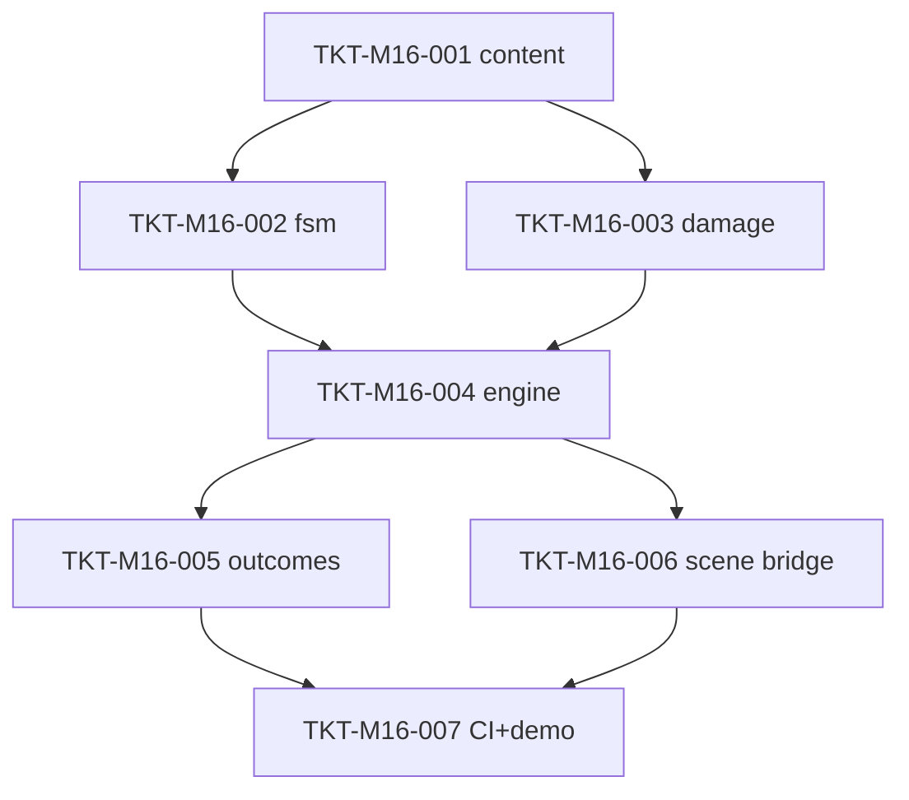

# TICKETS-M16 v1.0 — «Naval Combat Real-time»

**Тип документа:** Детализация тикетов вехи M16  
**Дата:** 2026-11-14  
**Статус:** ✅ реализовано (2026-11-16) — Naval Combat Real-time  
**Веха:** M16 (Wave 2 — First domain: Fleet)  
**Покрывает:** `DEV-SPEC-018`  
**Тикетов:** 7  
**Демо вехи:** `bun run demo:m16` — encounter approach → exchange → hit/damage → board_decision → outcome — 50 тактов, три исхода (win/lost/fled) воспроизводимы на фиксированных сценариях; журнал боя входит в snapshot.

---

## 1. Состав вехи

| ID | Название | DEV-SPEC-018 | Размер |
|---|---|---|---|
| `TKT-M16-001` | Combat content-типы, схемы и пакеты | §5, §6 | M |
| `TKT-M16-002` | EncounterStateMachine | §7.1 | M |
| `TKT-M16-003` | DamageCalculator и боевая математика | §7.2 | M |
| `TKT-M16-004` | CombatEngine: фазы, tick и журнал | §5, §7 | M |
| `TKT-M16-005` | Outcomes и `combat.encounter_resolved` | §4, §7 | M |
| `TKT-M16-006` | Мост с боевой сценой и адаптеры | §8 | S |
| `TKT-M16-007` | CI, determinism и demo:m16 | §11, §12 | M |

---

## 2. Порядок выполнения

---

## 3. Тикеты

### TKT-M16-001 — Combat content-типы, схемы и пакеты

**DEV-SPEC:** DEV-SPEC-018 §5, §6  
**Требования:** R01, R02  
**AC:** AC01, AC04  
**Размер:** M  
**Статус:** ✅ выполнено  
**Зависит от:** TKT-M15-001  
**Блокирует:** TKT-M16-002, TKT-M16-003

**Что сделать:**
- Описать `CombatDefinition`, `DuelDoctrineDefinition`, `CrewMemberDefinition`, `CombatInstance`, `CombatJournalEntry` (§5).
- Добавить схемы `combat-definition`, `duel-doctrine`, `crew-member`, `combat-instance`; минимум 5 механик на archetype (lint 018).
- Зарегистрировать пакет `combat-core`; сценарии 4 archetype-ов в `content/combat/`.

**Acceptance Criteria:**
- `DEV-SPEC-018-AC04`: `hit_landed` соответствует предрассчитанной формуле (проверка в T003).
- `DEV-SPEC-018-AC09`: archetype с < 5 механик → lint error.

**Definition of Done:**
- [ ] типы/схемы/контент добавлены; [ ] schema-тесты; [ ] `t:test` зелёный; [ ] PR смержен.

---

### TKT-M16-002 — EncounterStateMachine

**DEV-SPEC:** DEV-SPEC-018 §7.1  
**Требования:** R01  
**AC:** AC01, AC02, AC03  
**Размер:** M  
**Статус:** ✅ выполнено  
**Зависит от:** TKT-M16-001  
**Блокирует:** TKT-M16-004

**Что сделать:**
- Реализовать `EncounterStateMachine`: `approach → exchange → board_decision → resolved` (+ flee).
- Переход по расстоянию `< engage_range`; ветка `board` по решению; события `combat.phase_changed`.
- Не допускать недопустимых переходов (например, `resolved → exchange`) без нового encounter.

**Acceptance Criteria:**
- `DEV-SPEC-018-AC01`: ship vs enemy → `encounter_approach`.
- `DEV-SPEC-018-AC02`: расстояние < engage_range → `phase_changed(exchange)`.
- `DEV-SPEC-018-AC03`: `board_decision` → `outcome=board`.

**Definition of Done:**
- [ ] FSM реализована; [ ] unit-тесты переходов; [ ] `t:test` зелёный; [ ] PR смержен.

---

### TKT-M16-003 — DamageCalculator и боевая математика

**DEV-SPEC:** DEV-SPEC-018 §7.2  
**Требования:** R02  
**AC:** AC04, AC05  
**Размер:** M  
**Статус:** ✅ выполнено  
**Зависит от:** TKT-M16-001  
**Блокирует:** TKT-M16-004

**Что сделать:**
- Реализовать `DamageCalculator`: hit roll, variance, модификаторы статусов/доктрины/класса.
- Использовать изолированные потоки `rng.fleet.combat_resolution`, `combat_buffs`, `combat_flee`.
- Вернуть детерминированный результат с записью факторов в журнал.

**Acceptance Criteria:**
- `DEV-SPEC-018-AC04`: `hit_landed` равен предрассчитанной формуле.
- `DEV-SPEC-018-AC05`: buff-intensity влияет на damage.

**Definition of Done:**
- [ ] калькулятор реализован; [ ] unit-тесты формул; [ ] `t:test` зелёный; [ ] PR смержен.

---

### TKT-M16-004 — CombatEngine: фазы, tick и журнал

**DEV-SPEC:** DEV-SPEC-018 §5, §7  
**Требования:** R01, R02, R04  
**AC:** AC01, AC02, AC08  
**Размер:** M  
**Статус:** ✅ выполнено  
**Зависит от:** TKT-M16-002, TKT-M16-003  
**Блокирует:** TKT-M16-005, TKT-M16-006

**Что сделать:**
- Реализовать `CombatEngine`: tick-обработка encounter, движение/дистанция, вызов FSM и калькулятора.
- Журнал: все hit/applied события в порядке `(tick, seq)`, сериализуется в snapshot.
- Интеграция с механизмами 017: статусы и доктрина учитываются в бою.

**Acceptance Criteria:**
- `DEV-SPEC-018-AC08`: все hit/applied события попадают в журнал и snapshot.
- `DEV-SPEC-018-AC01`, `AC02`: фазы и переходы соблюдены.

**Definition of Done:**
- [ ] движок реализован; [ ] unit/integration-тесты; [ ] `t:test` зелёный; [ ] PR смержен.

---

### TKT-M16-005 — Outcomes и `combat.encounter_resolved`

**DEV-SPEC:** DEV-SPEC-018 §4, §7  
**Требования:** R03  
**AC:** AC06, AC07  
**Размер:** M  
**Статус:** ✅ выполнено  
**Зависит от:** TKT-M16-004  
**Блокирует:** TKT-M16-007

**Что сделать:**
- Реализовать разрешение encounter: `win|lost|fled|board`, публикация `combat.encounter_resolved`.
- Мост в `epilogue.fact_published` (Noop-порт до Wave 6); не блокировать исход отсутствием нарративного домена.
- Проверить достижимость всех трёх исходов на фиксированных 50-тактовых сценариях.

**Acceptance Criteria:**
- `DEV-SPEC-018-AC06`: win/lost/fled достижимы.
- `DEV-SPEC-018-AC07`: resolution → событие + факт эпилога.

**Definition of Done:**
- [ ] исходы реализованы; [ ] scenario-тесты; [ ] `t:test` зелёный; [ ] PR смержен.

---

### TKT-M16-006 — Мост с боевой сценой и адаптеры

**DEV-SPEC:** DEV-SPEC-018 §8  
**Требования:** R01, R04  
**AC:** AC01, AC08  
**Размер:** S  
**Статус:** ✅ выполнено  
**Зависит от:** TKT-M16-004  
**Блокирует:** TKT-M16-007

**Что сделать:**
- Добавить адаптер боевой сцены (010): `combat.encounter_started` → загрузка сцены с `SceneParams`.
- Синхронизировать визуальное состояние кораблей без хранения доменного состояния в сцене.
- Null-адаптер для CI.

**Acceptance Criteria:**
- `DEV-SPEC-018-AC01`: старт encounter открывает боевую сцену.
- `DEV-SPEC-018-AC08`: журнал доступен presentation-слою без мутаций.

**Definition of Done:**
- [ ] адаптер добавлен; [ ] smoke-тест; [ ] `t:type` зелёный; [ ] PR смержен.

---

### TKT-M16-007 — CI, determinism и demo:m16

**DEV-SPEC:** DEV-SPEC-018 §11, §12  
**Требования:** R01–R05  
**AC:** AC01–AC10  
**Размер:** M  
**Статус:** ✅ выполнено  
**Зависит от:** TKT-M16-005, TKT-M16-006  
**Блокирует:** DEV-SPEC-029, DEV-SPEC-038

**Что сделать:**
- Добавить CI-правила combat: ≥5 механик на archetype, graph-ссылки на ship-class/events.
- Determinism-сценарий: 50 тактов × 3 исхода, replay после restore идентичен.
- Добавить `scripts/demo-m16.ts` и `demo:m16`.

**Acceptance Criteria:**
- `DEV-SPEC-018-AC09`, `AC10`: CI ловит нарушения.
- `DEV-SPEC-018-AC06`, `AC07`: демо воспроизводит исходы.

**Definition of Done:**
- [ ] CI/демо добавлены; [ ] `demo:m16` и `ci:validate` зелёные; [ ] PR смержен.

---

## 4. Definition of Done для вехи

- [ ] все 7 тикетов смержены; [ ] `t:check`/`ci:validate` зелёные; [ ] `demo:m16` воспроизводится; [ ] все AC 018 покрыты.

## 5. Что разблокирует M16

`DEV-SPEC-029` (бой отряда на фоне дуэли), `DEV-SPEC-038` (integration).

## 6. Риски и заметки

- Боевая математика должна быть чистой функцией от состояния + RNG, иначе replay сломается.
- Мост в эпос — через порт, без прямой зависимости domain от narrative.
