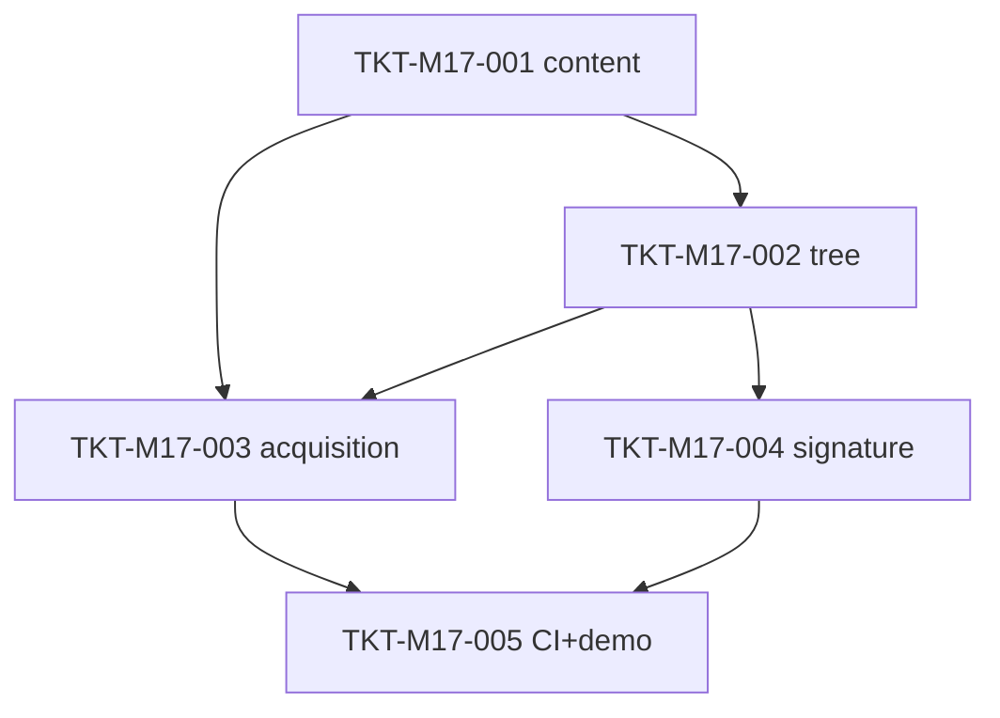

# TICKETS-M17 v1.0 — «Doctrine & Branch Unlock»

**Тип документа:** Детализация тикетов вехи M17  
**Дата:** 2026-11-14  
**Статус:** ✅ реализовано (2026-11-16) — Doctrine & Branch Unlock  
**Веха:** M17 (Wave 2 — First domain: Fleet)  
**Покрывает:** `DEV-SPEC-019`  
**Тикетов:** 5  
**Демо вехи:** `bun run demo:m17` — ветка faction-ship DAG → unlock tier 1 → попытка tier 2 без tier 1 отклонена → unlock через quest_reward → signature-механика активна → save/load ветки идентичен.

---

## 1. Состав вехи

| ID | Название | DEV-SPEC-019 | Размер |
|---|---|---|---|
| `TKT-M17-001` | Branch content-типы, схемы и пакеты | §5, §6 | M |
| `TKT-M17-002` | BranchTreeRuntime: DAG и unlock | §5, §7 | M |
| `TKT-M17-003` | AcquisitionResolver: пути получения | §5, §7 | M |
| `TKT-M17-004` | Signature-механики и события ветки | §4, §7 | S |
| `TKT-M17-005` | CI, memento и demo:m17 | §10, §11 | M |

---

## 2. Порядок выполнения

---

## 3. Тикеты

### TKT-M17-001 — Branch content-типы, схемы и пакеты

**DEV-SPEC:** DEV-SPEC-019 §5, §6  
**Требования:** R01, R02  
**AC:** AC01, AC04  
**Размер:** M  
**Статус:** ✅ выполнено  
**Зависит от:** TKT-M15-001  
**Блокирует:** TKT-M17-002, TKT-M17-003

**Что сделать:**
- Описать `BranchNodeDefinition`, `BranchTreeDefinition`, `UnlockCondition`, `AcquisitionPathway` (§5).
- Добавить схемы `branch-tree`, `branch-node`, `unlock-condition`; `tier`, `requires`, `acquisition` — обязательные поля.
- Зарегистрировать пакет `fleet-branches`; контент `content/fleet/branches/*.json` для 4 фракций.

**Acceptance Criteria:**
- `DEV-SPEC-019-AC01`: tier 2 требует tier 1 unlocked.
- `DEV-SPEC-019-AC08`: цикл в DAG → lint error (проверка в T005).

**Definition of Done:**
- [ ] типы/схемы/контент добавлены; [ ] schema-тесты; [ ] `t:test` зелёный; [ ] PR смержен.

---

### TKT-M17-002 — BranchTreeRuntime: DAG и unlock

**DEV-SPEC:** DEV-SPEC-019 §5, §7  
**Требования:** R01  
**AC:** AC01, AC02, AC03  
**Размер:** M  
**Статус:** ✅ выполнено  
**Зависит от:** TKT-M17-001  
**Блокирует:** TKT-M17-003, TKT-M17-004

**Что сделать:**
- Реализовать `BranchTreeRuntime`: загрузка DAG, `canUnlock`, `unlock`, `unlockedNodes`, `availableNodes`.
- Отклонять unlock при невыполненных prerequisite; O(n) проверка (n ≤ 12 на ветку).
- Эмитить `ship.branch_node_unlocked` и `ship.branch_ship_acquired`; идемпотентность повторного unlock.

**Acceptance Criteria:**
- `DEV-SPEC-019-AC01`: tier 2 недоступен без tier 1.
- `DEV-SPEC-019-AC02`: reject без доступа к низшему узлу.
- `DEV-SPEC-019-AC03`: unlock эмитит события.

**Definition of Done:**
- [ ] runtime реализован; [ ] unit-тесты DAG; [ ] `t:test` зелёный; [ ] PR смержен.

---

### TKT-M17-003 — AcquisitionResolver: пути получения

**DEV-SPEC:** DEV-SPEC-019 §5, §7  
**Требования:** R02  
**AC:** AC04, AC05, AC06  
**Размер:** M  
**Статус:** ✅ выполнено  
**Зависит от:** TKT-M17-001, TKT-M17-002  
**Блокирует:** TKT-M17-005

**Что сделать:**
- Реализовать `AcquisitionResolver`: `port_service`, `world_event`, `quest_reward`, `faction_reputation`.
- `port_service` проводит экономическую транзакцию через порт (stub до Wave 3), не напрямую.
- RNG-поток `rng.fleet.branch_unlock` только для chance-based условий.

**Acceptance Criteria:**
- `DEV-SPEC-019-AC04`: port_service требует экономическую транзакцию.
- `DEV-SPEC-019-AC05`: world_event разблокирует signature.
- `DEV-SPEC-019-AC06`: quest_reward разблокирует узел.

**Definition of Done:**
- [ ] resolver реализован; [ ] integration-тесты путей; [ ] `t:test` зелёный; [ ] PR смержен.

---

### TKT-M17-004 — Signature-механики и события ветки

**DEV-SPEC:** DEV-SPEC-019 §4, §7  
**Требования:** R03  
**AC:** AC07  
**Размер:** S  
**Статус:** ✅ выполнено  
**Зависит от:** TKT-M17-002  
**Блокирует:** TKT-M17-005

**Что сделать:**
- Подключить signature-механики корабля к `FleetStateAggregate` (017) как tracker state.
- Зарегистрировать события ветки/доктрины, проверить отсутствие коллизий с core namespace.
- Запретить активацию signature-механики без acquired-узла.

**Acceptance Criteria:**
- `DEV-SPEC-019-AC07`: signature-корабль создаёт unique mechanic + tracker state во fleet.

**Definition of Done:**
- [ ] механики подключены; [ ] integration-тест signature; [ ] `t:test` зелёный; [ ] PR смержен.

---

### TKT-M17-005 — CI, memento и demo:m17

**DEV-SPEC:** DEV-SPEC-019 §10, §11  
**Требования:** R01–R04  
**AC:** AC01–AC09  
**Размер:** M  
**Статус:** ✅ выполнено  
**Зависит от:** TKT-M17-003, TKT-M17-004  
**Блокирует:** DEV-SPEC-033

**Что сделать:**
- Добавить memento ветки (`domainId: 'fleet_branch'`): unlocked nodes, acquisition evidence.
- CI-правила: цикл в DAG, отсутствующий `ship_class_id`, duplicate node ID, недоступный `acquisition` ref.
- Добавить `scripts/demo-m17.ts` и `demo:m17`.

**Acceptance Criteria:**
- `DEV-SPEC-019-AC08`, `AC09`: CI ловит цикл и битую ссылку.
- `DEV-SPEC-019-AC01`–`AC07`: демо проходит.

**Definition of Done:**
- [ ] memento/CI/демо добавлены; [ ] `demo:m17` и `ci:validate` зелёные; [ ] PR смержен.

---

## 4. Definition of Done для вехи

- [ ] все 5 тикетов смержены; [ ] `t:check`/`ci:validate` зелёные; [ ] `demo:m17` воспроизводится; [ ] все AC 019 покрыты.

## 5. Что разблокирует M17

`DEV-SPEC-033` (скрытые ветки трансформации), `DEV-SPEC-039` (vertical slice).

## 6. Риски и заметки

- Экономическая транзакция за портом, иначе Wave 3 создаст циклическую зависимость.
- Ветки — данные; новая фракция не должна требовать правок кода.
