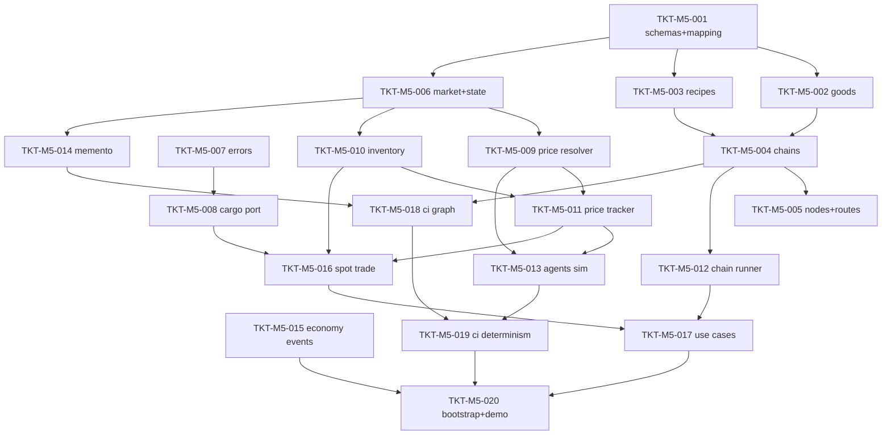

# TICKETS-M5 v1.0 — «Market & Trade Core»

**Тип документа:** Детализация тикетов вехи M5  
**Дата:** 2026-11-03  
**Статус:** draft  
**Веха:** M5 (первый блок Wave 3 — Economy core)  
**Покрывает:** `DEV-SPEC-020` (SPEC-ECON-001…022 в части Market + Trade-фундамент, 050…066, 080…093 в части ядра, 100…103, 110…120)  
**Тикетов:** 20  
**Демо вехи:** `bun run demo:m5` — bootstrap с экономическим пакетом → 4 узла, 3 цепочки → 10 тактов экономики (симуляция агентов + производство) → спот-сделка игрока → save/load → идентичное продолжение; `bun run ci:validate` зелёный с расширенными стадиями.

---

## 1. Состав вехи

| ID | Название | DEV-SPEC-020 | Размер |
|---|---|---|---|
| `TKT-M5-001` | Registry mapping + 7 схем экономики | §4.2, §6.2 | M |
| `TKT-M5-002` | GoodDefinition (TS) + контент goods | §5.1 | S |
| `TKT-M5-003` | RecipeDefinition (TS) + контент recipes | §5.2 | S |
| `TKT-M5-004` | ProductionChainDefinition + graph-инварианты | §5.3 | M |
| `TKT-M5-005` | TradeNode/TradeRoute + контент узлов и рёбер среза | §5.4 | M |
| `TKT-M5-006` | MarketDefinition + MarketState (TS) | §5.5, §5.6 | M |
| `TKT-M5-007` | EconomyErrors + IntCode (Result) | §8.3 | XS |
| `TKT-M5-008` | ICargoCapacityPort + NullCargoCapacityPort | §5.8 | S |
| `TKT-M5-009` | PricePolicyResolver (клэмпы/насыщение/издержки) | §5.5, §7.2 | M |
| `TKT-M5-010` | InventoryOps: резервы + INV-09/10 | §5.6 | M |
| `TKT-M5-011` | Механика economy-market-price-tracker (plugin) | §6.1 | M |
| `TKT-M5-012` | Механика economy-production-chain-runner | §6.1, §7.5 | M |
| `TKT-M5-013` | Механика economy-trade-agents-sim | §6.1, §7.3 | L |
| `TKT-M5-014` | MarketStateMementoProvider + регистрация | §8.2 | S |
| `TKT-M5-015` | Событийное ядро economy.* (25 events) | §6.4, §9 | S |
| `TKT-M5-016` | ITradeService + ExecuteSpotTrade | §5.7, §7.2 | M |
| `TKT-M5-017` | Use cases: GetTradeOffers / GetMarketPrices / RunProductionChain / AcceptSupplyContract | §9.4 | M |
| `TKT-M5-018` | CI: расширение стадии graph (economy) | §12.6 | M |
| `TKT-M5-019` | CI: determinism-сценарий экономики + rng-streams fixture | §12.4, §12.6 | M |
| `TKT-M5-020` | Bootstrap экономики + демо demo:m5 | §16 | M |

---

## 2. Порядок выполнения

**Параллелизация:**
- Ветка схем/контента: T001→T002/T003→T004→T005.
- Ветка домена: T006→T009/T010→T011→T013; T004→T012.
- T007 (ошибки) — XS, независим, тянет только 001.
- Точка схода — T020 (bootstrap+демо), требует T015–T019.

---

## 3. Тикеты

### TKT-M5-001 — Registry mapping + 7 схем экономики

**DEV-SPEC:** DEV-SPEC-020 §4.2, §6.2  
**Требования:** R01  
**AC:** AC01, AC02  
**Размер:** M  
**Зависит от:** Wave 0 (M2/M4 registry + CI).  
**Блокирует:** TKT-M5-002…006

**Что сделать:**
- Расширить `schemaNameForKind` в `src/infrastructure/content/JsonContentRegistry.ts`: `good→good-definition`, `recipe→recipe-definition`, `productionChain→production-chain-definition`, `tradeNode→trade-node-definition`, `tradeRoute→trade-route-definition`, `market→market-definition`.
- Добавить 6 схем в `content/schemas/` по §6.2 (`additionalProperties: false`, enum-ы, kebab-case ID).
- Добавить `content/schemas/market-state.json` (снимок: числа ≥ 0, `reserved ≤ quantity` через `if/then`).
- Зарегистрировать файлы экономических kinds в `content/packs.json` (пакет `economy-core`).

**Acceptance Criteria:**
- `DEV-SPEC-020-AC01`: валидный good → `Ok` при `loadAll()`.
- `DEV-SPEC-020-AC02`: лишнее поле → `Err(INFRA_SCHEMA_INVALID)`.

**Definition of Done:**
- [ ] маппинг расширен; - [ ] схемы добавлены; - [ ] unit-тесты валид/невалид; - [ ] `bun run t:type` и `t:test` зелёные; - [ ] `ci:validate` зелёный.

---

### TKT-M5-002 — GoodDefinition (TS) + контент goods

**DEV-SPEC:** DEV-SPEC-020 §5.1  
**Требования:** R01  
**AC:** AC01  
**Размер:** S  
**Зависит от:** TKT-M5-001  
**Блокирует:** TKT-M5-003, TKT-M5-004

**Что сделать:**
- Тип `GoodId` (branded), `GoodTier`, `GoodOrigin`, `GoodTag`, `GoodDefinition` — `src/domain/economy/GoodDefinition.ts`.
- Инвариант `ECON-INV-02` (нет чисел в товаре) — типовым запретом полей.
- Контент: срез ≥ 12 товаров (≥ 3 на фракцию, обе оси покрыты, ≥ 1 `hybrid`, ≥ 1 `contraband`, дубли `display_name_key` — нет).

**Definition of Done:**
- [ ] типы + контент; - [ ] unit-тесты таксономии; - [ ] CI зелёный.

---

### TKT-M5-003 — RecipeDefinition (TS) + контент recipes

**DEV-SPEC:** DEV-SPEC-020 §5.2  
**Требования:** R01, R04  
**AC:** AC01  
**Размер:** S  
**Зависит от:** TKT-M5-002  
**Блокирует:** TKT-M5-004

**Что сделать:**
- `RecipeDefinition`, `RecipeInputOutput`, `RecipeKind` — `src/domain/economy/RecipeDefinition.ts`.
- Инвариант `ECON-INV-03` (conversion требует loss+risk и разные origin) — проверкой в CI graph (низ задачи на схеме if/then).
- Контент: ≥ 8 рецептов, из них ≥ 1 `refinement`, ≥ 1 `conversion` Наука ↔ Магия (перечень среза SPEC-ECON-111).

**Definition of Done:**
- [ ] тип + контент; - [ ] схема покрывает if/then; - [ ] CI зелёный.

---

### TKT-M5-004 — ProductionChainDefinition + graph-инварианты

**DEV-SPEC:** DEV-SPEC-020 §5.3  
**Требования:** R04  
**AC:** AC07, AC08  
**Размер:** M  
**Зависит от:** TKT-M5-003  
**Блокирует:** TKT-M5-005, TKT-M5-012, TKT-M5-018

**Что сделать:**
- `ProductionChainDefinition` — `src/domain/economy/ProductionChainDefinition.ts`.
- Локальная утилита БД-графа (topo-sort detection) либо зависимости на `tools/ci/stages/validate-graph.ts` — ацикличность и связность подграфа рецептов.
- Контент среза: 3 цепочки (industrial-steam — научная, ancient-arcane — магическая, 1 гибрид/конверсионная) — своего `faction_tags/origin_tags/entry/exit`.
- Инвариант `ECON-INV-06` (рецепты принадлежат ровно одной chain) — CI-проверкой.

**Acceptance Criteria:**
- `DEV-SPEC-020-AC07`: ссылка на несуществующий good → graph ошибка.
- `DEV-SPEC-020-AC08`: узел с < 2 рёбрами → graph ошибка (после TKT-M5-005).

**Definition of Done:**
- [ ] тип + контент; - [ ] graph проверка: ациклична/связна/входы/выходы; - [ ] unit-тесты (цикл → Err); - [ ] CI зелёный.

---

### TKT-M5-005 — TradeNode/TradeRoute + контент узлов и рёбер среза

**DEV-SPEC:** DEV-SPEC-020 §5.4  
**Требования:** R04  
**AC:** AC08  
**Размер:** M  
**Зависит от:** TKT-M5-004  
**Блокирует:** TKT-M5-006, TKT-M5-013

**Что сделать:**
- `TradeNodeDefinition`, `TradeRouteDefinition` — `src/domain/economy/TradeNodeDefinition.ts`.
- Контент среза: 4 узла (по одному на фракцию) из SPEC-ECON-110 + 12 узлов полного скелета Wave 3 (doже контент, не самоцель); каждый узел связан ≥ 2 рёбрами; граф связен.
- Рёбра: ≥ 6 маршрутов, политики distance/risk/blockTags/legality — заполнены ссылками на политики.

**Definition of Done:**
- [ ] типы + контент; - [ ] INV-07 (узел без инвентаря/цен) типовым запретом; - [ ] CI graph зелёный.

---

### TKT-M5-006 — MarketDefinition + MarketState (TS)

**DEV-SPEC:** DEV-SPEC-020 §5.5, §5.6  
**Требования:** R02, R03, R06  
**AC:** AC03, AC05, AC11  
**Размер:** M  
**Зависит от:** TKT-M5-001, TKT-M5-005  
**Блокирует:** TKT-M5-009, TKT-M5-010, TKT-M5-014

**Что сделать:**
- `MarketDefinition`, `MarketState`, `InventoryEntry`, `PriceEntry`, `PlayerImpactEntry`, `knowledge` — `src/domain/economy/MarketState.ts`.
- Контент: `MarketDefinition` на каждый узел среза (policy IDs в `content/market/core.json`).
- Политики: стартовый пакет `priceModifier`-политик (клэмпы, издержки, насыщение, reversion, consumption, quantity, duration, distance, risk) — data-driven, формат из §6.3, generic-схема.

**Definition of Done:**
- [ ] типы + контент; - [ ] generic-схема политик; - [ ] INV-09/10 заложены в типы; - [ ] CI зелёный.

---

### TKT-M5-007 — EconomyErrors + Result codes

**DEV-SPEC:** DEV-SPEC-020 §8.3  
**Требования:** общее (Result)  
**AC:** —  
**Размер:** XS  
**Зависит от:** TKT-M5-001  
**Блокирует:** TKT-M5-009…017

**Что сделать:**
- `src/domain/economy/EconomyErrors.ts` — union `ECON_E` из 8 кодов + фабрика `economyError`.
- Все методы домена экономики возвращают `Result<T, ECON_E>` (согласование с `AppError` из 001).

**Definition of Done:** - [ ] файл + unit-тесты фабрики; - [ ] CI зелёный.

---

### TKT-M5-008 — ICargoCapacityPort + NullCargoCapacityPort

**DEV-SPEC:** DEV-SPEC-020 §5.8  
**Требования:** supports R02  
**AC:** —  
**Размер:** S  
**Зависит от:** TKT-M5-007  
**Блокирует:** TKT-M5-016

**Что сделать:**
- `src/domain/economy/ICargoCapacityPort.ts` — контракт из §5.8.
- `src/infrastructure/economy/NullCargoCapacityPort.ts` — заглушка (∞/0) для dev и тестов.
- DI-регистрация GameContainer; TODO-маркированный link на DEV-SPEC-017.

**Definition of Done:** - [ ] порт + заглушка; - [ ] commit/release-симметрия в unit; - [ ] CI зелёный.

---

### TKT-M5-009 — PricePolicyResolver

**DEV-SPEC:** DEV-SPEC-020 §5.5, §7.2  
**Требования:** R03, R06  
**AC:** AC05, AC11  
**Размер:** M  
**Зависит от:** TKT-M5-006, TKT-M5-007  
**Блокирует:** TKT-M5-011, TKT-M5-013, TKT-M5-016

**Что сделать:**
- `src/infrastructure/economy/PricePolicyResolver.ts`:
  - `quote(state, good, side, qty, defs)` → `PriceQuote` (клэмпы → насыщение → издержки → требование клэмпов после).
  - `regionIndex(region)` — проекция узловых цен (`INV`: не хранится).
- Код не знает чисел — только чтение политик рынка из контента.
- Память влияния игрока: `playerImpact` + `reversion_policy` — отдельный блок `applyPlayerImpact`.

**Acceptance Criteria:**
- `DEV-SPEC-020-AC05`: bulk 1000 не выходит за клэмпы, `saturationApplied = true`.
- `DEV-SPEC-020-AC11`: узловая цена меняете → индекс пересчитан.

**Definition of Done:** - [ ] unit-тесты клэмпов/насыщения/издержек; - [ ] CI зелёный.

---

### TKT-M5-010 — InventoryOps: резервы + INV-09/10

**DEV-SPEC:** DEV-SPEC-020 §5.6  
**Требования:** R02  
**AC:** AC03, AC04  
**Размер:** M  
**Зависит от:** TKT-M5-006, TKT-M5-007  
**Блокирует:** TKT-M5-011, TKT-M5-016, TKT-M5-017

**Что сделать:**
- Типизированные операции над `MarketState` (pure-функции): `tryReserve`, `tryTake`, `tryAdd`, `tryDeliverContract`.
- Каждый оп возвращает `Result<InventoryEntry, ECON_E>`, нарушение `ECON-INV-09/10` → `Err`, state не изменён (иммутабельность изменений).

**Acceptance Criteria:**
- `DEV-SPEC-020-AC03`: продажа 6 из 10 (4 reserved) → `Ok`.
- `DEV-SPEC-020-AC04`: резерв 7 > 6 доступных → `Err(ECON_RESERVE_CONFLICT)`.

**Definition of Done:** - [ ] unit-тесты на каждый оп (вкл. негативные); - [ ] CI зелёный.

---

### TKT-M5-011 — Механика economy-market-price-tracker

**DEV-SPEC:** DEV-SPEC-020 §6.1  
**Требования:** R03  
**AC:** AC05  
**Размер:** M  
**Зависит от:** TKT-M5-009, TKT-M5-010  
**Блокирует:** TKT-M5-013, TKT-M5-014, TKT-M5-016

**Что сделать:**
- Плагин `src/infrastructure/economy/mechanics/MarketPriceTracker.ts` + `MechanicDefinition` в `content/mechanics/economy.json` (kind tracker, scope economy, priority 300).
- `consumes`: `economy.tick_advanced`, `economy.trade_executed`, `economy.good_produced`, `economy.good_consumed`; `emits`: `economy.price_changed`, `economy.inventory_changed`.
- Состояние: `Record<marketId, MarketState>`; валидация по `market-state.json` через `StateSchemaValidator` (INV-11 из 004).
- Такт: агент-независимая динамика цен (потребление узла по `consumption_policy_id`, reversion), RNG — **только** `rng.economy.market`.

**Definition of Done:** - [ ] определение + плагин; - [ ] unit на порядок_SO и событие; - [ ] CI зелёный.

---

### TKT-M5-012 — Механика economy-production-chain-runner

**DEV-SPEC:** DEV-SPEC-020 §6.1, §7.5  
**Требования:** R04  
**AC:** AC07  
**Размер:** M  
**Зависит от:** TKT-M5-004, TKT-M5-010  
**Блокирует:** TKT-M5-017

**Что сделать:**
- Плагин + определение (tracker, scope economy, priority 200).
- Список активных «бегов» ( enterprise × chain × stage) в состоянии; списывает входы, ждёт duration, кладёт выходы, эмитит `good_produced / chain_completed`; отказ → `chain_disrupted` (Pavlicher: состояние сохраняется).
- RNG не используется (детерминизм на длительностях).

**Definition of Done:** - [ ] плагин + определение; - [ ] unit: успех / нехватка / disruption; - [ ] CI зелёный.

---

### TKT-M5-013 — Механика economy-trade-agents-sim

**DEV-SPEC:** DEV-SPEC-020 §6.1, §7.3  
**Требования:** R03, R05  
**AC:** AC09  
**Размер:** L  
**Зависит от:** TKT-M5-011  
**Блокирует:** TKT-M5-019, TKT-M5-020

**Что сделать:**
- Плагин + определение (tracker, scope economy, priority 100).
- Агентный pool из `TradeAgentDefinition` (kind `tradeAgent` — контент пакета, вью `content/tradeAgent/agents.json`).
- Такт: выбор маршрута (по политике риска/расстояния), движение N тиков, спот-сделка по прибытии через **общий** `PricePolicyResolver` (то же, что у игрока), эмит `economy.trade_executed{agent:true}`, `agent_dispatched/arrived/lost`.
- RNG — **только** `rng.economy.agents` (потоки риизкова — `rng.economy.risk` при проработке риск-развилок; в 020 развилка «играет штраф/event» шумно — протестированно на фиксированных политиках).

**Definition of Done:** - [ ]eterminationដ детерминированный прогон 3 агентов × 5 тиков; - [ ] инвариант инвентарей не нарушается; - [ ] CI зелёный.

---

### TKT-M5-014 — MarketStateMementoProvider

**DEV-SPEC:** DEV-SPEC-020 §8.2  
**Требования:** R05  
**AC:** AC10  
**Размер:** S  
**Зависит от:** TKT-M5-006  
**Блокирует:** TKT-M5-018

**Что сделать:**
- `src/infrastructure/economy/MarketStateMementoProvider.ts` (id: `economy.markets`), принимающий state из трекера.
- `getState()` — полный снимок; `restore(raw)` — валидация по `market-state.json`, любой несоответствие → `Err` (SPEC-ECON-093).
- Регистрация в `MementoRegistry` bootstrap'а (рядом с RngMementoProvider).

**Acceptance Criteria:**
- `DEV-SPEC-020-AC10`: снимок проходит схему; повреждённый → `Err` при загрузке.

**Definition of Done:** - [ ] провайдер + регистрация; - [ ] roundtrip unit-тест; - [ ] CI зелёный.

---

### TKT-M5-015 — Событийное ядро economy.*

**DEV-SPEC:** DEV-SPEC-020 §6.4, §9  
**Требования:** общее (EventRegistry)  
**AC:** —  
**Размер:** S  
**Зависит от:** TKT-M5-001  
**Блокирует:** TKT-M5-020

**Что сделать:**
- `content/events/economy-core.json` — 25 ядерных событий SPEC-ECON-081 (type, source: core, payload_schema — минимум `node_id/good_id/дельтака` где применимо).
- Все `consumes/emits` механик TKT-M5-011…013 зарегистрированы (follow-up на валидатор events Wave 0).
- Мостовые события fleet/cataclysm — сверка fixture с `DEV-SPEC-017`/`025` перечнем (требование bridge contract); незарегистрированный мост → CI error.

**Definition of Done:** - [ ] 25 событий зарегистрированы; - [ ] CI events зелёный.

---

### TKT-M5-016 — ITradeService + ExecuteSpotTrade

**DEV-SPEC:** DEV-SPEC-020 §5.7, §7.2  
**Требования:** R02, R03, R06  
**AC:** AC03, AC04, AC05  
**Размер:** M  
**Зависит от:** TKT-M5-008, TKT-M5-009, TKT-M5-010, TKT-M5-011  
**Блокирует:** TKT-M5-017

**Что сделать:**
- `src/domain/economy/ITradeService.ts` + `src/infrastructure/economy/TradeService.ts` (Trade-контекст читает Market только через приватный шлюз по ограниченной поверхности).
- `src/application/trade/ExecuteSpotTrade.ts`: quote → policy → port commit/release → state apply → события (порядок как в §7.2), все фейлы ведут к короткому контракту ошибок.
- Событие `economy.trade_executed` (Immediate) + обновление `knowledge.visited` игрока.

**Definition of Done:** - [ ] use case + unit: путь успеха и 3 отказа (reserve, clamp, capacity); - [ ] CI зелёный.

---

### TKT-M5-017 — Use cases: GetTradeOffers / GetMarketPrices / RunProductionChain / AcceptSupplyContract

**DEV-SPEC:** DEV-SPEC-020 §9.4  
**Требования:** R02, R06  
**AC:** AC06  
**Размер:** M  
**Зависит от:** TKT-M5-012, TKT-M5-016  
**Блокирует:** TKT-M5-020

**Что сделать:**
- `GetTradeOffers` → `PriceQuote[]` (только посещённые точно + слухи с confidence по гильдейскому рангу — рания этс информация через порт знания, до 021 вернув informant-fallback).
- `GetMarketPrices` — консистентный read без мутаций.
- `RunProductionChain` — ручной запуск как в §7.5.
- `AcceptSupplyContract` — контракт из data-пакета: резерв товара-источника, фиксируется цена, дедлайн; нарушение срока/loss Policy обработка в 021/022 — здесь механики отказа хранит контракт-лицензию CONTRACT state.

**Definition of Done:** - [ ] 4 use case'а + unit-тесты; - [ ] Result везде; - [ ] CI зелёный.

---

### TKT-M5-018 — CI: расширение стадии graph (economy)

**DEV-SPEC:** DEV-SPEC-020 §12.6  
**Требования:** R04  
**AC:** AC07, AC08  
**Размер:** M  
**Зависит от:** TKT-M5-004, TKT-M5-005, TKT-M5-014  
**Блокирует:** TKT-M5-019

**Что сделать:**
- Расширить `tools/ci/stages/validate-graph.ts` (или соседний модуль `tools/ci/rules/economy/graph.ts`):
  - Уникальность ID economics kinds; ссылки good/recipe/chain/node/route/market/doctrine/enterprise.
  - Ацикличность и связность каждой catch (INV-05/06); узлов≥2 ребра; граф узлов связен.
  - Механики `economy-*` существуют, scope `economy`, consumes/emits зарегистрированы.
  - Все `id` kebab-case, `display_name_key` уникальны.
- ruleId Format: `graph/economy/<field>`; фикс в `StageResult` схеме.

**Acceptance Criteria:**
- `DEV-SPEC-020-AC07`, `DEV-SPEC-020-AC08` — покрыты unit-тестами (валидный пакет / 3 вида бита).

**Definition of Done:** - [ ] стадия расширяется; - [ ] тесты зелёные; - [ ] `ci:validate` зелёный.

---

### TKT-M5-019 — CI: determinism-сценарий экономики + rng-streams fixture

**DEV-SPEC:** DEV-SPEC-020 §12.4, §12.6  
**Требования:** R05  
**AC:** AC09, AC10  
**Размер:** M  
**Зависит от:** TKT-M5-013, TKT-M5-018  
**Блокирует:** TKT-M5-020

**Что сделать:**
- Расширить `tools/ci/fixtures/determinism/scenario.json` + `design-rng-streams.json` экономическими стадиями (economic tick, спот-сделки, agent moves).
- Прогон: 10 тиков → save → load → 10 тиков == 20 тиков напрямую (`MarketState` byte-ident для непрерывных полей, hash-структура для maps).
- Проверка: 6 потоков `rng.economy.*` в каталоге, отсутствие `Math.random` в новых каталогах (`src/domain/economy/`, `src/application/trade/`).

**Acceptance Criteria:**
- `DEV-SPEC-020-AC09`: потоки изолированы (стадия rng-streams).
- `DEV-SPEC-020-AC10`: снимок сохранился/загрузился только валидный.

**Definition of Done:** - [ ] сцена в fixtures; - [ ] snapshot обновлён (`--update` и потом обычный прог); - [ ] CI зелёный.

---

### TKT-M5-020 — Bootstrap экономики + демо demo:m5

**DEV-SPEC:** DEV-SPEC-020 §16  
**Требования:** все R  
**AC:** все AC  
**Размер:** M  
**Зависит от:** TKT-M5-015…019  
**Блокирует:** Wave 3 продолжение (M6: гильдии/инвестиции), интеграцию 017.

**Что сделать:**
- Расширить `GameBootstrap`:
  - Контент-пакет `economy-core` (6 kinds файлов).
  - `IMarketEngine/ITradeService/ICargoCapacityPort/ILegalityPort` в DI.
  - 3 экономические механики → `MechanicRegistry` (scope `economy`).
  - `MarketStateMementoProvider` → `MementoRegistry`.
- Скрипт `scripts/demo-m5.ts`:
  1. bootstrap (включая экономический пакет) → Ok.
  2. 10 тактов мира (фаза `scope:economy` реально тикает 3 механики).
  3. Спот-сделка игрока (buy coal 5 в порт-node).
  4. Save → load → ещё 10 тактов.
  5. Сравнение с прямым прогоном 20 тиков — `MarketState` идентичен.
  6. `ci:validate` зелёный.
- README секция «Как проверить M5»; `package.json` → `demo:m5`.

**Definition of Done:**
- [ ] демо отрабатывает: bootstrap → 10 ticks → trade → save → load → 10 ticks → identical; - [ ] `bun run demo:m5` exit 0; - [ ] `ci:validate` зелёный; - [ ] README обновлён.

---

## 4. Definition of Done для вехи M5

- [ ] все 20 тикетов смержены в `main`;
- [ ] `bun run demo:m5` воспроизводится (bootstrap → ticks → trade → save → load → identical);
- [ ] `bun run ci:validate` зелёный с расширенными стадиями (graph + rng-streams + determinism включают экономику);
- [ ] все AC из `DEV-SPEC-020` покрыты тестами (R01…R06, AC01…AC11);
- [ ] контент среза: 4 узла и 12-узловый скелет, 3 цепочки, ≥ 8 рецептов, ≥ 1 conversion, 4 MarketDefinition, политики отдельным пакетом;
- [ ] событийное ядро 25 `economy.*` зарегистрировано, потребление/эмиссия механик валидированы;
- [ ] детерминизм: экономические потоки изолированы, save/load идентичен;
- [ ] нет `Math.random`/`Date.now` в `src/domain/economy`, `src/application/trade`;
- [ ] открытые вопросы `DEV-SPEC-020` (Q-01…Q-04) закрыты или отложены с тикетом-разблокировщиком (Q-02 → интеграция `DEV-SPEC-017` после M6).

---

## 5. Что разблокирует M5

- `DEV-SPEC-021` (гильдии/задания/репутация) — Market-контракт готов, гильдейский кредит разблокирован (CurrencyKind уже объявлен).
- `DEV-SPEC-022` (инвестиции/легальность) — `ILegalityPort` настоящий контур, EnterpriseState читаем через memento.
- `DEV-SPEC-029/031` (боевой контекст на узел) — риск-развилки маршрутов получают реальный «бой» коллбек.
- `DEV-SPEC-017` (CargoCapacityPort) — мы уже泻 холостая заглушка и контракт, интеграция не блокирована.

---

## 6. Риски и заметки

| Риск | Митигация |
|---|---|
| Агентная симуляция взрывает бюджет фазы | SPEC-ECON-040: LOD «легкий режим» — часть агентов по политике; протестировать max agents/node |
| Числа (цены/объёмы) уползают в код | правило INV-02/INV-07 — CI граф проверяет отсутствие числовых полей вне политик |
| Схемы `if/then` по `kind: conversion` сложны в ajv | тест-кейсы TKT-M5-003: valid+invalid оба branche |
| Нарушение детерминизма через итерации `Record` | фиксируемый порядок: сортировка ключей в каждой записи state'а (canonicalJson уже в ContentHasher) |
| `knowledge.visited/hearsay` — приватность состояний от UI | read только через `GetMarketPrices`, не из мутабельного state |
| Веха большая (20 тикетов) | нарезка в 3 PR-потока: схемы+контент → домен+механики → интеграция+демо |
