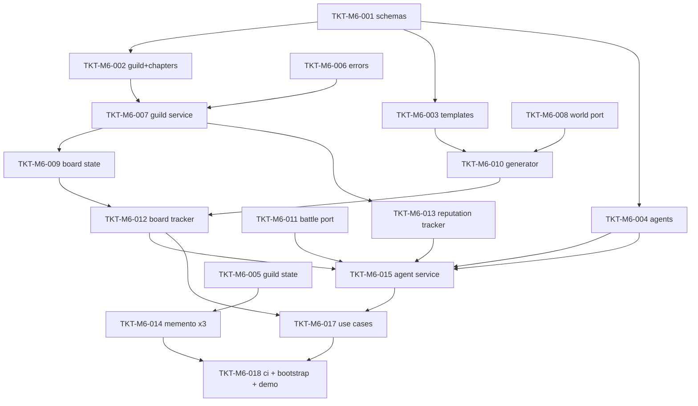

# TICKETS-M6 v1.0 — «Guilds, Quest Generation & Trade Agents»

**Тип документа:** Детализация тикетов вехи M6  
**Дата:** 2026-11-03  
**Статус:** ⏳ запланировано — реализация не начата (2026-11-14)  
**Веха:** M6 (второй блок Wave 3 — Trade-контекст, после M5)  
**Покрывает:** `DEV-SPEC-021` (SPEC-ECON-023…035, 067…068, 073 + события/потоки/CI)  
**Тикетов:** 18  
**Демо вехи:** `bun run demo:m6` — bootstrap с пакетом `guilds-core` → гонка delivery-квеста через 020-спот-сделки → награда + репутация → присяга → найм агента → агентская сделка влияет на `MarketState`; save/load идентичен; `bun run ci:validate` зелёный.

---

## 1. Состав вехи

| ID | Название | DEV-SPEC-021 | Размер |
|---|---|---|---|
| `TKT-M6-001` | 4 контент-схемы гильдейского пакета + registry mapping | §4.2, §6.2 | M |
| `TKT-M6-002` | GuildDefinition + GuildChapterDefinition + контент среза | §5.1 | M |
| `TKT-M6-003` | GuildQuestTemplateDefinition + 6 quest types + шаблоны среза | §5.4 | M |
| `TKT-M6-004` | TradeAgentDefinition + контент агентов | §5.6 | S |
| `TKT-M6-005` | GuildState (membership/reputation/scars/guildCredit) + типы | §5.2, §5.3 | M |
| `TKT-M6-006` | EconomyErrors-расширение (9 кодов GUILD_*/AGENT_*) | §8.2 | XS |
| `TKT-M6-007` | GuildService: ранги, присяга, шрамы, guild-credit | §5.2, §5.3, §5.7 | M |
| `TKT-M6-008` | IWorldContextPort + FixtureWorldContextPort | §5.8 | S |
| `TKT-M6-009` | QuestInstance/QuestBoardState типы + GenericQuestBoard policies | §5.4 | M |
| `TKT-M6-010` | QuestGenerator (weighted, seed, policy) | §5.4 | L |
| `TKT-M6-011` | IBattlePort-стуб (auto-flee) + risk-развилка | §5.5 | M |
| `TKT-M6-012` | Механика economy-quest-board-tracker | §6.1, §7.2 | M |
| `TKT-M6-013` | Механика economy-guild-reputation-tracker | §6.1 | M |
| `TKT-M6-014` | GuildStateMementoProvider + QuestBoardMementoProvider + TradeAgentStateMementoProvider | §8.2 | M |
| `TKT-M6-015` | ITradeAgentService + Hire/Dispatch/Collect | §5.6 | L |
| `TKT-M6-016` | Use cases: BrowseQuestBoard / AcceptQuest / CompleteQuest / ReportQuestFailure / SwearGuildOath | §9.4 | M |
| `TKT-M6-017` | CI: graph/events/rng-streams расширение (guild kinds, 7+ событий, поток quests) | §12.6 | M |
| `TKT-M6-018` | Bootstrap + demo:m6 + determinism-сценарий 5 | §7.4, §16 | M |

---

## 2. Порядок выполнения

**Параллелизация:**
- Поток контента (T001→T002/T003/T004) и поток servicios (T006→T007→T009; T008; T011) независимы до сборки.
- Точка схода — T018 (bootstrap + demo + CI determinism).

---

## 3. Тикеты

### TKT-M6-001 — 4 контент-схемы + registry mapping

**DEV-SPEC:** DEV-SPEC-021 §6.2  
**Требования:** R01  
**AC:** AC01, AC02  
**Размер:** M  
**Статус:** ⏳ не начато  
**Зависит от:** M5 (registry основа).  
**Блокирует:** TKT-M6-002…004

**Что сделать:**
- Схемы: `guild-definition.json`, `guild-chapter-definition.json`, `guild-quest-template-definition.json`, `trade-agent-definition.json` (additionalProperties: false, kebab-case, enum quest types, if/then: `sworn`-policy).
- Расширить `schemaNameForKind`: `guild→…`, `guildChapter→…`, `guildQuestTemplate→…`, `tradeAgent→…`.
- Пакет `guilds-core` в `content/packs.json` (отдельный от `economy-core`).

**Definition of Done:** - [ ] 4 схемы; - [ ] mapping; - [ ] unit валид/невалид; - [ ] CI зелёный.

---

### TKT-M6-002 — GuildDefinition + GuildChapterDefinition + контент среза

**DEV-SPEC:** DEV-SPEC-021 §5.1  
**Требования:** R01  
**AC:** AC01  
**Размер:** M  
**Статус:** ⏳ не начато  
**Зависит от:** TKT-M6-001  
**Блокирует:** TKT-M6-007, TKT-M6-009

**Что сделать:**
- Типы §5.1 в `src/domain/economy/GuildDefinition.ts`.
- Контент: ≥ 2 гильдий (merchants, contraband); каждая — отделения во всех 12 узлах скелета Wave 3 (срез 112); rivals проставлены между merchants/contraband.

**Definition of Done:** - [ ] типы; - [ ] контент 2×12; - [ ] graph CI зелёный.

---

### TKT-M6-003 — GuildQuestTemplateDefinition + 6 quest types

**DEV-SPEC:** DEV-SPEC-021 §5.4  
**Требования:** R04  
**AC:** AC08  
**Размер:** M  
**Статус:** ⏳ не начато  
**Зависит от:** TKT-M6-001  
**Блокирует:** TKT-M6-010

**Что сделать:**
- Типы: `QUEST_TYPES` enum (6 значений), `GuildQuestTemplateDefinition`, `FailureAction`, `blockScars`.
- Контент: ≥ 8 шаблонов покрывающих все 6 типов; failure/deadline/loss policies как ссылки на контентные политики (§12.3 base pack).
- if/then правило conversion-only-шаблонов.

**Definition of Done:** - [ ] типы; - [ ] шаблоны; - [ ] unit negativi; - [ ] CI зелёный.

---

### TKT-M6-004 — TradeAgentDefinition + контент агентов

**DEV-SPEC:** DEV-SPEC-021 §5.6  
**Требования:** R06  
**AC:** AC11, AC12  
**Размер:** S  
**Статус:** ⏳ не начато  
**Зависит от:** TKT-M6-001  
**Блокирует:** TKT-M6-016

**Что сделать:**
- `TradeAgentDefinition` (skillPolicy/sharePolicy/loyaltyPolicy/unlockPolicy/maxOrders).
- Контент: ≥ 3 агентов с разными unlock (guild-by-rank, investment-later, quest-reward).

**Definition of Done:** - [ ] тип; - [ ] 3 агента; - [ ] CI зелёный.

---

### TKT-M6-005 — GuildState типы

**DEV-SPEC:** DEV-SPEC-021 §5.2, §5.3  
**Требования:** R02, R03  
**AC:** AC03  
**Размер:** M  
**Статус:** ⏳ не начато  
**Зависит от:** TKT-M6-002  
**Блокирует:** TKT-M6-007, TKT-M6-014

**Что сделать:**
- `GuildMembership`, `OathState`, `ReputationScar`, `GuildReputationState` — `src/domain/economy/GuildState.ts`.
- Инварианты: `guildCredit ≥ 0`, ровно ≤ 1 sworn-гильдия, шрамы append-only.

**Definition of Done:** - [ ] типы; - [ ] unit инварианты; - [ ] CI зелёный.

---

### TKT-M6-006 — EconomyErrors-расширение

**DEV-SPEC:** DEV-SPEC-021 §8.2  
**Размер:** XS  
**Статус:** ⏳ не начато  
**Зависит от:** TKT-M6-001  
**Блокирует:** TKT-M6-007+

**Что сделать:** — 9 новых кодов (`GUILD_UNKNOWN`, `CHAPTER_UNKNOWN`, `REPUTATION_REQUIRED`, `OATH_ALREADY_SWORN`, `QUEST_BOARD_FULL`, `QUEST_NOT_ACCEPTABLE`, `AGENT_NOT_UNLOCK` `AGENT_BUSY`, `GUILD_CREDIT_INSUFFICIENT`) + фабрика.

**Definition of Done:** - [ ] файл + unit; - [ ] CI зелёный.

---

### TKT-M6-007 — GuildService

**DEV-SPEC:** DEV-SPEC-021 §5.2, §5.3, §5.7  
**Требования:** R02, R03  
**AC:** AC03, AC04, AC05  
**Размер:** M  
**Статус:** ⏳ не начато  
**Зависит от:** TKT-M6-005, TKT-M6-006  
**Блокирует:** TKT-M6-009, TKT-M6-017

**Что сделать:**
- `IGuildService` + `GuildService`: join/leave, promotion по rankPolicyId, swear/withdraw oath (data restrictions from content), scar add/remove (только по событию), credit earn/spend.

**Definition of Done:** - [ ] unit все операции + негативы; - [ ] CI зелёный.

---

### TKT-M6-008 — IWorldContextPort + Fixture

**DEV-SPEC:** DEV-SPEC-021 §5.8  
**Требования:** R04  
**AC:** AC07  
**Размер:** S  
**Статус:** ⏳ не начато  
**Зависит от:** TKT-M6-009  
**Блокирует:** TKT-M6-010

**Что сделать:**
- Интерфейс + `FixtureWorldContextPort` (данные из fixtures сцен детерминизма — povertyIndex, chainStatus, warFronts, cataclysmTags).
- DI-регистрация; TODO перенос на 023-реализацию.

**Definition of Done:** - [ ] порт + fixture; - [ ] unit; - [ ] CI зелёный.

---

### TKT-M6-009 — QuestInstance + QuestBoardState

**DEV-SPEC:** DEV-SPEC-021 §5.4  
**Требования:** R05  
**AC:** AC09, AC10  
**Размер:** M  
**Статус:** ⏳ не начато  
**Зависит от:** TKT-M6-003, TKT-M6-007  
**Блокирует:** TKT-M6-008, TKT-M6-010, TKT-M6-012

**Что сделать:**
- `QuestInstance` (двухчастный: template-based + generated), `QuestBoardState` (active, cooldowns, limits, scar-blocks).
- Политики доски — контент (per-template cooldown, board max active, auto-clean rules).

**Definition of Done:** - [ ] типы; - [ ] unit; - [ ] CI зелёный.

---

### TKT-M6-010 — QuestGenerator

**DEV-SPEC:** DEV-SPEC-021 §5.4  
**Требования:** R04  
**AC:** AC07, AC08  
**Размер:** L  
**Статус:** ⏳ не начато  
**Зависит от:** TKT-M6-003, TKT-M6-008  
**Блокирует:** TKT-M6-012

**Что сделать:**
- `IQuestGenerator` + `QuestGenerator`:
  - weighted выбор good/nodes по povertyIndex и фильтрам шаблона;
  - формулы наград провеrónt из `rewardPolicyId`;
  - сумка 6 quest types (все реализации не отложены: delivery/chain-support/chain-sabotage/escort/market-recon/invest-contract);
- Детерминизм — строго `rng.economy.quests`; чистая функция от (template, snapshot, rng), без скрытых состояний.

**Acceptance Criteria:**
- `AC07`: double-run с фиксированным seed → identical QuestInstance.
- `AC08`: 6 типов генерируются в тестах.

**Definition of Done:** - [ ]generator + unit (determinism, weighted, 6 types); - [ ] CI зелёный.

---

### TKT-M6-011 — IBattlePort-стуб + risk-развилка

**DEV-SPEC:** DEV-SPEC-021 §5.5  
**Требования:** R06  
**AC:** AC11  
**Размер:** M  
**Статус:** ⏳ не начато  
**Зависит от:** TKT-M6-009  
**Блокирует:** TKT-M6-016

**Что сделать:**
- `IBattlePort` (auto-flee заглушка), модуль risk-развилки: `economy.risk_triggered` → откуп (bribe_policy)/бой (port)/потеря (lossPolicy) — на маршрутах 020.
- Unit: три ветки детерминировано.

**Definition of Done:** - [ ] порт+развилка; - [ ] unit 3 ветки; - [ ] CI зелёный.

---

### TKT-M6-012 — Механика quest-board-tracker

**DEV-SPEC:** DEV-SPEC-021 §6.1, §7.2  
**Требования:** R05  
**AC:** AC09, AC10  
**Размер:** M  
**Статус:** ⏳ не начато  
**Зависит от:** TKT-M6-009, TKT-M6-010  
**Блокирует:** TKT-M6-016, TKT-M6-018

**Что сделать:**
- Плагин + `MechanicDefinition` (scope economy, priority 150): кулдауны, лимиты, автоснятие, rival harassment (реролл чужой доски), emit `quest_generated/quest_expired/guild_rival_harass`.
- RNG — только quests.

**Definition of Done:** - [ ] механика + определение; - [ ] unit: cooldowns/limits/auto-clean; - [ ] CI зелёный.

---

### TKT-M6-013 — Механика guild-reputation-tracker

**DEV-SPEC:** DEV-SPEC-021 §6.1  
**Требования:** R03  
**AC:** AC05, AC06  
**Размер:** M  
**Статус:** ⏳ не начато  
**Зависит от:** TKT-M6-007  
**Блокирует:** TKT-M6-018

**Что сделать:**
- Плагин (scope economy, priority 250): react eвents quest_completed/failed/trade_executed; применяет policy; шрамы; эмит `reputation_changed/guild_scar_revealed/oath_sworn/guild_credit_changed`.
- one-shot фаkты эпилога (`became_guild_master/swore_oath_to_guild`) через `IEpilogueFactPort`.

**Definition of Done:** - [ ] механика; - [ ] unit: impasse/scars/facts; - [ ] CI зелёный.

---

### TKT-M6-014 — 3 memento-провайдера

**DEV-SPEC:** DEV-SPEC-021 §8.2  
**Требования:** R03 (AC06)  
**Размер:** M  
**Статус:** ⏳ не начато  
**Зависит от:** TKT-M6-005, TKT-M6-009  
**Блокирует:** TKT-M6-018

**Что сделать:**
- `GuildStateMementoProvider` (id `economy.guilds`), `QuestBoardMementoProvider` (id `economy.quest-board`), `TradeAgentStateMementoProvider` (id `economy.agents`).
- Каждый: getState/restore + валидация по соответствующим схемам (`guild-state.json`, `quest-board-state.json`, `trade-agent-state.json` — добавить в `content/schemas/`).

**Definition of Done:** - [ ] 3 провайдера + 3 схемы; - [ ] roundtrip unit; - [ ] CI зелёный.

---

### TKT-M6-015 — ITradeAgentService

**DEV-SPEC:** DEV-SPEC-021 §5.6  
**Требования:** R06  
**AC:** AC11, AC12  
**Размер:** L  
**Статус:** ⏳ не начато  
**Зависит от:** TKT-M6-004, TKT-M6-007, TKT-M6-011  
**Блокирует:** TKT-M6-017

**Что сделать:**
- `ITradeAgentService` + `TradeAgentService`:
  - hire (unlock check), fire (loyalty низкий),
  - dispatch order (buy/sell по маршруту, budget cap, maxOrders),
  - collect share (по `sharePolicyId`),
  - betrayal hook (low loyalty → `agent_betrayed` контракт),
  - все сделки — общий `PricePolicyResolver` код-путь (020).

**Definition of Done:** - [ ] сервис; - [ ] unit: hire/betrayal/limits/general path; - [ ] CI зелёный.

---

### TKT-M6-016 — Use cases гильдий и доски

**DEV-SPEC:** DEV-SPEC-021 §9.4  
**Требования:** R02, R03, R05  
**AC:** AC03, AC04, AC09  
**Размер:** M  
**Статус:** ⏳ не начато  
**Зависит от:** TKT-M6-012, TKT-M6-014, TKT-M6-015  
**Блокирует:** TKT-M6-017

**Что сделать:** — `BrowseQuestBoard`, `AcceptQuest`, `CompleteQuest`, `ReportQuestFailure`, `SwearGuildOath` — Result API, контроль ранга/шрамов/лимитов; CompleteQuest проверяет условия выполненеxia через зарегистрированные сделки 020 (следы сделки, registered-флаг).

**Definition of Done:** - [ ] 5 use cases; - [ ] unit+E2E plumbing; - [ ] CI зелёный.

---

### TKT-M6-017 — CI расширения

**DEV-SPEC:** DEV-SPEC-021 §12.6  
**Требования:** R01  
**AC:** AC01, AC02  
**Размер:** M  
**Статус:** ⏳ не начато  
**Зависит от:** TKT-M6-014  
**Блокирует:** TKT-M6-018

**Что сделать:**
- graph: гильдейские kinds; chapter-node ref; guild-chapter min 1; templates refs; 2 гильдии × 12 chapters.
- events: 7+ событий §6.3 зарегистрированы; epilogue факты объявлены.
- rng-streams: `rng.economy.quests` единственный паттерн для board; запрет Math.random в новых каталогах домена.

**Definition of Done:** - [ ] стадии расширены; - [ ] тесты валид/битые refs; - [ ] CI зелёный.

---

### TKT-M6-018 — Bootstrap + demo:m6 + determinism

**DEV-SPEC:** DEV-SPEC-021 §7.4, §16  
**Требования:** все R  
**AC:** все AC  
**Размер:** M  
**Статус:** ⏳ не начато  
**Зависит от:** TKT-M6-017  
**Блокирует:** Wave 3 продолжение (022) и интеграция 028.

**Что сделать:**
- Bootstrap: пакет `guilds-core`, `IGuildService/IQuestGenerator/ITradeAgentService/IBattlePort/IWorldContextPort` в DI, 2 новые механики, 3 memento-провайдера.
- `scripts/demo-m6.ts`: bootstrap → принять delivery-квест из доски → выполнить спот-сделками → подтвер reputation+награвда → присяга merchants → vpust agent → агентская сделка меняет MarketState → save/load идентичен → `ci:validate` зелёный.
- Determinism fixtures: сценарий 5 (доска + агенты 10 тиков → save → load → 10 == 20).
- README secция «Как проверить M6»; `package.json` → `demo:m6`.

**Definition of Done:** - [ ] демо exit 0; - [ ] `ci:validate` зелёный; - [ ] README обновлён.

---

## 4. Definition of Done вехи M6

- [ ] все 18 тикетов смержены;
- [ ] `bun run demo:m6` воспроизводится (доска → квест → сделки → награда → присяга → агент → save/load identical);
- [ ] `bun run ci:validate` зелёный (graph/tasks/events/rng/determinism включают гильдейский контент);
- [ ] все AC `DEV-SPEC-021` (R01…R06, AC01…AC12) покрыты тестами;
- [ ] контент: 2 гильдии × 12 chapters, ≥ 8 шаблонов на все 6 типов, ≥ 3 агентов, политики отдельным пакетом;
- [ ] 7+ событий `economy.*` расширения зарегистрированы, 2 эпилог-фага работают one-shot;
- [ ] нет `Math.random`/`Date.now` в новых доменных каталогах;
- [ ] Q-01…Q-04 закрыты или отложены с разблокирующим тикетом.

---

## 5. Что разблокирует M6

- `DEV-SPEC-022` (инвестиции/легальность — настоящая реализация ILegalityPort, guild-credit как валюта);
- `DEV-SPEC-028` (напарники через acquisition hooks гильдейских квестов);
- `DEV-SPEC-034` (нарративные арки: шрамы/присяга/гильд-мастер как источники сюжета);
- `DEV-SPEC-029/031` (бой в risk-развилках — IBattlePort настоящий).

---

## 6. Риски и заметки

| Риск | Митигация |
|---|---|
| Доска может тикать чрезмерно часто | cooldown/лимиты в контентt; LOD-политика трекера |
| Детерминизм зависит от world snapshot-порядка | canonicalJson фиксация порядка ключей (как 020) |
| Rival harassment создаёт чувство нечестности | приоритет контента: harassment открывается narративно через story-beacon, не спам |
| Синтетический объём agent-событий | batching (`economy.agent_order_completed` с суммарной дельтой) |
| Цикл «шрам → нет квестов → затухание» | правило auto-open: 1 шаблон без blockScars всегда в срезе |
