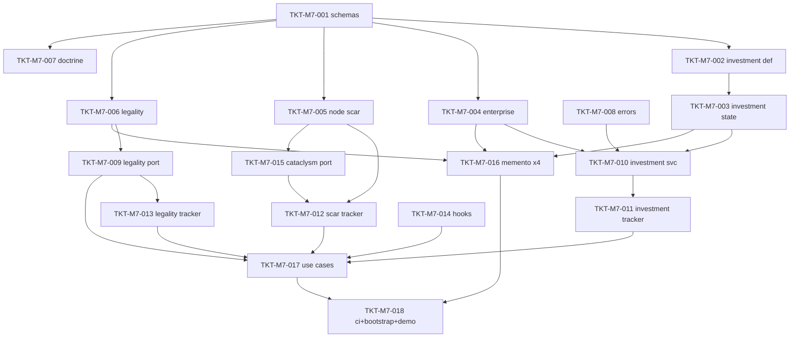

# TICKETS-M7 v1.0 — «Investments, Enterprises & Legality»

**Тип документа:** Детализация тикетов вехи M7  
**Дата:** 2026-11-03  
**Статус:** ⏳ запланировано — реализация не начата (2026-11-14)  
**Веха:** M7 (завершающий блок Wave 3 — после M5/M6)  
**Покрывает:** `DEV-SPEC-022` (SPEC-ECON-041…046, 069…072, 074 + 002/070, 084, 110…114 slice)  
**Тикетов:** 18  
**Демо вехи:** `bun run demo:m7` — bootstrap с пакетом `economy-3` → инвестиция верфь (2 стадии, вклады золото+steel) → контест NPC → год завершён, epoch shift — сигнал → контрабандная сделка → wanted-цикл (detected → bribe → clean) → шок узла от катаклизм-фикстуры → save/load идентичен; `bun run ci:validate` зелёный.

---

## 1. Состав вехи

| ID | Название | DEV-SPEC-022 | Размер |
|---|---|---|---|
| `TKT-M7-001` | 5 контент-схем + 5 snapshot-схем + registry mapping | §6.2 | M |
| `TKT-M7-002` | InvestmentProjectDefinition + контент shipyard | §5.1 | M |
| `TKT-M7-003` | InvestmentState типы (стадии, прогресс, контест) | §5.1 | M |
| `TKT-M7-004` | EnterpriseDefinition + EnterpriseState + контент 4 предприятий | §5.2 | M |
| `TKT-M7-005` | NodeScarDefinition + NodeScarState + шок-модель + контент среза | §5.3 | M |
| `TKT-M7-006` | LegalityDefinition + LegalityState + контент | §5.4 | M |
| `TKT-M7-007` | EconomyDoctrineDefinition + 4 доктрины первой волны | §5.5 | M |
| `TKT-M7-008` | Ошибки INVESTMENT_*/ENTERPRISE_*/WANTED_* (8 кодов) | §8.2 | XS |
| `TKT-M7-009` | RealLegalityPort + ILegalityPort полный контракт | §5.4 | L |
| `TKT-M7-010` | IInvestmentService + ContributeToProject (атомарные вклады) | §7.2, §9.3 | L |
| `TKT-M7-011` | Механика economy-investment-tracker (стадии + контест + epoch) | §6.1, §7.2 | L |
| `TKT-M7-012` | Механика economy-node-scar-tracker (шоки ↔ шрамы) | §6.1, §7.1 | M |
| `TKT-M7-013` | Механика economy-legality-tracker (wanted/конфискация) | §6.1 | M |
| `TKT-M7-014` | Hidden-branch hooks + cataclysm_pressure API | §5.6 | S |
| `TKT-M7-015` | ICataclysmEconomyPort + FixtureCataclysmEconomyPort | §5.3, §8.1 | S |
| `TKT-M7-016` | 4 memento-провайдера + roundtrip | §8.2 | M |
| `TKT-M7-017` | Use cases: investments (4) + legality (4) | §9.3 | M |
| `TKT-M7-018` | CI расширения + bootstrap + demo:m7 + determinism сценарий 6 | §12.6, §16 | M |

---

## 2. Порядок выполнения

**Параллелизация:**
- Контент-поток (T001→T002/T004/T005/T006/T007) — независим.
- Сервисный поток (T008→T010; T009; T012; T015) — независим до сборки.
- Точка схода — T018.

---

## 3. Тикеты

### TKT-M7-001 — 5 контент-схем + 5 снимков + mapping

**DEV-SPEC:** DEV-SPEC-022 §6.2  
**Требования:** R01  
**AC:** AC01  
**Размер:** M  
**Статус:** ⏳ не начато  
**Зависит от:** M5/M6 (registry основа).  
**Блокирует:** TKT-M7-002…007

**Что сделать:**
- Схемы: `investment-project-definition.json` (стадии≥1, вклады с kind-enum, порт-тир int), `enterprise-definition.json`, `node-scar-definition.json`, `legality-definition.json`, `economy-doctrine-definition.json`.
- Снимки: `investment-state.json`, `enterprise-state.json` (Σ ≤ 1 через JSON Schema-условие), `node-scar-state.json` (+`economic-shock.json`), `legality-state.json` (wanted enum).
- Расширение `schemaNameForKind` на 5 kinds; пакет `economy-3` в `packs.json`.

**Definition of Done:** - [ ] 10 схем; - [ ] mapping; - [ ] unit валид/невалид; - [ ] CI зелёный.

---

### TKT-M7-002 — InvestmentProjectDefinition + контент

**DEV-SPEC:** DEV-SPEC-022 §5.1  
**Требования:** R01  
**AC:** AC01, AC02  
**Размер:** M  
**Статус:** ⏳ не начато  
**Зависит от:** TKT-M7-001  
**Блокирует:** TKT-M7-003, TKT-M7-010

**Что сделать:**
- Типы `InvestmentStage/InvestmentProjectDefinition/ContributionKind/YieldPolicy` в `src/domain/economy/InvestmentProjectDefinition.ts`.
- Контент: `investment-shipyard-expansion` (2 стадии; вклады: gold+steel→stage1, gold+service→stage2; effects: local `shipyard-capacity-boost`, global `advanced-shipyard-tier`, epoch `science-shift-small`, portTierChange +1; yield hybrid; contestPolicy/riskPolicy заполнены).
- ≥ 1 проект цели; data-driven формула вкладов.

**Definition of Done:** - [ ] типы + контент; - [ ] INV-01..03; - [ ] CI зелёный.

---

### TKT-M7-003 — InvestmentState типы

**DEV-SPEC:** DEV-SPEC-022 §5.1, §7.1  
**Требования:** R01, R02  
**AC:** AC01, AC03  
**Размер:** M  
**Статус:** ⏳ не начато  
**Зависит от:** TKT-M7-002  
**Блокирует:** TKT-M7-010, TKT-M7-011, TKT-M7-016

**Что сделать:**
- `InvestmentState`-иcosystem: `stageProgress`, `contributionsPaid`, `contestState` (NPC progress map per tick), `completedStages[]`.
- Инварианты: progress атомарные переходы; NPC-соперники — отдельные потоки.

**Definition of Done:** - [ ] типы; - [ ] unit переходов; - [ ] CI зелёный.

---

### TKT-M7-004 — Enterprise модели + контент

**DEV-SPEC:** DEV-SPEC-022 §5.2  
**Требования:** R05  
**AC:** AC09  
**Размер:** M  
**Статус:** ⏳ не начато  
**Зависит от:** TKT-M7-001  
**Блокирует:** TKT-M7-010, TKT-M7-016

**Что сделать:**
- `EnterpriseDefinition/EnterpriseState` в TS (статусы op/damaged/destroyed/captured; shares map).
- Контент: ≥ 4 предприятий (по узлу среза: верфь капитала, refinery industry, workshop arcane, extraction necro), ссылки на цепочки 020; ownership/state/capacity policies заполнены.
- Инвариант INV-04 (Σ≤1) — на функции; тест на предельные значения.

**Definition of Done:** - [ ] типы + 4 предприятия; - [ ] unit Σ≤1 и переходы; - [ ] CI зелёный.

---

### TKT-M7-005 — NodeScar + шок-модель + контент

**DEV-SPEC:** DEV-SPEC-022 §5.3  
**Требования:** R03  
**AC:** AC05, AC06  
**Размер:** M  
**Статус:** ⏳ не начато  
**Зависит от:** TKT-M7-001  
**Блокирует:** TKT-M7-012, TKT-M7-015

**Что сделать:**
- `NodeScarDefinition/NodeScarState/EconomicShockInstance`.
- Контент: ≥ 2 шрамов (`scar-plague-outbreak` — permanent, `scar-blockade-sea` — removable), политики цен/цепочек-разрыва из `priceModifier`-пакет 020; шок kind-enum full.
- INV: шок — временный и детерминированно снимается; шрам — только removable_by.

**Definition of Done:** - [ ] типы + контент; - [ ] unit: шок-таймер, шрам append-only; - [ ] CI зелёный.

---

### TKT-M7-006 — Legality модели + контент

**DEV-SPEC:** DEV-SPEC-022 §5.4  
**Требования:** R04  
**AC:** AC07, AC08  
**Размер:** M  
**Статус:** ⏳ не начато  
**Зависит от:** TKT-M7-001  
**Блокирует:** TKT-M7-009, TKT-M7-013

**Что сделать:**
- `LegalityDefinition/LegalityState/WantedLevel` (clean→noticed→suspicious→wanted→bounty).
- Контент: `steam-legality + arcane-legality (+ necro/relic упрощённые)` — все 4 policy-ids заполнены (check/bribe/wanted/confiscation).

**Definition of Done:** - [ ] типы + контент; - [ ] CI зелёный.

---

### TKT-M7-007 — 4 доктрины первой волны

**DEV-SPEC:** DEV-SPEC-022 §5.5  
**Требования:** —  
**AC:** —  
**Размер:** M  
**Статус:** ⏳ не начато  
**Зависит от:** TKT-M7-001  
**Блокирует:** TKT-M7-018

**Что сделать:**
- Тип `EconomyDoctrineDefinition`.
- Контент: `steam-market-doctrine`, `arcane-market-doctrine`, `necrotic-market-doctrine`, `relic-market-doctrine` — по одному на фракцию (SPEC-ECON-114); uniqueResourceId для паровых — `steam-credit` (новый GoodDefinition в пакете 020-скилла — дописать good в `content/good/core.json`), остальные — neutral.
- Правила потребления: механики 020/021 обязаны читать доктрину, если целевая фракция её имеет (CI-правило: node economy_doctrine_id существует в доктринальном наборе).

**Definition of Done:** - [ ] типы; - [ ] 4 доктрины + steam-credit good; - [ ] CI graph зелёный.

---

### TKT-M7-008 — Ошибки

**DEV-SPEC:** DEV-SPEC-022 §8.2  
**Размер:** XS  
**Статус:** ⏳ не начато  
**Зависит от:** TKT-M7-001  
**Блокирует:** TKT-M7-009…017

**Что сделать:** 8 кодов (`INVESTMENT_UNKNOWN`, `STAGE_NOT_READY`, `CONTRIBUTION_MISMATCH`, `ENTERPRISE_SHARE_CAP`, `SCAR_NOT_REMOVABLE`, `WANTED_MAXED`, `BRIBE_REJECTED`, `CREDIT_INSUFICIENT_INVESTMENT`) + фабрика + unit.

**Definition of Done:** - [ ] коды; - [ ] CI зелёный.

---

### TKT-M7-009 — RealLegalityPort

**DEV-SPEC:** DEV-SPEC-022 §5.4  
**Требования:** R04  
**AC:** AC07, AC08  
**Размер:** L  
**Статус:** ⏳ не начато  
**Зависит от:** TKT-M7-006, TKT-M7-008  
**Блокирует:** TKT-M7-013, TKT-M7-017

**Что сделать:**
- Полный контракт `ILegalityPort` (checkEntry/bribe/wantedOf/confiscate) — замена passthrough из 020/021.
- Детект контрабанды: сверка cargo с `GoodDefinition.contrabandIn` (020) на узле входа; roll — `rng.economy.legality` — **новый поток?** Нет: фиксирован `rng.economy.risk` (уже в каталоге, отдельная легальность спеки экономии — избегаем нового потока; контест сначала берёт investments).
- Bribe — по bribePolicyId, wanted сброс на 1 ступень; конфискация при bounty/нарушении.
- DI-замена: `ILegalityPort` теперь регистрирует `RealLegalityPort` (удаление RealityLegalityPort из контейнера).

**Definition of Done:** - [ ] порт + замена DI; - [ ] unit: 4 метода × ветки; - [ ] детерминизм double-run; - [ ] CI зелёный.

---

### TKT-M7-010 — IInvestmentService

**DEV-SPEC:** DEV-SPEC-022 §7.2, §9.3  
**Требования:** R01  
**AC:** AC01, AC02  
**Размер:** L  
**Статус:** ⏳ не начато  
**Зависит от:** TKT-M7-003, TKT-M7-004, TKT-M7-008  
**Блокирует:** TKT-M7-011, TKT-M7-017

**Что сделать:**
- `IInvestmentService` + `InvestmentService`: list projects (visibility), contribute (атомарная сумма всех вкладов стадии — все-или-ничего), abandon (refund по riskPolicyId), claimShare.
- Списание золота/товаров/credit через `IWealthPort`/`GuildService.spendCredit` (021) — реальные API; товары — через InventoryOps/TradeService (020).

**Acceptance Criteria:**
- `AC01`: полный вклад стадии закрывает её; `AC02`: частичный вклад не списывается вообще (атомарность).

**Definition of Done:** - [ ] сервис; - [ ] unit: contribute/abandon/atomics; - [ ] CI зелёный.

---

### TKT-M7-011 — Механика investment-tracker

**DEV-SPEC:** DEV-SPEC-022 §6.1, §7.2  
**Требования:** R02, R06  
**AC:** AC03, AC04, AC10  
**Размер:** L  
**Статус:** ⏳ не начато  
**Зависит от:** TKT-M7-010  
**Блокирует:** TKT-M7-018

**Что сделать:**
- Плагин (tracker, scope economy, priority 280): длительность стадий, прогресс NPC-гонок (`rng.economy.investments`), саботат-события, завершение (эффекты local/global/epoch/portTier, события investment_started/completed/disrupted + epoch_balance_shifted).
- Саботаж-пояснение с БаттelPort-стуб (021): NPC-саботаж — автоsuccess по riskPolicyId (бой-детали — 029/031).
- Факт `invested_in_epoch_shift` via IEpilogueFactPort (one-shot flag).

**Definition of Done:** - [ ] механика; - [ ] unit: стадии/контест/эффекты; - [ ] детерминизм double-run; - [ ] CI зелёный.

---

### TKT-M7-012 — Механика node-scar-tracker

**DEV-SPEC:** DEV-SPEC-022 §6.1, §7.1  
**Требования:** R03  
**AC:** AC05, AC06  
**Размер:** M  
**Статус:** ⏳ не начато  
**Зависит от:** TKT-M7-005, TKT-M7-015  
**Блокирует:** TKT-M7-018

**Что сделать:**
- Плагин (tracker, priority 270): активные шоки (таймер снимает), переход шок → шрам при заданной эскалации катаклизма (событие от порта-моста). Применение модификаторов цен 020 — только запись политики-состояния; пересчёт цен делает трекер 020 при следующем такте.
- Эмиссия `scar_applied/removed`, `shock_generated/expired`.

**Definition of Done:** - [ ] механика; - [ ] unit: shock timer, scar transition; - [ ] CI зелёный.

---

### TKT-M7-013 — Механика legality-tracker

**DEV-SPEC:** DEV-SPEC-022 §6.1  
**Требования:** R04  
**AC:** AC08  
**Размер:** M  
**Статус:** ⏳ не начато  
**Зависит от:** TKT-M7-009  
**Блокирует:** TKT-M7-018

**Что сделать:**
- Плагин (tracker, priority 260): wanted decay (clean path), события `wanted_level_changed/legality_changed/good_confiscated`, экспорт wanted state в LegalityState (memento).

**Definition of Done:** - [ ] механика; - [ ] unit wanted lifecycle; - [ ] CI зелёный.

---

### TKT-M7-014 — Hidden-branch hooks + cataclysm_pressure

**DEV-SPEC:** DEV-SPEC-022 §5.6  
**Требования:** R06  
**AC:** AC10  
**Размер:** S  
**Статус:** ⏳ не начато  
**Зависит от:** TKT-M7-011  
**Блокирует:** TKT-M7-017

**Что сделать:**
- Контент hook'ов (≥ 2: `monopolist-arc-hook`, `epoch-zealot-hook`), API `CataclysmPressureService.addPressure(delta, source)` (счётчик в AppHandle state, over-limit — хуком 033).
- Событие-триггеры: `economy.good_monopolized` (020-вычисление: игрок ≥ threshold % рынка одного товара — код 020, тут эмиссия при декларации) и epoch shift.

**Definition of Done:** - [ ] hooks + pressure API; - [ ] unit; - [ ] CI зелёный.

---

### TKT-M7-015 — ICataclysmEconomyPort + fixture

**DEV-SPEC:** DEV-SPEC-022 §5.3, §8.1  
**Требования:** R03  
**Размер:** S  
**Статус:** ⏳ не начато  
**Зависит от:** TKT-M7-005  
**Блокирует:** TKT-M7-012

**Что сделать:**
- Порт: `triggerShock(nodeId, kind, magnitudePolicyId)`; реализация `FixtureCataclysmEconomyPort` из fixtures детерминизма (мост на 025: реальная реализация заменит fixture).
- Unit: шок по fixture → scar tracker получив событие.

**Definition of Done:** - [ ] порт+fixture; - [ ] CI зелёный.

---

### TKT-M7-016 — 4 memento-провайдера

**DEV-SPEC:** DEV-SPEC-022 §8.2  
**Требования:** R03, R05  
**AC:** AC05, AC09  
**Размер:** M  
**Статус:** ⏳ не начато  
**Зависит от:** TKT-M7-003, TKT-M7-004, TKT-M7-005, TKT-M7-006  
**Блокирует:** TKT-M7-018

**Что сделать:** провайдеры `economy.investments`, `economy.enterprises`, `economy.node-scars`, `economy.legality` + схемы снимков из TKT-M7-001; restore-валидация каждое; регистрация в MementoRegistry bootstrap.

**Definition of Done:** - [ ] 4 провайдера; - [ ] roundtrip unit по каждому; - [ ] CI зелёный.

---

### TKT-M7-017 — Use cases

**DEV-SPEC:** DEV-SPEC-022 §9.3  
**Требования:** R01, R04  
**AC:** AC01, AC07  
**Размер:** M  
**Статус:** ⏳ не начато  
**Зависит от:** TKT-M7-010, TKT-M7-009, TKT-M7-014  
**Блокирует:** TKT-M7-018

**Что сделать:** инвестиционные 4 (`ListInvestmentProjects/ContributeToProject/AbandonOrSabotageProject/ClaimEnterpriseShare`) + легальные 4 (`PayBribe/ReportContrabandAttempt/ClearWantedDebt/GetLegalityStatus`) — Result API, юнит-тесты успех/отказ (все коды ошибки).

**Definition of Done:** - [ ] 8 use cases; - [ ] unit; - [ ] CI зелёный.

---

### TKT-M7-018 — CI + bootstrap + demo:m7

**DEV-SPEC:** DEV-SPEC-022 §12.6, §16  
**Требования:** все R  
**AC:** все AC  
**Размер:** M  
**Статус:** ⏳ не начато  
**Зависит от:** TKT-M7-016, TKT-M7-017  
**Блокирует:** Wave 4 (023) и интеграция 025/026/033.

**Что сделать:**
- CI: graph — 5 новых kinds, ref-целостность (доктрины на фракции, сцепка enterprise↔node↔chain, scar policy refs), доля Σ≤1 в snapshots; events — 11 новых зарегистрированы; rng-streams — только investments/shocks-risk; determinism — сценарий 6 (20 тиков инвестиции+контрабанда → save/load == straight).
- Bootstrap: пакет `economy-3`, RealLegalityPort замена, 3 механики, 4 провайдера, CataclysmPressureService.
- `scripts/demo-m7.ts`: bootstrap → инвестиция верфь (атомарные вклады) → 10 тиков контест → completed + epoch shift + факт → контрабандная сделка → checkEntry (detected) → PayBribe → clean → fixture-шок узла → scar → цены изменились → save/load → идентично → `ci:validate` зелёный.
- README «Как проверить M7»; `package.json` → `demo:m7`.

**Definition of Done:** - [ ] демо exit 0 (полный поток выше); - [ ] `ci:validate` зелёный; - [ ] README; - [ ] Волна 3 (M5–M7) закрыта.

---

## 4. Definition of Done вехи M7

- [ ] все 18 тикетов смержены;
- [ ] `bun run demo:m7` воспроизводится (инвестиция → epoch shift → контрабанда → bribe → шок → шрам → save/load identical);
- [ ] `bun run ci:validate` зелёный (graph/events/rng/determinism включают Wave 3 пакет полностью);
- [ ] все AC `DEV-SPEC-022` (R01…R06, AC01…AC10) покрыты тестами;
- [ ] контент: shipyard-investment, 4 предприятия, 2 шрама, 4 доктрины, 4 legality-политика; 
- [ ] 11 событий в реестре; 2 факта эпилога one-shot;
- [ ] нет `Math.random`/`Date.now` в новых каталогах;
- [ ] Q-01…Q-04 закрыты или отложены с разблокирующим тикетом;
- [ ] Wave 3 (Economy core) — fully done: M5+M6+M7 суммарно закрывают `DEV-SPEC-020/021/022`.

---

## 5. Что разблокирует M7 (конец Wave 3)

- **Wave 4** (`DEV-SPEC-023` мир): consuming legality/scar/shock/epoch states через `IWorldContextPort` настоящей реализацией.
- `DEV-SPEC-025/026` (катаклизмы): мост `cataclysm.* → economy.shock/scar` уже работающий, fixture заменяется реализацией.
- `DEV-SPEC-029/031` (бои): саботаж и risk-развилки получают настоящий `IBattlePort`.
- `DEV-SPEC-033` (скрытые ветки): `cataclysm_pressure` накапливается экономическими действиями.

---

## 6. Риски и заметки

| Риск | Митигация |
|---|---|
| Контест может ломать детерминизм | строго `rng.economy.investments`, canonicalJson state-снимков |
| RealLegalityPort меняет поведение 020-сделок (ранее passthrough) | миграция помечена; старые тесты обновляются на R04-семантику в одном PR |
| Шок/шрам сложные взаимодействия с 020-ценами | однонаправленные модификаторы: scar пишет в политика-стейт, prices-only recomputation вручную трекером 020 пересчитывает |
| Смена CurrencyKind.guild-credit | все spend-операции через GuildService API (021), никаких прямых мутаций |
| Демо-сценарий растёт | 20 тиков фикс; все случайности — fixture seed `econ-m7` |
