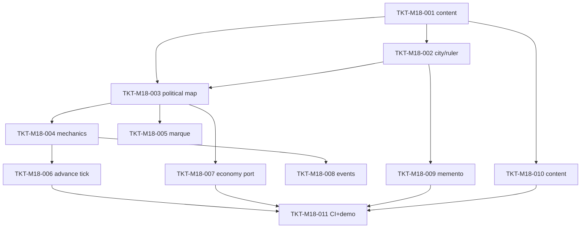

# TICKETS-M18 v1.0 — «World Simulation & Political Map»

**Тип документа:** Детализация тикетов вехи M18  
**Дата:** 2026-11-14  
**Статус:** ✅ реализовано (2026-11-16) — World Simulation & Political Map  
**Веха:** M18 (Wave 4 — World & Cataclysms)  
**Покрывает:** `DEV-SPEC-023`  
**Тикетов:** 11  
**Демо вехи:** `bun run demo:m18` — 4 фракции × 8 городов → 20 тактов дрейфа отношений → война и падение города → смена правителя → каперская грамота → экономика видит контроль на следующем такте → save/load → 400 тактов дают идентичный `PoliticalMapState`.

---

## 1. Состав вехи

| ID | Название | DEV-SPEC-023 | Размер |
|---|---|---|---|
| `TKT-M18-001` | World content-типы, схемы и пакеты | §5, §6 | M |
| `TKT-M18-002` | CityInstance, RulerInstance и статус города | §5.1, §5.2, §7.2 | M |
| `TKT-M18-003` | PoliticalMap: отношения, войны, контроль | §5.3, §5.4 | M |
| `TKT-M18-004` | Механики world-scope (relation/war/control) | §7.1, §7.3 | M |
| `TKT-M18-005` | Марки: трекер и `RequestMarque` | §5.4, §7.4 | M |
| `TKT-M18-006` | `AdvancePoliticalTick` и фаза `scope:world` | §7.3 | M |
| `TKT-M18-007` | `IWorldContextPort` — мост в экономику | §7.4 | S |
| `TKT-M18-008` | Событийное ядро `world.*` | §6.3 | S |
| `TKT-M18-009` | Memento политической карты | §6.4 | S |
| `TKT-M18-010` | Контент первой волны (8 городов, 4 фракции) | §6.2 | M |
| `TKT-M18-011` | CI, determinism 400 тактов и demo:m18 | §11, §12 | M |

---

## 2. Порядок выполнения

---

## 3. Тикеты

### TKT-M18-001 — World content-типы, схемы и пакеты

**DEV-SPEC:** DEV-SPEC-023 §5, §6  
**Требования:** R01, R02, R04  
**AC:** AC02, AC03, AC10  
**Размер:** M  
**Статус:** ✅ выполнено  
**Зависит от:** TKT-M15-001  
**Блокирует:** TKT-M18-002, TKT-M18-003, TKT-M18-010

**Что сделать:**
- Описать `CityDefinition`, `RulerDefinition`, `PoliticalMapState`, `RelationPair`, `ActiveWar`, `MarqueGrant`, `TerritoryControl`, `RelationStatus`.
- Добавить схемы `city`, `ruler`, `political-map-state`, `relation-policy`, `succession-policy`, `marque-policy`.
- Зарегистрировать пакет `world-core`; проверить `trade_node_id`, `faction_id`, `succession_policy_id`.

**Acceptance Criteria:**
- `DEV-SPEC-023-AC02`: ≥4 фракции, у каждой ≥2 города.
- `DEV-SPEC-023-AC10`: все ссылки существуют, схема города валидна.

**Definition of Done:**
- [ ] типы/схемы/пакет добавлены; [ ] schema-тесты; [ ] `t:test` зелёный; [ ] PR смержен.

---

### TKT-M18-002 — CityInstance, RulerInstance и статус города

**DEV-SPEC:** DEV-SPEC-023 §5.1, §5.2, §7.2  
**Требования:** R02  
**AC:** AC03, AC06  
**Размер:** M  
**Статус:** ✅ выполнено  
**Зависит от:** TKT-M18-001  
**Блокирует:** TKT-M18-003, TKT-M18-009

**Что сделать:**
- Реализовать `CityInstance` и `RulerInstance`: статус, garrison, population_index, legitimacy, personality_tags.
- State machine статуса города: `prosperous|stable|unrest|besieged|ruined|occupied` — только через механики.
- Смена правителя эмитит `world.ruler_changed`; прямые записи `status` вне механик запрещены.

**Acceptance Criteria:**
- `DEV-SPEC-023-AC03`: смена правителя → `world.ruler_changed` + корректный `RulerInstance`.
- `DEV-SPEC-023-AC06`: все переходы статуса идут через механики (lint).

**Definition of Done:**
- [ ] сущности и state machine реализованы; [ ] unit-тесты; [ ] `t:test` зелёный; [ ] PR смержен.

---

### TKT-M18-003 — PoliticalMap: отношения, войны, контроль

**DEV-SPEC:** DEV-SPEC-023 §5.3, §5.4  
**Требования:** R01, R02  
**AC:** AC02, AC09  
**Размер:** M  
**Статус:** ✅ выполнено  
**Зависит от:** TKT-M18-001, TKT-M18-002  
**Блокирует:** TKT-M18-004, TKT-M18-005, TKT-M18-007

**Что сделать:**
- Реализовать корневой агрегат `PoliticalMap`: города, правители, отношения, войны, марки.
- Инварианты: truce блокирует войну, союзник не объявляет войну союзнику; контроль города переключается механикой.
- Эмитить `world.relation_changed`, `world.war_declared/ended`, `world.city_control_changed`.

**Acceptance Criteria:**
- `DEV-SPEC-023-AC02`: контроль города переключается военной механикой.
- `DEV-SPEC-023-AC09`: truce/союз блокируют войну.

**Definition of Done:**
- [ ] агрегат реализован; [ ] unit-тесты отношений; [ ] `t:test` зелёный; [ ] PR смержен.

---

### TKT-M18-004 — Механики world-scope (relation/war/control)

**DEV-SPEC:** DEV-SPEC-023 §7.1, §7.3  
**Требования:** R03, R04  
**AC:** AC01, AC04, AC06  
**Размер:** M  
**Статус:** ✅ выполнено  
**Зависит от:** TKT-M18-003  
**Блокирует:** TKT-M18-006, TKT-M18-008

**Что сделать:**
- Добавить `MechanicDefinition`: `world-relation-drift-tracker`, `world-political-tracker`, `world-war-resolver`, `world-control-tracker`.
- Построить порядок такта `scope:world` (drift → politics → war → control); `NextTick`-политика для контроля.
- Зарегистрировать в `content/mechanics/world.json`; role_tags и priority по 004.

**Acceptance Criteria:**
- `DEV-SPEC-023-AC01`: 400 тактов при скрытом UI дают идентичный `PoliticalMapState`.
- `DEV-SPEC-023-AC04`: `city_control_changed` виден экономике в следующем такте.
- `DEV-SPEC-023-AC06`: переходы статуса только через механики.

**Definition of Done:**
- [ ] механики и порядок такта добавлены; [ ] unit/determinism-тесты; [ ] `ci:validate --stage=mechanics` зелёный; [ ] PR смержен.

---

### TKT-M18-005 — Марки: трекер и `RequestMarque`

**DEV-SPEC:** DEV-SPEC-023 §5.4, §7.4  
**Требования:** R02  
**AC:** AC05  
**Размер:** M  
**Статус:** ✅ выполнено  
**Зависит от:** TKT-M18-003  
**Блокирует:** TKT-M18-011

**Что сделать:**
- Реализовать `world-marque-tracker`: выдача, отзыв, истечение `MarqueGrant`.
- Use case `RequestMarque`: проверка фракции/репутации, запись в `PoliticalMap`, событие `world.marque_granted`.
- Мост в легальность экономики (022) через порт, без прямой зависимости.

**Acceptance Criteria:**
- `DEV-SPEC-023-AC05`: выдача/отзыв/истечение работают и влияют на wanted-логику 022.

**Definition of Done:**
- [ ] трекер и use case реализованы; [ ] integration-тест marque-legality; [ ] `t:test` зелёный; [ ] PR смержен.

---

### TKT-M18-006 — `AdvancePoliticalTick` и фаза `scope:world`

**DEV-SPEC:** DEV-SPEC-023 §7.3  
**Требования:** R04  
**AC:** AC01, AC04  
**Размер:** M  
**Статус:** ✅ выполнено  
**Зависит от:** TKT-M18-004  
**Блокирует:** TKT-M18-011

**Что сделать:**
- Реализовать use case `AdvancePoliticalTick`, вызываемый конвейером 007 на фазе `scope:world`.
- Обеспечить идемпотентность в рамках такта; не выполнять при `paused`.
- Логировать длительность и число изменённых городов (наблюдаемость).

**Acceptance Criteria:**
- `DEV-SPEC-023-AC01`: tick-конвейер детерминирован.
- `DEV-SPEC-023-AC04`: изменения контроля доходят до экономики на следующем такте.

**Definition of Done:**
- [ ] use case встроен в конвейер; [ ] integration world-phase-pipeline; [ ] `t:test` зелёный; [ ] PR смержен.

---

### TKT-M18-007 — `IWorldContextPort` — мост в экономику

**DEV-SPEC:** DEV-SPEC-023 §7.4  
**Требования:** R02, R04  
**AC:** AC04, AC05  
**Размер:** S  
**Статус:** ✅ выполнено  
**Зависит от:** TKT-M18-003  
**Блокирует:** TKT-M18-011, DEV-SPEC-024

**Что сделать:**
- Реализовать `IWorldContextPort` (заглушка из 021/022): `getCityControl`, `getNodeStatus`, `isWar`.
- Подписаться на `world.city_control_changed` / `world.city_status_changed` и обновлять read-model для экономики.
- `NullWorldContextPort` для тестов без мира.

**Acceptance Criteria:**
- `DEV-SPEC-023-AC04`: экономика получает контроль в следующем такте.
- `DEV-SPEC-023-AC05`: легальность/марки читаются через порт.

**Definition of Done:**
- [ ] порт и реализация добавлены; [ ] contract-тест; [ ] `t:test` зелёный; [ ] PR смержен.

---

### TKT-M18-008 — Событийное ядро `world.*`

**DEV-SPEC:** DEV-SPEC-023 §6.3  
**Требования:** R03  
**AC:** AC03, AC04, AC05  
**Размер:** S  
**Статус:** ✅ выполнено  
**Зависит от:** TKT-M18-004  
**Блокирует:** TKT-M18-011

**Что сделать:**
- Зарегистрировать core-события: `world.relation_changed`, `world.war_declared`, `world.war_ended`, `world.city_control_changed`, `world.city_status_changed`, `world.ruler_changed`, `world.marque_granted/revoked`, `world.alliance_formed/broken`, `world.event_occurred`.
- Добавить payload-схемы и delivery policy; проверить отсутствие коллизий.
- Подключить `cataclysm.political_impact_applied` как входящее событие (025).

**Acceptance Criteria:**
- `DEV-SPEC-023-AC03`, `AC04`, `AC05`: события доставляются и видны потребителям.

**Definition of Done:**
- [ ] события зарегистрированы; [ ] `ci:validate --stage=events` зелёный; [ ] PR смержен.

---

### TKT-M18-009 — Memento политической карты

**DEV-SPEC:** DEV-SPEC-023 §6.4  
**Требования:** R02, R04  
**AC:** AC07  
**Размер:** S  
**Статус:** ✅ выполнено  
**Зависит от:** TKT-M18-002  
**Блокирует:** TKT-M18-011

**Что сделать:**
- Добавить `PoliticalMapMementoProvider` (`domainId: 'world'`): города, правители, отношения, войны, марки.
- Валидировать снимок `political-map-state`; миграций нет (v1).
- Contract-тест: save/load → продолжение идентично непрерывному прогону.

**Acceptance Criteria:**
- `DEV-SPEC-023-AC07`: save/load восстанавливает валидное состояние.

**Definition of Done:**
- [ ] memento добавлен; [ ] roundtrip-тест; [ ] `t:test` зелёный; [ ] PR смержен.

---

### TKT-M18-010 — Контент первой волны (8 городов, 4 фракции)

**DEV-SPEC:** DEV-SPEC-023 §6.2  
**Требования:** R01, R02  
**AC:** AC02, AC08  
**Размер:** M  
**Статус:** ✅ выполнено  
**Зависит от:** TKT-M18-001  
**Блокирует:** TKT-M18-011

**Что сделать:**
- Добавить `content/world/cities/*.json` (8 городов) и `rulers/*.json`, привязанные к фракциям и торговым узлам.
- Добавить политики: drift, succession, marque, foreign policy; локализационные ключи en/ru.
- Проверить, что новый город добавляется только JSON (без правок домена).

**Acceptance Criteria:**
- `DEV-SPEC-023-AC02`: 4 фракции, ≥2 города у каждой.
- `DEV-SPEC-023-AC08`: добавление города не требует изменений кода.

**Definition of Done:**
- [ ] контент добавлен; [ ] CI content-тест; [ ] PR смержен.

---

### TKT-M18-011 — CI, determinism 400 тактов и demo:m18

**DEV-SPEC:** DEV-SPEC-023 §11, §12  
**Требования:** R01–R04  
**AC:** AC01–AC10  
**Размер:** M  
**Статус:** ✅ выполнено  
**Зависит от:** TKT-M18-005, TKT-M18-006, TKT-M18-007, TKT-M18-008, TKT-M18-009, TKT-M18-010  
**Блокирует:** DEV-SPEC-024, DEV-SPEC-025

**Что сделать:**
- Determinism-сценарий 400 тактов с golden snapshot; save/load → продолжение совпадает.
- CI-правила: ссылки городов/правителей/узлов, запрет прямых записей статуса.
- Добавить `scripts/demo-m18.ts` и `demo:m18`.

**Acceptance Criteria:**
- `DEV-SPEC-023-AC01`, `AC08`, `AC10`: CI и determinism зелёные.
- `DEV-SPEC-023-AC02`–`AC09`: демо проходит.

**Definition of Done:**
- [ ] CI/демо добавлены; [ ] `demo:m18` и `ci:validate` зелёные; [ ] PR смержен.

---

## 4. Definition of Done для вехи

- [ ] все 11 тикетов смержены; [ ] `t:check`/`ci:validate` зелёные; [ ] `demo:m18` воспроизводится; [ ] все AC 023 покрыты.

## 5. Что разблокирует M18

`DEV-SPEC-024` (мировые события), `DEV-SPEC-025/026` (катаклизмы), `DEV-SPEC-034` (нарратив).

## 6. Риски и заметки

- Политическая карта — корневой агрегат; не давать экономике писать в неё напрямую.
- 400-тактовый determinism-тест тяжёлый: держать бюджет < 1 мс/такт.
