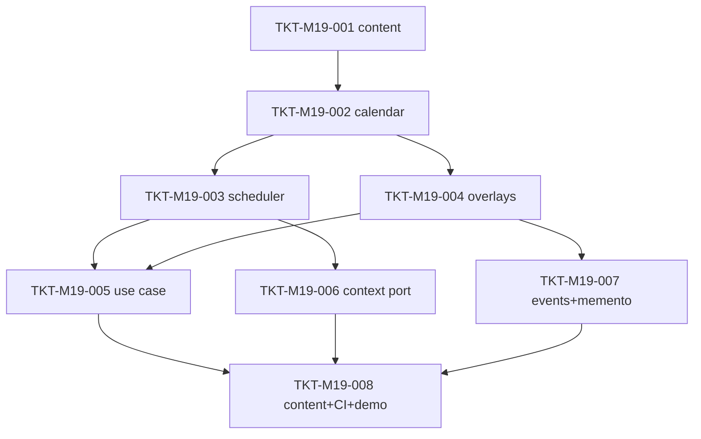

# TICKETS-M19 v1.0 — «World Events & Location Changes»

**Тип документа:** Детализация тикетов вехи M19  
**Дата:** 2026-11-14  
**Статус:** ⏳ запланировано — реализация не начата  
**Веха:** M19 (Wave 4 — World & Cataclysms)  
**Покрывает:** `DEV-SPEC-024`  
**Тикетов:** 8  
**Демо вехи:** `bun run demo:m19` — календарь на 100 тактов → procedural-событие по таймеру → scripted-событие по `city_control_changed` → overlay карантина применяется и снимается → экономика видит узел в пределах 1 такта → save/load календаря идентичен.

---

## 1. Состав вехи

| ID | Название | DEV-SPEC-024 | Размер |
|---|---|---|---|
| `TKT-M19-001` | World-event content-типы, схемы и пакеты | §5, §6 | M |
| `TKT-M19-002` | ScheduledWorldEvent и WorldEventCalendar | §5.2 | M |
| `TKT-M19-003` | scheduler-tracker: таймеры и условия | §7.1, §7.2 | M |
| `TKT-M19-004` | overlay-tracker и LocationOverlay | §5.2, §7.3 | M |
| `TKT-M19-005` | Use case `RollWorldEvents` | §7.2 | M |
| `TKT-M19-006` | `IWorldEventContextPort` для экономики/нарратива | §7 | S |
| `TKT-M19-007` | События `world.event_*` и memento календаря | §4, §10 | S |
| `TKT-M19-008` | Контент, CI, determinism и demo:m19 | §6, §11 | M |

---

## 2. Порядок выполнения

---

## 3. Тикеты

### TKT-M19-001 — World-event content-типы, схемы и пакеты

**DEV-SPEC:** DEV-SPEC-024 §5, §6  
**Требования:** R01, R02, R03  
**AC:** AC02, AC06, AC08  
**Размер:** M  
**Статус:** ⏳ не начато  
**Зависит от:** TKT-M18-001  
**Блокирует:** TKT-M19-002, TKT-M19-004

**Что сделать:**
- Описать `WorldEventDefinition`, `LocationOverlay`, `ScheduledWorldEvent`, `WorldEventScale`, `WorldEventSource`.
- Добавить схемы `world-event`, `location-overlay`, `event-selector-policy`, `event-duration-policy`.
- Зарегистрировать пакет `world-events`; проверить `target_selector_policy_id`, `trigger_policy_id`, `overlay_policy_ids`.

**Acceptance Criteria:**
- `DEV-SPEC-024-AC02`: 3 источника и 3 масштаба представлены в контенте.
- `DEV-SPEC-024-AC08`: новое событие добавляется JSON без правок домена.

**Definition of Done:**
- [ ] типы/схемы/пакет добавлены; [ ] schema-тесты; [ ] `t:test` зелёный; [ ] PR смержен.

---

### TKT-M19-002 — ScheduledWorldEvent и WorldEventCalendar

**DEV-SPEC:** DEV-SPEC-024 §5.2  
**Требования:** R01  
**AC:** AC01, AC07  
**Размер:** M  
**Статус:** ⏳ не начато  
**Зависит от:** TKT-M19-001  
**Блокирует:** TKT-M19-003, TKT-M19-004

**Что сделать:**
- Реализовать `ScheduledWorldEvent` (instance_id, definition_id, started/expires tick) и корневой `WorldEventCalendar`.
- Детерминированный порядок событий: `(started_tick, seq)`; без `Date.now`.
- Инвариант: один overlay на узел, без дубликатов.

**Acceptance Criteria:**
- `DEV-SPEC-024-AC01`: 20k тактов × 2 прогона → идентичный календарь.
- `DEV-SPEC-024-AC04`: дубликат overlay невозможен.

**Definition of Done:**
- [ ] календарь реализован; [ ] unit-тесты; [ ] `t:test` зелёный; [ ] PR смержен.

---

### TKT-M19-003 — scheduler-tracker: таймеры и условия

**DEV-SPEC:** DEV-SPEC-024 §7.1, §7.2  
**Требования:** R01, R03  
**AC:** AC02, AC05, AC06  
**Размер:** M  
**Статус:** ⏳ не начато  
**Зависит от:** TKT-M19-002  
**Блокирует:** TKT-M19-005, TKT-M19-006

**Что сделать:**
- Реализовать `world-event-scheduler-tracker`: priority queue таймеров, проверка условий, выбор источника (`procedural|scripted|player_or_faction_driven`).
- Selector policies: `point|regional|global` → списки `affected` (node_ids/city_ids).
- RNG-поток `rng.world.events`; запрет прямых мутаций контроля/войн (событие только публикуется).

**Acceptance Criteria:**
- `DEV-SPEC-024-AC02`: все 3 источника работают на данных.
- `DEV-SPEC-024-AC05`: scripted срабатывает ровно по триггеру.
- `DEV-SPEC-024-AC06`: масштабы дают корректные списки affected.

**Definition of Done:**
- [ ] трекер реализован; [ ] unit-тесты селекторов; [ ] `t:test` зелёный; [ ] PR смержен.

---

### TKT-M19-004 — overlay-tracker и LocationOverlay

**DEV-SPEC:** DEV-SPEC-024 §5.2, §7.3  
**Требования:** R01, R02  
**AC:** AC03, AC04, AC10  
**Размер:** M  
**Статус:** ⏳ не начато  
**Зависит от:** TKT-M19-002  
**Блокирует:** TKT-M19-005, TKT-M19-007

**Что сделать:**
- Реализовать `world-event-overlay-tracker`: применение/снятие overlay на узлы и города.
- Публиковать `world.event_occurred` / `world.event_ended`; `NextTick`-доставка для экономики.
- `cataclysm-omen` overlay увеличивает `cataclysm_pressure` (мягкий мост к 025).

**Acceptance Criteria:**
- `DEV-SPEC-024-AC03`: overlay применяется и снимается в пределах 1 такта.
- `DEV-SPEC-024-AC04`: дубликат overlay заблокирован.
- `DEV-SPEC-024-AC10`: omen увеличивает pressure.

**Definition of Done:**
- [ ] трекер реализован; [ ] integration-тест с экономикой; [ ] `t:test` зелёный; [ ] PR смержен.

---

### TKT-M19-005 — Use case `RollWorldEvents`

**DEV-SPEC:** DEV-SPEC-024 §7.2  
**Требования:** R01, R03  
**AC:** AC01, AC03  
**Размер:** M  
**Статус:** ⏳ не начато  
**Зависит от:** TKT-M19-003, TKT-M19-004  
**Блокирует:** TKT-M19-008

**Что сделать:**
- Реализовать `RollWorldEvents`, вызываемый на фазе `scope:world` после политических трекеров.
- Идемпотентность в рамках такта; не бросать исключения, ошибки → `Result`.
- Ограничение числа активных событий по конфигу; журнал истории для наблюдаемости.

**Acceptance Criteria:**
- `DEV-SPEC-024-AC01`: календарь детерминирован.
- `DEV-SPEC-024-AC03`: overlay применяется в пределах такта.

**Definition of Done:**
- [ ] use case встроен в конвейер; [ ] integration-тест; [ ] `t:test` зелёный; [ ] PR смержен.

---

### TKT-M19-006 — `IWorldEventContextPort` для экономики/нарратива

**DEV-SPEC:** DEV-SPEC-024 §7  
**Требования:** R02  
**AC:** AC03, AC05  
**Размер:** S  
**Статус:** ⏳ не начато  
**Зависит от:** TKT-M19-003  
**Блокирует:** TKT-M19-008

**Что сделать:**
- Описать `IWorldEventContextPort`: `getActiveOverlays(nodeId)`, `getHistory()`, `getAffectedNodes(eventId)`.
- Реализация read-only; `NullWorldEventContextPort` для тестов.
- Подключить экономику (020) и narrative (034) через порт, не через прямые импорты.

**Acceptance Criteria:**
- `DEV-SPEC-024-AC03`: экономика видит overlay в пределах такта.
- `DEV-SPEC-024-AC05`: scripted-событие доступно через историю.

**Definition of Done:**
- [ ] порт реализован; [ ] contract-тест; [ ] `t:test` зелёный; [ ] PR смержен.

---

### TKT-M19-007 — События `world.event_*` и memento календаря

**DEV-SPEC:** DEV-SPEC-024 §4, §10  
**Требования:** R01, R02  
**AC:** AC07  
**Размер:** S  
**Статус:** ⏳ не начато  
**Зависит от:** TKT-M19-004  
**Блокирует:** TKT-M19-008

**Что сделать:**
- Зарегистрировать `world.event_occurred`, `world.event_ended` + payload-схемы; `NextTick` для потребителей.
- Добавить `WorldEventCalendarMementoProvider` (`domainId: 'world_events'`): активные события, overlay, история.
- Валидация схемы при restore; журнал не переигрывает поведение.

**Acceptance Criteria:**
- `DEV-SPEC-024-AC07`: журнал накапливается, входит в memento и валиден.

**Definition of Done:**
- [ ] события/memento добавлены; [ ] roundtrip-тест; [ ] `ci:validate --stage=events` зелёный; [ ] PR смержен.

---

### TKT-M19-008 — Контент, CI, determinism и demo:m19

**DEV-SPEC:** DEV-SPEC-024 §6, §11  
**Требования:** R01–R04  
**AC:** AC01–AC10  
**Размер:** M  
**Статус:** ⏳ не начато  
**Зависит от:** TKT-M19-005, TKT-M19-006, TKT-M19-007  
**Блокирует:** DEV-SPEC-025, DEV-SPEC-034

**Что сделать:**
- Контент: 12–15 событий (по 4 на источник), overlay-политики, selector-политики, 3 масштаба.
- CI: резолв policy/template ID, запрет прямых мутаций контроля/войн из календаря.
- Determinism-сценарий 20k тактов + `scripts/demo-m19.ts`, `demo:m19`.

**Acceptance Criteria:**
- `DEV-SPEC-024-AC08`, `AC09`: CI ловит битые ID и прямые мутации.
- `DEV-SPEC-024-AC01`–`AC07`: демо проходит.

**Definition of Done:**
- [ ] контент/CI/демо добавлены; [ ] `demo:m19` и `ci:validate` зелёные; [ ] PR смержен.

---

## 4. Definition of Done для вехи

- [ ] все 8 тикетов смержены; [ ] `t:check`/`ci:validate` зелёные; [ ] `demo:m19` воспроизводится; [ ] все AC 024 покрыты.

## 5. Что разблокирует M19

`DEV-SPEC-025` (scripted-катаклизмы), `DEV-SPEC-034/035` (нарратив), vertical slice.

## 6. Риски и заметки

- Календарь не должен менять политику напрямую — только публиковать события.
- Таймеры — данные + tick, не реальное время.
