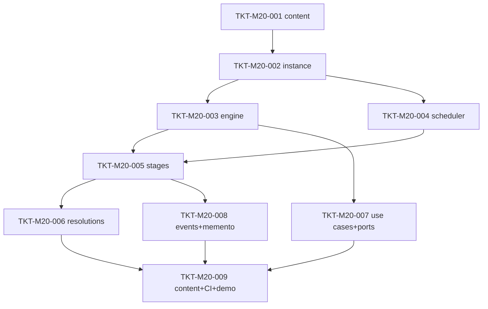

# TICKETS-M20 v1.0 — «Cataclysm Lifecycle & Escalation»

**Тип документа:** Детализация тикетов вехи M20  
**Дата:** 2026-11-14  
**Статус:** ⏳ запланировано — реализация не начата  
**Веха:** M20 (Wave 4 — World & Cataclysms)  
**Покрывает:** `DEV-SPEC-025`  
**Тикетов:** 9  
**Демо вехи:** `bun run demo:m20` — давление растёт → procedural spawn катастрофы → стадии 1→2→3 → escalation → resolution → политический удар по городу → save/load журнала → 5k тактов × 2 прогона идентичны.

---

## 1. Состав вехи

| ID | Название | DEV-SPEC-025 | Размер |
|---|---|---|---|
| `TKT-M20-001` | Cataclysm content-типы, схемы и пакеты | §5.1, §6 | M |
| `TKT-M20-002` | CataclysmInstance, StageProgress, EscalationState | §5.2 | M |
| `TKT-M20-003` | CataclysmEngine: реестр и журнал | §5.2, §7.4 | M |
| `TKT-M20-004` | Scheduler-tracker: давление и spawn | §5.3, §7.3 | M |
| `TKT-M20-005` | Stage-tracker и escalation-resolver | §7.1, §7.2 | M |
| `TKT-M20-006` | Resolution-resolver и исходы | §7.1 | M |
| `TKT-M20-007` | Use cases и порты (political/economic/hidden) | §7, §8 | M |
| `TKT-M20-008` | События `cataclysm.*` и memento | §6.3, §6.4 | S |
| `TKT-M20-009` | Контент 6 катастроф, CI и demo:m20 | §6.2, §11 | M |

---

## 2. Порядок выполнения

---

## 3. Тикеты

### TKT-M20-001 — Cataclysm content-типы, схемы и пакеты

**DEV-SPEC:** DEV-SPEC-025 §5.1, §6  
**Требования:** R01, R02  
**AC:** AC02, AC03, AC06  
**Размер:** M  
**Статус:** ⏳ не начато  
**Зависит от:** TKT-M18-001  
**Блокирует:** TKT-M20-002, TKT-M20-004

**Что сделать:**
- Описать `CataclysmDefinition`, `CataclysmStageDefinition`, `CataclysmSpawnState`, политики escalation/resolution/effect/political impact.
- Добавить схемы `cataclysm-definition`, `cataclysm-stage`, `cataclysm-spawn-state`, `escalation-policy`, `resolution-policy`.
- Зарегистрировать пакет `cataclysm-core`; проверить archetype_tags и `mechanic_ids`.

**Acceptance Criteria:**
- `DEV-SPEC-025-AC02`: минимум 2 стадии; ветвление через `escalation_policy` — данные.
- `DEV-SPEC-025-AC03`: 3 источника дают валидные инстансы.

**Definition of Done:**
- [ ] типы/схемы/пакет добавлены; [ ] schema-тесты; [ ] `t:test` зелёный; [ ] PR смержен.

---

### TKT-M20-002 — CataclysmInstance, StageProgress, EscalationState

**DEV-SPEC:** DEV-SPEC-025 §5.2  
**Требования:** R02  
**AC:** AC01, AC08  
**Размер:** M  
**Статус:** ⏳ не начато  
**Зависит от:** TKT-M20-001  
**Блокирует:** TKT-M20-003, TKT-M20-005

**Что сделать:**
- Реализовать `CataclysmInstance`: определение, текущая стадия, velocity, affected_entities, tracker states.
- Value objects `StageProgress` и `EscalationState` с валидацией диапазонов.
- Инварианты: стадия монотонна (без отката), velocity в допустимых пределах.

**Acceptance Criteria:**
- `DEV-SPEC-025-AC01`: stage-фиксация детерминирована на seed.
- `DEV-SPEC-025-AC02`: стадии и ветвление data-driven.

**Definition of Done:**
- [ ] сущности реализованы; [ ] unit-тесты инвариантов; [ ] `t:test` зелёный; [ ] PR смержен.

---

### TKT-M20-003 — CataclysmEngine: реестр и журнал

**DEV-SPEC:** DEV-SPEC-025 §5.2, §7.4  
**Требования:** R01, R02  
**AC:** AC01, AC08, AC09  
**Размер:** M  
**Статус:** ⏳ не начато  
**Зависит от:** TKT-M20-002  
**Блокирует:** TKT-M20-005, TKT-M20-007

**Что сделать:**
- Реализовать `CataclysmEngine`: реестр активных, max active instances (конфиг, default 6), журнал lifecycle.
- API: `spawn`, `advanceStage`, `resolve`, `active`, `journal`.
- Детерминированный порядок обработки активных (по instance_id/started_tick).

**Acceptance Criteria:**
- `DEV-SPEC-025-AC01`: журнал и снимки стабильны между прогонами.
- `DEV-SPEC-025-AC08`: журнал append-only и валиден по схеме.

**Definition of Done:**
- [ ] движок реализован; [ ] unit-тесты; [ ] `t:test` зелёный; [ ] PR смержен.

---

### TKT-M20-004 — Scheduler-tracker: давление и spawn

**DEV-SPEC:** DEV-SPEC-025 §5.3, §7.3  
**Требования:** R01, R05  
**AC:** AC03, AC05  
**Размер:** M  
**Статус:** ⏳ не начато  
**Зависит от:** TKT-M20-001  
**Блокирует:** TKT-M20-005

**Что сделать:**
- Реализовать `cataclysm-scheduler-tracker`: накопление давления из omens (024), hooks (022/033), политического стресса (023).
- Потолок `pressure_ceiling`; spawn при превышении; таймеры/условия для procedural.
- RNG-поток `rng.cataclysm.spawn` (изолированный); запрет `Math.random`.

**Acceptance Criteria:**
- `DEV-SPEC-025-AC03`: 3 источника равноправны и валидны.
- `DEV-SPEC-025-AC05`: давление растёт от всех каналов и обрезается потолком.

**Definition of Done:**
- [ ] трекер реализован; [ ] unit-тесты pressure; [ ] `t:test` зелёный; [ ] PR смержен.

---

### TKT-M20-005 — Stage-tracker и escalation-resolver

**DEV-SPEC:** DEV-SPEC-025 §7.1, §7.2  
**Требования:** R02, R03  
**AC:** AC01, AC02, AC04  
**Размер:** M  
**Статус:** ⏳ не начато  
**Зависит от:** TKT-M20-003, TKT-M20-004  
**Блокирует:** TKT-M20-006, TKT-M20-008

**Что сделать:**
- Реализовать `cataclysm-stage-tracker`: таймеры стадий, `stage_changed`, порядок `(tick, seq)`.
- Реализовать `cataclysm-escalation-resolver`: velocity/branch по `escalation_policy`.
- Проверить, что стадии не перескакивают и не откатываются.

**Acceptance Criteria:**
- `DEV-SPEC-025-AC01`: stage-фиксация детерминирована.
- `DEV-SPEC-025-AC02`: ветвление по данным.
- `DEV-SPEC-025-AC04`: все 4 kind resolution достижимы.

**Definition of Done:**
- [ ] трекер и резолвер добавлены; [ ] unit-тесты; [ ] `t:test` зелёный; [ ] PR смержен.

---

### TKT-M20-006 — Resolution-resolver и исходы

**DEV-SPEC:** DEV-SPEC-025 §7.1  
**Требования:** R03  
**AC:** AC04, AC09  
**Размер:** M  
**Статус:** ⏳ не начато  
**Зависит от:** TKT-M20-005  
**Блокирует:** TKT-M20-009

**Что сделать:**
- Реализовать `cataclysm-resolution-resolver`: завершение по `resolution_policy`, исходы и награды/последствия.
- Публиковать `cataclysm.ended` и события эффектов (026) через порты.
- Обеспечить доставку по policy (Immediate/NextTick/AfterScene).

**Acceptance Criteria:**
- `DEV-SPEC-025-AC04`: комбинации resolution программируются данными.
- `DEV-SPEC-025-AC09`: delivery policy соблюдается.

**Definition of Done:**
- [ ] резолвер реализован; [ ] scenario-тесты; [ ] `t:test` зелёный; [ ] PR смержен.

---

### TKT-M20-007 — Use cases и порты (political/economic/hidden)

**DEV-SPEC:** DEV-SPEC-025 §7, §8  
**Требования:** R04  
**AC:** AC05, AC07  
**Размер:** M  
**Статус:** ⏳ не начато  
**Зависит от:** TKT-M20-003  
**Блокирует:** TKT-M20-009

**Что сделать:**
- Реализовать `TriggerCataclysmManually` (debug/scripted) и `ChangeCatalogPressure` (hooks из 022/033).
- Порты `ICataclysmPoliticalOut`, `ICataclysmEconomicOut`, `ICataclysmHiddenBranchOut`, `ICataclysmContextPort` + Null-реализации.
- Публикация `cataclysm.political_impact_applied` в 023.

**Acceptance Criteria:**
- `DEV-SPEC-025-AC05`: давление меняется через use case.
- `DEV-SPEC-025-AC07`: вертикальный срез с мостами economy/fleet зелёный.

**Definition of Done:**
- [ ] use cases/порты добавлены; [ ] contract-тесты; [ ] `t:test` зелёный; [ ] PR смержен.

---

### TKT-M20-008 — События `cataclysm.*` и memento

**DEV-SPEC:** DEV-SPEC-025 §6.3, §6.4  
**Требования:** R02, R05  
**AC:** AC08, AC09  
**Размер:** S  
**Статус:** ⏳ не начато  
**Зависит от:** TKT-M20-005  
**Блокирует:** TKT-M20-009

**Что сделать:**
- Зарегистрировать события: `cataclysm.triggered`, `stage_changed`, `escalated`, `effect_applied`, `ended`, `faction_interaction_applied`, `hidden_branch_opened`, `political_impact_applied`, `scar_applied/removed`, `player_transformed`.
- Добавить payload-схемы и delivery policy.
- `CataclysmMementoProvider` (`domainId: 'cataclysm'`): активные инстансы + журнал append.

**Acceptance Criteria:**
- `DEV-SPEC-025-AC08`: memento восстанавливает активные и журнал.
- `DEV-SPEC-025-AC09`: delivery policy соблюдается.

**Definition of Done:**
- [ ] события/memento добавлены; [ ] roundtrip-тест; [ ] `ci:validate --stage=events` зелёный; [ ] PR смержен.

---

### TKT-M20-009 — Контент 6 катастроф, CI и demo:m20

**DEV-SPEC:** DEV-SPEC-025 §6.2, §11  
**Требования:** R01–R05  
**AC:** AC01–AC10  
**Размер:** M  
**Статус:** ⏳ не начато  
**Зависит от:** TKT-M20-006, TKT-M20-007, TKT-M20-008  
**Блокирует:** DEV-SPEC-026, DEV-SPEC-033

**Что сделать:**
- Контент: 6 катастроф первой волны, покрывающих 4 архетипа, стадии/escalation/resolution/эффекты.
- CI: schemas + graph (mechanics/events/doctrines/scars), gameplay lint (≥1 контрплей, ≥2 канала доставки, мост в другой домен).
- Determinism 5k тактов × 2 + `scripts/demo-m20.ts`, `demo:m20`.

**Acceptance Criteria:**
- `DEV-SPEC-025-AC06`, `AC10`: контент и CI зелёные.
- `DEV-SPEC-025-AC07`: вертикальный срез проходит.

**Definition of Done:**
- [ ] контент/CI/демо добавлены; [ ] `demo:m20` и `ci:validate` зелёные; [ ] PR смержен.

---

## 4. Definition of Done для вехи

- [ ] все 9 тикетов смержены; [ ] `t:check`/`ci:validate` зелёные; [ ] `demo:m20` воспроизводится; [ ] все AC 025 покрыты.

## 5. Что разблокирует M20

`DEV-SPEC-026` (эффекты/шрамы), `DEV-SPEC-033` (игрок-катаклизм), `DEV-SPEC-034/036`.

## 6. Риски и заметки

- Давление и spawn должны быть детерминированы; никаких таймеров реального времени.
- Максимум активных катастроф ограничен — иначе деградация такта.
