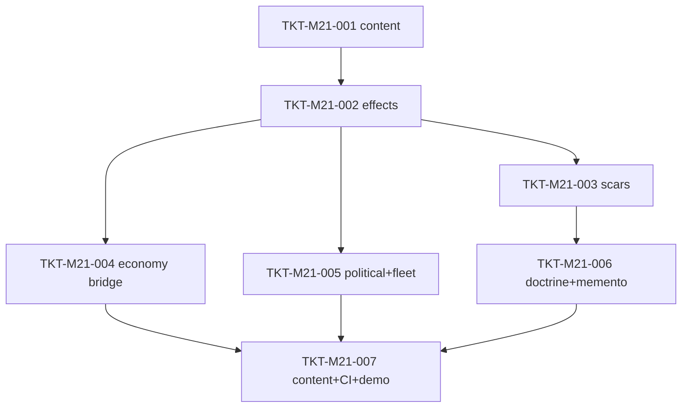

# TICKETS-M21 v1.0 — «Cataclysm Effects & Node Scars»

**Тип документа:** Детализация тикетов вехи M21  
**Дата:** 2026-11-14  
**Статус:** ⏳ запланировано — реализация не начата  
**Веха:** M21 (Wave 4 — World & Cataclysms)  
**Покрывает:** `DEV-SPEC-026`  
**Тикетов:** 7  
**Демо вехи:** `bun run demo:m21` — arcane rupture → `effect_applied` на выбранные узлы → market shock меняет цены за 1 такт → политический impact уходит в 023 → шрам накладывается и снимается только ритуалом → save/load шрамов без перезапуска.

---

## 1. Состав вехи

| ID | Название | DEV-SPEC-026 | Размер |
|---|---|---|---|
| `TKT-M21-001` | Effect/scar content-типы, схемы и пакеты | §5, §6 | M |
| `TKT-M21-002` | cataclysm-effect-tracker | §5.1, §7.1 | M |
| `TKT-M21-003` | node-scar-tracker: жизненный цикл шрамов | §5.2, §7.2 | M |
| `TKT-M21-004` | Экономический мост: шоки и шрамы | §5.1, §7 | M |
| `TKT-M21-005` | Политический и флотский мосты | §5.1, §7 | M |
| `TKT-M21-006` | Доктрина катастрофы и memento | §5.3, §6.4 | S |
| `TKT-M21-007` | Контент, CI и demo:m21 | §6, §11 | M |

---

## 2. Порядок выполнения

---

## 3. Тикеты

### TKT-M21-001 — Effect/scar content-типы, схемы и пакеты

**DEV-SPEC:** DEV-SPEC-026 §5, §6  
**Требования:** R01, R02  
**AC:** AC01, AC02, AC10  
**Размер:** M  
**Статус:** ⏳ не начато  
**Зависит от:** TKT-M20-001  
**Блокирует:** TKT-M21-002, TKT-M21-003

**Что сделать:**
- Описать `StageEffectPolicyDefinition`, `NodeScarDefinition`, `CataclysmDoctrineDefinition`, `EffectAction`, `IScarRemovalPort`.
- Добавить схемы `stage-effect-policy`, `node-scar`, `cataclysm-doctrine`, `scar-removal`.
- Зарегистрировать пакеты `cataclysm-effects`, `node-scars`; проверить `node_selector_id`, `scar_ids`, `counterplay_tags`.

**Acceptance Criteria:**
- `DEV-SPEC-026-AC01`: recoverable-эффекты снимаются автоматически, шрамы — только explicit removal.
- `DEV-SPEC-026-AC10`: CI-схемы/граф зелёные.

**Definition of Done:**
- [ ] типы/схемы/пакеты добавлены; [ ] schema-тесты; [ ] `t:test` зелёный; [ ] PR смержен.

---

### TKT-M21-002 — cataclysm-effect-tracker

**DEV-SPEC:** DEV-SPEC-026 §5.1, §7.1  
**Требования:** R01, R02  
**AC:** AC01, AC02, AC03  
**Размер:** M  
**Статус:** ⏳ не начато  
**Зависит от:** TKT-M21-001  
**Блокирует:** TKT-M21-003, TKT-M21-004, TKT-M21-005

**Что сделать:**
- Реализовать `cataclysm-effect-tracker` (priority 240): применение `effect_policy` стадий к выбранным узлам/сущностям.
- Учитывать `target_selector_id`, `severity_tag`, `duration_policy`; публиковать `cataclysm.effect_applied`.
- Не допускать двойного применения одного эффекта на один узел.

**Acceptance Criteria:**
- `DEV-SPEC-026-AC01`: recoverable снимаются по таймеру.
- `DEV-SPEC-026-AC02`: market shock меняет ровно выбранные узлы.
- `DEV-SPEC-026-AC03`: sailing conditions обновляются в пределах такта.

**Definition of Done:**
- [ ] трекер реализован; [ ] unit-тесты селекторов; [ ] `t:test` зелёный; [ ] PR смержен.

---

### TKT-M21-003 — node-scar-tracker: жизненный цикл шрамов

**DEV-SPEC:** DEV-SPEC-026 §5.2, §7.2  
**Требования:** R02, R03  
**AC:** AC04, AC07, AC08  
**Размер:** M  
**Статус:** ⏳ не начато  
**Зависит от:** TKT-M21-002  
**Блокирует:** TKT-M21-006

**Что сделать:**
- Реализовать `node-scar-tracker` (priority 230): наложение шрама, хранение, снятие через `IScarRemovalPort`.
- Разделить шок и шрам: снятие шока не создаёт шрам; `remove` только по `removable_by`.
- Публиковать `cataclysm.scar_applied/removed`; запрет прямых мутаций шрамов.

**Acceptance Criteria:**
- `DEV-SPEC-026-AC04`: шрам накладывается только механикой (lint).
- `DEV-SPEC-026-AC07`: таймер шока не создаёт шрам.
- `DEV-SPEC-026-AC08`: неразрешённый `remove` → `SCAR_NOT_REMOVABLE_BY`.

**Definition of Done:**
- [ ] трекер реализован; [ ] unit-тесты снятия; [ ] `t:test` зелёный; [ ] PR смержен.

---

### TKT-M21-004 — Экономический мост: шоки и шрамы

**DEV-SPEC:** DEV-SPEC-026 §5.1, §7  
**Требования:** R02  
**AC:** AC02, AC05  
**Размер:** M  
**Статус:** ⏳ не начато  
**Зависит от:** TKT-M21-002  
**Блокирует:** TKT-M21-007

**Что сделать:**
- Реализовать `ICataclysmEconomicOutImpl`: публикация `economy.scar_applied` / shock-состояний узлов (контракт 022).
- Обеспечить, что цены реагируют в течение 1 такта после `effect_applied`.
- Null-реализация для тестов без экономики.

**Acceptance Criteria:**
- `DEV-SPEC-026-AC02`: цены меняются в пределах 1 такта на выбранных узлах.
- `DEV-SPEC-026-AC05`: политические эффекты публикуются отдельно, без дублирования.

**Definition of Done:**
- [ ] мост реализован; [ ] integration-тест effect-market; [ ] `t:test` зелёный; [ ] PR смержен.

---

### TKT-M21-005 — Политический и флотский мосты

**DEV-SPEC:** DEV-SPEC-026 §5.1, §7  
**Требования:** R02  
**AC:** AC03, AC05  
**Размер:** M  
**Статус:** ⏳ не начато  
**Зависит от:** TKT-M21-002  
**Блокирует:** TKT-M21-007

**Что сделать:**
- Реализовать `ICataclysmPoliticalOut` → `cataclysm.political_impact_applied` (023), без прямого изменения контроля.
- Флот: `fleet.ship_damaged_by_cataclysm`, sailing conditions (017) через порт.
- Проверить порядок доставки и отсутствие циклических зависимостей.

**Acceptance Criteria:**
- `DEV-SPEC-026-AC03`: sailing conditions обновляются в пределах такта.
- `DEV-SPEC-026-AC05`: городские сдвиги делаются логикой 023.

**Definition of Done:**
- [ ] мосты добавлены; [ ] integration-тесты 017/023; [ ] `t:test` зелёный; [ ] PR смержен.

---

### TKT-M21-006 — Доктрина катастрофы и memento

**DEV-SPEC:** DEV-SPEC-026 §5.3, §6.4  
**Требования:** R03  
**AC:** AC06, AC09  
**Размер:** S  
**Статус:** ⏳ не начато  
**Зависит от:** TKT-M21-003  
**Блокирует:** TKT-M21-007

**Что сделать:**
- Реализовать `CataclysmDoctrineDefinition`: `interaction_modes`, `faction_interaction_applied`, intensity по escalation (025).
- Добавить `NodeScarMementoProvider` (`domainId: 'cataclysm_scars'`): шрамы, доктрины, removal evidence.
- Валидация схемы; восстановление без перезапуска жизненного цикла.

**Acceptance Criteria:**
- `DEV-SPEC-026-AC06`: доктрина с каналом публикует interaction, без канала — нулевой вклад.
- `DEV-SPEC-026-AC09`: шрамы сохраняются и восстанавливаются.

**Definition of Done:**
- [ ] доктрина/memento добавлены; [ ] roundtrip-тест; [ ] `t:test` зелёный; [ ] PR смержен.

---

### TKT-M21-007 — Контент, CI и demo:m21

**DEV-SPEC:** DEV-SPEC-026 §6, §11  
**Требования:** R01–R03  
**AC:** AC01–AC10  
**Размер:** M  
**Статус:** ⏳ не начато  
**Зависит от:** TKT-M21-004, TKT-M21-005, TKT-M21-006  
**Блокирует:** DEV-SPEC-033, DEV-SPEC-036

**Что сделать:**
- Контент: шрамы (перенесённые + новые), effect-политики для 6 катастроф, 4 доктрины, removal actions.
- CI: schemas + graph (scar policies, doctrine refs, effect tags) + gameplay lint (persistent_scar → скелет шрамов, ≥2 counterplay tags).
- Integration arcane-rupture + `scripts/demo-m21.ts`, `demo:m21`.

**Acceptance Criteria:**
- `DEV-SPEC-026-AC10`: CI-стадии ловят нарушения.
- `DEV-SPEC-026-AC01`–`AC09`: демо проходит.

**Definition of Done:**
- [ ] контент/CI/демо добавлены; [ ] `demo:m21` и `ci:validate` зелёные; [ ] PR смержен.

---

## 4. Definition of Done для вехи

- [ ] все 7 тикетов смержены; [ ] `t:check`/`ci:validate` зелёные; [ ] `demo:m21` воспроизводится; [ ] все AC 026 покрыты.

## 5. Что разблокирует M21

`DEV-SPEC-033` (скрытые ветки), `DEV-SPEC-036` (эпилог), vertical slice.

## 6. Риски и заметки

- Шрам — не эффект: разные жизненные циклы и разные способы снятия.
- Мосты не должны давать домену cataclysm знать о внутренностях экономики/флота.
