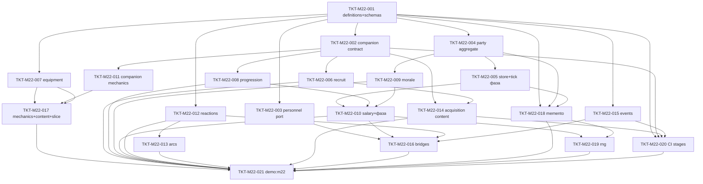

# TICKETS-M22 v1.0 — «Party Management»

**Тип документа:** Детализация тикетов вехи M22  
**Дата:** 2026-11-14  
**Статус:** ✅ реализовано (2026-11-16) — Party Management  
**Веха:** M22 (Wave 5 — Party, Companions & Combat)  
**Покрывает:** `DEV-SPEC-027`  
**Тикетов:** 21  
**Демо вехи:** `bun run demo:m22` — найм 3 напарников (industrial-steam, ancient-arcane, necromantic-corpse) → покупка/экипировка 10 предметов → 20 тактов (maintenance/salary) → synthetic cataclysm.effect_applied (mood+scar) → synthetic combat-loss (wounded→died одного) → save/load → идентичное продолжение 10 тактов; журнал содержит ≥1 запись каждого ключевого topic среза, sнапшот-хэш сравнивается с прогоном без сохранения.

---

## 1. Состав вехи

| ID | Название | DEV-SPEC-027 | Размер |
|---|---|---|---|
| `TKT-M22-001` | Party content definitions, схемы и PartyErrors | §5.1, §6.2, §8.3, §4.2 | M |
| `TKT-M22-002` | CompanionDefinition контракт и graph integrity | §5.1, §6.1, §12 T11 | M |
| `TKT-M22-003` | IPartyPersonnelPort и разделение экипажа/отряда | §8.1, §8.2, §2.2, §9.1 | S |
| `TKT-M22-004` | PartyInstance runtime-агрегат, PARTY-INV-06/09 | §5.3, §5.2, §10 | M |
| `TKT-M22-005` | PartyStore, tick-хендлеры, scope:party фаза | §4.1, §7.3, §9.1, §11 R01/R14 | M |
| `TKT-M22-006` | Модель найма: RecruitCompanion use case | §9.4, §7.2a, §11 R04 | M |
| `TKT-M22-007` | Экипировка: EquipmentDefinition, EquipmentModel, Equip/Unequip | §5.1, §9.4, §11 R06 | M |
| `TKT-M22-008` | Прокачка: ProgressionModel, uses→level, боевой буфер | §5.2, §7.5, §11 R05 | M |
| `TKT-M22-009` | Мораль: MoraleModel, party-morale-tracker, TTL moods | §5.3, §6.1, §7.1a, §11 R07 | M |
| `TKT-M22-010` | Зарплата и содержание runtime: фаза scope:party | §6.1, §7.2c, §9.4, §11 R07/R09 | M |
| `TKT-M22-011` | Companion mechanics content и graph | §6.1, §12 T11 | M |
| `TKT-M22-012` | Реакции: reaction_policy, party-reaction-resolver | §5.1, §6.1, §7.2d, §9.1, §11 R10 | M |
| `TKT-M22-013` | Личная арка: PersonalArcPolicy, AdvancePersonalArc | §5.1, §7.1c, §9.4, §11 R10 | M |
| `TKT-M22-014` | Acquisition content и graph-lint (market-kind forbidden) | §5.1, §6, §12 T15/T16 | M |
| `TKT-M22-015` | Events: party-core.json registration, фракционные namespace'ы | §6.4, §9.2, §11 R12 | S |
| `TKT-M22-016` | Мосты: personnel limits + salary→economy + relationship→028 | §9.3, §8.1/8.2, §11 R02/R09/R10 | M |
| `TKT-M22-017` | Mechanics registration + vertical slice content | §6.1, §4.2, §11 R16 | M |
| `TKT-M22-018` | PartyStateMementoProvider, party-state.json, save/load roundtrip | §5.4, §6.2, §6.3, §11 R14 | M |
| `TKT-M22-019` | RNG: 4 потока rng.party.*, изоляция, CI rng-streams | §6.1, §7.4, §11 R13/R17 | S |
| `TKT-M22-020` | CI stages: validate-party-graph + validate-party-lint | §6, §12 T15/T16 | S |
| `TKT-M22-021` | Вертикальный срез demo:m22 (E2E сценарий AC26) | §4.2, §7, §11 R16 | M |

---

## 2. Порядок выполнения

**Параллелизация:** T001 — корень; T002/T003/T004/007 независимы после типов; T008/009/011/012/014/015 после соответствующих зависимостей; T010 — точка схода фазы scope:party; T021 требует T006–T020.

---

## 3. Тикеты

### TKT-M22-001 — Party content definitions, схемы и PartyErrors

**DEV-SPEC:** DEV-SPEC-027 §5.1, §6.2, §8.3, §4.2  
**Требования:** R01, R06, R15  
**AC:** AC01, AC02, AC04, AC23  
**Размер:** M  
**Статус:** ✅ выполнено  
**Зависит от:** Wave 0 (DEV-SPEC-001…007, 003 schemas)  
**Блокирует:** TKT-M22-002, TKT-M22-004, TKT-M22-006, TKT-M22-007, TKT-M22-008, TKT-M22-017, TKT-M22-020, TKT-M22-021

**Что сделать:**
- Описать TS-контракты §5.1: `CompanionDefinition` (CompanionDefId, MechanicRefId, CompanionBaseStats, CompanionDefinition с 16 обязательными полями), `EquipmentDefinition` (EquipmentSlot enum из 5 значений, stat_modifiers, good_id, durability_policy_id?, required_skill?), `PartyStructurePolicy`, `PartyPolicy` и формы политик (MoralePolicyBody, MaintenancePolicyBody, SalaryPolicyBody, ReactionRule/effects, PersonalArcStage/PolicyBody, SkillProgressionPolicyBody, AcquisitionPolicyBody, RelationshipThresholdsBody, PartyPolicyKind enum из 8 значений).
- Добавить JSON-схемы §6.2: `companion-definition.json` (required 16, additionalProperties false, mechanic_ids minItems 2, counterplay_tags minItems 1, id pattern `^[a-z0-9][a-z0-9-]*$`, base_stats required [hp,strength,agility,endurance] ≥0), `equipment-definition.json` (slot enum 5, good_id required, stat_modifiers object numbers, additionalProperties false), `party-structure-policy.json` (max_companions≥1, journal_cap≥1, additionalProperties false), `party-policy.json` (id, kind enum 8, body; allOf if-then по kind; reaction.rules[].trigger_event pattern; effects[].kind enum), `party-state.json` (global_morale 0-1, moods[].remaining_ticks≥0, salary_overdue_periods≥0, arc_stage_index≥-1, hp current/max ∈ [0,∞) current≤max, journal items required [event_id,tick], additionalProperties false на всех уровнях).
- Зарегистрировать новые ContentKind `partyStructurePolicy`, `partyPolicy` как additive-дополнение к enum Wave 0; расширить `DIR_TO_KIND` директориями `companion`, `equipment`, `partyStructurePolicy`, `partyPolicy` и `schemaNameForKind` — companion→companion-definition, equipment→equipment-definition, partyStructurePolicy→party-structure-policy, partyPolicy→party-policy.
- Добавить `PartyErrors.ts` §8.3: `DOMAIN_PARTY_NOT_FOUND`, `DOMAIN_COMPANION_UNKNOWN`, `DOMAIN_PARTY_SLOT_FULL`, `DOMAIN_PARTY_PERSONNEL_LIMIT`, `DOMAIN_PARTY_ACQUISITION_NOT_UNLOCKED`, `DOMAIN_PARTY_EQUIPMENT_UNKNOWN`, `DOMAIN_PARTY_EQUIPMENT_SLOT_MISMATCH`, `DOMAIN_PARTY_MORALE_RANGE`, `DOMAIN_PARTY_STATE_CORRUPTED`, `APP_PARTY_SALARY_UNPAID`, `INFRA_PARTY_SCHEMA_INVALID`.
- Добавить контент-файлы §4.2: `content/companion/core.json`, `content/equipment/core.json`, `content/partyStructurePolicy/core.json`, `content/partyPolicy/core.json`.

**Acceptance Criteria:**
- `DEV-SPEC-027-AC01`: запись с `ship_state` в party-state снимок → `Err(INFRA_PARTY_SCHEMA_INVALID)` (additionalProperties false).
- `DEV-SPEC-027-AC02`: CI-grep — в `src/domain/party/**` нет import'ов `domain/fleet`, `domain/economy`, `infrastructure/*` (кроме primitives и собственных портов).
- `DEV-SPEC-027-AC04`: превышение `max_companions` → `Err(DOMAIN_PARTY_SLOT_FULL)` (инвариант PARTY-INV-09, тестируется в T06).
- `DEV-SPEC-027-AC23`: party-state.json схема part of memento validation (см. TKT-M22-018).

**Definition of Done:**
- [ ] типы, схемы и mapping добавлены; [ ] новые ContentKind зарегистрированы; [ ] PartyErrors.ts добавлен; [ ] контент-файлы добавлены; [ ] `t:type` зелёный; [ ] PR смержен.

---

### TKT-M22-002 — CompanionDefinition контракт и graph integrity

**DEV-SPEC:** DEV-SPEC-027 §5.1, §6.1, §12 (T11), §11 R08/R11  
**Требования:** R08, R11  
**AC:** AC13, AC14, AC19  
**Размер:** M  
**Статус:** ✅ выполнено  
**Зависит от:** TKT-M22-001  
**Блокирует:** TKT-M22-006, TKT-M22-011, TKT-M22-017, TKT-M22-021

**Что сделать:**
- Заполнить `content/companion/core.json`: 3 напарника industrial-steam / ancient-arcane / necromantic-corpse, каждый с `mechanic_ids` ≥2 (ссылки на mechanics/party.json), `role_tags ⊇ ['companion']`, `counterplay_tags` ≥1, все `*_policy_id` refs разрешаются в записи `partyPolicy`/`partyStructurePolicy` соответствующего kind (graph integrity), vulnerability_tags.
- Заполнить `content/mechanics/party.json`: 7 core-механик §6.1 с `role_tags ⊇ ['companion']` для companion-scope механик; companion-механики — роль companion.
- CI graph `validate-party-graph.ts` (T11): companion-mechanics против `mechanic-definition.json`, проверка role_tags ⊇ ['companion'], разрешение *-policy_id refs, mechanic_ids reference registered mechanics.

**Acceptance Criteria:**
- `DEV-SPEC-027-AC13`: companion definition с 1 механикой → `Err(INFRA_PARTY_SCHEMA_INVALID)` (minItems 2).
- `DEV-SPEC-027-AC14`: companion-механика без `role_tags ∋ 'companion'` → `ci:validate` красный (validate-party-graph).
- `DEV-SPEC-027-AC19`: все механики `content/mechanics/party.json` проходят `mechanic-definition.json` + INV-01…05 (004); contract-тест зелёный.

**Definition of Done:**
- [ ] контент companions + mechanics party.json добавлены; [ ] graph-стадия добавлена; [ ] `ci:validate` зелёный; [ ] PR смержен.

---

### TKT-M22-003 — IPartyPersonnelPort и разделение экипажа/отряда

**DEV-SPEC:** DEV-SPEC-027 §8.1, §8.2, §2.2, §9.1, §11 R02  
**Требования:** R02  
**AC:** AC03  
**Размер:** S  
**Статус:** ✅ выполнено  
**Зависит от:** TKT-M22-001  
**Блокирует:** TKT-M22-004, TKT-M22-016, TKT-M22-021

**Что сделать:**
- Реализовать `IPartyPersonnelPort` §8.1: `canAdd(captain_id, headcount_delta) → Result<boolean>`, `currentTotal(captain_id) → Result<number>` (лимит «всего людей на борту», SPEC-PARTY-003).
- Реализовать `NullPartyPersonnelPort` §8.2: `canAdd → Ok(true)`, `currentTotal → Ok(roster.length)` (dev/тесты до интеграции 017).
- DI: `IPartyPersonnelPort` → `NullPartyPersonnelPort` singleton на стадии `integration` (замена на 017-реализацию).
- Проверить, что напарники не обслуживают корабль (нет таких механик/policy в пакете party-core).

**Acceptance Criteria:**
- `DEV-SPEC-027-AC03`: `canAdd=false` → найм → `Err(DOMAIN_PARTY_PERSONNEL_LIMIT)`, roster не изменён.

**Definition of Done:**
- [ ] порт и заглушка добавлены; [ ] DI-регистрация; [ ] contract-тест; [ ] `t:test` зелёный; [ ] PR смержен.

---

### TKT-M22-004 — PartyInstance runtime-агрегат, PARTY-INV-06/09

**DEV-SPEC:** DEV-SPEC-027 §5.3, §5.2, §10, §11 R03  
**Требования:** R03  
**AC:** AC04  
**Размер:** M  
**Статус:** ✅ выполнено  
**Зависит от:** TKT-M22-001, TKT-M22-003  
**Блокирует:** TKT-M22-005, TKT-M22-006, TKT-M22-007, TKT-M22-010, TKT-M22-016

**Что сделать:**
- Реализовать `PartyInstance` §5.3 (party_id, captain_id внешний ref, structure_policy_id, roster, companions, global_morale, accrued_maintenance, salary_due_tick, journal) и `CompanionInstance` §5.2 (instance_id, definition_id, current_stats, hp, skills, equipment частичный record слотов, relationship_with_captain [-1,1], moods, permanent_scars, arc_stage_index, salary_overdue_periods, tracker_states), `PartyJournalEntry` (event_id, tick, companion_id?, epilogue_facts).
- Инварианты: PARTY-INV-06 (roster без дублей, ключи companions = roster, погибшие удаляются из обоих), PARTY-INV-09 (|roster| ≤ max_companions → при загрузке нарушение → `Err(DOMAIN_PARTY_STATE_CORRUPTED)`).
- Use case `DismissCompanion` (instance_id, reason_policy_id): companion удаляется из roster + companions, journal.append.

**Acceptance Criteria:**
- `DEV-SPEC-027-AC04`: найм сверх `max_companions` → `Err(DOMAIN_PARTY_SLOT_FULL)`.

**Definition of Done:**
- [ ] PartyInstance + CompanionInstance реализованы; [ ] инварианты PARTY-INV-06/09 проверены; [ ] DismissCompanion реализован; [ ] unit-тесты; [ ] `t:test` зелёный; [ ] PR смержен.

---

### TKT-M22-005 — PartyStore, tick-хендлеры, scope:party фаза

**DEV-SPEC:** DEV-SPEC-027 §4.1, §7.3, §9.1, §11 R01/R14  
**Требования:** R01, R14  
**AC:** AC04, AC23, AC24  
**Размер:** M  
**Статус:** ✅ выполнено  
**Зависит от:** TKT-M22-004  
**Блокирует:** TKT-M22-010, TKT-M22-018, TKT-M22-021

**Что сделать:**
- Реализовать `PartyStore` §4.1 (holder PartyInstance, единственная точка мутации, замок use case/tick-хендлера).
- Реализовать `PartyTickHandlers` §4.1: регистрация механик scope:party в `MechanicRegistry`; фаза `scope:party` вызывается `TickScheduler.tickScope('party')` после `world.tick_advanced` по порядку скоупов (world→economy→cataclysm→party→combat) §7.3.
- Курсоры трекеров `last_charged_tick`/`next_due_tick` для LOD-догона при пропуске фазы §7.3.
- Интеграция с GameClock/MechanicRuntime (DEV-SPEC-007/004) — фаза scope:party в конвейере тика.
- Валидация загрузки: PARTY-INV-05…11 → пересчёт производных; нарушение → `Err(DOMAIN_PARTY_STATE_CORRUPTED)` (AC24) или `Err(INFRA_PARTY_SCHEMA_INVALID)`.

**Acceptance Criteria:**
- `DEV-SPEC-027-AC04`: max_companions нарушение ловится (PARTY-INV-09).
- `DEV-SPEC-027-AC23`: фаза scope:party детерминирована (ключи для T12).
- `DEV-SPEC-027-AC24`: corrupted state (morale 1.5, дубль в roster) → `Err(DOMAIN_PARTY_STATE_CORRUPTED)`/schema-invalid; загрузка отклонена.

**Definition of Done:**
- [ ] PartyStore + tick-хендлеры реализованы; [ ] фаза scope:party в конвейере; [ ] валидация загрузки; [ ] unit/integration-тесты; [ ] `t:test` зелёный; [ ] PR смержен.

---

### TKT-M22-006 — Модель найма: RecruitCompanion use case

**DEV-SPEC:** DEV-SPEC-027 §9.4, §7.2a, §11 R04  
**Требования:** R04  
**AC:** AC05  
**Размер:** M  
**Статус:** ✅ выполнено  
**Зависит от:** TKT-M22-001, TKT-M22-002, TKT-M22-004  
**Блокирует:** TKT-M22-014, TKT-M22-021

**Что сделать:**
- Реализовать `RecruitCompanion` §9.4 (DTO `{definition_id, origin_evidence[]}`): проверка CompanionDefinition + AcquisitionPolicy (все requires доказаны?), PartyStructurePolicy |roster| < max?, IPartyPersonnelPort.canAdd(captain, +1), PartyStore create CompanionInstance (stats=base, moods=[], arc=-1, morale-вклад init), EventBus.emit `party.companion_recruited`, journal.append, IEpilogueFactPort.publish('epilogue.party.recruited_companion').

**Acceptance Criteria:**
- `DEV-SPEC-027-AC05`: `RecruitCompanion` без доказанных `requires` → `Err(DOMAIN_PARTY_ACQUISITION_NOT_UNLOCKED)`.

**Definition of Done:**
- [ ] use case реализован; [ ] integration-тест (recruit→equip→pay→dismiss T06); [ ] `t:test` зелёный; [ ] PR смержен.

---

### TKT-M22-007 — Экипировка: EquipmentDefinition, EquipmentModel, Equip/Unequip

**DEV-SPEC:** DEV-SPEC-027 §5.1, §9.4, §11 R06  
**Требования:** R06  
**AC:** AC09, AC10  
**Размер:** M  
**Статус:** ✅ выполнено  
**Зависит от:** TKT-M22-001, TKT-M22-002  
**Блокирует:** TKT-M22-010, TKT-M22-017, TKT-M22-021

**Что сделать:**
- Реализовать `EquipmentDefinition` §5.1 (slot enum 5, good_id обязателен, stat_modifiers, tags, durability_policy_id?, required_skill?), `EquipmentModel.effectiveStats(companion, defs)` = base + Σ modifiers (PARTY-INV-08: снимок не сериализует effective stats), use cases `EquipCompanion`/`UnequipCompanion` (слот, equipment_instance_id), старый item → cargo `ICargoCapacityPort.release/commit`.
- Эмитить `party.companion_equipment_changed` (companion_id, slot, old_ref, new_ref) + мост `economy.item_acquired`.
- `ITradePricePort` owner-стаб §8.1 (impl 020); stub для тестов.

**Acceptance Criteria:**
- `DEV-SPEC-027-AC09`: `EquipCompanion(weapon ← armor-item)` → `Err(DOMAIN_PARTY_EQUIPMENT_SLOT_MISMATCH)`, слот не изменён.
- `DEV-SPEC-027-AC10`: unit-тест `effectiveStats`: предмет с `{strength:+5}` даёт ровно +5; снятие — возврат baseline.

**Definition of Done:**
- [ ] EquipmentDefinition + EquipmentModel + use cases реализованы; [ ] ITradePricePort stub; [ ] unit-тесты; [ ] `t:test` зелёный; [ ] PR смержен.

---

### TKT-M22-008 — Прокачка: ProgressionModel, uses→level, боевой буфер

**DEV-SPEC:** DEV-SPEC-027 §5.2, §7.5, §11 R05  
**Требования:** R05  
**AC:** AC07, AC08  
**Размер:** M  
**Статус:** ✅ выполнено  
**Зависит от:** TKT-M22-002, TKT-M22-004  
**Блокирует:** TKT-M22-010, TKT-M22-021

**Что сделать:**
- Реализовать `ProgressionModel`, `SkillRuntime` (uses, level), `onSkillUsed(c, skill, tick)`: s = c.skills[skill] ?? {uses:0, level:0}; s.uses+=1; need = policy.usage_to_level_base[skill] * curve(s.level); if s.uses >= need: s.level+=1, s.uses=0, emit `party.companion_skill_improved` (companion_id, skill, new_level).
- Боевой буфер §7.5: при активном энкаунтере (`combat.encounter_started` без `resolved`) события `party.companion_action_executed` копятся в упорядоченный буфер, применяются в первой фазе `scope:party` после `combat.encounter_resolved`; буфер сортируется по (tick, seq) для детерминизма.

**Acceptance Criteria:**
- `DEV-SPEC-027-AC07`: накопление uses до порога `usage_to_level_base * curve(level)` → ровно один `party.companion_skill_improved`, `level+1`, `uses=0`.
- `DEV-SPEC-027-AC08`: 10 событий `party.companion_action_executed` внутри активного энкаунтера → ни одного повышения до `combat.encounter_resolved`; после — применения в порядке (tick, seq).

**Definition of Done:**
- [ ] ProgressionModel + буфер реализованы; [ ] unit-тесты (T03); [ ] `t:test` зелёный; [ ] PR смержен.

---

### TKT-M22-009 — Мораль: MoraleModel, party-morale-tracker, TTL moods

**DEV-SPEC:** DEV-SPEC-027 §5.3, §6.1, §7.1a, §11 R07  
**Требования:** R07  
**AC:** AC11, AC12  
**Размер:** M  
**Статус:** ✅ выполнено  
**Зависит от:** TKT-M22-001, TKT-M22-004, TKT-M22-005  
**Блокирует:** TKT-M22-010, TKT-M22-021

**Что сделать:**
- Реализовать `MoraleModel.recompute(state, policy)` — чистая идемпотентная функция §5.3, `global_morale ∈ [0,1]` (PARTY-INV-05), уровни low/medium/high — проекция по `MoralePolicy.thresholds`.
- Реализовать `party-morale-tracker` §6.1 (priority 300, tracker, scope:party, consumes tick + companion_mood_changed + companion_scar_applied + salary_overdue, emits `party.morale_changed`, state `{last_decay_tick}`); TTL mood effects decay на каждом тике (§7.1a).
- Mood effects: наложение через реакции (TTL, morale_weight застывший на момент наложения), истечение → `party.morale_changed` если Δ > ε, иначе без эмита.

**Acceptance Criteria:**
- `DEV-SPEC-027-AC11`: fixture-политика: 3 негативных mood → мораль падает и `level='low'` (GetPartyStatus).
- `DEV-SPEC-027-AC12`: истечение TTL на следующем тике возвращает мораль к baseline ± ε политики; эмита нет, если Δ ≤ ε.

**Definition of Done:**
- [ ] MoraleModel + party-morale-tracker реализованы; [ ] unit-тесты (T02); [ ] `t:test` зелёный; [ ] PR смержен.

---

### TKT-M22-010 — Зарплата и содержание runtime: фаза scope:party

**DEV-SPEC:** DEV-SPEC-027 §6.1, §7.2c, §9.4, §11 R07/R09  
**Требования:** R07, R09  
**AC:** AC11, AC12, AC15, AC16  
**Размер:** M  
**Статус:** ✅ выполнено  
**Зависит от:** TKT-M22-004, TKT-M22-005, TKT-M22-008, TKT-M22-009  
**Блокирует:** TKT-M22-016, TKT-M22-018, TKT-M22-021

**Что сделать:**
- Реализовать `party-salary-scheduler` §6.1 (priority 100, tracker, scope:party, state `{next_due_tick}`, consumes tick + salary_paid, emits salary_paid + salary_overdue + desertion_risk_elevated), `party-maintenance-charger` (priority 200, tracker, scope:party, state `{last_charged_tick}`, emits maintenance_charged).
- Реализовать `SalaryModel`, use case `PaySalaries` (mode: 'full'|'arrears'): попытка оплаты Σ salary.amount из казны [020 wallet], успех → salary_paid + overdue=0 + due+=period, отказ → salary_overdue(periods+1) для каждого непровыплаченного, periods ≥ threshold → `party.desertion_risk_elevated` (per companion).
- Фаза scope:party tick (тест T07): maintenance accrued += Σ cost_per_tick → maintenance_charged; salary scheduler t==due? оплата; morale-tracker recompute → morale_changed если Δ>ε; periods≥threshold → desertion_risk_elevated.

**Acceptance Criteria:**
- `DEV-SPEC-027-AC11/AC12`: мораль recompute в фазе (интеграция T07).
- `DEV-SPEC-027-AC15`: нулевая казна, `period_ticks*k` → `salary_overdue_periods=k`, мораль ≥ clamp `overdue_morale_penalty.max`.
- `DEV-SPEC-027-AC16`: успешная `PaySalaries` эмитит `party.salary_paid` и порождает `economy.expense_recorded` (bridge test на recording bus — тест T08).

**Definition of Done:**
- [ ] salary-scheduler + maintenance-charger + SalaryModel реализованы; [ ] PaySalaries use case; [ ] фаза scope:party интеграция; [ ] unit/integration-тесты (T04, T07); [ ] `t:test` зелёный; [ ] PR смержен.

---

### TKT-M22-011 — Companion mechanics content и graph

**DEV-SPEC:** DEV-SPEC-027 §6.1, §12 (T11)  
**Требования:** R08, R11  
**AC:** AC13, AC14, AC19  
**Размер:** M  
**Статус:** ✅ выполнено  
**Зависит от:** TKT-M22-002  
**Блокирует:** TKT-M22-017, TKT-M22-021

**Что сделать:**
- Заполнить companion-специфичные механики §6.1: `companion-steam-pressure-boost-resolver` (priority 100, resolver, companion, consumes combat.duel_action_executed + party.companion_action_executed, emits party.companion_pressure_boosted, state null), `companion-steam-repair-tracker` (priority 90, tracker, companion, state `{repair_charges, last_used_tick}`, emits party.companion_repair_ready).
- Graph-integrity: companion-механики role_tags ⊇ ['companion'], зарегистрированы в mechanic-definition registry, state_schema валидны; companion-scope механики получают `tickScope('companion')` на фазе combat-скоупа (029) и обязаны быть корректны при отсутствии party-данных ещё в этом такте.

**Acceptance Criteria:**
- `DEV-SPEC-027-AC13/AC14/AC19`: companion-механики проходят mechanic-definition schema + INV, role_tags companion, graph-стадия зелёная.

**Definition of Done:**
- [ ] companion-механики добавлены в mechanics/party.json; [ ] graph-стадия; [ ] `ci:validate` зелёный; [ ] PR смержен.

---

### TKT-M22-012 — Реакции: reaction_policy, party-reaction-resolver

**DEV-SPEC:** DEV-SPEC-027 §5.1, §6.1, §7.2d, §9.1, §11 R10  
**Требования:** R10  
**AC:** AC17  
**Размер:** M  
**Статус:** ✅ выполнено  
**Зависит от:** TKT-M22-001, TKT-M22-004  
**Блокирует:** TKT-M22-013, TKT-M22-016, TKT-M22-021

**Что сделать:**
- Реализовать `ReactionPolicyBody` §5.1 (rules: триггер-событие, condition?, effects: mood/global_morale_delta/scar/epilogue_fact), контент `content/partyPolicy/core.json` с reaction-политиками (mood, scar, epilogue_fact эффекты).
- Реализовать `party-reaction-resolver` §6.1 (priority 400, resolver, party, consumes cataclysm.effect_applied + combat.encounter_resolved + world.event_occurred + economy.price_shock, emits reaction_triggered + companion_mood_changed + companion_scar_applied, state null); pre-index-map `trigger_event → rules`; матчинг rules → effects; локационный фильтр слабый через world-ref (OQ-06).
- Катаклизм-мост §7.2d: cataclysm.effect_applied → match rules → reaction_triggered → mood (TTL, weight) / scar (companion_scar_applied) / fact (IEpilogueFactPort.publish).

**Acceptance Criteria:**
- `DEV-SPEC-027-AC17`: synthetic `cataclysm.effect_applied`, совпадающее правило → `party.reaction_triggered` + `party.companion_mood_changed` + факт `epilogue.party.*` в коллекторе Noop-port (тест T08).

**Definition of Done:**
- [ ] reaction_policy + resolver реализованы; [ ] pre-index-map; [ ] катаклизм-мост; [ ] integration-тест (T08); [ ] `t:test` зелёный; [ ] PR смержен.

---

### TKT-M22-013 — Личная арка: PersonalArcPolicy, AdvancePersonalArc

**DEV-SPEC:** DEV-SPEC-027 §5.1, §7.1c, §9.4, §11 R10  
**Требования:** R10  
**AC:** AC18  
**Размер:** M  
**Статус:** ✅ выполнено  
**Зависит от:** TKT-M22-012, TKT-M22-004  
**Блокирует:** TKT-M22-021

**Что сделать:**
- Реализовать `PersonalArcPolicyBody` §5.1 (stages линейная цепочка, на каждом stage_id + advance_condition_policy_id + on_advance_effects), `AdvancePersonalArc` use case (DTO `{instance_id, evidence[]}`): проверка advance_condition_policy_id evidences, arc_stage_index монотонно растёт (PARTY-INV-11), emit `party.personal_arc_advanced` (companion_id, from_stage, to_stage), journal.append, IEpilogueFactPort.publish.
- Попытка «назад» → `Err` (INV-11); линейная цепочка, ветвление — OQ-05 (Wave 6).

**Acceptance Criteria:**
- `DEV-SPEC-027-AC18`: `AdvancePersonalArc` с evidences → `party.personal_arc_advanced` + journal; попытка «назад» → `Err` (INV-11) (тест T08).

**Definition of Done:**
- [ ] PersonalArcPolicy + AdvancePersonalArc реализованы; [ ] инвариант INV-11; [ ] integration-тест (T08); [ ] `t:test` зелёный; [ ] PR смержен.

---

### TKT-M22-014 — Acquisition content и graph-lint (market-kind forbidden)

**DEV-SPEC:** DEV-SPEC-027 §5.1, §6, §12 (T15/T16)  
**Требования:** R04, R15  
**AC:** AC05, AC06  
**Размер:** M  
**Статус:** ✅ выполнено  
**Зависит от:** TKT-M22-002, TKT-M22-006  
**Блокирует:** TKT-M22-021

**Что сделать:**
- Заполнить acquisition-политики `content/partyPolicy/core.json` (kind acquisition, requires: quest/reputation/event/hook refs) для 3 companions.
- Реализовать `validate-party-lint.ts` §12 (T15/T16): запрет `kind:'market'` в acquisition-поликах (AC06 — прямой денежный найм невозможен), проверка наличия arc-policy, counterplay_tags≥1, reaction_rules≥1, отсутствие дубликатов ID в реестре.
- Negative fixtures: отсутствие arc-policy → lint err; 0 counterplay tags → lint err; битый good_id → graph err; циклическая ссылка companion→companion → lint err; дубликат ID в реестре → graph err.

**Acceptance Criteria:**
- `DEV-SPEC-027-AC05`: (тестируется в TKT-M22-006 use case) — RecruitCompanion без requires → Err.
- `DEV-SPEC-027-AC06`: graph-lint: ни одна acquisition-политика пакета не имеет `kind:'market'`; прямой денежный найм невозможен (unit-тест use case без evidence всегда Err) — тесты T01, T06.

**Definition of Done:**
- [ ] acquisition content + lint-стадия; [ ] negative fixtures; [ ] `ci:validate` зелёный; [ ] PR смержен.

---

### TKT-M22-015 — Events: party-core.json registration, фракционные namespace'ы

**DEV-SPEC:** DEV-SPEC-027 §6.4, §9.2, §11 R12  
**Требования:** R12  
**AC:** AC20, AC21  
**Размер:** S  
**Статус:** ✅ выполнено  
**Зависит от:** TKT-M22-001  
**Блокирует:** TKT-M22-012, TKT-M22-016, TKT-M22-021

**Что сделать:**
- Зарегистрировать ядро §6.4 в `content/events/party-core.json`: 23 topics (party.companion_recruited/dismissed/died/wounded/traumatized/equipment_changed/skill_improved/relationship_changed/mood_changed/scar_applied/scar_removed/morale_changed/salary_paid/salary_overdue/reaction_triggered/personal_arc_advanced/desertion_risk_elevated/maintenance_charged/ship_changed/companion_action_executed/prisoner_conversion_requested/journal_summary/companion_repair_ready/companion_pressure_boosted) с source:core, payload_schema.
- Фракционные расширения §6.4/§9.2: `party.industrial-steam.*`, `party.ancient-arcane.*`, `party.necromantic-corpse.*`, `party.living-artifact.*` — обязательная регистрация, payload schema, запрет коллизий ID с ядром, запрет переопределения ядерной семантики.
- CI graph: полный перечень topics §6.4 ⊆ party-core.json (AC20), negative fixture фракционное событие с ID ядерного topic → graph-stage Err (AC21).

**Acceptance Criteria:**
- `DEV-SPEC-027-AC20`: CI-сверка: список topics §6.4 ⊆ `content/events/party-core.json` (иначе ci:graph красный).
- `DEV-SPEC-027-AC21`: negative-fixture фракционное событие с ID ядерного topic → `Err` graph-стадии.

**Definition of Done:**
- [ ] events party-core.json + фракционные namespace'ы; [ ] graph-стадия; [ ] `ci:validate` зелёный; [ ] PR смержен.

---

### TKT-M22-016 — Мосты: personnel limits + salary→economy + relationship→028

**DEV-SPEC:** DEV-SPEC-027 §9.3, §8.1/8.2, §11 R02/R09/R10  
**Требования:** R02, R09, R10  
**AC:** AC03, AC16, AC17  
**Размер:** M  
**Статус:** ✅ выполнено  
**Зависит от:** TKT-M22-003, TKT-M22-010, TKT-M22-012, TKT-M22-015  
**Блокирует:** TKT-M22-021

**Что сделать:**
- Мосты §9.3: `IPartyPersonnelPort.canAdd` → personnel limits (AC03, тест T08), `PaySalaries` → `economy.expense_recorded` bridge (AC16, тест T08 на recording bus), `party.companion_equipment_changed` → `economy.item_acquired` bridge, `party.companion_relationship_changed` emit → 028 (AC17, тест T08).
- Тест T08 мосты: cataclysm→scar; combat→casualty; fleet→ship_changed + salary→economy + relationship emit (recording bus).

**Acceptance Criteria:**
- `DEV-SPEC-027-AC03`: `canAdd=false` → `Err(DOMAIN_PARTY_PERSONNEL_LIMIT)` (тест T08).
- `DEV-SPEC-027-AC16`: `PaySalaries` эмитит `party.salary_paid` и порождает `economy.expense_recorded` (bridge test T08).
- `DEV-SPEC-027-AC17`: `party.companion_relationship_changed` emit → мост 028 (тест T08).

**Definition of Done:**
- [ ] мосты реализованы; [ ] recording-bus test T08; [ ] `t:test` зелёный; [ ] PR смержен.

---

### TKT-M22-017 — Mechanics registration + vertical slice content

**DEV-SPEC:** DEV-SPEC-027 §6.1, §4.2, §11 R16  
**Требования:** R06, R16  
**AC:** AC09, AC10, AC26  
**Размер:** M  
**Статус:** ✅ выполнено  
**Зависит от:** TKT-M22-002, TKT-M22-007, TKT-M22-011  
**Блокирует:** TKT-M22-021

**Что сделать:**
- Зарегистрировать все 7 mechanics §6.1 в `content/mechanics/party.json` (priority order, role_tags, state_schema).
- Контент-срез первой волны §4.2/§11 R16: 3 напарника (industrial-steam, ancient-arcane, necromantic-corpse) + 10 предметов экипировки + политики (morale/maintenance/salary/reaction/personalArc/skillProgression/acquisition/relationshipThresholds) + partyStructurePolicy.
- Вертикальный срез SPEC-PARTY-080: сборка контента для demo:m22 (mechanics, экипировка 10 предметов, мораль, шрамы, арки, реакции, мосты).

**Acceptance Criteria:**
- `DEV-SPEC-027-AC09/AC10`: equipment effectiveStats exercised (тесты T05, T09).
- `DEV-SPEC-027-AC26`: контент среза готов для demo:m22 (тест T14).

**Definition of Done:**
- [ ] mechanics/party.json + контент среза; [ ] vertical slice content; [ ] `ci:validate` зелёный; [ ] PR смержен.

---

### TKT-M22-018 — PartyStateMementoProvider, party-state.json, save/load roundtrip

**DEV-SPEC:** DEV-SPEC-027 §5.4, §6.2, §6.3, §11 R14  
**Требования:** R14  
**AC:** AC23, AC24, AC01  
**Размер:** M  
**Статус:** ✅ выполнено  
**Зависит от:** TKT-M22-004, TKT-M22-005  
**Блокирует:** TKT-M22-019, TKT-M22-021

**Что сделать:**
- Реализовать `PartyStateMementoProvider` implements `IMementoProvider`, `domainId: 'party'` §5.4; интеграция в композицию save-snapshot (DEV-SPEC-006).
- `party-state.json` схема валидация §6.2 (global_morale 0-1, moods remaining_ticks≥0, salary_overdue_periods≥0, arc_stage_index≥-1, hp current/max, journal items required [event_id,tick], additionalProperties false).
- Валидация загрузки: JSON Schema → реструктуризация типов → проверка INV-05…11 → пересчёт производных; провал → `Err(INFRA_PARTY_SCHEMA_INVALID)` или `Err(DOMAIN_PARTY_STATE_CORRUPTED)` (SPEC-PARTY-050/051).
- Contract-тест T12 determinism: save→load→deep-equal снимка (кроме пересчитываемых производных); 20 тактов после load ≡ контрольный прогон.

**Acceptance Criteria:**
- `DEV-SPEC-027-AC23`: save→load→deep-equal снимка; 20 тактов после load ≡ контрольный прогон (тест T12).
- `DEV-SPEC-027-AC24`: negative-fixture (global_morale 1.5, дубль в roster) → `Err(DOMAIN_PARTY_STATE_CORRUPTED)`/schema-invalid; загрузка отклонена (тест T12).
- `DEV-SPEC-027-AC01`: party-state.json схема part of memento validation (тест T09 CI schemas).

**Definition of Done:**
- [ ] PartyStateMementoProvider + party-state.json; [ ] валидация загрузки; [ ] roundtrip-тест T12; [ ] `t:test` зелёный; [ ] PR смержен.

---

### TKT-M22-019 — RNG: 4 потока rng.party.*, изоляция, CI rng-streams

**DEV-SPEC:** DEV-SPEC-027 §6.1, §7.4, §11 R13/R17  
**Требования:** R13, R17  
**AC:** AC22, AC27  
**Размер:** S  
**Статус:** ✅ выполнено  
**Зависит от:** TKT-M22-010, TKT-M22-018  
**Блокирует:** TKT-M22-021

**Что сделать:**
- Объявить 4 RNG-потока §7.4: `rng.party.morale` (шум морали/оценка риска), `rng.party.progression` (вердикт повышения при равных условиях), `rng.party.reactions` (выбор из нескольких применимых эффектов одного правила), `rng.party.recruitment` (вариация стартовых параметров при найме); смешение запрещено.
- CI rng-streams stage (T13): in fixture-прогоне задействованы ровно 4 party-потока, изоляция подтверждена (diff-проверка состояний при независимом потреблении); grep `Math.random`/`Date.now` в `src/domain/party/**` и `src/application/party/**` (запрет).
- Determinism-CI сценарий party (T12, T13): 10 тактов + save + load + 10 ≡ 20; снапшот-хэш совпадает.

**Acceptance Criteria:**
- `DEV-SPEC-027-AC22`: rng-streams CI-стадия: в fixture-прогоне задействованы ровно 4 party-потока, изоляция подтверждена.
- `DEV-SPEC-027-AC27`: determinism-CI сценарий party (10 тактов + save + load + 10 ≡ 20) зелёный; снапшот-хэш совпадает (тесты T12, T13).

**Definition of Done:**
- [ ] 4 потока объявлены + CI rng-streams; [ ] determinism-сценарий party; [ ] grep запрет; [ ] `ci:validate` зелёный; [ ] PR смержен.

---

### TKT-M22-020 — CI stages: validate-party-graph + validate-party-lint

**DEV-SPEC:** DEV-SPEC-027 §6, §12 (T15/T16)  
**Требования:** R15  
**AC:** AC25  
**Размер:** S  
**Статус:** ✅ выполнено  
**Зависит от:** TKT-M22-001, TKT-M22-002, TKT-M22-014, TKT-M22-015  
**Блокирует:** TKT-M22-021

**Что сделать:**
- Реализовать `tools/ci/stages/validate-party-graph.ts` §12 (T15): companion-mechanics против mechanic-definition, policy refs resolve, event topics registered, no collision IDs.
- Реализовать `tools/ci/stages/validate-party-lint.ts` §12 (T16): counterplay_tags≥1, arc-policy exists, reaction_rules≥1, dup IDs in registry, cycle refs companion→companion.
- Negative fixtures — `test/party/fixtures/negative/` (AC25): отсутствие arc-policy, 0 counterplay tags, битый good_id, циклическая ссылка companion→companion, дубликат ID в реестре — каждая стадия `ci:validate` даёт ожидаемую ошибку.

**Acceptance Criteria:**
- `DEV-SPEC-027-AC25`: negative-fixtures ловятся: каждая стадия `ci:validate` даёт ожидаемую ошибку (тесты T09, T15, T16).

**Definition of Done:**
- [ ] validate-party-graph + validate-party-lint; [ ] negative fixtures; [ ] `ci:validate` зелёный; [ ] PR смержен.

---

### TKT-M22-021 — Вертикальный срез demo:m22 (E2E сценарий AC26)

**DEV-SPEC:** DEV-SPEC-027 §4.2, §7, §11 R16  
**Требования:** R16  
**AC:** AC26  
**Размер:** M  
**Статус:** ✅ выполнено  
**Зависит от:** TKT-M22-006, 007, 008, 009, 010, 012, 013, 014, 016, 017, 018, 019, 020  
**Блокирует:** DEV-SPEC-028, DEV-SPEC-029, DEV-SPEC-030, DEV-SPEC-031, DEV-SPEC-033, DEV-SPEC-034, DEV-SPEC-039

**Что сделать:**
- Реализовать `scripts/demo-m22.ts` и `demo:m22` §4.2/§11 R16.
- E2E сценарий AC26: найм 3 (industrial-steam, ancient-arcane, necromantic-corpse) → покупка/экипировка 10 предметов (через BuyEquipment → ITradeService stub) → 20 тактов (maintenance/salary accrual + morale recompute) → synthetic cataclysm.effect_applied (mood+scar реакция) → synthetic combat-loss (wounded→died одного, party.companion_died) → save/load → идентичное продолжение 10 тактов; журнал содержит ≥1 запись каждого ключевого topic среза; sнапшот-хэш сравнивается с прогоном без сохранения.
- Запуск `bun run demo:m22` завершается `Ok`.

**Acceptance Criteria:**
- `DEV-SPEC-027-AC26`: `bun run demo:m22` завершается `Ok`: найм 3 → покупка/экипировка 10 предметов → 20 тактов (maintenance/salary) → synthetic cataclysm-effect (mood+scar) → synthetic combat-loss (wounded→died одного) → save/load → идентичное продолжение 10 тактов; журнал содержит ≥1 запись каждого ключевого topic среза; sнапшот-хэш совпадает с прогоном без сохранения (тест T14).

**Definition of Done:**
- [ ] demo-m22.ts + скрипт; [ ] E2E сценарий AC26; [ ] `demo:m22` и `ci:validate` зелёные; [ ] PR смержен.

---

## 4. Definition of Done для вехи

- [ ] все 21 тикетов смержены в `main`;
- [ ] `t:check` и `ci:validate` зелёные;
- [ ] `bun run demo:m22` воспроизводится;
- [ ] все AC `DEV-SPEC-027` (AC01…AC27) покрыты тестами;
- [ ] трассировка TKT → DEV-SPEC → DESIGN → INT → INTENT сохранена (§7).

## 5. Что разблокирует M22

`DEV-SPEC-028` (отношения, дезертирство, synergy), `DEV-SPEC-029…031` (боёвка, wound-модель, battlefield), `DEV-SPEC-032` (капитан), `DEV-SPEC-033` (скрытые ветки трансформации), `DEV-SPEC-034` (диалоги, story beacons), `DEV-SPEC-036` (эпилог), `DEV-SPEC-039` (vertical slice финальный).

## 6. Риски и заметки

- 3 напарника × полный контракт — объёмный контент; держать data-driven, не кодировать фракции и напарников в домене.
- Мосты (§9.3) зависят от портов 020/028/029/032/036 — заглушки для тестов, интеграция в Wave 5+.
- determinism-party (019) требует, чтобы фаза scope:party была детерминирована до demo; буфер боевых событий (008) — источник возможной потери детерминизма при неправильной сортировке.
- Событийное ядро party.* (015) — 23 topics — допускает добавление фракционных namespace'ов в Wave 6 без правок ядра.
- Капитан как сущность не определён до 032 — `captain_id` в PartyInstance только ref; порт ICaptainStatePort заглушен (modifier 0).
